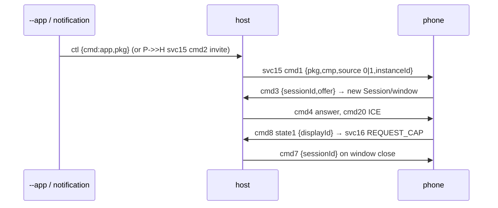

# App streaming (phone apps in their own Linux windows) — v1 2026-10-21

Spec: `evidence-2026-10-20/appstream-and-display-spec.md` §A (+ `mirroring-spec.md`).

## What
`mirror/` (`smartconnect-mirror`) became a multi-session stream host:
- `smartconnect-mirror --host` — long-running; answers every phone svc15 cmd 2 invite (any pkg, incl. notification
  "Open" and the whole-screen `mirror`) and serves `$XDG_RUNTIME_DIR/smartconnect-mirror.sock`
  (JSON lines: `app {pkg,cmp?}`, `mirror`, `sessions`, `close {sessionId}`, `apps`).
- `--app PKG [CMP]` — PC-initiated launch (via the host if running, else a one-shot process).
- `--list-apps` — svc17 cmd 2 → phone re-sends cmd 1; prints pkg/userId/name/cmp, caches to `~/.cache/smartconnect/apps.json`.
- `--sessions`, `--close SID`. No args = whole-screen mirror (delegated to the host when one runs).

Verified on device (edge 60 stylus): Calculator and Clock launched from Linux → own VirtualDisplay
(display 67/68), 610×1356 H.264, ICE completed, window titled "Clock — Phone"; `--close` → cmd 7 and the
phone released the `AppStream:` display. Phone-initiated (cmd 2) path and app-window keyboard/mouse were
not separately exercised (same code as the mirror's input path).

## How
- `Session` (one per phone `sessionId`): own `gst::Pipeline` + `webrtcbin`, decoder bin, nav-event probe →
  svc 16 with that session's `displayId` (cmd 8 state 1 / second cmd 3 / cmd 16), REQUEST_CAP once per display.
- `Host` (main thread): routes svc15 by `sessionId` (cmd 3 offer creates a session; 20 ICE; 8 state 0 / 7 close;
  12/14 raise; 13 retitle), queues cmd 1 starts one at a time (wait for cmd 3 / cmd 8 state 0 / cmd 12 / 20 s),
  one cmd 9 heartbeat per 30 s, polls each pipeline's bus (window closed → cmd 7) and ICE (>5 s down → cmd 7).
- Ownership: `pkg=="mirror"` sessions belong to the mirror-owning process, others to app-owning processes, so a
  standalone mirror and a host never both answer.
- `instanceId` shared by every process via `$XDG_RUNTIME_DIR/smartconnect-mirror.instance` (phone kills all
  sessions on a changed id).
- Window titles: glimagesink ignores title tags, so the GL window's X11 handle (gstreamer-gl ffi) gets
  `_NET_WM_NAME`/`WM_NAME`/`WM_CLASS=smartconnect-mirror` via x11rb. Raise = `niri msg action focus-window` by title.

## Why / not done
- One pipeline per window keeps sessions independent (a crash/close only drops that one).
- Not done: minimise pause (5/6), window icons (cmd 2/13 base64), svc17 icon download.

## Additions 2026-10-21 (untested on a device)
- **Headless sessions** for notification action buttons: see `notification-background-actions.md`.
  `Session.headless` → video into a fakesink, no REQUEST_CAP, closed by `HeadlessTimer`.
- **Views**: `"desktop"`/`"mobile"` streams and the phone's svc 1 cmd 0 are handled like the mirror
  (`views.rs`); see `phone-view-invites.md`.
- **Repeated invites**: a cmd 2 (or `app` request) for a package already queued or in flight is
  ignored, so the phone re-sending an unanswered invite can't start the app twice.
- **ICE**: candidates filtered by `ice.rs` (`ice-candidate-filter.md`) instead of `"192.168."`.
- **Resize (cmd 17), opt-in** with `SMARTCONNECT_MIRROR_RESIZE=1` or `--host --resize`: every
  250 ms the host reads each app window's X11 client size (`get_geometry` on the glimagesink
  window); `resize::ResizeDebouncer` sends cmd 17 once a new size has held for 400 ms, at most once
  a second, never for the size it requested last, and not while the window still matches the
  stream (cmd 3 `width`/`height`). Payload = cmd 1 fields + `displayId`, `width`/`height` =
  `displayWidth`/`displayHeight` = window size. Never for `"mirror"` or headless sessions.
  - Phone side (APK `appstream.a.G`): resizes the VirtualDisplay in place and calls
    `kf8.b(w, h)` on the same PeerConnection, answers cmd 26 (`false` when the new bound maps to the
    current size), then a cmd 3 with the new size and cmd 8 state 1. glimagesink should keep its
    window across the caps change (INFERRED: GstGLWindowX11 applies its preferred size only on the
    first show), so a request can't trigger another one; the "last requested" check covers sinks
    that do resize.
  - Opt-in because niri tiles a new window immediately, so with resize on every app window asks the
    phone for a new display size right after opening: a change to the verified streaming path that
    has not been seen on a device.
- GUI (Apps page + Mirror button) talks to the host socket directly and starts `--host` on demand; see gtk-gui-frontend.md.
- `--list-apps --json` prints the list as one JSON array (used by the GUI).
