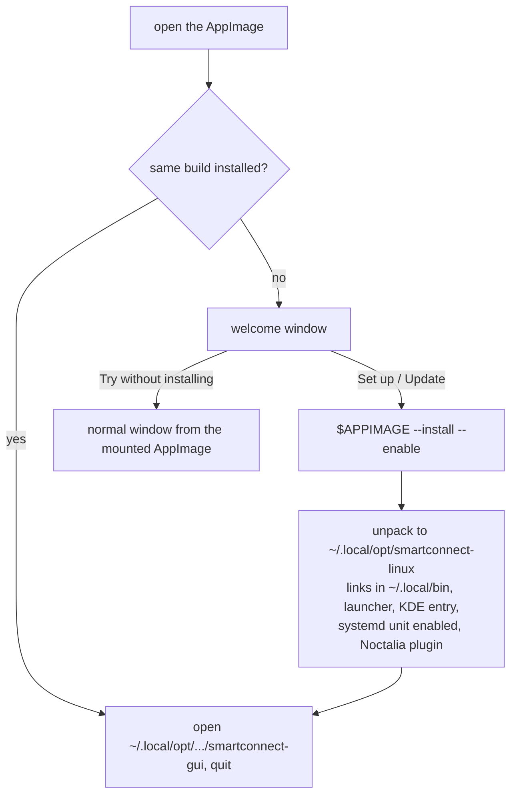

# AppImage and first-run setup

## What

One file, `Smart_Connect-<version>-anylinux-x86_64.AppImage` (~167 MB), that runs on any x86_64
distribution: all eight programs, GTK 4 / libadwaita, GStreamer with only the plugins we use, VA
drivers (Intel, Mesa), wl-clipboard, avahi's tools, `xkbcli`, `notify-send`, and glibc itself.
Opening it shows a welcome window; **Set up** installs it for the user, **Try without installing**
runs it from the file. The pairing dialog warns about a firewall in the way.

## How

- `packaging/appimage/make-appimage.sh` runs `build-in-container.sh` in `archlinux:latest` with the
  checkout read-only and a cache volume. Inside: pacman packages, `cargo build --release
  --workspace --locked`, the programs installed to `/usr/bin`, every GStreamer plugin not in
  `GST_PLUGINS` deleted, then quick-sharun (pinned commit) bundles programs, tools and VA drivers
  with `DEPLOY_GTK/GSTREAMER/OPENGL/PIPEWIRE/PULSE/P11KIT=1` and packs the AppImage + `.zsync`
  (`UPINFO` points at the GitHub releases). The live Noctalia `settings.json` is excluded.
- `packaging/appimage/AppRun.sh` (run by sharun with the bundled dash): `--install [--enable]`,
  `--uninstall`, a program by name (`… smartconnectd status`), else the GTK app.
- `gui/src/setup.rs`: `installed_same_build()` / `pending_install()` compare
  `share/smartconnect-linux/build-id` (written at build time) in `$APPDIR` and the installed copy;
  `welcome()` runs `$APPIMAGE --install --enable` in a thread, then starts the installed app after
  this process has quit (same application id). `FirewallHint` is added to the pairing dialog.

## Why

- **Arch + quick-sharun, not linuxdeploy on an old base.** The GTK app needs GTK 4.18 and
  libadwaita 1.7 (`adw::ToggleGroup`), which no old LTS base has; building them there would mean
  building GLib, GTK, libadwaita and GStreamer from source. quick-sharun bundles glibc and the
  dynamic loader too, so a build from the newest Arch still runs on older systems.
- **sharun keeps `/proc/self/exe` right.** It maps the loader in-process (userland execve) and each
  program is a hard link named after it, so `current_exe()` is `AppDir/bin/<name>`: the programs
  still find each other in the same directory, and the installed copy has a fixed path, which
  KWin's `X-KDE-Wayland-Interfaces` check matches against `Exec=`.
- **Install, don't only run.** The daemon must outlive the GUI; an AppImage's mount disappears
  with its last process. Unpacking also gives KDE the fixed path. No root: everything goes under
  `~/.local` and `~/.config`.
- **Environment leaks.** The bundled `anylinux.so` preload removes the AppImage's variables from
  child processes, so host programs we start (`niri msg`, `hyprctl`, `gsettings`, `systemctl`,
  `fusermount3`) don't load bundled libraries.
- **Firewall without lockouts.** Only read-only checks run unasked (`systemctl is-active`,
  firewalld's default-zone `--query-port`); a polkit request without an agent counts as a failed
  login (pam_faillock) and can lock sudo, so the **Allow** button (which lets firewalld ask) is
  offered only on GNOME and KDE, which always run an agent. Other zones can't be read without
  authentication, so the hint says "may block".
- **GStreamer allowlist.** gst-plugins-bad pulls dozens of libraries; keeping only the plugins the
  code uses (webrtc + nice/dtls/srtp/sctp/rtp/rtpmanager, va, x264, libav, opus, pipewire, pulse,
  opengl, waylandsink, v4l2, the converters) keeps the file at ~167 MB.

## Verified

- Built twice in the container (~15 min first, faster with the cache volume).
- On this PC (Arch-based, GNOME 51) from the AppImage: every program's `--help`;
  `smartconnect-display --list-outputs` (Mutter D-Bus); `smartconnect-webcam --check` (webrtcbin,
  nice, VA decoder, v4l2sink, pipewiresink load from the bundle).
- `--install` into a throwaway `$HOME`: links, absolute `Exec=` lines, unit `ExecStart`, plugin
  without personal settings; the installed copy runs.
- The welcome window renders (screenshot); the app icon now loads from inside the AppImage.

## Not verified

- A phone session through the AppImage build; the **Set up** button end to end on a real account;
  KDE trust with the installed copy; NVIDIA; other distributions on real hardware (only containers).
