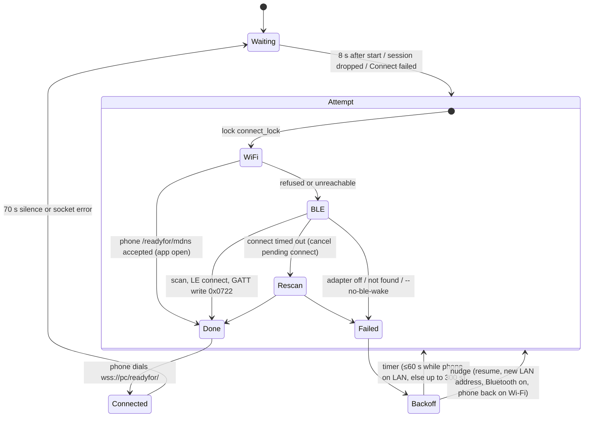

# Reconnect with Smart Connect in the background (2026-10-21)

Status: **verified on the phone** for daemon restart and desktop/CLI Connect with the app in the
background. The early-retry triggers and the dead-link drop are unit-tested, not yet seen live.

## What

The reported symptom: reconnect "only works while Smart Connect is in the foreground"; the journal
shows `connect: Wi-Fi dial failed (Connection refused (os error 111)); trying Bluetooth`.

Root cause, in three parts:

1. **The Wi-Fi refusal is expected and can't be fixed on the PC.** In the background the phone app
   has no LAN listener at all: its `/readyfor/mdns` server and its mDNS advert run only while the UI
   is in the foreground (static RE, `reconnect-spec.md` Q1), and live: with the app backgrounded and
   a session up, `/proc/net/tcp*` on the phone shows no listening socket for the app's uid, and a
   dial to any port is refused in ~35 ms.
2. **The phone never reconnects a Windows-class PC by itself.** Its discovery-driven auto-connect
   (`DeviceStateListRepository`, obfuscated `jn2.j`) fires only for `os` 1/2 devices, for
   Lenovo-cloud ("cloud key") pairs, or once per paired PC after the UI returns to the foreground
   (`f00` "BackToForeground autoConnect list"). The other background channels (9 cloud push,
   10 account P2P tunnel, 0 cloud broker) need a Lenovo account. So a genuine Windows PC without an
   account wakes the phone the only remaining way: a BLE GATT write as central (HCI capture,
   `ble-capture/CAPTURE-NOTES.md`). **The daemon already did exactly that** (`ble_connect.rs`;
   `--no-ble` only disables the old peripheral, not the wake), and the journal showed it working
   most of the time.
3. **What actually failed** was robustness, not the mechanism. Seen in today's journal:
   - `Bluetooth is off on this computer` (adapter off; no PC-side fix without BLE or the cloud);
   - `Bluetooth operation in progress` ×3: the GTK Connect and the auto loop ran BlueZ scans and
     connects at the same time;
   - `connect timed out` then `target object was either not present or removed`: a timed-out LE
     connect stays pending in BlueZ (dropping the future doesn't cancel it), and BlueZ removes the
     temporary device object, so retrying the same address can't work;
   - `phone not found over Bluetooth` for whole 20 s scans: the phone's background advert is
     continuous (250 ms interval) but only about -7 dBm (phone `dumpsys bluetooth_manager`), so
     the PC sometimes misses it;
   - after a drop the backoff reached 300 s quickly, so a missed scan cost minutes;
   - a dead TCP session (phone left Wi-Fi, PC slept) looked connected for up to ~15 min because
     nothing timed out on silence, which blocked the reconnect loop;
   - invite addresses were read once at startup, so a PC network change broke every later invite.

## How

- `discovery::connect_now`: holds `Daemon::connect_lock` (a tokio mutex) so only one attempt runs;
  re-checks `is_connected` after taking it; honours `--no-ble-wake`; classifies the Wi-Fi failure
  (`is_refused`: refused = phone present, app in background) for the user-facing message.
- `ble_connect.rs`: up to two rounds of scan (30 s) + connect (2 × 12 s); after a failed or
  timed-out connect it calls `Device::disconnect()` to cancel BlueZ's pending LE connect, then
  rescans. `watch_adapter` subscribes to adapter property changes (read-only) and nudges the loop
  when `Powered` becomes true. Nothing ever writes adapter power.
- `reconnect.rs` (new):
  - `run`: the loop. Backoff 2/5/15/30/60 s then 300 s; capped at 60 s for the first 15 attempts
    while the phone answers on the LAN. Waits are interrupted by `Daemon::nudge_reconnect`
    (`tokio::sync::Notify`, `notify_one` so a nudge during an attempt isn't lost), and every 30 s it
    probes the phone (`probe`: one TCP connect to `<phone ip>:11000`; refused or connected =
    present, timeout/unreachable = absent). Absent → present means "back on Wi-Fi": try now.
  - `watch_system`: every 5 s, `CLOCK_BOOTTIME - CLOCK_MONOTONIC` growing by >10 s means the PC
    was suspended → nudge; a new LAN address → `Daemon::set_ips` (unless `--ip`) and nudge.
  - `detect_lan_ips` moved here from `main.rs`.
- `server.rs`: `ips` became a `Mutex` behind `ips()`/`set_ips()` (a pending QR invite with stale
  addresses is dropped); `phone_ip` remembered from each verified session and mDNS advert
  (`remember_phone_ip` also moves a remembered `/readyfor/mdns` endpoint to the new address);
  `spawn_auto_reconnect` delegates to `reconnect::run`; the session loop drops a session after
  70 s without any frame (the phone answers our 20 s pings; logged once per session as
  `phone answers WebSocket pings`).
- `control.rs`: a failed `connect` starts the loop, so the GTK/Noctalia button "keeps trying".
- `main.rs`: `--no-ble-wake`, clearer `--no-ble` help, spawns the two watchers.

## Why this way

- **No Wi-Fi-only fix exists** for a backgrounded phone without an account: there is nothing
  listening and the phone won't start the reconnect. Masquerading as another device class (`os`
  1/2) to trigger the phone's own auto-connect would change the tile type and break the Windows
  feature set; rejected.
- **Keep the BLE wake on by default, but never touch adapter power.** It was already on by default
  (independent of `--no-ble`) and is the user's working path; making it opt-in would need a change
  to the systemd unit's flags, which is the user's call. Added `--no-ble-wake` as the opt-out.
- **Presence probe instead of periodic BLE scans** to notice the phone coming back: a TCP SYN costs
  no radio time on the PC's Bluetooth (earbud concern) and distinguishes "app backgrounded"
  (refused) from "phone away" (timeout). Its only blind spot is a phone that changed IP; the
  300 s attempts still cover that.
- **Eager 60 s retries only while the phone is on the LAN**: then it's almost certainly in BLE
  range and a missed weak advert is the likely failure; when it's away, scanning often is pointless.
- **Clock comparison for suspend** instead of logind's `PrepareForSleep`: no D-Bus dependency, and
  a false positive only costs one harmless attempt.
- **Dead-link timeout 70 s** (3.5 ping intervals) after confirming live that the phone answers
  pings; otherwise a quiet session would be dropped every minute.

## Measured (2026-10-21, app in the background, phone awake)

| Path | Result |
|---|---|
| `smartconnectd disconnect` → `smartconnectd connect` (4 runs) | connected in 5.0, 5.4, 6.0, 6.0 s (BLE wake) |
| `systemctl --user restart smartconnectd` (final build) | connected 16.3 s after the restart (8 s startup grace + 2 s backoff + ~6 s wake) |
| Restart with an intermediate build (20 s scans, no presence cap) | 2 min 27 s: three scans missed the weak advert / one LE connect timed out |

## Open

- Live check of the nudges (resume, network change, Bluetooth on), the presence probe's
  "back on Wi-Fi" path, the 70 s dead-link drop, and a wake with the phone's screen off.
- With the PC's Bluetooth off, only opening the app on the phone reconnects. A Lenovo-account
  channel (9/10/0) would be the only other route.
- Whether periodic LE scans disturb Bluetooth earbuds during audio; if so, skip scans while an
  audio device streams.
