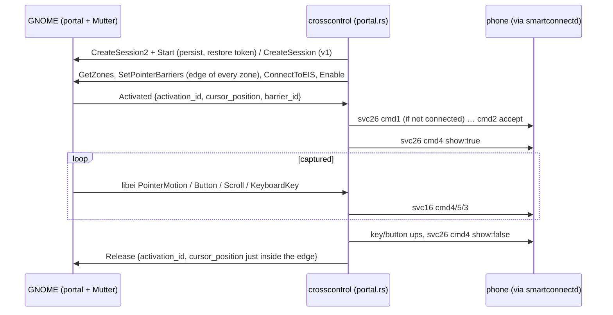

# Cross Control on GNOME (InputCapture portal) and the merged 26/202 tile

## What

- `smartconnect-crosscontrol` split into `core.rs` (svc 26 session, virtual cursor, svc 16 input,
  key mapping), `layer.rs` (the existing wlr-layer-shell strip + pointer lock) and a new
  `portal.rs` (xdg-desktop-portal InputCapture + libei). `--backend auto|layer-shell|portal`; auto
  picks layer-shell when the `zwlr_layer_shell_v1` global exists, else the portal.
- Daemon: `"202": 1` added to the svc 25 `cap` map so the phone's Cross Control tile can relaunch
  the PC display (Duplicate/Extend).

## How

### Core/backend split

`Core` methods return an `Action` (`None`, `Enter`, `Leave(why)`) that the backend carries out:
`Enter` → the backend grabs input and calls `Core::enter()`; `Leave` → `Core::leave()` (releases
held keys/buttons, hides the phone pointer, 350 ms cooldown) and the backend ungrabs. Knock re-entry
stays in `layer.rs` (it only exists for the strip). `Core::edge_fraction()` gives the position along
the edge for putting the PC pointer back.

### Portal backend

- One tokio current-thread loop `select!`s over: portal `Activated`/`Deactivated`/`Disabled`/
  `ZonesChanged` signals, the libei event stream (`reis` `handshake_tokio`, receiver context, binds
  pointer + keyboard + button + scroll on `SeatAdded`), the daemon watch socket (`AsyncFd` on a
  clone), and an 8 ms tick (request timeout, move coalescing, `STOP` from SIGINT/SIGTERM).
- After every event the desktop's capture is synced to the core: while activated and
  `!core.wants_capture()` (left the phone, request denied/timed out, cooldown) it calls `Release`.
  So pushing into the barrier while the phone refuses gives the pointer straight back.
- `ZonesChanged` → leave, `Disable`, re-arm barriers, `Enable` (the portal requires the session
  disabled to change barriers). `Disabled` → exit with an error.
- Restore token: `$XDG_STATE_HOME/smartconnect-linux/crosscontrol-portal.token`.
- libei key codes are evdev codes, the same as `wl_keyboard`, so the core's scancode table is
  shared. Scroll: `ScrollDiscrete` (value120) when present, else `ScrollDelta / 15`.

### Merged phone tile

Phone `QuickSettingRepository.n()` ("startLastUseUCExtend"): reads the last Cross Control mode for
this PC (`latest_cross_control_type_<realDeviceId>`, default 26; written whenever a 26 or 202 session
connects, see `ez` case 6) and launches it if supported; "supported" for 202 means qsType 11 passes,
which needs `"202"` in the PC's svc 25 cap. 202 then sends svc 202 `cmd 50` with `shareType` = the
phone's last share type for this PC (default `"extend"`), which `helpers.rs` already answers with
`smartconnect-display`.

## Why

- **The user's report:** tapping Cross Control on the phone did nothing. The daemon did spawn
  `smartconnect-crosscontrol --accept`, but the user is on GNOME, which has no wlr-layer-shell, so it
  exited at once (`compositor lacks wlr-layer-shell`, in `$XDG_RUNTIME_DIR/smartconnectd/`).
- **Why the portal:** Mutter can't host a layer-shell strip and a normal window can't be put on an
  edge. InputCapture (GNOME 45+, KDE 6.1+) is the sanctioned way to do this (it's what input-leap and
  lan-mouse use), needs no root and no evdev grab, and handles pointer barriers, cursor hiding and
  shortcut suppression itself. niri has no InputCapture backend, so layer-shell stays the first
  choice wherever it exists.
- **Why split the file:** the session/cursor/input logic is identical for both grabs; duplicating it
  would let the two drift. The refactor is behaviour-preserving for layer-shell.
- **Windows' "3 options":** the Windows app offers keyboard + mouse, Duplicate and Extend on the PC
  side; the phone has no picker, only the "last used" relaunch. Duplicate/Extend are the PC display
  (svc 202, `smartconnect-display`). The GTK app's mode picker is a separate change (it needs a hook
  from the Display page).

## Not verified

- The portal backend hasn't been run against the phone yet (needs the user to accept GNOME's prompt
  and push into the edge). Open: whether GNOME hides the cursor while captured, and how its own
  capture-release shortcut interacts with our edge return.
- The 202 tile relaunch hasn't been seen on a device.

## Update: "202" removed again (same day)

On the device, with `"202"` in the cap map, tapping Cross Control after an Extend session sent svc 202
`cmd 50 {shareType:"extend"}` (session log, `srcServiceId 19`) and the phone became an extended
display straight away: the user wanted the tile to offer the three modes instead. `"202"` is out of
the map again (`proto::caps_with_extra`, test asserts it), so a tap is always svc 26 `cmd 0`; the
GTK app's Display tab (Cross Control modes, `cross-control-modes-page.md`) comes forward to pick Duplicate/Extend.
