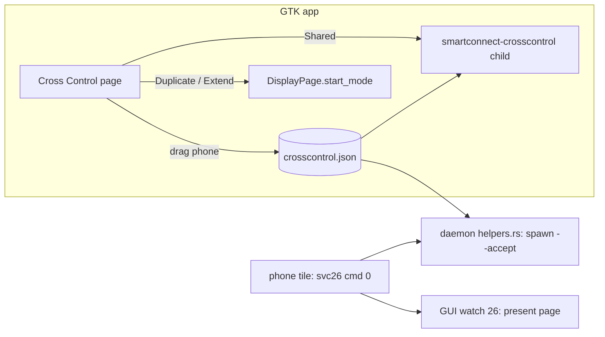

# Cross Control modes and the phone position editor (Display tab)

## What

- GTK app: a new **Cross Control** view (`gui/src/crosscontrol.rs`) with the three modes the Windows
  app offers: *Shared mouse and keyboard* (svc 26, `smartconnect-crosscontrol`), *Duplicate display*
  and *Extend display* (svc 202, through the Display page's `start_mode("mirror" | "extend")`).
  One runs at a time; clicking the running one stops it. The Phone page's switch + edge combo became
  a row that opens the page.
- A **phone position editor**: a drawing of this PC's screen and the phone; drag the phone, it
  snaps to the nearest side and stays on it. Saved as `{"edge", "start", "end"}` in
  `~/.config/smartconnect-linux/crosscontrol.json`.
- `smartconnect-crosscontrol` reads that file at startup (`--edge`/`--span START:END` override it).
  Only the phone's part of the edge crosses over, and it maps onto the phone's whole side: the
  layer-shell strip ignores hits outside it (sliding along the strip into it counts as arriving),
  and the portal barrier only spans it.
- The daemon no longer forces `--edge right` on the client it starts for the phone's tile (only
  `$SMARTCONNECT_CROSS_EDGE` when set), so the tile uses the saved position.
- The daemon keeps `"202"` out of the svc 25 cap map, so the phone's merged tile always sends svc 26
  `cmd 0` instead of relaunching Extend by itself (seen on the device with `"202"` in the map).
- Tapping Cross Control on the phone brings the GTK app forward on this page (a `watch [26]`
  thread in `gui/src/daemon.rs` → `Event::CrossControlRequested`).

## How

- Running-mode detection: our child (running and not stopping), else the crosscontrol lock file is
  held (a client the daemon or a terminal started; its pid is in the file and gets SIGINT on stop),
  else `DisplayPage::running_mode()`. A 500 ms poll runs while anything is up.
- Applying a move while shared mode runs: our child is SIGINTed and started again once reaped
  (`restart_after_exit`); a client we didn't start is taken over by starting ours (the client's
  single-instance takeover).
- Geometry (`Geometry`): the screen is drawn at the first monitor's aspect, 42 % of the canvas
  height; the phone is 70 % of the screen height at 9:20. The saved span is the phone's length
  along that edge in the drawing (about 70 % of a side edge), centred where it was dropped and
  clamped to stay on the edge. Snapping compares the phone centre's offset from the screen centre,
  normalised by the combined half-sizes, on each axis.
- Colours come from the theme: the widget's foreground and libadwaita's accent colour (redrawn when
  the accent changes).

## Why

- The user's request: the Windows app's Cross Control has three options and lets you place the phone
  around the screen; ours had a right-only (or combo-picked) edge and a single switch, and nothing
  happened on the PC when the tile was tapped.
- The phone has no mode picker (its tile relaunches the last mode, see
  `cross-control-gnome-portal.md`), so the picker belongs on the PC, and showing it when the tile is
  tapped is the closest match to "the tile opens the options".
- Duplicate/Extend reuse the Display page (owned by the display work) through its small public API
  instead of spawning `smartconnect-display` here, so settings, adoption of detached sessions and
  errors stay in one place.
- A shared JSON file (like `display.json`) instead of daemon state: the client is also started by
  the daemon and from a terminal, and reading one file at startup keeps all three consistent
  without a new control-socket command.
- A span rather than a full edge: with the phone shorter than the screen, crossing anywhere on the
  edge would put the pointer on a phone that isn't there in the picture.

## Not verified

The page and the editor were built and unit-tested (snapping, clamping, round trip); they haven't
been clicked through by hand yet. The Noctalia plugin still has only the shared mode and an edge
cycle button (no span).

## Update: Extend follows the phone position

`smartconnect-display` (display work, see `display-any-desktop.md`) now reads the same
`crosscontrol.json` when it lays out Extend: the virtual screen goes on that side of the primary
monitor, centred on the phone span, and a running session follows a move within a second (mtime
poll), so the page does not restart display sessions after a drag. `--side` overrides the edge.

## Open: a mode picker on the phone

The phone app (09.0.3.013) has no Cross Control mode picker in the tile code read so far: a tap
either relaunches the last mode (with `"202"` in the cap) or always sends svc 26. The user reports
three options when the phone is paired with Windows, so a phone-side screen recording plus logcat
of that flow is needed before deciding (pending a Windows capture).

## Merged into the Display tab (2026-10-25)

The user found two tabs cluttered, so Cross Control moved onto the Display tab. `CrossControlPage::build`
returns its parts (modes + status, and the *Phone position* group) and `DisplayPage::build` its
content, without their own scrollers; `window.rs` stacks modes → phone position → display
session/settings in one scrolled column. The Display part hides its Mode row and its Start button
(the mode cards start sessions; the button only shows as Stop/Apply while one runs). The phone's
tile and the Phone page's Cross Control row open the Display tab. The "Display settings…" button is
gone.

## Phone drawn in its real orientation (2026-10-25)

While a display session runs, the *Phone position* picture draws the phone on its side when it is
held landscape. `DisplayPage::phone_landscape()` reads the helper's log: the phone's last
`setOrientation` (`← phone cmd 7: …`, 1 landscape, 2 portrait), else the stream's shape. The page's
500 ms poll (running while any mode is on) redraws when it changes; with no session the phone is
drawn upright.
