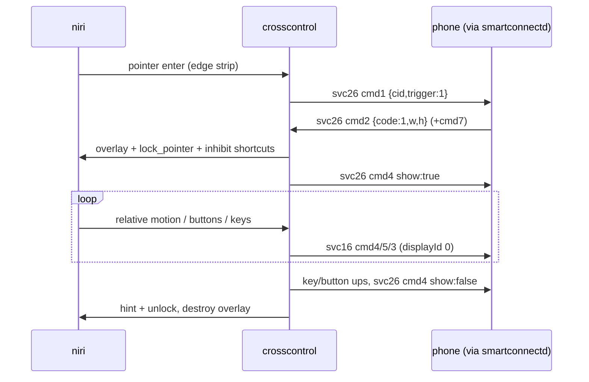

# Cross Control (svc 26) for Wayland/niri

## What
New crate `crosscontrol/` (binary `smartconnect-crosscontrol`): the PC mouse+keyboard glide across a
screen edge onto the phone (unmodified Smart Connect app), Universal-Control style.
Also `src/proto.rs`: `"26":1` in `service_versions()`, `"26":2` in `service_caps()` (takes effect on daemon restart).

## How
- Standalone Wayland client (sctk 0.19 + raw wayland-protocols), talks to `smartconnectd.sock`
  (`watch [26,16,25]` + `send`). Single-threaded loop: `libc::poll` on the Wayland fd and the watch socket.
- 1-px `Layer::Overlay` strip anchored on `--edge` (exclusive zone -1, no keyboard).
- Strip `wl_pointer.enter` → svc 26 cmd 1 `{cid, trigger:1}` → phone cmd 2 `code:1 width height`
  → svc 25 cmd 1 `cap {"26":9}` (in-use bit, INFERRED) → enter:
  fullscreen transparent overlay layer (keyboard Exclusive), `zwp_pointer_constraints.lock_pointer`,
  `zwp_keyboard_shortcuts_inhibit`, cursor hidden; svc 26 cmd 4 `show:true`.
- `zwp_relative_pointer` deltas × `--gain` integrate a virtual cursor in phone px → svc 16 cmd 4
  (displayId 0, absolute, coalesced ≤125 Hz). Buttons → cmd 5, wheel (value120) → cmd 5 key 4,
  keys: evdev code → set-1 scancode (+0x100 for E0 keys, media keys as Android keycodes flag 0x1000) → cmd 3.
- Return: outward overshoot past the shared edge > `--exit-px` (no button held), or Ctrl+Alt+Esc:
  release held keys/buttons, cmd 4 `show:false`, cursor-position hint just inside the edge, destroy lock/overlay.
  350 ms cooldown; re-entry while still in the strip needs a 25 px outward "knock" (relative motion).
- Phone cmd 0 → we send cmd 1; cmd 5 → reply cmd 6 + reset; cmd 7 → rescale. SIGINT/TERM → cmd 5.

## Why
- Wayland can't warp; lock + relative motion keeps the PC cursor at the edge, so unlocking leaves it
  where it entered (spec §7 option A, no root / evdev grab). Relative events also flow without a
  granted lock (overlay covers the output), which is the fallback.
- Separate overlay surface (not resizing the strip) keeps the strip state simple.
- Verified 2026-10-21 against the running daemon (before the proto.rs change!): cmd 1 → cmd 2
  `code:1 1220x2712 supportTouch:true` then cmd 7; svc16 cmd 4 moves logged by `R4InputManager
  getTransformedPosition` (identity at rotation 0); cmd 5 → cmd 6. The phone accepted without "26"
  in serviceVersions.
- Open: svc 25 cap value (phone itself reports `"26":5` while connected — maybe bit 4, not 8);
  lock on a layer surface under niri and real-hand feel (gain) are untested.
