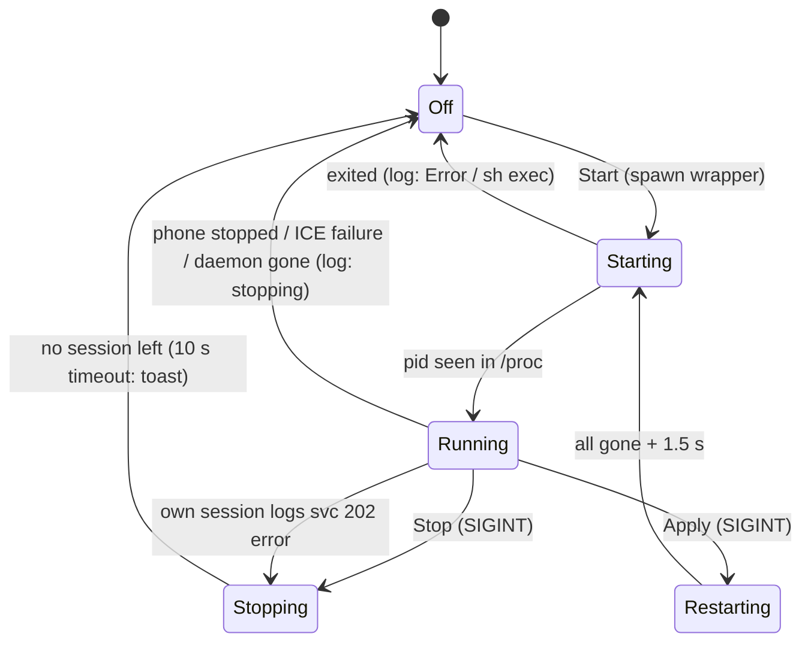

# Phone-as-display controls in the GTK app and the Noctalia plugin

Backend: [phone-as-display.md](phone-as-display.md) (`smartconnect-display`, svc 202). This note is
about starting, watching and stopping it from the desktop front-ends.

## What

- **GTK app**: a *Display* page (between Apps and Notifications). Header: status line, detail line,
  Start/Stop, and *Apply Changes* when the running session differs from the settings. Settings:
  - Mode: *Extend* | *Duplicate* (`--mode mirror`; the page says "shows this PC's screen on the
    phone", the opposite of the Phone page's Mirror Screen).
  - Resolution, remembered per mode: *Phone native* (Extend's default, `--size native`),
    *Phone default* (Duplicate's default, what the phone asks for), *Custom* W×H.
  - Display scale 100–300 % (default 200), Extend only.
  - On-screen keyboard height 15–80 % (default 45, `--osk-height`).
  - *Send PC audio to the phone* and *Rotate with the phone* (Extend only), both marked experimental.
  - *Advanced → Extend onto*: Automatic (first `Virtual-*`) or a niri output; a saved choice stays
    listed as "(not connected)" while unplugged.
  - Setup hints: no virtual output (`sudo modprobe vkms`, copy button, the
    `/etc/modules-load.d/vkms.conf` tip, Check again), chosen output missing, `niri msg` failing,
    no wvkbd (`yay -S wvkbd`).
- **Noctalia plugin**: panel button *Phone as display* / *Stop phone display* with an
  Extend/Duplicate cycle button and a status line. Settings: mode, resolution (native/requested,
  plus a custom size set elsewhere), scale, keyboard height, the two experimental switches, helper
  path. IPC: `qs ipc call plugin:smart-connect display toggle|start|stop|extend|duplicate`.
- **Shared choices**: `~/.config/smartconnect-linux/display.json`, the contract with
  `smartconnect-display` (it takes its defaults from there, so a start from the phone uses them):
  `{"mode","size":"native"|"requested"|"WxH","displayScale","oskHeight","output":null|NAME,"audio","followRotation"}`.
- GTK window: with five pages the header switcher ellipsized its labels, so below 700sp it moves to
  a bottom `AdwViewSwitcherBar` (breakpoint).

## How

| File | Written by | Read by |
|---|---|---|
| `$XDG_CONFIG_HOME/smartconnect-linux/display.json` | GTK (every change, and on Start), plugin (Settings Apply, mode button, IPC extend/duplicate) | the helper, GTK (start-up, page shown), plugin (file watch) |
| `$XDG_CONFIG_HOME/smartconnect-linux/gui.json` | GTK | GTK: per-mode resolution, custom size |
| `$XDG_RUNTIME_DIR/smartconnect-display.log` | the wrapper of whichever front-end started the session | GTK and plugin: live status, last stop reason |

- **Start** (`gui/src/display.rs` `spawn`, plugin `startDisplay`): both use the same wrapper,
  `sh -c 'exec >"$1" 2>&1; echo "pid $$"; shift; exec "$@"' sh LOG BIN ARGS…`. The log's first line
  names the pid, and after `exec` the helper keeps that pid. GTK spawns it in its own process group
  with SIGINT/SIGTERM reset to default (`pre_exec`), and a reaper thread reports the exit. The plugin
  uses `Quickshell.execDetached`.
- **Flags**: GTK runs `smartconnect-display --help` (cached per file and mtime) and passes optional
  flags only if they are listed (`--osk-height`, `--audio`/`--no-audio`, …). A helper that lists
  `--no-config` reads display.json, and it gets every choice spelled out (`--size requested`,
  `--output auto`, `--no-follow-rotation`, …), so its command line alone describes the session. The
  plugin passes mode/size/scale/output, and `--osk-height` only when it is not 45; audio and rotation
  reach the helper through display.json.
- **Finding sessions** (any starter, also the CLI or the daemon): GTK scans `/proc` (kernel name =
  the first 15 bytes of the file name, then argv[0], or argv[1] for an interpreter). The plugin runs
  `pgrep -a -x <15 bytes>` with the same argv check. The settings of a running session come from its
  command line. Missing flags mean display.json for a helper that reads it (unless `--no-config`),
  else the helper's defaults. `--replace` and `--config` don't count as differences. GTK compares
  its own session against what it asked for (`State::own`).
- **Status** (`parse_log` / `parseDisplayLog`): `phone panel … sending WxH`, `stream size → WxH`,
  `capturing NAME (`, `peer connection: Connected|Failed|…`, `stopping: <reason>`,
  `svc 202: <error>` (fatal), `Error: …` (+ `Caused by:`), `phone refused:`, `daemon: {"ok":false…}`,
  `pipeline error from …`, `sh: … exec …`. The log describes the running session only when its pid is
  running; otherwise it is the last session ("Last session: stopped on the phone").
- **Stop / Apply**: SIGINT once per pid. After the first one glib has put the helper's handler back to
  default, so a second SIGINT would kill it mid clean-up. Apply = SIGINT, wait until every session
  is gone (at most 10 s), wait 1.5 s, start. A front-end stops its *own* session on a `svc 202:`
  error unless the log already says `stopping:`. An older helper keeps running without a stream, and
  the phone would wait on "Connecting…". A newer one sends cmd 26 and exits by itself
  ([display-settings-and-phone-start.md](display-settings-and-phone-start.md)). In both cases the
  error, not "could not start the stream", becomes the "Last session failed: …" text.
- **Together with the helper's own rules**: the helper allows one instance (a lock in
  `$XDG_RUNTIME_DIR`). The front-ends only start when they see no session, and Apply stops before it
  starts, so they never need `--replace`. A session the daemon starts for the phone
  (`--mode <shareType>`, everything else from display.json) shows as "Running, started outside Smart
  Connect: …" with its settings resolved through display.json, and it can be stopped from either
  front-end.
- **Preflight** (GTK, every 5 s while the page is shown): `niri msg --json outputs`, wvkbd on `PATH`
  or `$SMARTCONNECT_OSK`, and the helper's flags. Start is blocked when Extend has no virtual output
  or the chosen output is missing. It is not blocked when niri can't be asked. The laptop panel
  (`eDP*`/`LVDS*`/`DSI*`) is never offered as an extend target: it would be reconfigured and then
  switched off.

## Why

- **Detached sessions.** Quickshell SIGKILLs a tracked `Process` on a plugin reload or shell
  restart, which skips the helper's clean-up and leaves Virtual-1 on. Closing the GTK window should
  not pull away a monitor that has windows on it either. The phone can stop a session itself, and both
  front-ends find a running session again, so they don't need to own the process.
- **A log file, not a pipe.** The helper `println!`s on every step. Once a pipe's reader is gone,
  that panics, and inside a glib callback the panic aborts, so cmd 26 is never sent and the output
  stays on. A file can't break that way, and it is also the log you read when something fails.
- **/proc and the log instead of an API.** The helper has no control socket. Its stdout already
  carries every state change and the stop reason, and this works the same for sessions started from
  a terminal.
- **Probing `--help`.** The helper gained flags while this was being written, and an unknown flag
  makes it exit. Passing only listed flags, with display.json carrying the rest, keeps every
  combination of GUI and helper working.
- **Per-mode resolution only in gui.json.** The contract has a single `size` (the current mode's);
  the GTK app remembers the other mode's choice on its own.
- **The Noctalia plugin keeps display choices in display.json, not `pluginSettings`.** One copy
  means the panel, the GTK page and a phone-initiated start can't disagree. Only the helper path stays
  a plugin setting.
- **One SIGINT and a pause before restarting.** See *Stop / Apply*. The 1.5 s pause lets the phone
  close its display view before the next cmd 0.

## Verified, and not

Verified without a phone or a real session:
- `cargo test --release` in `gui/` (12 tests): args ↔ parse for three helper generations, display.json
  contract, log parsing, and a stand-in session through the real wrapper, `/proc` detection and SIGINT.
- GTK app driven over AT-SPI in a headless weston, with a fake daemon socket and a stand-in helper
  (`SMARTCONNECT_DISPLAY_BIN`): Start → "Streaming 2712×1220 to the phone / Extended onto Virtual-1" →
  switch toggled → Apply restarted the session with the new flags → Stop → "Last session: stopped from
  this PC". The narrow (bottom bar) and wide (header) layouts were checked from screenshots.
- Plugin service in a separate Quickshell instance (isolated runtime and config dirs, fake daemon,
  stand-ins), 27 checks: parsing, args, start/stop, duplicate, extend-restart, fatal-error stop,
  outcome texts, mute. Panel.qml and Settings.qml rendered with Noctalia's own widgets. The IPC
  target lists `display(action: string)`. qmllint (Qt 6) reports no errors; only the usual warnings
  that `qs.*` can't be resolved outside the shell.

Not verified: a real session from either front-end (no phone access while this was written); that
the phone accepts the restart after 1.5 s; the plugin inside the user's running shell (it needs a
reload, see below).

Known limitation: both front-ends write the same log. If both start a session within the same
detection interval (≤ 0.5 s), the helper refuses the second start, but that wrapper has already
truncated the log, so the first session's status reads "started outside Smart Connect" until it
ends.

Reloading the plugin: Noctalia Settings → Plugins, switch *Smart Connect* off and on (or enable hot
reload in debug mode). The GTK app only needs a restart.

## Testing without a phone

- Stand-in helper: point `SMARTCONNECT_DISPLAY_BIN` (GTK) or the plugin's helper-path setting at a
  script that prints the helper's lines and traps SIGINT. Give it a unique name, because detection
  goes by file name.
- Fake daemon socket: use a short private runtime dir such as `/run/user/$UID/<name>`. A scratch path
  easily exceeds the 108-byte `sockaddr_un` limit.
- Don't wrap an AT-SPI-driven run in `dbus-run-session`. Its accessibility bus launcher replaces
  `$XDG_RUNTIME_DIR/at-spi/bus_0` for the whole login session; repair with
  `systemctl --user restart at-spi-dbus-bus`.
- A GUI started with `&` from a non-interactive script inherits an ignored SIGINT. That is why the
  GTK spawn resets SIGINT and SIGTERM to default for the helper.
