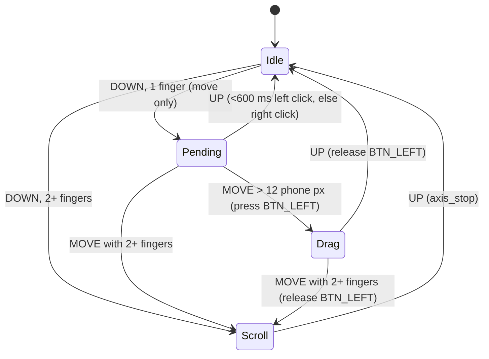

# Phone-as-display input injection (svc 202, `display/src/input.rs`)

## What
The phone, acting as an external display, sends touch / mouse / keyboard / pen input back over the
WebRTC data channel `touchDataChannel` as binary little-endian packets. `input.rs` decodes them and
injects them into niri through Wayland virtual input protocols:

- `zwlr_virtual_pointer_v1` (manager v2): absolute motion, relative motion, buttons, wheel, and finger scroll
- `zwp_virtual_keyboard_v1`: Android keycodes mapped to evdev keycodes

Public API (the contract `session` uses):

- `Injector::new(target)`
- `Injector::new_for_output(name, target)`
- `set_target`
- `handle_packet(&[u8])`

## How
- **Decode** (`decode`). The packet layouts are in spec B.4. I re-checked them against the APK
  (`z68.l/g/h/c`, `j68.a`, `i68.a`, `x29.K/L/M/N`, `py1`). Type is `u32 @0`: 0 touch (128 B),
  1 key (32 B), 2 mouse (48 B), 3 pen (56 B).
  - Touch: the phone sends only ACTION_DOWN, MOVE, UP and CANCEL, as flags 1, 3 and 5. It never sends
    POINTER_DOWN or POINTER_UP. A second finger therefore shows up only as `count` ≥ 2 on a MOVE packet.
  - Mouse wheel (flag 2048): the value is the Android scroll axis, where +1 means up. The phone's
    two-finger touchpad mode sends ±1 for both scroll and zoom.
  - CapsLock arrives as one packet with flag 32768 (a toggle) instead of a down/up pair.
- **Translate** (`Translator`, pure and unit-tested). Each packet becomes a list of `Action`s. Touch
  goes through a gesture state machine, so a tap does not turn into a press followed by a drag.
- **Inject** (`Injector::apply`):
  - Absolute motion is sent as `motion_absolute` in output-relative coordinates, with extents ×16
    for sub-pixel precision.
  - With manager v2, the pointer is pinned through `create_virtual_pointer_with_output`. The output is
    chosen by connector name (wl_output v4 `name`) or by an exact match of its xdg-output logical rect.
  - Without pinning, niri maps absolute motion over the bounding box of all outputs. The code mirrors
    that with `layout_bbox`.
  - The keyboard re-uses the seat's own keymap, taken from the `wl_keyboard.keymap` fd. If that fails
    it falls back to `xkbcli compile-keymap --layout us`.
  - `Drop` releases any held buttons and keys.

## Why
- **Wayland virtual input instead of uinput.** niri supports both protocols; the virtual pointer is
  smithay's, at manager v2. They need no device permissions, and absolute motion can be bound to a
  single output. A uinput touchscreen would need a niri `map-to-output` config edit. `/dev/uinput` is
  writable here through the `input` group, so uinput stays available as a fallback, but it was not
  needed.
- **Pinning by output name.** With vkms the layout is eDP-1 plus Virtual-1 (extend). Unpinned
  absolute motion is spread over the whole layout bounding box, which breaks if the layout changes
  while a session is running. When the pointer is pinned, niri uses `device().output()` in
  `compute_absolute_location`. I checked this in the niri source.
- **Deferred press.** Pressing on DOWN would turn every two-finger scroll into a stray click, because
  the second finger only appears on a later MOVE.
- **Seat keymap.** Uploading a different keymap to the virtual keyboard can switch the keymap clients
  see. Re-using the seat's keymap leaves the user's layout untouched.

## Verification
- Unit tests decode synthetic packets laid out exactly as the APK writes them. They cover tap, drag,
  long press, two-finger scroll, mouse buttons and wheel, Ctrl+C and CapsLock, the keymap table, and
  extend-output mapping.
- `smoke_move_pointer` (ignored test, `CURSOR_LOCATOR=…/cursor_pos.py`) runs live on niri:
  - It makes small relative moves (±12 px) and absolute moves (+15, +10), then returns to the start
    position. It sends no clicks and no keys.
  - It finds the cursor sprite with grim by diffing grabs taken with and without the cursor.
  - In both the pinned and the unpinned path, the pointer landed exactly on target and returned to
    its starting pixel.
