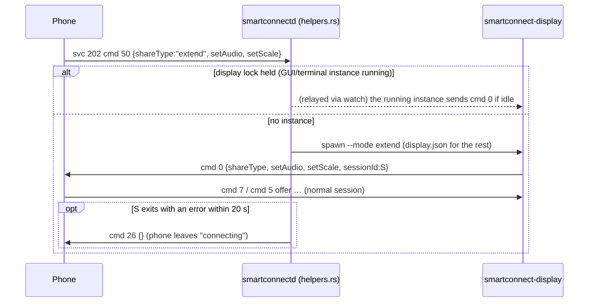

# Phone as display: shared settings, phone-initiated start, one instance (svc 202) — 2026-10-21

Sibling notes: [phone-as-display.md](phone-as-display.md) (the session), [display-rotation.md](display-rotation.md),
[display-audio.md](display-audio.md), [helper-supervision.md](helper-supervision.md) (the helper pattern).
**Nothing here has run against the phone yet** (written while it was unavailable); see "Verified".

## What

- **Shared settings file.** `smartconnect-display` reads its defaults from
  `$XDG_CONFIG_HOME/smartconnect-linux/display.json` (default `~/.config/...`), which the GUI writes.
  Command-line flags override it. `display/src/opts.rs` holds the options, the file parser and the CLI.
  ```json
  {"mode":"extend","size":"native","displayScale":2.0,"oskHeight":45,"output":null,
   "audio":false,"followRotation":false}
  ```
  `size` is `native` / `requested` (the GUI's `phone` is accepted too) / `WxH`. `displayScale` is a
  factor (0.5–4) or a percentage (50–400 or `"150%"`). `output: null`, `""` and `"auto"` all mean the
  first `Virtual-*` output. New flags: `--audio/--no-audio`, `--follow-rotation/--no-follow-rotation`,
  `--size requested`, `--output auto`, `--config PATH`, `--no-config`, `--replace`.
- **Phone-initiated start.** Phone svc 202 cmd 50 `{"shareType","setAudio","setScale"}` (the user
  starts "PC screen" on the phone) makes `smartconnectd` start
  `smartconnect-display --mode <shareType>` (`src/helpers.rs`, `answer_display`). This happens only
  when no instance holds the lock; a running one answers cmd 50 itself. Every other choice comes from
  `display.json`.
- **One instance.** The display takes an exclusive flock on `$XDG_RUNTIME_DIR/smartconnect-display.lock`
  (our pid inside). A second start refuses with "already running (pid N)". `--replace` instead
  SIGTERMs the holder, which sends cmd 26 and switches its output off, then waits ≤ 4 s for the lock.
- **Nobody left waiting.** If the answer to an offer can't be built (no virtual output, capture
  failure…), the display sends cmd 26, shows a desktop notification and exits. If the display the
  daemon started exits with an error within 20 s (and no other instance holds the lock), the daemon
  sends cmd 26 itself. It also sends cmd 26 if the binary can't be started at all.
- **ICE candidates** (open-source blocker): the hard-coded `192.168.` filter is gone. `display/src/ice.rs`
  uses the same rules and env var as the mirror crate ([ice-candidate-filter.md](ice-candidate-filter.md)):
  `SMARTCONNECT_ICE_ADDRESSES` (IPs, IPv4 CIDRs or `all`), else the daemon's `pcAddress` (asked with
  a plain `status` request per offer), else RFC 1918 IPv4 on interfaces that don't look virtual
  (via `getifaddrs`). UDP only. Safety net: if gathering completes and **no** candidate matched, the
  held-back private-address UDP candidates are offered rather than none.



## How

- `opts::parse_with(args, file)` is pure and unit-tested. `apply_file` maps each known key, skips a
  bad value with a warning and ignores unknown keys, so a newer GUI's file never blocks a
  phone-started session.
- `parse_args` pre-scans for `--config`/`--no-config`, loads the file (silently absent), then
  parses the flags on top.
- `session::single_instance_at(path, replace)`: flock `LOCK_EX|LOCK_NB`, pid written after locking.
  The daemon's probe (`helpers::lock_held`) takes `LOCK_SH|LOCK_NB`, the same scheme as the webcam
  and cross-control helpers.
- `helpers::display_request(&data)` recognises cmd 50 (int or string `cmd`; inner `data` as a JSON
  string or object) and returns the `shareType` if it is `extend`/`mirror`. Anything else leaves the
  mode to the file. The daemon tracks the pid it started, so a cmd 50 repeated while that pid is
  still starting doesn't start a second one.
- `display_stop_msg` = `{"ver":"1","cmd":26,"data":{},"sessionId":<cmd 50's>}`. The phone doesn't
  check `sessionId` on incoming commands (OBSERVED in `p68.q`). cmd 26 while it is still connecting
  resets it and it answers cmd 52 (OBSERVED in `p68.R`).

## Why

- **The file is read by the display, not passed by the daemon:** one source of truth for the GUI,
  the daemon-started sessions and terminal runs. The daemon only knows what the phone asked for (the
  mode).
- **The phone's mode wins over the file for phone-started sessions:** the phone sends the share type
  the user picked (stored per PC on the phone, default `extend`; OBSERVED in `p68`/`z68`).
- **Refuse by default, `--replace` on request:** two senders answering the same offer broke ICE on
  the device, so a silent second instance is never right. Cross control's takeover-by-default suits
  a toggle; here a terminal user is better served by an explicit message.
- **The stop on failure matters more than it looks:** after cmd 50 the phone sets itself to
  "connecting" and ignores further start requests until a cmd 0 or a stop (OBSERVED: `startConnect`
  returns early while a connection is in progress). Without the cmd 26, one failed start would
  leave the phone's entry dead until the activity is closed.
- **`getifaddrs` instead of `ip -j`** (mirror uses `ip`): no process spawn per offer, and `libc` was
  already in the lock file. The gathering-complete safety net exists because filtering to one
  address fails closed if that address isn't gathered (e.g. a stale `pcAddress`).

## Verified (locally, no phone)

- Unit tests: `opts::tests` (file → defaults, flags override, bad values skipped, GUI spellings),
  `ice::tests` (candidate parsing, each rule, CIDR/`all` override, UDP only, interface names,
  `getifaddrs`), `session::tests::lock_refuses_a_second_instance`, and
  `helpers::tests::display_start_requests` in the daemon.
- The binary was run against a fake `smartconnectd.sock` in a private runtime dir:
  - `display.json` was applied (extend, audio, follow rotation, cmd 0 `setAudio:true`).
  - A second instance refused.
  - `--replace` stopped the first (its cmd 26, then the new cmd 0).
  - A cmd 5 whose capture fails produced cmd 26 and a clean exit.

## Not verified

- The phone actually sending cmd 50 to this PC, and its UI path (quick-settings entry vs device-page
  tile). That the phone accepts our cmd 0 after its cmd 50 (same message as a PC-started session,
  so likely).
- The daemon spawn path end to end (needs a phone cmd 50).
