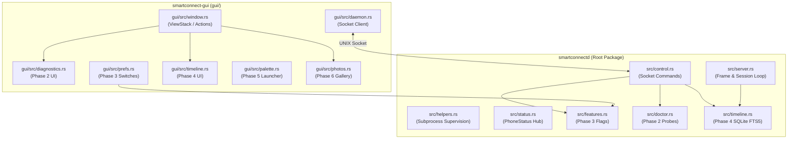

# Feature Plan Reconnaissance: Workspace Map & Integration Points

> **Phase 0 Reconnaissance Note**  
> Map of crates, daemon architecture, control socket protocol, configuration storage, and concrete file integration points for `FEATURE_PLAN.md`.  
> Status: **Complete** (No source code modified).

---

## 1. Workspace Architecture & Packages

The project is structured as a single Cargo workspace governed by the root [Cargo.toml](file:///home/vamshi/smartconnect-linux/Cargo.toml) (edition 2024, resolver "3").

| Package Name | Crate Directory | Primary Role & Binary | Key Source Files |
| :--- | :--- | :--- | :--- |
| **`smartconnect-linux`** | Root (`src/`) | Daemon (`smartconnectd`) & core lib (`smartconnect`): WebSockets, TLS, pairing, notifications, clipboard, SMS, helper supervisor | [src/main.rs](file:///home/vamshi/smartconnect-linux/src/main.rs), [src/server.rs](file:///home/vamshi/smartconnect-linux/src/server.rs), [src/control.rs](file:///home/vamshi/smartconnect-linux/src/control.rs), [src/helpers.rs](file:///home/vamshi/smartconnect-linux/src/helpers.rs), [src/clipboard.rs](file:///home/vamshi/smartconnect-linux/src/clipboard.rs), [src/notifications.rs](file:///home/vamshi/smartconnect-linux/src/notifications.rs), [src/share.rs](file:///home/vamshi/smartconnect-linux/src/share.rs) |
| **`smartconnect-gui`** | `gui/` | GTK4 / Libadwaita desktop interface (`smartconnect-gui`) | [gui/src/main.rs](file:///home/vamshi/smartconnect-linux/gui/src/main.rs), [gui/src/window.rs](file:///home/vamshi/smartconnect-linux/gui/src/window.rs), [gui/src/daemon.rs](file:///home/vamshi/smartconnect-linux/gui/src/daemon.rs), [gui/src/display.rs](file:///home/vamshi/smartconnect-linux/gui/src/display.rs), [gui/src/apps.rs](file:///home/vamshi/smartconnect-linux/gui/src/apps.rs), [gui/src/files.rs](file:///home/vamshi/smartconnect-linux/gui/src/files.rs), [gui/src/prefs.rs](file:///home/vamshi/smartconnect-linux/gui/src/prefs.rs) |
| **`smartconnect-mirror`** | `mirror/` | WebRTC screen mirror viewer & per-app streaming host (`smartconnect-mirror`) | [mirror/src/main.rs](file:///home/vamshi/smartconnect-linux/mirror/src/main.rs), [mirror/src/views.rs](file:///home/vamshi/smartconnect-linux/mirror/src/views.rs), [mirror/src/actions.rs](file:///home/vamshi/smartconnect-linux/mirror/src/actions.rs), [mirror/src/resize.rs](file:///home/vamshi/smartconnect-linux/mirror/src/resize.rs) |
| **`smartconnect-crosscontrol`** | `crosscontrol/` | Seamless mouse/keyboard edge glide (`smartconnect-crosscontrol`) | [crosscontrol/src/main.rs](file:///home/vamshi/smartconnect-linux/crosscontrol/src/main.rs), [crosscontrol/src/core.rs](file:///home/vamshi/smartconnect-linux/crosscontrol/src/core.rs), [crosscontrol/src/layer.rs](file:///home/vamshi/smartconnect-linux/crosscontrol/src/layer.rs), [crosscontrol/src/portal.rs](file:///home/vamshi/smartconnect-linux/crosscontrol/src/portal.rs) |
| **`smartconnect-display`** | `display/` | External display extension & duplication (`smartconnect-display`) | [display/src/main.rs](file:///home/vamshi/smartconnect-linux/display/src/main.rs), [display/src/opts.rs](file:///home/vamshi/smartconnect-linux/display/src/opts.rs), [display/src/capture.rs](file:///home/vamshi/smartconnect-linux/display/src/capture.rs), [display/src/input.rs](file:///home/vamshi/smartconnect-linux/display/src/input.rs) |
| **`smartconnect-webcam`** | `webcam/` | Phone camera streaming into v4l2loopback or PipeWire (`smartconnect-webcam`) | [webcam/src/main.rs](file:///home/vamshi/smartconnect-linux/webcam/src/main.rs), [webcam/src/output.rs](file:///home/vamshi/smartconnect-linux/webcam/src/output.rs), [webcam/src/proto.rs](file:///home/vamshi/smartconnect-linux/webcam/src/proto.rs) |
| **`smartconnect-files`** | `files/` | FUSE mount of `/sdcard` & NFSv3 over mTLS PC folder share (`smartconnect-files`) | [files/src/main.rs](file:///home/vamshi/smartconnect-linux/files/src/main.rs), [files/src/fuse.rs](file:///home/vamshi/smartconnect-linux/files/src/fuse.rs), [files/src/server.rs](file:///home/vamshi/smartconnect-linux/files/src/server.rs), [files/src/nfs.rs](file:///home/vamshi/smartconnect-linux/files/src/nfs.rs) |
| **`smartconnect-fex`** | `fex/` | App icon downloader & file exchange HTTPS client (`smartconnect-fex`) | [fex/src/main.rs](file:///home/vamshi/smartconnect-linux/fex/src/main.rs), [fex/src/client.rs](file:///home/vamshi/smartconnect-linux/fex/src/client.rs), [fex/src/tls.rs](file:///home/vamshi/smartconnect-linux/fex/src/tls.rs) |

Additional workspace assets:
- **`noctalia-plugin/`**: QML plugin providing panel widgets, bar status, and IPC integration for Noctalia Shell.
- **`packaging/`**: Shell installers (`install.sh`, `uninstall.sh`, `setup-v4l2loopback.sh`, `smartconnect-share`), systemd user units, desktop entries, and packaging metadata (Arch `PKGBUILD`, AppImage scripts).
- **`tests/`**: Integration test suite (`tests/handshake.rs`, `tests/test_smartconnect_share.sh`).

---

## 2. Control Socket Protocol & Framing

The local control socket is the single source of truth between `smartconnectd`, frontends (`smartconnect-gui`, Noctalia), and CLI helpers.

- **Path**: `$XDG_RUNTIME_DIR/smartconnectd.sock` (fallback: `~/.local/state/smartconnect-linux/run/smartconnectd.sock`).
- **Security**: Unix domain socket with permissions `0600` in parent directory `0700`. Peer credentials are verified via `SO_PEERCRED` (`same_user(cred.uid())`), dropping connections from other UIDs.
- **Framing**: UTF-8 encoded text lines terminated by newline (`\n`). Each line is either a keyword command or a JSON object. Responses are JSON objects serialized on a single line terminated by `\n`.
- **Supported Commands**:
  - `status`: Returns snapshot of `PhoneStatus` as JSON.
  - `subscribe`: Returns immediate `PhoneStatus` JSON, then streams a JSON line on every state change until disconnect.
  - `connect`: Initiates Wi-Fi discovery / BLE wake to dial paired phone (`{"ok": bool, "message": "..."}`).
  - `disconnect`: Terminates active phone session (`{"ok": bool, "message": "..."}`).
  - `pair`: Regenerates pairing invite QR code (`{"ok": true, "qr": "<svg-path>"}`).
  - `{"cmd": "watch", "services": [N, ...]}`: Streams raw frames `{"service": N, "data": ...}` from the phone for listed service IDs (empty array = all services; service `-1` = local daemon events).
  - `{"cmd": "reply", "key": "...", "text": "..."}`: Sends quick reply to notification.
  - `{"cmd": "notif_mute", "pkg": "...", "mute": bool}`: Adds/removes app from mute list; omitting `pkg` returns current list.
  - `{"cmd": "send", "service": N, "data": {...}}`: Injects message to phone (or merges service 25 capability map).
  - `{"cmd": "sms_threads"}` / `{"cmd": "sms_thread", "thread": "..."}` / `{"cmd": "sms_send", ...}` / `{"cmd": "sms_mark_read", ...}` / `{"cmd": "sms_state"}`: Queries and sends SMS messages.

---

## 3. Configuration & State Storage

Configuration and persistent state adhere strictly to XDG base directories:

| Directory | Default Path | Contents & Permissions |
| :--- | :--- | :--- |
| **XDG State** (`XDG_DATA_HOME`) | `~/.local/share/smartconnect-linux/` | Mode `0700`. Stores `identity.json` (device IDs, name), `cert.pem` / `key.pem` (mode `0600`), `paired.json` (phone pairing credentials), `pairing-qr.svg`, `notif-mute.json` (muted app list), and `sessions/` (redacted frame logs). |
| **XDG Config** (`XDG_CONFIG_HOME`) | `~/.config/smartconnect-linux/` | Mode `0755` / `0644`. Stores helper settings: `display.json` (modes, scale, fps, audio), `crosscontrol.json` (edge, span, rect), `webcam.json` (quality, flip, contrast), and `gui.json` (mount location, autostart). |
| **XDG Runtime** (`XDG_RUNTIME_DIR`) | `/run/user/<uid>/` or `~/.local/state/.../run` | Mode `0700`. Stores `smartconnectd.sock`, `smartconnectd/phone-wallpaper.jpg`, log files (`smartconnect-display.log`, `smartconnect-webcam.log`), and `smartconnectd/shares/` (staging for incoming transfers). |
| **XDG Cache** (`XDG_CACHE_HOME`) | `~/.cache/smartconnect-linux/` | Mode `0755`. Stores downloaded phone launcher icons (`app-icons/<pkg>.png`), `apps.json`, and GUI last-device metadata. |

---

## 4. Event & Handler Subsystems

1. **Clipboard Sync (`src/clipboard.rs`)**:
   - Manages service 4 (`SERVICE_CLIPBOARD`).
   - Watches local Wayland clipboard via `wl-paste --watch` (or X11 XFixes under GNOME).
   - Filters out password manager entries (sensitive flag); caps text to 100,000 characters.
   - Applies incoming clips to desktop using `wl-copy`.
2. **Notifications (`src/notifications.rs`)**:
   - Manages service 5 (`SERVICE_NOTIFY`) and service 37 (`SERVICE_NOTIFY_WIDGET`).
   - Interacts with D-Bus `org.freedesktop.Notifications` via `zbus`.
   - Coalesces rapid updates per notification key (`UPDATE_MIN_INTERVAL` = 1s), deduplicates reposts, and suppresses muted packages.
   - Dispatches notification click actions through headless app streaming in `smartconnect-mirror --host`.
3. **Files & Transfers (`src/share.rs`, `files/`)**:
   - Phone ➔ PC: Service 2 (`SERVICE_FILE_EX`) frames handled by `ShareManager`. Staged in runtime directory, then notified to user with `xdg-desktop-portal` Open / Save-As prompts.
   - PC ➔ Phone: Handled by `smartconnect-files serve` (NFSv3 over mTLS on port 2049) with thumbnail generation via ffmpeg.
   - Phone Mount: Handled by `smartconnect-files mount` (FUSE3 filesystem mounting `/sdcard`).
4. **Screen Mirroring & App Streaming (`mirror/`, `src/helpers.rs`)**:
   - Supervised by `smartconnectd` via `helpers.rs`.
   - Uses WebRTC (`webrtcbin`) over UDP for H.264 video.
   - Mirror viewer captures mouse and keyboard input and forwards them over service 16.
5. **Phone as Webcam (`webcam/`, `src/webcam.rs`)**:
   - Supervised by `smartconnectd` on service 3 command 0.
   - Streams WebRTC H.264 camera feed into `/dev/video10` (`v4l2loopback`) or PipeWire camera node.

---

## 5. GUI Architecture (State & Page Lifecycle)

`smartconnect-gui` ([gui/src/main.rs](file:///home/vamshi/smartconnect-linux/gui/src/main.rs)) is a GTK4 / Libadwaita application adhering to GNOME Human Interface Guidelines.

- **State Pipeline ([gui/src/daemon.rs](file:///home/vamshi/smartconnect-linux/gui/src/daemon.rs))**:
  - Background thread runs `stream_status()`, sending `subscribe\n` over the control socket.
  - Status updates are parsed into `gui::daemon::Status` and sent across an unbounded `async_channel` to the GTK main context.
  - A secondary thread watches service 26 (`watch_cross_requests`) to detect phone-initiated Cross Control requests.
  - Discrete commands execute asynchronously using `gui::daemon::command()` via `gio::spawn_blocking`.
- **View Hierarchy & Page Registration ([gui/src/window.rs](file:///home/vamshi/smartconnect-linux/gui/src/window.rs))**:
  - Main window contains an `adw::ToolbarView` with an `adw::ViewStack` (`views`).
  - Currently registered views:
    - `"phone"`: `PhonePage` (`views.add_titled_with_icon(&phone_w, Some("phone"), "Phone", "phone-symbolic")`)
    - `"apps"`: `AppsPage` (`views.add_titled_with_icon(&apps_w, Some("apps"), "Apps", "view-app-grid-symbolic")`)
    - `"display"`: `DisplayPage` (`views.add_titled_with_icon(&display_w, Some("display"), "Display", "video-display-symbolic")`)
    - `"files"`: `FilesPage` (`views.add_titled_with_icon(&files_w, Some("files"), "Files", "folder-symbolic")`)
  - Header bar contains the `DeviceMenu` popover (current phone status, Pair new phone, Preferences dialog, Disconnect/Connect).
  - Transient dialogs: `PairDialog` and `Preferences` ([gui/src/prefs.rs](file:///home/vamshi/smartconnect-linux/gui/src/prefs.rs)).

---

## 6. Concrete Integration Points for Subsequent Phases

### Phase 1: Capability Matrix
- **Daemon (`src/`)**:
  - Create [src/capabilities.rs](file:///home/vamshi/smartconnect-linux/src/capabilities.rs): System probes for GStreamer plugins (`gst-inspect-1.0` / registry), `/dev/video*` & `v4l2loopback`, `/dev/fuse` & `fusermount3`, Wayland `wlr-layer-shell` / GNOME InputCapture portal, `wl-copy`/`wl-paste`, and active phone session state.
  - Update [src/control.rs](file:///home/vamshi/smartconnect-linux/src/control.rs): Handle `capabilities` command returning `Available` or `Unavailable { reason, fix_hint }`.
  - Update [src/status.rs](file:///home/vamshi/smartconnect-linux/src/status.rs) / [src/server.rs](file:///home/vamshi/smartconnect-linux/src/server.rs): Re-probe on connect/disconnect and notify subscribers.
- **GUI (`gui/src/`)**:
  - Update [gui/src/daemon.rs](file:///home/vamshi/smartconnect-linux/gui/src/daemon.rs): Add `Capability` types and query methods.
  - Update [gui/src/window.rs](file:///home/vamshi/smartconnect-linux/gui/src/window.rs), [gui/src/display.rs](file:///home/vamshi/smartconnect-linux/gui/src/display.rs), [gui/src/files.rs](file:///home/vamshi/smartconnect-linux/gui/src/files.rs), and [gui/src/apps.rs](file:///home/vamshi/smartconnect-linux/gui/src/apps.rs): Dynamically set button sensitivity and attach `fix_hint` tooltips.

### Phase 2: Connection Doctor
- **Daemon & CLI (`src/`)**:
  - Create [src/doctor.rs](file:///home/vamshi/smartconnect-linux/src/doctor.rs): Multi-check engine verifying Avahi daemon, listening ports (52020, 2049), firewall rules (firewalld/ufw/nftables), BlueZ service, LAN phone reachability, and Phase 1 probes.
  - Update [src/main.rs](file:///home/vamshi/smartconnect-linux/src/main.rs): Add CLI subcommand `smartconnectd doctor [--json]`.
  - Update [src/control.rs](file:///home/vamshi/smartconnect-linux/src/control.rs): Add `{"cmd": "doctor"}` handler.
- **GUI (`gui/src/`)**:
  - Create [gui/src/diagnostics.rs](file:///home/vamshi/smartconnect-linux/gui/src/diagnostics.rs): Diagnostics view/dialog displaying check cards with status icons (Ok/Warn/Fail), details, and command hints.
  - Add "Copy Report" button with IP redaction and optional `pkexec` one-click fix action for whitelisted commands.
  - Expose in [gui/src/window.rs](file:///home/vamshi/smartconnect-linux/gui/src/window.rs) via header menu.

### Phase 3: Per-Feature Switches
- **Daemon (`src/`)**:
  - Create [src/features.rs](file:///home/vamshi/smartconnect-linux/src/features.rs): Per-device flags saved to `$XDG_DATA_HOME/smartconnect-linux/features.json` (or keyed in `paired.json`). Sensitive features (storage mount, folder share, cross control) default to OFF.
  - Update [src/server.rs](file:///home/vamshi/smartconnect-linux/src/server.rs): Enforce switches on incoming frames.
  - Update [src/helpers.rs](file:///home/vamshi/smartconnect-linux/src/helpers.rs): Skip helper spawn if feature is toggled off.
  - Update [src/control.rs](file:///home/vamshi/smartconnect-linux/src/control.rs): Add `feature` command (`smartconnectd feature <device> <name> on|off`).
  - Update [src/capabilities.rs](file:///home/vamshi/smartconnect-linux/src/capabilities.rs): Return `Unavailable { reason: "disabled in settings" }` when switched off.
- **GUI (`gui/src/`)**:
  - Update [gui/src/prefs.rs](file:///home/vamshi/smartconnect-linux/gui/src/prefs.rs): Add feature toggle switches per device.

### Phase 4: Timeline
- **Dependencies ([Cargo.toml](file:///home/vamshi/smartconnect-linux/Cargo.toml))**:
  - Add `rusqlite` (with `bundled` feature).
- **Daemon (`src/`)**:
  - Create [src/timeline.rs](file:///home/vamshi/smartconnect-linux/src/timeline.rs): SQLite database at `$XDG_DATA_HOME/smartconnect-linux/timeline.db` (permissions `0600`) with FTS5 table `(id, ts, device, kind, title, detail, path, direction)`.
  - Integrate event logging in [src/server.rs](file:///home/vamshi/smartconnect-linux/src/server.rs) (connect/disconnect), [src/share.rs](file:///home/vamshi/smartconnect-linux/src/share.rs) (files), [src/clipboard.rs](file:///home/vamshi/smartconnect-linux/src/clipboard.rs) (clipboard items), and [src/notifications.rs](file:///home/vamshi/smartconnect-linux/src/notifications.rs) (notifications).
  - Add control socket commands in [src/control.rs](file:///home/vamshi/smartconnect-linux/src/control.rs): `timeline.list`, `timeline.search`, `timeline.clear`. Implement 30-day retention pruning.
- **GUI (`gui/src/`)**:
  - Create [gui/src/timeline.rs](file:///home/vamshi/smartconnect-linux/gui/src/timeline.rs): Search bar with FTS search, category filters, and file open actions.
  - Register new page in [gui/src/window.rs](file:///home/vamshi/smartconnect-linux/gui/src/window.rs): `views.add_titled_with_icon(&timeline_w, Some("timeline"), "Timeline", "document-open-recent-symbolic")`.

### Phase 5: Command Palette
- **GUI (`gui/src/`)**:
  - Create [gui/src/palette.rs](file:///home/vamshi/smartconnect-linux/gui/src/palette.rs): AdwDialog / popup window with fuzzy-matching search entry, arrow key navigation, and action execution.
  - Register actions from Phase 1 capabilities (only show `Available` actions).
  - Update [gui/src/main.rs](file:///home/vamshi/smartconnect-linux/gui/src/main.rs): Add `--palette` argument handling using single-instance GApplication activation to open the palette under 200ms.
- **Shell / Noctalia**:
  - Expose action list to Noctalia plugin via control socket.

### Phase 6: Photos Browser
- **GUI (`gui/src/`)**:
  - Create [gui/src/photos.rs](file:///home/vamshi/smartconnect-linux/gui/src/photos.rs): `adw::Bin` / `gtk::GridView` backed by `Gio::ListStore`.
  - Scans `DCIM` and `Pictures/Screenshots` directly from the active FUSE mount (`smartconnect-files mount`).
  - Worker thread loads and caches thumbnails under `$XDG_CACHE_HOME/smartconnect-linux/thumbnails/`.
  - Actions: Open, Copy to folder, drag-and-drop.
  - Automatically disabled when FUSE mount is absent.
  - Register in [gui/src/window.rs](file:///home/vamshi/smartconnect-linux/gui/src/window.rs): `views.add_titled_with_icon(&photos_w, Some("photos"), "Photos", "emblem-photos-symbolic")`.

### Phase 7: "Send to Phone" in File Managers
- **CLI & Daemon (`src/`, `packaging/`)**:
  - Update [packaging/smartconnect-share](file:///home/vamshi/smartconnect-linux/packaging/smartconnect-share) / CLI: Send files via control socket command (`{"cmd": "send_files", "paths": [...]}`).
  - Add file manager integration scripts under `packaging/file-manager/`:
    - Nautilus: `~/.local/share/nautilus/scripts/Send to Phone`.
    - Dolphin: `~/.local/share/kio/servicemenus/smartconnect-send.desktop`.
    - Thunar: custom action XML entry.
- **Notifications & Timeline**:
  - Report progress via desktop notifications and record in Phase 4 Timeline.

### Phase 8: Packaging & Install
- **Packaging Scripts (`packaging/`)**:
  - Update [packaging/install.sh](file:///home/vamshi/smartconnect-linux/packaging/install.sh): Add SHA-256 verification of downloaded releases and comprehensive `--uninstall` handling (cleans binaries, desktop entries, icons, and systemd units).
  - Update GitHub Actions workflow (`.github/workflows/ci.yml`) to generate `.deb`, `.rpm`, AppImage, and tarball releases with `SHA256SUMS`.
  - Verify and keep Arch [packaging/arch/PKGBUILD](file:///home/vamshi/smartconnect-linux/packaging/arch/PKGBUILD) updated.

### Phase 9: Clipboard Extras & Protocol Expansion
- **Daemon (`src/clipboard.rs`, `src/notifications.rs`)**:
  - Add encrypted ring buffer for clipboard history.
  - Add sensitive OTP / verification code detection regex to exclude OTPs from history and provide a "Copy code" action on notifications.
  - Protocol exploration for media state / MPRIS and low-battery desktop alerts.
