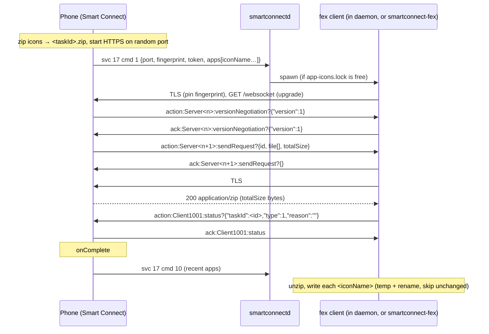

# fex client and app-icon download

## What

- **Recovered the phone's "fex" LAN transfer** (the pull side), which earlier notes had at ~70% and
  assumed to be a Moto binary framing carrying Lenovo Mesh crypto. On a LAN it is much simpler: the
  *sender* runs an HTTPS server (Go `net/http`, TLS 1.3, a fresh self-signed cert per transfer whose
  `SHA-256(DER)` is the advertised `fingerprint`) with three routes: `/websocket` (control),
  `/download?taskId=` (the whole transfer as one zip) and `/downloadFile?taskId=&index=` (the
  library's unzipped "direct" mode). The WebSocket carries text frames
  `(action|ack):<id>:<name>?<json>`; the client acks `versionNegotiation` and `sendRequest`, downloads,
  then sends `status` type 1. Full write-up: `docs/protocol/file-exchange.md` §3.
- **New crate `fex/`** (`smartconnect-fex`, lib `smartconnect_fex` + CLI): `tls` (pinning verifier),
  `frame` (parse/encode + payload types), `http` (minimal HTTP/1.1 GET), `zip` (central-directory
  reader for streaming-mode zips, Store + Deflate, CRC-checked), `client::pull` (the sequence),
  `icons` (svc 17 advert, cache dir, atomic write-if-changed, cross-process lock).
- **Daemon auto-fetch** (`src/app_icons.rs`): every svc 17 `cmd 1` spawns a background pull into
  `~/.cache/smartconnect-linux/app-icons/`. Status gains `phoneAddress`.
- **CLI**: `smartconnect-fex fetch-app-icons [--out] [--phone]` (asks for the list via the control
  socket, then pulls) and `smartconnect-fex pull --host --port --fingerprint [--token] --out`.
- Verified on a device: every app icon on the test phone (158×158 PNGs, one zip) in well under a second; the phone logs
  `onComplete` and then sends svc 17 `cmd 10` (recent apps); a second run writes nothing
  (all unchanged); the daemon skips an offer while the CLI holds the lock.

## How

How it was recovered (no Ghidra needed in the end):

1. Probed the advertised port: no server banner; `openssl s_client` showed TLS 1.3 + ALPN `h2`, a
   `CN=Lenovo` self-signed cert whose SHA-256 equals the advertised `fingerprint`.
2. `curl` against guessed paths: `/download` answered `taskId … does not exist`; `/websocket` 400
   (needs upgrade); `/downloadFile` 403. URL format strings in `libgojni.so`
   (`https://%s:%d/download?taskId=%s&token=%s`, …) and the frame regex
   `(ack|action):(\S+):(versionNegotiation|sendRequest|status|message)…` confirmed the shape.
3. A raw WebSocket client then walked the exchange, while the phone's own `GoLog` `FileTransfer`
   debug lines (read-only `adb logcat`) printed every request it received and the `%#v` of the
   decoded frames, which gave `server.Status{TaskId, Type, Reason}` and showed `/download` ignoring
   `token`. Sending each `status.type` showed 0 → `onProgress`, 1 → `onComplete`, 2/3 → `onFailure`.
4. Offers were triggered at will with svc 17 `cmd 2` through the control socket.

Key code: `fex/src/client.rs` (`pull`), `fex/src/frame.rs`, `fex/src/tls.rs` (`PinnedVerifier`),
`fex/src/zip.rs` (`read_all`), `fex/src/icons.rs` (`AppListAdvert`, `store`, `write_if_changed`,
`FetchLock`), `src/app_icons.rs` (`on_app_list`), hook in `src/server.rs::session_loop`.

Tests: frame known-answer strings (the exact acks/status the client sends), SHA-256 and CRC-32
known answers, fingerprint normalisation, HTTP head/chunked parsing and size cap, streaming-mode zip
(Store and Deflate) built in-test, corruption detection, icon name safety, atomic store with
unchanged-skip, and an in-process mock fex server (rcgen cert, TLS, WebSocket, `/download`) that
checks the exact frame sequence, the pin rejection, the failure `status` (type 2) and the cache
layout. No real tokens, fingerprints or ids anywhere.

## Why

- **The earlier crypto hypothesis was the wrong layer.** X25519/HKDF(`gkhm256v2`)/AEAD/Ed25519 live
  in the Mesh `cloud-broker/filetransfer` package (cloud and P2P-tunnel transfers). The LAN direct
  path is plain TLS; the live exchange proves nothing else is needed. Going live first (cheap,
  minutes per experiment) beat a 20-minute Ghidra pass per function (one attempt failed on the
  procedure-name format and was abandoned).
- **A library crate, not an icon hack:** clipboard images arrive as a service 2 `FileExSendData`
  with the same `port` + `fingerprint` from the same Go send family, so `client::pull` is the piece
  they need. The daemon links the library (no extra process, no binary lookup) and the CLI is a
  thin wrapper for testing and manual refresh.
- **Hand-rolled HTTP/1.1 and zip reader** instead of new heavy dependencies: one GET with
  `Connection: close`, and a central-directory zip reader (~100 lines) that handles the phone's
  streaming-mode archives. Only `miniz_oxide` was added (Deflate entries, in case other transfers
  use them); everything else was already in the lockfile.
- **ALPN `http/1.1` only:** the server prefers `h2`, which can't carry the WebSocket upgrade.
- **Always pull, never skip:** the phone sends its recent-apps list only after `status` type 1,
  and an unclaimed transfer just lingers until its own timeout. A pull is ~1 s on a LAN; writes are
  skipped when bytes are unchanged, so the GTK app's file monitor only fires for real changes.
  `autoDownload` is `false` in every advert yet the Windows PC caches icons too, so it is ignored.
- **Report failure as `status` type 2** so the phone can drop the transfer instead of waiting.
- **Cross-process `flock`** (`$XDG_RUNTIME_DIR/smartconnectd/app-icons.lock`): an offer's
  `sendRequest` is handed out once, so two clients on one offer would race. The CLI takes the lock
  *before* it sends `cmd 2`, so the daemon's handler for that very offer sees it held and backs off.
- **Atomic writes, never delete:** the GTK app watches the directory; temp files are hidden
  (`.<name>.<pid>.part`) and renamed into place. `<pkg>.png` files from the mirror's harvest share
  the directory and must survive, so there is no pruning.
- **`phoneAddress` in status** (the WebSocket peer, canonicalised from IPv4-mapped IPv6) so the CLI
  does not need the user to know the phone's IP.

## Open

- Clipboard images: wire PULL → service 2 advert → `client::pull`; check whether that send uses the
  zip mode or `/downloadFile` (per index), which would need a small client addition.
- Whether `/websocket` restricts the client address was not tested (the `token` is not checked on
  `/download`); documented in `docs/security.md`.
- What the genuine Windows client puts in its `sendRequest` ack and whether it sends `status` type 0
  first is unknown (the phone ignores the ack body and works without type 0). A Windows capture is
  not needed for icons; it would only confirm these details.
