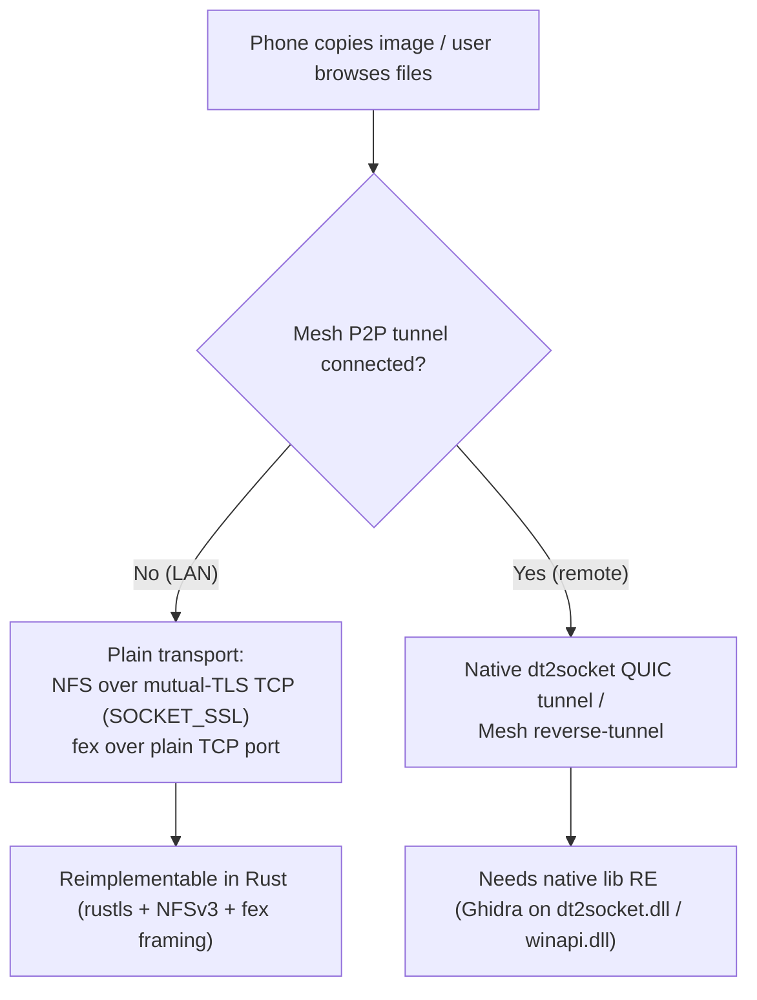

# File access & clipboard images: protocol reverse-engineering

> **Status since:** browsing the phone (`smartconnect-files mount`) is verified on a device, and the
> PC→phone direction (`smartconnect-files serve`) is built on File Station **service 168** with no
> Share Hub step (see [files-mount-resilience.md](files-mount-resilience.md) and
> [pc-to-phone-file-sharing.md](pc-to-phone-file-sharing.md)). "No transport is implemented yet" and
> the svc-30 MOUNT handler plan below are historical.

## What

Investigated how to add **both-way file access** and **image/file clipboard sync** to the daemon.
Neither existed; both were listed as out of scope. Outcome of this pass:

- The three file-moving mechanisms are reverse-engineered and documented in
  [`docs/protocol/file-exchange.md`](../docs/protocol/file-exchange.md) and the new image/file
  section of [`docs/protocol/clipboard.md`](../docs/protocol/clipboard.md).
- The daemon now **recognises** an incoming image/file clipboard clip (service 9 `UPDATE_NOTIFY`
  with a `filelist` and no `text`) and logs it, instead of treating it as unknown — but it does
  **not** fetch the bytes yet and never mistakenly PULLs (`src/clipboard.rs`, `describe_file_clip`).
- No transport is implemented yet; the remaining unknowns and the plan are in
  [`../TODO.md`](../TODO.md).

## How (the mechanisms)

Smart Connect has **three** separate subsystems, not one "file transfer":

1. **Tunnelled NFSv3** (file browsing). The phone runs a genuine NFSv3/MOUNTv3/PORTMAPv2 server
   (`com.lenovo.nfsserver.*`); the PC is the client (roles reverse for PC→phone). Programs
   100000/100005/100003, standard procs 0–21 plus Lenovo custom procs 22–29, a 64-byte zero root
   file handle from `MNT(sharePath)`, dynamic ports carried in a `ServerInfo` advert.
2. **Share Hub control** (service 30 ↔ 168). A small JSON command channel that negotiates which
   directories are exported and returns the NFS mount aliases. `CMD_MOUNT = "5001"`, `ver = "1"`,
   base64(NO_WRAP) paths, strict path-safety validation on the phone.
3. **fex / FileEx** (service 2). The Mesh file-transfer SDK that carries clipboard images,
   drag-and-drop and "send files". The control plane advertises a port + cert fingerprint; the
   bytes are chunked/encrypted by the native lib.

The decisive finding is that **on a LAN both features can avoid the proprietary transport**:

- The NFS data socket has a mode selector `dt2type`. `SOCKET_SSL (2)` is **plain mutual-TLS over
  TCP bound to the phone's LAN IP**, secured by `SHA-256(DER)` fingerprint pinning in pure
  `javax.net.ssl` — reimplementable with rustls, no native code. `SOCKET_DT2 (3)` is the native
  QUIC "DataTunnel20" tunnel (needs the native lib).
- fex, when no Mesh P2P tunnel is connected (the normal LAN case), uses a **plain TCP** port in
  `[50000, 59999]` that the sender advertises — not a WebRTC data channel.

## How (the method)

- Driven the `rea` CLI (v6.7.0) directly over the shell — **JADX** for the phone APK
  (`inspect-android-class` / `inspect-android-method` / `search-android-classes`) and **Ghidra** for
  the Windows binaries (`analyze --snapshot`, `decompile`, `function`, `search`). The MCP wrapper was
  not needed.
- Ran the decompilation as background `Workflow` fan-outs (one agent per subsystem) so the raw
  decompiler output stayed out of the main context; agents returned distilled OBSERVED/INFERRED
  facts.
- Followed the repo RE rules: behaviour described in our own words, placeholders for secrets, every
  fact tagged OBSERVED or INFERRED. Raw evidence stays outside the repo.

## Why (decisions, constraints)

- **Protocol-faithful, no adb/scrcpy at runtime.** The daemon must look like a Windows PC, so we
  reverse-engineer the real wire protocol rather than shelling out. adb/Ghidra are research tools
  only.
- **Documented but not yet built.** Two pieces still need the native binaries or a live capture:
  the **fex byte framing + chunk crypto** (`winapi.dll`), and — if the phone insists on
  `SOCKET_DT2` — the **dt2socket QUIC tunnel**. Shipping a transport that cannot interoperate would
  be worse than shipping nothing, so the daemon only recognises the clip for now.
- **The gating question is resolved (OBSERVED).** The phone's NFS data path defaults to
  `SOCKET_SSL` and the **PC chooses the transport** in the `cmd=1001` handshake (`dt2type` defaults
  to 2, anything but 3 is clamped to 2). So file access needs **no native tunnel** — it is NFSv3 over
  plain mutual-TLS TCP, fingerprint-pinned, implementable in pure Rust. The native QUIC tunnel is
  only used if the PC asks for `dt2type:3`, which this project won't.

## Live bring-up (OBSERVED on the device, 2026-10-21)

Drove the `cmd=1001` handshake through the daemon control socket (`send` service 30 with a
`StationData{ver:"1.0",cmd:1001,data:"<type:0 json>"}`, `watch` service 168) against the connected
phone. Findings:

- **File Station is reachable and the enable precondition is resolved.** Simply being connected and
  sending one `cmd=1001` makes the phone engage File Station — no special serviceVersions/cap needed.
- **The phone replies on service 168 with `cmd=1001`**, confirming the envelope (`StationData` with
  `cmd` as a frame field, handshake JSON double-encoded as a string) exactly as reverse-engineered.
- The phone's frames are **`type:0`** (it is the *client* — it wants to browse the **PC**, asking the
  PC to be the NFS server) and it **repeats ~1/s** waiting for the PC's `type:1` reply. Its payload:
  `{type:0, path:"", port:0, fp:<phone fp>, fp2:<…>, deviceId:…, capability:1, nfs_version:8,
  nfs_dependency:24, dt2type:3}` — note it requests **`dt2type:3`** (native tunnel) and advertises no
  server (`path:""`, `port:0`).
- **Our `type:0` (PC wants to browse the phone) got no `type:1` reply.** Leading hypothesis: the
  phone's `startNfsServer` can't start (so `serverHandleClientHandShake` returns without replying) —
  most likely Smart Connect lacks **"All files access"** (`MANAGE_EXTERNAL_STORAGE`) on the phone, or
  another precondition in `serverHandleClientHandShake`. Could not confirm: wireless adb dropped
  mid-test. Next: grant the permission + re-enable adb, then retry; if still silent, decompile
  `serverHandleClientHandShake`'s reply conditions.
- **Two directions are now visible:** (a) PC-browses-phone (FUSE mount) needs the phone to serve — the
  blocked path above; (b) phone-browses-PC — the phone is *actively asking* for it, so replying
  `type:1` with a PC NFS server (`nfsserve` + rustls) would mount the PC on the phone. The daemon
  relay must send with `srcServiceId:168 / serviceId:30` (the generic `send` sets them equal).

## Status / next

- Done: protocol docs (incl. the `cmd=1001` handshake + the SSL verdict), service-table updates,
  clipboard clip recognition (+ tests), TODO backlog.
- **File access — WORKING end to end, verified on the device.** `smartconnect-files mount
  --mountpoint DIR` mounts the phone's `/sdcard` as a read-only FUSE filesystem: it handshakes with
  the phone through the daemon control socket (`cmd=1001` on **serviceId 168** — the live capture
  corrected the earlier "service 30" inference; 30 is Share Hub, 168 is File Station), opens an
  NFSv3-over-mutual-TLS connection (fingerprint-pinned both ways), and serves `fuser` callbacks from
  the NFS client. Directory listing, navigation and file reads all work against the real phone, in
  pure Rust, no proprietary tunnel. The one TLS wrinkle: the phone's self-signed cert is X.509 v1,
  which webpki rejects, so the handshake signature is verified against the (pinned) cert's public key
  extracted with `x509-parser` + `ring`, bypassing webpki's version check (`tls.rs::verify_signature`).
  Remaining: write-back (NFS write path + the `nfs_dependency` bit-16 data channel), the PC→phone
  direction (phone mounts the PC — an `nfsserve` server; the phone actively requests this via its own
  `type:0`), unmount-on-signal, a stable default mountpoint, daemon-managed lifecycle, and GUI.

### Older progress (foundation)

Foundation done and tested:
  self-signed cert + uppercase-hex SHA-256 fingerprint (`cert.rs`); a fingerprint-pinning mutual-TLS
  rustls config + an `nfs3_client` custom `Connector` over `tokio-rustls` (`tls.rs`); and an NFS
  path that mounts the phone's export and lists the root (`nfs.rs`), exposed as
  `smartconnect-files list --ip … --mount-port … --nfs-port … --fp …`. Crates: `nfs3_client` 0.9 (its
  builder takes explicit mount/nfs ports, so no portmap, and `connect_from_privileged_port(false)`
  avoids needing root), `tokio-rustls` 0.26 + `rustls` 0.23 (ring), `rcgen` 0.14, `fuser` planned.
  Still to do: the daemon `cmd=1001` handshake relay (sends `{type:0,dt2type:2,fp}` over the phone WS,
  returns `{ip,mount_port,nfs_port,phone_fp,path}` — needs the exact WS service/envelope, being
  decompiled now); then the FUSE layer (`fuser` → `nfs3_client`); then the PC→phone server side
  (`nfsserve` + the Share Hub svc-30 MOUNT handler). First real test: drive `list` against the phone
  once the daemon relay lands.
- *(Superseded 2026-10-21 by [fex-app-icons.md](fex-app-icons.md): the LAN fex path is plain TLS +
  a WebSocket of text frames + a zip download; the crypto below is the cloud path.)*
  **Clipboard images — fex RE ~70% done, a real crypto build.** On a LAN the phone advertises a plain
  TCP port + fingerprint (service 2, `FileExSendData`); over it runs a Moto text-framed transport
  (`VersionNegotiation/SendRequest/Message/Status`) carrying the Lenovo Mesh crypto: per-transfer
  **X25519 ECDH → HKDF(info `gkhm256v2`) → ChaCha20-Poly1305** (an AES-256 path also exists),
  per-chunk SHA-256 + **Ed25519** signatures on the offer and each chunk. Still pinning from the
  winapi.dll pseudo-code: TCP-vs-TLS + frame magic, the AEAD/nonce, HKDF salt/IKM + where the X25519
  pubkeys ride, and the signed byte ranges. This is materially harder than file access, so it is the
  second feature.
