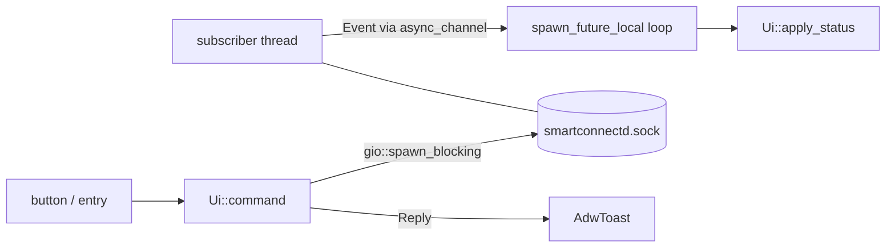

# GTK4/libadwaita front-end (`smartconnect-gui`)

> **Layout note:** the window was re-laid-out to a shared design — see
> [gtk-ui-redesign.md](gtk-ui-redesign.md). Pairing and the Start-at-login/Connect controls now live
> in a header **device menu** and a Pair dialog, not in tabs. The backend, control-socket client and
> all the wiring described below are unchanged.

## What
A standalone desktop app for `smartconnectd`: Phone (wallpaper, status rows, Connect/Disconnect,
Mirror screen), Apps (stream single phone apps into their own windows), Notifications (recent phone notifications with inline replies) and Pair (fresh
pairing QR). Shows an `AdwStatusPage` while the daemon is down and reconnects automatically.

## How
- `src/daemon.rs` — socket client. A dedicated thread runs `subscribe`, parses each JSON line into
  `Status` and sends `Event::Status`/`Event::Down` over an `async_channel`; on EOF/error it sleeps
  2 s and re-dials (the daemon recreates the socket on restart). One-shot commands open their own
  connection inside `gio::spawn_blocking`.
- `src/window.rs` — `Ui` (in an `Rc`) owns all widgets plus a `RefCell<State>`. A
  `glib::spawn_future_local` loop drains events on the main thread. Notification rows are kept in
  a `HashMap<key, NotifRow>` and diffed/re-ordered instead of rebuilt.
- `src/apps.rs` — `AppsPage` (own `Rc`, owned by `Ui`). App list = cached
  `~/.cache/smartconnect/apps.json` at startup, then `smartconnect-mirror --list-apps --json` on first
  view while connected (or Refresh/Load). Searchable `boxed-list` (rows hidden via `set_visible`
  against a lowercase `name pkg` haystack); icon = themed icon guessed from name/pkg
  (`IconTheme::has_icon`), else `application-x-executable-symbolic`. Launch / sessions / close
  speak JSON lines straight to the host socket `$XDG_RUNTIME_DIR/smartconnect-mirror.sock`;
  `ensure_host()` spawns `smartconnect-mirror --host` detached (`process_group(0)`, log in
  `~/.cache/smartconnect/mirror-host.log`, reaped by a thread) and waits ≤8 s for the socket.
  Sessions are polled every 3 s (+0.7/2.5 s after an action) and shown in a "Running" group with
  Close buttons.
- Mirror button: goes through the host too (`{"cmd":"mirror"}`), shows "Stop Mirroring" while the
  host has a `pkg=="mirror"` session (Stop = `close` that session). Only if the host can't start is
  the old standalone viewer child used. Previously a viewer spawned with a host running handed off
  and exited at once, so the button flipped back as if mirroring had stopped.
- `src/mirror.rs` — spawns `smartconnect-mirror` (override, next to the app, else `$PATH`), stops it with
  SIGINT, and a 500 ms `timeout_add_local` reaps it to reset the button.

## Why
- Blocking std `UnixStream` on threads keeps the crate free of tokio; gio's blocking pool and an
  async channel are the idiomatic ways to marshal back to GTK.
- Rows are diffed by notification key so a half-typed reply survives the frequent status pushes
  (battery/signal changes re-send the whole status).
- The host control socket is used directly instead of parsing `--sessions`/`--app` stdout: one JSON
  reply per request, no process spawn per 3 s poll. Only `--list-apps` needs the CLI (it talks to the
  daemon's svc 17 watch); `--json` was added to `mirror/src/main.rs` for that.
- The host is detached from the GUI so open app windows survive closing the GUI; racing with the
  daemon's own auto-start is harmless (the second host bails, the socket check succeeds).
- Wallpaper is loaded via a fresh `gdk::Texture` whenever the `?md5` suffix changes, because the
  daemon rewrites the same file path.

## Display page, preferences, mute toggles, adaptive switcher (2026-10-21)

- `src/display.rs` (`DisplayPage`, owned by `Ui` like `AppsPage`): phone-as-display controls
  (Extend/Duplicate, resolution, scale, keyboard height, experimental audio/rotation, output
  override, setup hints, Start/Stop/Apply). It runs `smartconnect-display` detached and follows it
  through `/proc` and a shared log. The session keeps running when the window closes (unlike the
  mirror viewer and Cross Control, which `shutdown()` still stops). Design and tests:
  [display-frontend-ui.md](display-frontend-ui.md).
- `src/prefs.rs`: the app's first preferences file, `~/.config/smartconnect-linux/gui.json`, plus
  the display.json contract shared with the helper and the Noctalia plugin. It is a JSON file rather
  than GSettings because a cargo-built binary has no installed schema.
- `mirror::binary()` honours `$SMARTCONNECT_<NAME>_BIN` (e.g. `SMARTCONNECT_DISPLAY_BIN`), then
  looks next to `smartconnect-gui`, then `$PATH`: the same order smartconnectd uses for its helpers
  ([packaging-and-workspace.md](packaging-and-workspace.md)).
- Notifications page: one scrolled column (*Muted apps* expander, empty state, list) instead of a
  stack, so the muted list is reachable in both states. Each row has a mute toggle; see
  [notification-mute-ui.md](notification-mute-ui.md).
- The header `ViewSwitcher` ellipsized five page names at the default 560 px width. An
  `adw::Breakpoint` (max-width 700sp) clears the header's title widget and reveals an
  `AdwViewSwitcherBar` at the bottom; `show_switcher()` hides both while the daemon is down.
