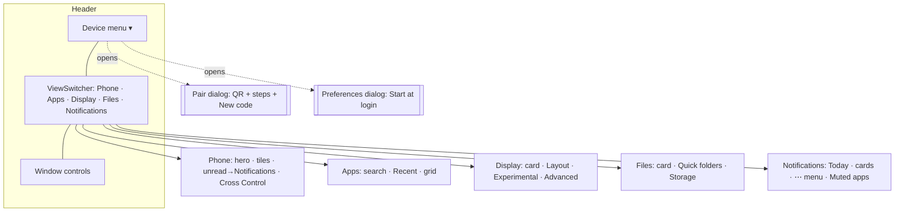

# GTK app: layout restructure to the shared design (2026-10-21)

## What
The `smartconnect-gui` window was re-laid-out to match a shared design mockup. This is a **layout /
navigation** change only — every backend action, socket call, helper process and preference is the
same as before. Colours are untouched: the app uses plain libadwaita widgets and style classes, so
it inherits the user's light/dark theme and accent (no custom colour CSS, no forced theme).

Summary of the new shape:

- **Header:** a **device menu** `MenuButton` on the left (a status dot + device name + a popover
  with *the current device* (name + "Wi-Fi · N%" + a check), *Pair new phone…*, *Preferences*,
  *Connect/Disconnect*). Centre: the existing adaptive `AdwViewSwitcher` / `AdwViewSwitcherBar`, now
  with exactly five views — **Phone · Apps · Display · Files · Notifications** (Pair and the
  Start-at-login/Connect controls moved out of the pages). Right: the normal window controls. The
  Notifications switcher button carries the unread badge (`ViewStackPage::set_badge_number` +
  `needs_attention`, unchanged).
- **Phone:** a compact phone card (a 68×144 wallpaper thumbnail + name + state line + an inline
  row of symbolic-icon stats: battery %, Wi-Fi, mobile, Bluetooth, full text in tooltips + the
  action button), a one-line unread shortcut that switches to the Notifications view, and the Cross
  Control group (switch row + edge `ComboRow`). See *Connection states* below.
- **Apps:** search (`Search N apps`) + **Refresh**, a *Recent* chip row (remembered in `gui.json`),
  and an **All apps** `FlowBox` icon grid (icon + name, package id in the tooltip). The *Running*
  sessions group is kept (it drives the mirror button and app-window close) and auto-hides when empty.
- **Display:** a phone-as-display hero card (state line + **Start/Stop**/**Apply**) over three
  `AdwPreferencesGroup`s — **Layout** (mode `AdwToggleGroup`, resolution, custom W/H, scale, OSK
  height), **Experimental** (audio, rotate), and **Advanced** (the output `ComboRow`). All the
  session/log/flags logic is untouched.
- **Files:** a storage card ("Phone storage mounted" + path + *Read-only* badge + **Unmount** /
  **Open in Files**, or **Mount** when unmounted), a **Quick folders** row (Camera/Screenshots/
  Downloads/Documents, best-effort, hidden when absent), and a **Storage** group (Mount location +
  **Change…** folder chooser, and a *Mount automatically when connected* switch). Mount/unmount/open
  + quit-unmount lifecycle unchanged.
- **Notifications:** a *Today* header with **Clear all**, cards with the app icon, sender, app name,
  message, inline reply, and a **⋯** menu (*Open on phone* / *Dismiss* / *Mute app*). The *Muted
  apps* expander with per-app **Unmute** is kept.
- **Pair:** an `AdwDialog` opened from the device menu — QR + numbered steps + a "Waiting for
  phone…" status + **New code**. Reuses the old Pair-page QR request/refresh logic verbatim.

## How
- `gui/src/window.rs` was rewritten around the new `Ui` layout: a `DeviceMenu` struct (button +
  popover + its labels/check/connect button), a new `PhonePage` (hero + tiles + unread + cross),
  a regrouped `NotifPage` (`today` header + `clear_all` + list + muted expander), and a `PairDialog`
  struct. The ViewStack no longer has a *Pair* page. `refresh_phone()` now also fills the device
  menu; `refresh_notifications()` filters a per-key **dismissed** set (local *Dismiss* / *Clear all*,
  pruned when the phone stops reporting a key); `notification_row()` builds the ⋯ menu and wires
  *Open on phone* (`daemon::notif_open_line`), *Dismiss* (local) and *Mute* (existing `set_app_muted`).
  Preferences is a freshly built `AdwPreferencesDialog` (Start-at-login switch) so it always reflects
  the autostart file on disk.
- `gui/src/apps.rs` — the list `ListBox` became a `FlowBox` icon grid; added a *Recent* chip row,
  persisted via a new `AppsPrefs::recent` in `gui.json`. `pub fn icon_for(pkg, name)` exposes the
  existing themed-icon guess to the notification rows. Fetch/launch/host/sessions logic unchanged.
- `gui/src/display.rs` — only `build()` changed: the single *Settings* group became the hero card +
  **Layout** / **Experimental** / **Advanced** groups. All `Opts`/log/`/proc`/flags code and its
  tests are untouched.
- `gui/src/files.rs` — reworked `build()`/`refresh()` into the storage card + quick folders + storage
  settings; added `auto_mount` wiring (mount on the connect transition) and a folder chooser
  (`gtk::FileDialog`) in place of the old `EntryRow`. Mount/unmount/watch/shutdown kept verbatim.
- `gui/src/prefs.rs` — added `FilesPrefs::auto_mount` and `AppsPrefs { recent }` (both serde-default,
  so old `gui.json` files still load). `gui/src/daemon.rs` — added `notif_open_line()`.
- `gui/src/main.rs` — structural CSS only (`.sc-card`, `.sc-tile`, `.sc-chip`, `.sc-status-tile`,
  `.sc-badge`, `.sc-notif` — padding/radius). The lone colour is the QR's white backdrop, which is
  functional (a QR must scan under any theme), carried over from before.

## Why
- **Device menu over per-page controls:** pairing, Connect/Disconnect and the app preference were
  scattered across the Phone and Pair pages; the mockup consolidates them into one header menu, which
  also frees the switcher to five content pages. The menu is a `MenuButton` + a hand-built
  `GtkPopover` (not a `GMenu`) because the top entry needs a live, styled device row (name +
  "Wi-Fi · N%" + a check), which a model-based menu can't render.
- **Theme-native only:** the mockup renders dark+orange, but hard-coding that would fight the user's
  theme. Using `.card`, `.dim-label`, `.accent`, `.success`, `.error`, `.suggested-action`,
  `.destructive-action` and friends means the arrangement matches the mockup while the colours come
  from Adwaita + the user's accent. The status dot is a symbolic icon recoloured by `.success` /
  `.dim-label`; the Read-only badge is a `.card` label; no colour literals anywhere but the QR.
- **Keep the Running group / local Dismiss:** the mockup's Apps page doesn't show running sessions,
  but closing app windows and the Phone page's Stop-mirroring both depend on that list, so it is kept
  (auto-hidden when empty). There is no phone-side "dismiss notification" command, so **Dismiss** and
  **Clear all** clear only this PC's list (a key is un-dismissed if the phone re-reports it). *Open on
  phone* reuses the daemon's `send` path (notification event 2), the same click the daemon forwards.
- **Fallbacks:** the pinned libadwaita (`v1_7`, system 1.10) has every widget used — `AdwToggleGroup`
  (already used), `AdwDialog`, `AdwPreferencesDialog`, `AdwBanner`. No fallback was needed.

## Responsive width (wide / maximized windows)

The first cut clamped every page to a narrow column, so a maximized (~1920 px) window showed a thin
centred strip with big empty margins. Fixed so content fills the width and still collapses to the
single-column mockup when narrow:

- **Clamps widened**: Phone / Display / Files / Notifications → **1400**, Apps → **1700** (was 560
  everywhere). Each `AdwClamp` sets `tightening_threshold == maximum_size`, so the content fills the
  width up to the cap (like CSS `max-width`) instead of AdwClamp's default halving of growth past the
  threshold (which would have left the content at ~1280 px on a 1920 px screen).
- **Apps grid fills the width:** the All-apps `FlowBox` is `hexpand`, `max_children_per_line` raised
  3→**24**, so columns are added as the window widens (≈6/8/10+ when maximized). Recent chips
  `max_children_per_line` 6→**12**. The search bar is wrapped in its own `AdwClamp(760)` so it stays a
  sensible width while the grid below fills.
- **Two-column sections on wide windows** via a reflowing `GtkFlowBox` (`homogeneous`,
  `min_children_per_line: 1`, `max_children_per_line: 2`, each child `width_request: 360`):
  **Display** lays Layout / Experimental / Advanced two-up. (The Phone page briefly put the hero
  beside separate status tiles; the homogeneous row stretched the tiles into tall empty cards, so the
  tiles were folded into the card — see below.) Below ~740 px of inner
  width each collapses to one column, so the narrow layout (and the bottom switcher bar at the existing
  640sp `AdwBreakpoint`) is unchanged.
- **Files** stays single-column (its quick-folder group can be hidden, which would strand a half-width
  sibling in a two-column row) but fills the wider clamp and shows up to 6 quick-folder shortcuts per
  row. **Notifications** fills the wider clamp as a single list (readable line length).

No breakpoint plumbing into the sub-page structs was needed: the reflow comes from the FlowBoxes'
min/max-children-per-line plus a per-child `width_request`, which is self-contained per page.

## Connection states and the last device

User feedback on the first cut: a disconnected phone showed as a generic "Phone / Disconnected" with
an unusable **Mirror screen**, "—"/"Off" tiles and no way to connect; and the four big status tiles
were empty cards that said little. Now:

| State | Phone card | Device menu |
|---|---|---|
| Connected | live name/model, wallpaper, inline stats, **Mirror screen** | green (`.success`) dot, "Wi-Fi · N%", check, Disconnect |
| Paired, away | last name/model, dimmed wallpaper + stats (tooltips say *Last known*), "Disconnected · last connected 5 min ago", **Connect** (spinner + *Connecting…*; failure toast "Couldn't connect: <daemon reason>"); Cross Control visible but insensitive | grey (`.dim-label`) dot, last name, "Disconnected · last connected …", Connect |
| Not paired | "No phone paired", **Pair a phone** (opens the Pair dialog); no stats, no Cross Control | "No phone paired", Pair new phone… |
| Service down | root page "Smart Connect service isn't running" with the last phone's card and **Start service** | last name, grey dot, "Start service" (Pair disabled) |

- **Why a GUI cache:** the daemon keeps name/battery/wallpaper only for its own lifetime (it just
  flips `connected` on a disconnect) and its wallpaper lives in `$XDG_RUNTIME_DIR`. After a daemon
  restart or a logout those are gone, so `gui/src/lastdevice.rs` keeps
  `$XDG_STATE_HOME/smartconnect-linux/last-device.json` + `last-wallpaper.<ext>` (state, not
  preferences, so not in `gui.json`). `Ui::remember_device()` absorbs every connected status,
  copies the wallpaper when the daemon's value (`path?md5`) changes, saves when a field changes or
  every 5 min while connected, and stamps `lastConnected` on a disconnect, a daemon drop, and Quit.
  While away, the card falls back field-by-field to the cache (the daemon's name/wallpaper first, if
  it still has them).
- **Start service** runs the same `Daemon::ensure_running()` as opening the app, on a worker thread;
  if it launched something the window shows the *Starting…* spinner (`begin_starting`), if the socket
  is already alive the subscriber picks it up, otherwise a toast says it could not be started.
- **Compact card:** a `GtkPicture`'s natural size is the image's own size, so the thumbnail is two
  nested `AdwClamp`s (horizontal 68, vertical 144) around the picture — the card no longer grows with
  the wallpaper. The stats row is a small `FlowBox` so it wraps on a narrow window. Nothing on the page
  `vexpand`s; the unread row and Cross Control sit right under the card.
- Icons are Adwaita symbolics (`battery-level-N[-charging]-symbolic`, `battery-level-100-charged-symbolic`,
  `network-wireless-signal-*`, `network-cellular-signal-*`, `bluetooth-active/disabled`), checked
  present in the installed theme. Dimming is a structural `.sc-dimmed { opacity }` class — no colour.

## TODOs / follow-ups
- App icons: done in [gui-app-icons.md](gui-app-icons.md) (cached phone icons, exact desktop matches,
  else initials); the fex icon download that fills the cache is separate work.
- The Pair dialog shows a static "Waiting for phone…" (with a spinner) — there is no QR-expiry
  countdown because the daemon doesn't report one.
- Notifications have no timestamp on the wire, so the day grouping is a single *Today* header and the
  card shows the app name instead of "app · time".
- Auto-mount fires on the connect transition; a manual **Unmount** suppresses it until the next
  connect. (Changing the mount folder while auto-mount is on is not re-mounted automatically.)
