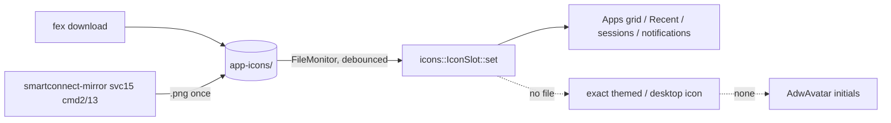

# GTK app: phone app icons (resolver + harvest)

## What
The *Apps* grid showed the generic `application-x-executable-symbolic` glyph for almost every app,
and a few got a **wrong** desktop icon (e.g. two unrelated apps got a browser's icon, two different
apps shared one) because the theme lookup guessed from package segments. Now:

- One resolver, `gui/src/icons.rs`, used by the Apps grid, the Recent chips, the running-stream rows
  and the notification rows. Order: `<cache>/<iconName>` → `<cache>/<pkg>.png` → an **exact**
  desktop icon (the package as a themed icon name, or an installed app whose name / desktop id equals
  the app's name, case-insensitive) → an `AdwAvatar` with the name's initials.
- `smartconnect-mirror` now **harvests** the base64 PNG the phone already sends in svc 15 `cmd 2`
  (stream invite) and `cmd 13` (focus change) into `<cache>/<pkg>.png` (`mirror/src/icons.rs`).
- `smartconnect-mirror --list-apps --json` keeps `iconName` (it already kept `cmp`/`userId`); the
  GUI's `App` deserializes `userId`/`iconName`.

Cache dir (contract shared with the fex icon download being built separately; don't change it):
`$XDG_CACHE_HOME/smartconnect-linux/app-icons/`, files named exactly the phone's `iconName`
(`<pkg>_<cmp>.png`, `<userId>_` prefix for another user; lite builds `<pkg>.png`).

## How
- `icons::Query { pkg, name, cmp, user_id, icon_name }` + `Query::icon_file()` (the sent `iconName`,
  else computed from pkg/cmp/userId; path components from the phone are rejected if they contain
  `/` or start with `.`). `icons::choose(dir, q, exists, themed, desktop)` is the pure order (tested
  with closures); `IconSlot` (a `GtkStack` of a `GtkImage` and an `AdwAvatar`) applies it.
- PNGs are decoded with `gdk::Texture::from_filename` inside `gio::spawn_blocking` (`gdk::Texture` is
  `Send + Sync`), cached per path + mtime in a thread-local map, so 150 tiles don't stall the main
  loop and a re-downloaded icon reloads. Until a file is decoded the slot shows initials; a stale
  load for a re-pointed slot is ignored (`want`).
- The installed-applications index (`gio::AppInfo::all()`, lowercase name and desktop id → `GIcon`)
  is built lazily on the main thread and dropped by `icons::rescan()`.
- `AppsPage` keeps a `gio::FileMonitor` on the cache dir; changes trigger a debounced (700 ms)
  `refresh_icons()`. A Refresh that returns the same list also re-resolves. `AppsPage::icon_query(pkg,
  name)` enriches a bare package with `cmp`/`userId`/`iconName` from the list (owner entry first) for
  the notification rows.
- Harvest (`mirror/src/icons.rs::harvest_into`): skip if `<pkg>.png` exists (checked before decoding,
  so repeated `cmd 13`s are cheap); accept only `[A-Za-z0-9._-]` package names not starting with `.`;
  accept a `data:` URL prefix; require the PNG magic; write `.<pkg>.png.<pid>.tmp` then rename. Uses the
  workspace's existing `base64` crate.

## Why
- **Exact matches only:** a wrong icon is worse than initials; the old candidates (package's second
  and last segments, name variants) matched common words. Initials via `AdwAvatar` keep colours
  theme-native and distinguish apps by name.
- **Per-path + mtime cache** rather than per-app: several widgets show the same file, and the fex
  download may replace a file in place.
- **Harvest only when absent:** the `iconName` file (from fex) is preferred anyway, and not rewriting
  avoids churn on every focus change.

## Not done / follow-ups
- Notification rows re-resolve their icon only when the notification changes, not on cache-dir
  events; running-stream rows only when the session list changes.
- The fex icon download itself is the other agent's work; until it lands, only streamed apps (harvest)
  and exact desktop matches have real icons.
