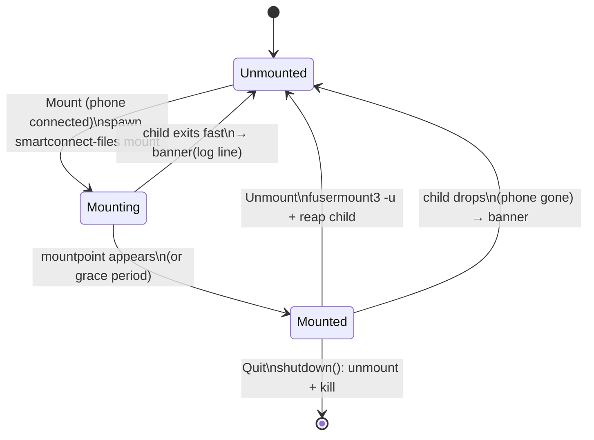

# GTK app: Files page (mount the phone's storage)

> **Superseded (labels):** the redesign in [gtk-ui-redesign.md](gtk-ui-redesign.md) renamed the
> buttons to **Mount** and **Open in Files**; "Mount Phone Storage" / "Open Folder" below are the
> original labels.

> **Update (2026-10-21):** liveness probing, stale-mount clean-up, remount-then-open and the helper's reconnect/signal handling are in [files-mount-resilience.md](files-mount-resilience.md); where this note says the GTK Files page decides "mounted" from the process or `mountpoint`, that is superseded.

## What

A **Files** page in the GTK app (`gui/`) that mounts the phone's storage as a read-only FUSE
filesystem through the existing `smartconnect-files` helper, so the user never needs a terminal:

- **Mount Phone Storage** — creates the mount folder (default `~/Phone`), spawns
  `smartconnect-files mount --mountpoint DIR` as a tracked background child, and shows *Mounting…*.
- Once mounted — **Open Folder** (launches the file manager on the folder) and **Unmount**
  (`fusermount3 -u DIR`, then reaps the child).
- Errors (phone not connected, handshake failure, a mount that drops later) are read from the
  helper's log and shown in an `adw::Banner`, returning the page to the unmounted state.
- The Mount button is disabled until the phone is connected (driven by the daemon status).
- The mount folder is configurable (an `adw::EntryRow`), remembered in `gui.json` under `files`.

**Lifecycle:** closing the window to the tray keeps the mount running; **Quit** unmounts it and kills
the child first, so no stale FUSE mount is left behind.

## How

New module `gui/src/files.rs` (`FilesPage`), built and wired exactly like the Apps/Display pages:

- `FilesPage::build(&toasts) -> (Rc<Self>, gtk::Widget)`, added to the `adw::ViewStack` in
  `window.rs` between Display and Notifications (`folder-symbolic` icon). The narrow-window
  breakpoint already moves the switcher to the bottom bar; it now covers six pages.
- `window.rs` calls `files.set_connected(..)` from `apply_status` / `set_down` (same as the other
  pages), and `window::Ui::shutdown` (the Quit path, and `app.connect_shutdown`) calls
  `files.shutdown()` after stopping the mirror/cross helpers.
- Helper lookup reuses `crate::mirror::binary` (`$SMARTCONNECT_FILES_BIN`, then next to the running
  executable, then `PATH`) — nothing is hard-coded.
- Mount child output goes to `$XDG_RUNTIME_DIR/smartconnect-files.log` (same convention as the
  Display page's log), not a pipe, so the long-running `tracing` output can't fill a pipe buffer and
  stall the child; on failure the page shows the last non-empty log line.
- A `glib::timeout_add_local` poll (500 ms, like the mirror/cross watchers) promotes
  Mounting → Mounted once the folder is a mount point (device-id differs from its parent) or a short
  grace period passes, and catches the child exiting.
- Prefs: `FilesPrefs { mount_dir }` added to `prefs.rs`; `mount_path()` expands a leading `~/`,
  blank → `~/Phone`. Saving loads fresh prefs then writes, so it can't clobber the Display page's
  `display.json`.

## Why

- **A tracked foreground child + log file, not a pipe.** `smartconnect-files mount` blocks until the
  mount is released and keeps logging via `tracing` to stderr; piping stderr risks filling the buffer
  and stalling the mount, so output goes to a log file and the quick-exit error is read from its
  tail. This mirrors how the Display page runs its helper.
- **Mount-point detection by device id**, with a time-based grace fallback, so the UI reflects the
  real state without parsing `/proc/mounts`, and still settles if detection is flaky.
- **Unmount off the main thread** (`gio::spawn_blocking` for `fusermount3 -u`), because a busy mount
  can make `fusermount3` wait; the watch timer steps aside while `busy` so it doesn't race the reap.
- **Quit unmounts, close-to-tray does not:** a mount is a resource the user expects to persist while
  the app runs (like a Display session), but a stale FUSE mount after the process is gone is a
  broken folder, so `shutdown()` tears it down synchronously (`fusermount3 -u` then SIGTERM).
- **Separate module** rather than extending `mirror.rs`'s `Mirror`: the mount needs mount-point
  detection, stderr-as-error, `fusermount3` teardown and its own UI, none of which the SIGINT-based
  Mirror helper has.

## Testing

- `cargo build --release -p smartconnect-gui` — warning-free; `cargo test --release -p
  smartconnect-gui` green (added `files_mount_path_defaults_and_expands`).
- Offline quick-exit path verified without a phone: `smartconnect-files mount --mountpoint <tmp>
  --ip 127.0.0.1 --mount-port 1 --nfs-port 1 --fp deadbeef` exits 1 within ~1 s, logs
  `Connection refused`, and leaves no mount point — exactly what the page's failure path reads.
- Not exercised: the successful mount / Open / Unmount flow from the GUI (needs a connected phone;
  mounting against the real phone was out of scope).
