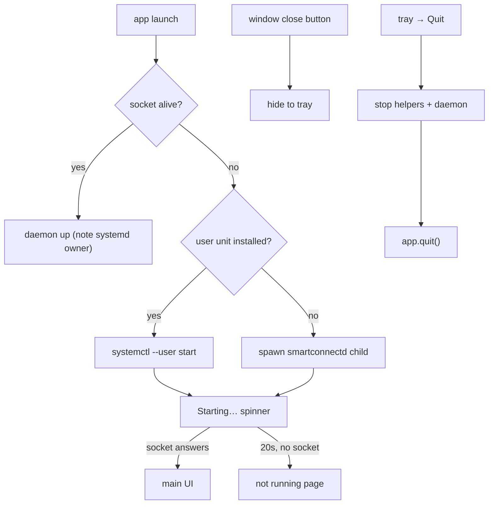

# GUI tray, daemon lifecycle and autostart

## What

Four related additions to the GTK app (`gui/`):

1. **System-tray item** (freedesktop/KDE StatusNotifierItem) whose icon reflects the connection
   state (daemon-down / starting / disconnected / connected). Its menu has Show/Hide Window,
   Connect, Disconnect and Quit; a left click toggles the window.
2. **Closing the window only hides it** to the tray. **Quit** (from the tray menu) is the only exit,
   and it also stops the daemon.
3. **Opening the app starts the daemon** if it isn't already running, showing a "Starting…" spinner
   until the control socket answers.
4. **"Start at login"** switch on the Phone page that adds/removes the XDG autostart entry
   `~/.config/autostart/dev.smartconnect.Linux.desktop` (`Exec=smartconnect-gui --background`), plus
   the `--background` flag that brings the app up hidden to the tray.

## How

New modules:

- `gui/src/tray.rs` — the `ksni` StatusNotifierItem. ksni runs the tray on its own thread (its
  `blocking` feature), so menu clicks and the left-click `activate` can't touch GTK directly; they
  drop a `tray::Command` (`ToggleWindow` / `Connect` / `Disconnect` / `Quit`) into an
  `async_channel`. The GTK side updates the icon/tooltip/menu through the ksni `Handle`
  (`Tray::set(state, window_visible)`). `Tray::spawn()` returns `None` if the desktop has no
  StatusNotifierHost, so the app still runs without a tray.
- `gui/src/lifecycle.rs` — daemon start/stop and the autostart entry. `socket_alive()` dials
  `$XDG_RUNTIME_DIR/smartconnectd.sock` (a stale socket file with no listener is refused, so no
  false positive). `Daemon::ensure_running()` returns a manager plus whether it launched the daemon:
  if the socket is dead it prefers the installed `systemctl --user` unit, else spawns `smartconnectd`
  as a child (binary found by `crate::mirror::binary("smartconnectd")`, i.e.
  `$SMARTCONNECT_SMARTCONNECTD_BIN` → next to the running exe → `PATH`). `Daemon::stop()` stops only
  what we started — our child (SIGTERM, short wait, then SIGKILL) or the systemd unit
  (`systemctl --user stop`).

Wiring in `gui/src/window.rs`:

- `Ui::start()` (called once after `Ui::new`) runs `Daemon::ensure_running()`, spawns the tray,
  subscribes to daemon status, and if it just launched the daemon calls `begin_starting()`.
- `connect_close_request` hides the window and returns `Propagation::Stop`.
- `listen_tray()` drains tray commands on the main loop. `quit()` stops helpers + daemon, then
  `app.quit()`. `tray_connect()` only acts when it would change state. `Ui::shutdown()` (run by both
  `quit()` and `app.connect_shutdown`) also unmounts the phone-storage mount, if any
  (`files.shutdown()`) — see [gui-files-page.md](gui-files-page.md).
- A `starting` flag in `State`: `begin_starting()` shows the spinner page with a
  "Starting smartconnectd…" label and arms a 20s fallback timeout; `set_down()` keeps the spinner
  while `starting` instead of flashing the "not running" page; `apply_status()` clears it. The tray
  icon follows the same state via `tray_state()` / `refresh_tray()`.
- "Start at login" `adw::SwitchRow` on the Phone page, initialised from `autostart_enabled()` before
  its handler is connected, writes/removes the entry via `lifecycle::set_autostart()`.

In `gui/src/main.rs`: `--background` is stripped from argv (so GApplication never sees it) and the
rest is forwarded via `run_with_args`. Only the first activation honours `--background` (stays
hidden); any later launch presents the window, as does a normal launch.

## Why

- **ksni `blocking` feature, not the default tokio API.** The app has a glib main loop, not a tokio
  runtime. The blocking API spawns ksni's own thread and uses a lazily-created current-thread tokio
  runtime internally, so no runtime plumbing leaks into the GTK code. Menu callbacks hand work back
  to the main loop through an `async_channel` (the same pattern `daemon.rs` already uses for status),
  which keeps all GTK access on the main thread.
- **Reuse `mirror::binary()` for the daemon lookup.** The project's convention is
  `$SMARTCONNECT_<NAME>_BIN` → next to the exe → `PATH`; for `smartconnectd` that env var is
  `SMARTCONNECT_SMARTCONNECTD_BIN`, exactly what the helper lookup produces, so no new convention.
- **Stop only what we started.** Killing a daemon a user launched by hand in a terminal would be
  surprising; the manager records whether it spawned a child or started the unit and stops just that.
  A hand-started daemon is left running on Quit (documented).
- **Strip `--background` before GApplication sees it.** A bare `adw::Application` rejects unknown
  options; stripping the flag and forwarding the rest avoids adding a full GOption command-line
  handler for one boolean. The single-instance behaviour is kept (a second launch raises the window).
- **Hide, don't quit, on window close.** A phone companion is a background tool; the tray is its home
  and the window is incidental. Making Quit the only exit (and the thing that stops the daemon)
  matches that.

## Tested

`gui/src/lifecycle.rs` unit tests (no real daemon, no `systemctl stop`): socket liveness needs a
real listener; the autostart entry round-trips in a temp dir and carries `Exec=… --background`; the
daemon binary resolves to `SMARTCONNECT_SMARTCONNECTD_BIN`; `Daemon::stop()` terminates a spawned
stand-in child (`sleep`). The tray and window behaviour were verified by building warning-free and by
code review (running the GUI needs a Wayland session and a StatusNotifierHost).
