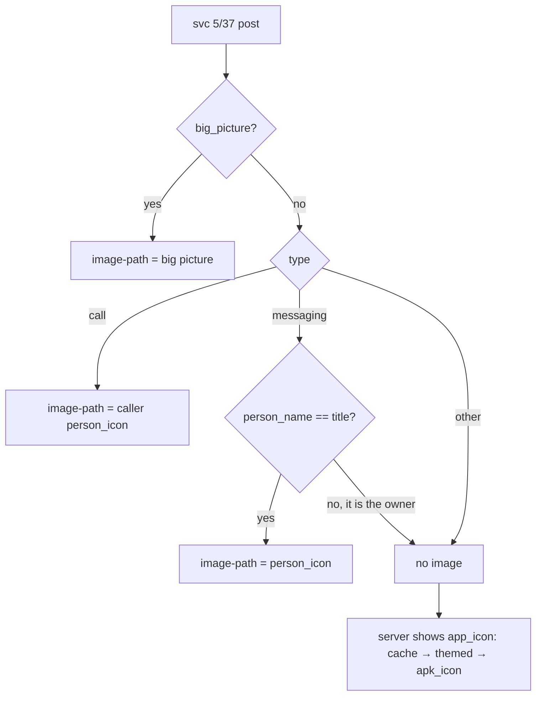

# Messaging notification avatar (WhatsApp showed your own picture)

## What

WhatsApp notifications on the desktop showed the phone owner's own profile picture instead of the
sender's. The daemon now never uses the phone owner's picture: a messaging notification's
`person_icon` is shown only when its `person_name` equals the notification `title`; otherwise the
desktop notification has no image and the server shows the app icon. The app icon now comes from
the phone's launcher icon in the app-icon cache first, then a themed desktop icon, then the
phone's monochrome `apk_icon`.

The GTK app's Notifications page and the Noctalia plugin were checked: they show only app icons
(the GTK app through `icons::IconSlot` with the cache; the plugin shows no notification images),
so only the daemon's desktop notification needed the fix.

## How

- Root cause, from the phone app (decompiled `MessagingData.init`): for a `MessagingStyle`
  notification the phone fills `person_name` / `person_icon` from `MessagingStyle.getUser()`. In
  Android that user Person is the device owner. For each message it sends only the sender's
  **name** (`message_persons[]`), no icon, and the base class sends only the small icon
  (`apk_icon`), not `android.largeIcon`. `CallData` fills them from `android.callPerson`, which is
  the caller.
- Confirmed on captured session frames (structure only: hashed names, image hashes and sizes): all
  WhatsApp messaging frames (several different 1:1 chats and one group) carried byte-identical
  180×180 `person_icon` and the same short `person_name`, never present in `message_persons`.
  A Google Phone messaging notification instead had `person_name == title == sender` with its own
  icon.
- `src/notifications.rs`:
  - `sender_avatar(n)`: call style → `person_icon`; messaging (type 3, or `messages` present) →
    `person_icon` only if `person_name` (trimmed, non-empty) equals `title`; else `None`.
  - `cached_app_icon(dir, pkg)`: `<pkg>.png`, else `<pkg>_<activity>.png`, else
    `<userId>_<pkg>_<activity>.png` (main user preferred). The activity must contain a dot and have
    no `_` in its first segment, so `com.foo` does not pick up `com.foo_bar_…`. Re-read on every
    notification (no negative cache) because the icon download may finish after the first post.
  - `show()`: `app_icon` = cache → `themed_icon` → `apk_icon`; `image-path` = `big_picture` →
    `sender_avatar`.
- Tests with placeholder payloads: self Person in 1:1, group, owner replied last; dialer-style
  user = other party; missing icon/name; call; cache lookup order and the prefix guard.

## Why

- The wanted behaviour (sender's avatar in 1:1, latest sender or group icon in groups) is not
  possible from this protocol: the phone never serializes per-sender icons or the large icon. The
  only person picture on a messaging post is the owner's, so the best correct result is the app
  icon. Fetching contact photos some other way (contacts sync) would be a new feature.
- Why compare with `title` rather than reject `person_icon` outright: some apps (the dialer here)
  misuse the user Person for the other party, and then the picture is correct and useful. Matching
  the headline name is a cheap, data-only test that is false for WhatsApp in 1:1 and group chats,
  and should stay false when the owner replied last (the title names the chat or sender; inferred,
  not captured). It would misfire only if
  a contact had exactly the owner's display name *and* the app labelled the owner with that name.
- Alternatives rejected: "person_name not in message_persons" (fails once the owner replies, since
  the owner then appears as a sender); "latest sender == person_name" (that is exactly the owner
  replying, the opposite of what we want).
- Cache before themed icon matches the GTK app's order and gives the exact app's colour icon
  instead of a guessed theme match. The lookup is a small directory scan, cheap per notification.

## Verification

- Unit tests (`cargo test --release -p smartconnect-linux --lib notifications`).
- Replay: every captured svc 5/37 frame with `person_icon` passed through `sender_avatar` (a
  scratch program outside the repo, hashes only): all WhatsApp frames now fall back to the app
  icon; the dialer frame keeps its contact picture. Newer session logs are redacted, so only older
  captures carried the fields.
- Live: needs a naturally arriving WhatsApp notification after the daemon runs the new build.
