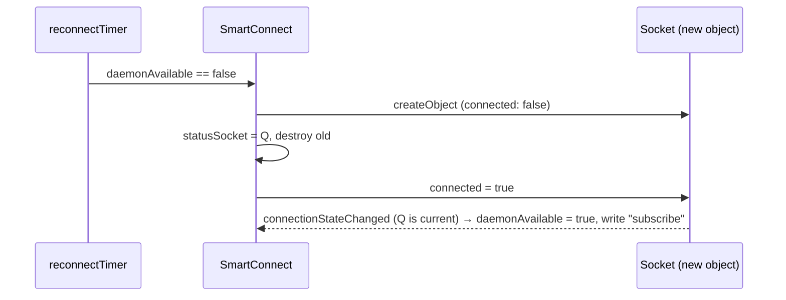

# Noctalia plugin: panel redesign and socket reconnection

## What

1. **Panel layout** (`noctalia-plugin/smart-connect/Panel.qml`). The phone card used to put a tall
   wallpaper picture (about 46 % of the 420 px panel) beside the text and buttons. That left the
   buttons a ~190 px column: the phone name was cut off, "Phone as display" overflowed its button,
   and the Cross Control edge and display mode were cryptic icon-only buttons. The new layout:
   - a compact header: a 54×108 wallpaper thumbnail, the full name on up to two lines, a status
     dot, and stats as chips (battery, Wi-Fi, signal, unread);
   - a 2×2 grid of `ActionTile`s (Mirror screen, Cross Control, Phone as display,
     Connect/Disconnect) with readable option chips ("Right edge", "Extend · 200 %") that change the
     setting without starting the feature;
   - one status line, and a "Notifications" section that grows with its content.

   `contentPreferredHeight` follows the content (capped at 860 px) instead of fixed sizes.
2. **Reconnection** (`Services/SmartConnect.qml`). After the daemon restarted, the panel stayed
   on "smartconnectd is not running" until Noctalia was restarted. Switching the plugin off and on
   didn't help.

## How

- `ActionTile` is an inline QML component built only from Noctalia tokens (`Color.mPrimary`,
  `mSurface`, `mHover`, `mOutline`; `Style.radiusM`, `marginS`/`M`, `fontSizeXS`/`L`,
  `animationFast`) and `TooltipService`, so it follows the user's theme. It is gated by `available`
  rather than `enabled`, so its option chip (a separate `MouseArea` above the tile's) still works
  while the phone is disconnected.
- Sockets: every reconnect attempt creates a fresh `Socket` from a `Component`, stores it as the
  current socket, and only then sets `connected = true`. Handlers ignore signals from sockets that
  are no longer current. `reconnectTimer` (3 s) redials whichever socket is down.

## Why

- Sandbox experiments in an isolated `qs -p` against a dummy Unix socket server that was stopped
  and restarted:
  - toggling `connected` on the same `Socket` (the old code), resetting `path`, and delaying the
    toggle by 300 ms all **never reconnected**;
  - a fresh `Socket` per attempt reconnected about a second after the server returned.
  - A first version that connected from inside the component (`Component.onCompleted`) never
    became available: a local connect can complete synchronously, before the new object is stored,
    so the "is current" guard dropped the event. Connecting after storing fixed that. The final code
    passed the same stop/restart test.
- Toggling the plugin didn't help because Noctalia reloads a plugin's entry points with a `?v=N`
  query, but the singleton service is imported by its plain path. The engine keeps the old instance,
  so changes to `Services/*.qml` need a Noctalia restart. Panels and widgets reload on a toggle.
- The sandbox log also showed `noctalia-qs` warning that it was built against Qt 6.11.2 while the
  system has Qt 6.12.0 ("likely to cause crashes"). That's outside this project; it's listed under
  known issues in the README.
