# Noctalia plugin: Phone files tile (mount the phone's storage)

> **Update (2026-10-21):** liveness probing, stale-mount clean-up, remount-then-open and the helper's reconnect/signal handling are in [files-mount-resilience.md](files-mount-resilience.md); where this note says the Phone files tile decides "mounted" from the process or `mountpoint`, that is superseded.

## What

A **Phone files** `ActionTile` in the Smart Connect panel (`noctalia-plugin/smart-connect/`) that
mounts the phone's storage as a read-only FUSE folder through the existing `smartconnect-files`
helper — the Noctalia-shell equivalent of the GTK app's Files page
([gui-files-page.md](gui-files-page.md)), for the user who lives in Noctalia:

- **Not mounted** → tapping the tile (**Mount**) spawns `smartconnect-files mount --mountpoint
  <dir>` (default `~/Phone`) as a tracked Quickshell `Process`. The option chip shows the target
  folder while idle and *Mounting…* while the helper handshakes with the phone.
- **Mounted** → the chip becomes a clickable **Open** (`xdg-open` on the folder) and the tile itself
  becomes **Unmount** (`fusermount3 -u <dir>`, after which the blocking mount process exits). The
  tile is highlighted (`active`) while mounted.
- The tile is `available` only while the phone is connected — or while a mount is still live, so it
  can be unmounted after the phone drops.
- If the mount process exits quickly (phone not connected / handshake failed), the tile falls back to
  the unmounted state and the helper's last stderr line is surfaced in the panel's status area.
- The mount folder and the helper path are exposed in the plugin **Settings** page (under *Phone
  files*); both default sensibly, so no settings are required.

**Lifecycle:** the mount is **not** auto-unmounted on panel close (it persists like a
phone-as-display session, matching the GTK app). A full shell/plugin teardown SIGKILLs the tracked
child and can leave a stale FUSE mount — recover with `fusermount3 -u ~/Phone`. This is a documented
limitation, not a bug.

## How

All in two files, matching the panel's recent redesign
([noctalia-panel-redesign-and-reconnect.md](noctalia-panel-redesign-and-reconnect.md)):

- **`Services/SmartConnect.qml`** — a new "Phone files" section modelled on the mirror/cross/display
  helper sections:
  - `filesProcess` (`property Process`) runs `sh -c 'mkdir -p "$2" && exec "$1" mount --mountpoint
    "$2"'` so the folder is created before the (foreground, blocking) mount. `running` ≈ the mount is
    up. Its `stderr` (SplitParser) is captured; `onExited` with a non-zero code (and not a
    user-requested unmount) sets `filesStatus = "Phone files: mount failed (exit N): <stderr>"`.
  - `startFiles / stopFiles / toggleFiles / openFiles(binary, dir)`. `stopFiles` runs `fusermount3
    -u` via `Quickshell.execDetached`; releasing the FUSE mount makes the blocking process exit on
    its own (so the child is reaped, no SIGINT/SIGTERM needed). `openFiles` uses `xdg-open`.
    `expandHome` (reused from the mirror code) expands a leading `~`; the default folder is `~/Phone`.
  - **Mounting → Mounted** is confirmed by a short `filesCheck` Process running `mountpoint -q <dir>`
    (exit 0 ⇒ it's a mount point), driven by `filesTimer` (500 ms) while the process is up but not
    yet marked mounted. A **grace fallback** promotes to Mounted after ~4 s even where `mountpoint`
    is unavailable, so the UI always settles.
  - `onConnectedChanged` clears a stale "Connect the phone first" message once the phone is back.
- **`Panel.qml`** — a 5th `ActionTile` added to the existing `GridLayout` (`columns: 2`) with
  `Layout.columnSpan: 2`, so it forms a tidy full-width **third row** under the 2×2 grid rather than
  leaving a half-empty row. Its `title`/`icon`/`option`/`optionIcon`/`active`/`available`/tooltips
  are bound to the service state; the chip's own `MouseArea` (via `optionAvailable`, only true when
  mounted) fires **Open** without toggling the tile. A `filesStatus` line was added to the panel's
  status Repeater (red only when it contains "failed").
- **`Settings.qml`** — a *Phone files* header plus **Mount folder** and **Phone files helper**
  `NTextInput`s, saved to `pluginSettings.filesDir` / `filesBinary` in `saveSettings()`. Read back
  with `?? SmartConnect.defaultFilesDir` / `defaultFilesBinary`, so a blank/absent setting is fine.
  The repo/live `settings.json` was **not** edited.

Helper lookup follows the repo rule (plugin settings → `PATH`): the panel passes
`pluginSettings.filesBinary` (blank ⇒ `smartconnect-files` on `PATH`) to the service, exactly like
the mirror/display binaries. No home or build path is hard-coded.

```mermaid
stateDiagram-v2
    [*] --> Unmounted
    Unmounted --> Mounting: tap tile (phone connected)\nspawn smartconnect-files mount
    Mounting --> Mounted: mountpoint -q ok\n(or ~4s grace)
    Mounting --> Unmounted: child exits fast\n→ status: helper error
    Mounted --> Unmounted: tap Unmount\nfusermount3 -u → child exits
    Mounted --> Unmounted: phone drops, child exits\n→ status: helper error
    Mounted --> [*]: shell exit\n(SIGKILL child; stale mount possible)
```

## Why

- **Tracked `Process`, not detached.** The mount should be owned by the plugin so Quickshell reaps
  the child, and so `running` directly drives the tile state. (Phone-as-display runs *detached* on
  purpose, because a plugin reload would SIGKILL a tracked child and leave the virtual output on; a
  stale FUSE mount is a lesser evil — a broken folder the user can `fusermount3 -u` — and a detached
  mount would need log-scraping to track, so a tracked child is simpler here.)
- **No auto-unmount on close**, per the task and matching the GTK app: a mount is a resource the user
  expects to persist while the shell runs. The stale-mount-on-shell-exit caveat is documented in the
  README matrix, `docs/usage.md` and the CHANGELOG.
- **`mountpoint` + grace fallback** mirrors the GTK page's device-id detection without parsing
  `/proc/mounts`, and still settles if `mountpoint` is missing or detection is flaky.
- **`fusermount3 -u` to stop**, not a signal: the helper blocks in FUSE and exits cleanly once the
  mount is released, so unmount and child-reap are the same action.
- **Full-width third row** keeps the 2×2 grid tidy instead of a lone half-width tile with a gap.

## Testing

- `qmllint` **cannot** validate these files in this environment: its parser rejects the Quickshell
  QML dialect the whole plugin already uses (typed JS functions `function f(): void`, optional
  chaining `?.`) — the first errors land on **unchanged** original lines (`SmartConnect.qml:33`,
  `Panel.qml:20`), so parsing stops before reaching any new code. (Diagnostics only appear with
  `QT_FORCE_STDERR_LOGGING=1 QT_ASSUME_STDERR_HAS_CONSOLE=1`; without them qmllint is silent and just
  returns exit 255.) Verification was therefore by careful review against the existing
  mirror/cross/display `Process`/`Timer` patterns and the `ActionTile` usage, which the new code
  mirrors exactly. The runtime helpers (`mountpoint`, `fusermount3`, `xdg-open`) are present.
- **Not exercised:** the successful Mount / Open / Unmount flow from the panel against a real phone
  (same gap as the GTK Files page). The underlying `smartconnect-files mount` helper is verified on a
  device. Load the service change with a **Noctalia restart** — toggling the plugin reloads its
  panels but not the shared singleton service.
