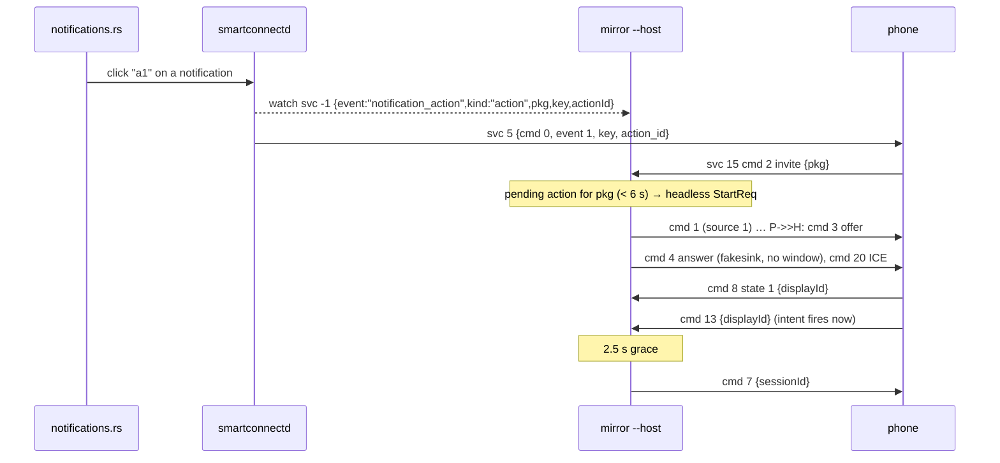

# Notification action buttons without a window ("background actions") — 2026-10-21

Status: implemented, **untested on a device** (written offline from the phone APK while no phone
was available). The user's priority #1.

## What

- Clicking a notification **action button** on Linux (e.g. a timer's "Pause", "Mark as read") now
  runs the action on the phone without opening a stream window: `smartconnect-mirror --host`
  answers the phone's app-stream invite headlessly and closes the stream again (svc 15 cmd 7) once
  the phone has fired the action.
- Clicking the notification itself ("Open on phone", phone event 2) still opens the app in a
  window.
- New daemon → helper **local event** on the control socket (see "Control-socket API" below).
- `SMARTCONNECT_BACKGROUND_ACTIONS=0` (environment of the host, inherited from the daemon) turns
  it off: action buttons then open a window like "Open".

## Why it needs the stream at all (from the APK)

Traced in `com.motorola.mobiledesktop` 09.0.3.013 (JADX names):

1. `fe3` (event 1 → `handlePcActionClick`, event 2 → content/full-screen intent) → `fh6.f`: with
   its own app-stream capability, creator = dialer or platform ≥ 71, and a non-cloud link, it
   calls `service.c.P(client, pi)`: stores the PendingIntent in `appstream.a.q` and invites
   (svc 15 cmd 2, `pkg` = the intent's **creator package**). Otherwise plain `pi.send()`.
2. If the app is already on an app-stream display (`vm.s`): no invite; `J(displayId)` fires the
   intent there at once, then cmd 12 (merge) + cmd 14 (raise).
3. PC cmd 1 (`source:1`) → `vm.f` → `appstream.a.O` builds the WebRTC session → cmd 3 offer. No
   display yet.
4. **PC cmd 4** (`error 0`, `resize != 1`) → `appstream.a.M` ("startApp"): creates the
   `AppStream:<pkg>` VirtualDisplay, sends cmd 8 state 1 (`c.S`), starts the app on it after a
   500 ms sleep (`N`), then applies the answer SDP and starts the encoder.
5. ITaskStackListener `onTaskFocusChanged` for a task on that display → `appstream.a.j` → cmd 13
   (`c.T` → `vm.m`, AppTopData) **and** `J(displayId)`: starts `AppStreamPendingIntentActivity`,
   which sends the PendingIntent with `setLaunchDisplayId(displayId)` and background-activity-start
   allowed, then finishes. `q` is cleared.

So "up" = our **cmd 4 answer**; the intent fires when the app gains focus on the new display, and
cmd 13 marks that moment. ICE, DTLS and video frames are not involved. The session must stay open
until the trampoline activity has run (a beat after cmd 13); cmd 7 then releases the display
(`D` → `B` → `C` → `zt9.r`). What happens to an activity the intent started there (moved to the
phone screen or destroyed) is up to the system service: unknown.

This also explains the original failure (`.notes/notifications-and-desktop-ui.md`): the invite was
answered with cmd 1 but the offer was never answered, so no display was ever created.

## How



- Daemon (`src/notifications.rs`): `click_event(service, cmd)` builds the event for svc 5/37
  cmd 0 with event 1 ("action") or 2 ("open"); `pkg` comes from the notification key
  (`<user>|<pkg>|<id>|<tag>|<uid>`, `key_package`). `Notifier::follow_signals` publishes it on
  `Daemon::from_phone` (the `watch` broadcast) **before** forwarding the click to the phone.
  `control.rs` `send` does the same for clicks sent by other desktop clients.
- `control.rs` `watch`: local ids (negative) are only streamed when listed explicitly, so
  "watch everything" clients never see them.
- Host (`mirror/src/actions.rs`, wired in `main.rs`): `PendingActions` (pkg → deadline, 6 s;
  "open" disarms), consumed by the next cmd 2 for that pkg → `StartReq.headless`. A headless
  `Session` links webrtcbin's pad to `queue ! fakesink`, skips svc 16 REQUEST_CAP, and starts a
  `HeadlessTimer` when cmd 4 goes out. cmd 13/12/14 for its display → `fired`; `tick()` closes it
  2.5 s after the last report, 12 s after cmd 4 without any report, and at most 30 s after cmd 4.
- Repeated invites for an app that is already queued/in flight are ignored (the phone re-sends
  unanswered invites), so a re-sent invite can't turn into a second, windowed start.

## Control-socket API: daemon-local events

Not on the wire; for desktop helpers. Subscribe with the reserved service id **-1**
(`proto::SERVICE_LOCAL_EVENTS`):

```
→ {"cmd":"watch","services":[15,-1]}
← {"ok":true,"message":"watching"}
← {"service":-1,"data":{"event":"notification_action","kind":"action","pkg":"com.example.clock",
    "key":"0|com.example.clock|7|null|10123","actionId":1,"service":5}}
```

| field | meaning |
|---|---|
| `event` | `"notification_action"` (the only event so far) |
| `kind` | `"action"` = action button (phone event 1), `"open"` = click on the notification (event 2) |
| `pkg` | package from the notification key; the phone's invite names the intent's creator, normally the same |
| `key` | the phone's notification key |
| `actionId` | the button's `action_id`, `null` for open |
| `service` | 5 or 37, the service the click goes out on |

Emitted just before the click is sent to the phone, for clicks from the daemon's own desktop
notifications and for svc 5/37 cmd 0 event 1/2 frames sent through `{"cmd":"send"}`. Replies
(event 0) need no stream and emit nothing. An empty `services` list in `watch` still means "every
phone service" and does not include -1. (`docs/control-socket-api.md` is owned by the docs pass;
this section is the reference until it is copied there.)

Host control socket (`$XDG_RUNTIME_DIR/smartconnect-mirror.sock`) changes in the same pass:
`sessions` entries carry `"headless": true` for background-action streams (a UI listing windows
should skip them; they live about 3 s), and `{"cmd":"desktop"}` starts Ready For desktop
(`phone-view-invites.md`).

Host environment (inherited from the daemon, which spawns `--host`):
`SMARTCONNECT_BACKGROUND_ACTIONS=0` (off), `SMARTCONNECT_MIRROR_RESIZE=1` (window resize, see
`app-streaming.md`), `SMARTCONNECT_ICE_ADDRESSES` (`ice-candidate-filter.md`).

## Why this way

- **Answer, don't avoid, the stream.** Nothing on svc 5 bypasses the app-stream routing on this
  phone, and the invite carries no hint whether it came from an action. Correlating our own click
  (local event) with the next invite for the same package is the only signal, hence the event.
- **Full webrtcbin, fakesink.** A hand-made answer would also trigger `M`, but a broken SDP could
  make the phone tear the session down before the app gets focus. Real ICE costs nothing.
- **cmd 13 as the trigger, not a fixed delay**: it is sent in the same call that fires the intent;
  the 2.5 s grace covers the trampoline activity and the app's receiver. 12 s/30 s caps keep a
  stuck session from lingering.
- **6 s correlation window**: the phone invites within about a second; a longer window raises the
  chance that a later, unrelated invite for the same app (the user picking it on the phone) runs
  headless.
- **On by default** (env opt-out): the old behaviour opened a window per action button, which is
  never what a button click wants; both paths share the verified session code.
- Event instead of a host-side guess from `pkgName`/`icon`: those are identical for tile and
  notification invites.

## Not done / to verify on the device

- Whether cmd 13 always arrives (it needs the app's task to gain focus on the new display); the
  12 s fallback closes anyway.
- Whether closing 2.5 s after cmd 13 is long enough for apps that do slow work in their receiver,
  and what happens to activities started on the released display.
- A second action click while the headless session is still open is fired by the phone directly
  on that display (cmd 12/14 re-arm the grace).
