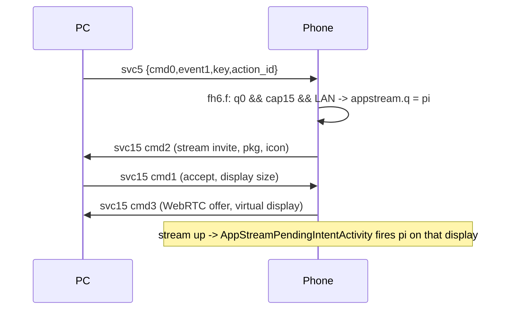

# Phone notifications on Linux + desktop control API / Noctalia plugin

Status 2026-10-21: **notifications mirror to the desktop and Reply works end to end** (verified with
WhatsApp). Action buttons / "Open on phone" reach the phone's handler correctly but only take effect
once **app streaming** (svc 15) works — see "Why actions don't fire" below. Noctalia plugin written
but not yet enabled/verified in the shell.

## Why actions don't fire (root cause, 2026-10-21)
Evidence (phone logcat + session log, Clock timer "Pause" action sent via the control socket):
`handlePcActionClick` finds the notification → `sendPendingIntent asHostCapability=true` →
`sendPendingIntent pkg=com.google.android.deskclock` → ~1 s later the phone creates a virtual display
`AppStream:com.google.android.deskclock` and sends us **svc 15 cmd 2** (app-stream invite, with the app
icon); the daemon answers cmd 1, the phone sends a WebRTC offer (cmd 3) — and the timer stays RUNNING.

`fh6.f(remoteClient, pi)`: if the phone's own capability bit 15 (`cl7.t(15)`, phone-side, not ours)
is set and the creator is the dialer **or `b54.q0`** (true when platform level ≥ 71 — it is on this
phone) and the link is not cloud (`nm9.f0(15, networkType)`; only networkType 8/9 fail), the intent is
handed to `service.c.P()` → `appstream.a.q = pi` + invite the PC to stream that app. The PendingIntent
is fired later, from `AppStreamPendingIntentActivity` on the streamed virtual display, once the session
is up (`appstream.a.J(displayId)`). Plain `pi.send()` is used only when that routing is off.
So the genuine Windows behaviour is: click an action/Open → the app opens in a streamed window on the PC
and the intent runs there. Nothing in svc 5 can bypass it; **fix = finish app streaming** (mirror work).
**Update (later 2026-10-21):** the intent fires only after the PC's *cmd 4 answer* (display + app
launch) once the app gains focus there (cmd 13); action buttons now run headless and the stream is
closed again — see `notification-background-actions.md` (untested on a device).
The action-lookup loop in that handler is fine: its index starts at 0, so every action is found.

## Polish (2026-10-21)
- Dedupe: per-key fingerprint of the visible fields (not the base64 images, which differ per post);
  identical re-posts are dropped. Coalescing: at most one desktop update per key per second, newest frame
  wins (one delayed tokio task per key). Removal clears all per-key state.
- Icons: themed desktop icon first (`whatsapp.svg` etc. from Papirus/hicolor/breeze/Adwaita, candidates
  from app name and package segments, cached), else the phone's glyph JPEG. Avatar/big picture stay in
  `image-path`. (Since changed: the phone's launcher icon from the app-icon cache comes first, and a
  messaging `person_icon` is the phone owner, so it is mostly not used; see
  `messaging-notification-avatar.md`.)
- Per-app mute: `<state dir>/notif-mute.json`; control `{"cmd":"notif_mute","pkg":…,"mute":true|false}`
  (no `pkg` → list).
- Not done: the bean has no visibility/secret or group-summary flag (`SimpleData`: apk_icon, apk_name,
  content, package_name, priority, progress, title; no extras), so nothing to respect there. The phone
  sends every removal on both svc 5 and svc 37 — harmless (second is a no-op).

## What
- `notifications.rs`: phone svc 5 (show-list apps) / svc 37 (others) frames → `org.freedesktop.Notifications`
  via zbus, replaced by the phone's notification `key`; `event 2` closes it. App icon / avatar / big picture
  decoded from base64 JPEG into `$XDG_RUNTIME_DIR/smartconnectd/icons/`.
- Click/actions → phone (svc 5, `{cmd:0, event, key, version:"1.0", data}`): event 0 = reply
  (`reply_content`), 1 = action button (`action_id` = index over ALL actions incl. Reply), 2 = open.
- Reply UI: the notification's default action ("Reply" — Noctalia renders the default action as a button,
  so it isn't added twice) opens `desktop/reply.qml` (embedded with `include_str!`, run via `qs -p`), a small
  Quickshell window that sends `{"cmd":"reply","key","text"}` to the control socket and quits on success.
- `status.rs`: `PhoneStatus` (battery/charging/wifi/cell/bluetooth/unread/wallpaper/recent notifications,
  memory only) from svc 25 cmd 1 / cmd 2 and svc 100 cmd 1018 (SMS/MMS unread counts).
- `control.rs`: `$XDG_RUNTIME_DIR/smartconnectd.sock`, one command per line; JSON replies.
  `status`, `subscribe` (stream), `connect`, `disconnect`, `pair`, and JSON `{"cmd":"reply",…}`.
  CLI: `smartconnectd status|subscribe|connect|disconnect|pair`.
- `noctalia-plugin/smart-connect/` (symlinked into `~/.config/noctalia/plugins/`): bar pill (icon +
  battery), control-center button, panel (phone card with its wallpaper, Connect/Disconnect, pairing QR,
  recent notifications with reply boxes). Talks to the socket with `Quickshell.Io.Socket`.
- Session logs redact svc 5/37 contents and the wallpaper blob.

## Why
- Spec: `evidence-2026-10-20/notification-spec.md`. No handshake/gate on the PC side: the phone sends
  notifications to every verified PC; no bulk sync on connect; no dismiss-only message (Linux dismiss is local).
- Reply via the phone's own RemoteInput action (`fe3` handler) beats "open on phone", which Android 16's
  background-activity-launch rules block.
- Noctalia doesn't enable Quickshell's `inlineReplySupported`, and patching its system files breaks on
  update — hence our own reply window.
- Desktop Connect tries Wi-Fi (`/readyfor/mdns`, app must be foreground) then Bluetooth LE (works with the
  app backgrounded) — see `wifi-reconnect.md`.
- Disconnect is respected: 60 s without auto dial-back after the phone/desktop closes a session.

## Noctalia plugin additions (2026-10-21)
- Phone as display: panel button + Extend/Duplicate cycle button + status line, display settings in
  Settings.qml (kept in the shared `~/.config/smartconnect-linux/display.json`), IPC
  `display toggle|start|stop|extend|duplicate`. Sessions start detached and are found with `pgrep`, so
  a plugin reload never kills one. See [display-frontend-ui.md](display-frontend-ui.md).
- Per-app mute: bell-off button per notification and a *Muted apps* list in Settings, see
  [notification-mute-ui.md](notification-mute-ui.md).
