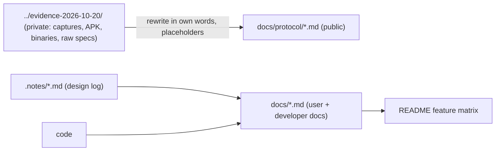

# Preparing the repo for open-source publication

## What

- **License: MIT** (`LICENSE` at the root; `license = "MIT"` in every crate's `Cargo.toml`). The
  owner chose it over GPL-3.0 and MIT/Apache-2.0 dual licensing.
- **Name kept: `smartconnect-linux`**, with a prominent "unofficial, not affiliated with
  Motorola/Lenovo" disclaimer in the README.
- **Agent rules split in two:** `CLAUDE.md` (public: documentation-is-done rules, what must never be
  committed, build/test) and `CLAUDE.local.md` (git-ignored: local target dirs, the private research
  folder, private files never to open, phone-access etiquette).
- **`.gitignore` hardened:** besides `target/`, it ignores `CLAUDE.local.md`, `/.cargo/config.toml`
  (holds an absolute path into the developer's home), and research/secret file types (`*.pcap*`,
  `*.etl`, `*.apk`, `*.dll`, `config.json`, `*KEEP-PRIVATE*`, `*.log`).
- **Documentation layout:** `README.md` (pitch, feature matrix, quick start, disclaimer),
  `docs/` (installation, usage, troubleshooting, architecture, control-socket API, development,
  security), `docs/protocol/` (one file per service), `CHANGELOG.md`, plus this `.notes/` design log.

## How

Raw research stays outside the repo. Protocol knowledge is ported into `docs/protocol/` in our own
words with placeholder values, tagged OBSERVED/INFERRED.

## Why

- MIT: maximum reuse for the Motorola/Linux ecosystem; all dependencies are MIT/Apache/BSD
  crates or dynamically linked LGPL GStreamer, so MIT is compatible.
- Name: the owner preferred discoverability; the disclaimer and nominative wording ("for Motorola
  Smart Connect") keep it clearly unofficial.
- The `CLAUDE.md` split keeps documentation rules with the code for every future contributor and
  agent, while machine-specific details never reach the public repo.
- Before the first push: run a secrets/personal-data scan over the whole tree (IPs, base64/hex
  blobs, tokens, phone numbers, names) and a dependency license check.
