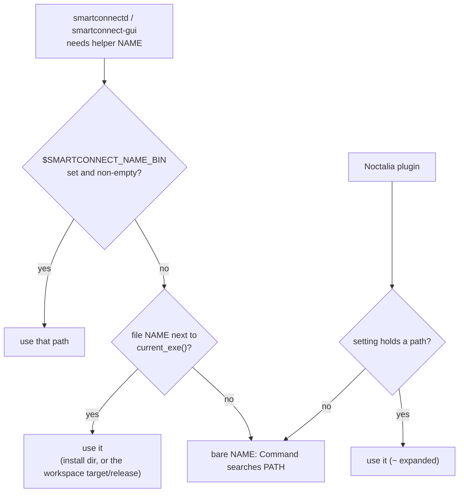

# Cargo workspace, helper lookup without developer paths, installer — 2026-10-21

## What

- **One Cargo workspace.** The root `Cargo.toml` (the daemon package) gained a `[workspace]` with
  `mirror/`, `crosscontrol/`, `display/`, `webcam/` and `gui/` as members (resolver 3). One
  `Cargo.lock` at the root; the five member lock files are gone. `cargo build --release --workspace`
  and `cargo test --release --workspace` cover everything, warning-free. `cargo clippy --workspace
  --release` reports only warnings that predate this change (none in the files touched here).
- **Manifests:** every crate has `license = "MIT"` (webcam lacked it) and a `description` (root and
  display lacked one). No `repository` yet: there is no public URL. The GUI's
  `[profile.release] strip = true` moved to the root as `[profile.release.package.smartconnect-gui]`
  (cargo ignores member profiles); the other binaries stay unstripped as before.
- **No developer paths.** The daemon (`src/helpers.rs::binary`), the GTK app
  (`gui/src/mirror.rs::binary`) and the Noctalia plugin no longer fall back to a hard-coded
  per-crate build directory in the developer's home. Order now: `$SMARTCONNECT_<NAME>_BIN` → a file of
  that name next to the running executable → `PATH`. The plugin: its *viewer* / *display helper*
  settings (default: bare names) → `PATH`; Cross Control by name. The override variables were
  renamed from `SMARTCONNECT_MIRROR` etc. to `SMARTCONNECT_MIRROR_BIN`, `…_CROSSCONTROL_BIN`,
  `…_DISPLAY_BIN`, `…_WEBCAM_BIN`.
- **Installer:** `packaging/install.sh` (+ `uninstall.sh`, shared `common.sh`) builds the workspace
  and installs all six binaries (since grown to eight with files/ and fex/) to `${PREFIX:-~/.local}/bin`, the user unit (enabled only with
  `--enable`), the launcher `dev.smartconnect.Linux.desktop` + a new SVG icon, the guide and
  license, and the Noctalia plugin (copy by default, `--link` for development). It prints, never
  runs, the root-only setup (firewall, vkms + niri snippet, v4l2loopback, wvkbd). `--dry-run`,
  `--no-build`, `--no-plugin`, `--prefix`. `packaging/arch/PKGBUILD` builds an Arch package from the
  checkout.
- `gui/smartconnect-gui.desktop` moved to `packaging/dev.smartconnect.Linux.desktop` (+
  `StartupWMClass`, own icon, one main category).

## How

- `helpers::binary` / `mirror::binary` are the same ten lines in both crates (`env_var(name)` builds
  the variable name). The daemon's spawn error names the variable when the file isn't found. Unit
  tests cover the variable names, the next-to-exe case (the test binary finds itself) and the bare
  name fallback.
- Lock files were merged with a throwaway script (union of all `[[package]]` entries, dependency
  strings made unambiguous), then `cargo update --workspace --offline` normalised it: the 338
  packages are exactly the union of the old locks, no version changed.
- `install.sh` finds the binaries with `cargo metadata --no-deps` (`target_directory`, so a
  `.cargo/config.toml` `target-dir` or `CARGO_TARGET_DIR` is honoured) and runs cargo from the
  checkout so that config applies. Generated files (unit with `%h/.local/` → `$PREFIX/` for another
  prefix, launcher with an absolute `Exec=`) are written through a temp file and `mv`.
- Plugin install rules: a real directory is only replaced when its `manifest.json` has id
  `smart-connect`; a symlink only when it points at this checkout. `settings.json` (Noctalia's
  per-user settings, kept in the plugin directory) is never copied from the checkout, survives an
  update in place, and moves along when switching link ↔ copy. It is git-ignored now.
- Verified with a throwaway `HOME`/`PREFIX` and a `systemctl` shim in `PATH` (records calls, never
  reaches the real user manager): dry run (nothing written), install, re-install keeping settings,
  copy → link → copy, `--enable` (a hand-started daemon was running, so it only enabled), foreign
  plugin dir and dangling link left alone, a custom `--prefix` (unit outside systemd's search path
  is enabled by full path), `uninstall.sh` with and without `--purge`. `makepkg` built the package in
  a scratch `BUILDDIR` with its own target dir; `check()` ran the workspace tests; `namcap` only
  flags the plugin's QML imports and runtime-only GStreamer plugin dependencies.

## Why

- **Workspace:** one `cargo build` for six binaries (eight since files/ and fex/), one lock to audit, one target directory. The
  last point is what makes "next to the running executable" work for a development build, so no
  code needs to know where a developer keeps build output.
- **Feature unification is the workspace's catch:** shared dependencies get the union of member
  features. zbus gets the daemon's `tokio` and the display helper's `async-io` backend. Before 5.19,
  `tokio` won whenever it was compiled in, and the display helper (no tokio runtime) would have
  failed on its first D-Bus call; 5.19 made the backends additive and picks tokio only inside a
  tokio runtime. Both manifests now require `zbus = "5.19"`. The other overlaps (GStreamer `v1_22`,
  wayland-protocols features) only add API.
- **Lookup order:** an explicit override must win (tests, stand-ins, unusual layouts); the
  executable's own directory is right for both an install and a build, and survives a service
  `PATH` that lacks `~/.local/bin`; `PATH` last for distribution packages and hand installs. The
  variable rename (`…_BIN`) avoids clashing with `SMARTCONNECT_MIRROR_RESIZE`,
  `SMARTCONNECT_WEBCAM_OUTPUT` and friends, which are settings, not paths.
- **Plugin copy by default:** a release install must not depend on the checkout staying where it
  is; `--link` keeps the live-editing workflow. Noctalia stores settings inside the plugin
  directory, which is why the installer treats `settings.json` as user data and why a system
  package can't just link `/usr/share` (settings would be unwritable): the PKGBUILD ships the plugin
  for each user to copy.
- **Unit location:** `~/.config/systemd/user` for the default prefix, matching what the previous
  installer and the docs used, so an existing unit is replaced instead of shadowed.
- **Launcher named after the app ID** (`dev.smartconnect.Linux`): Wayland docks match the window's
  app ID to the desktop file name. If the app ID changes before release (for example to an
  `io.github.<owner>` ID once the repository exists), rename the launcher and icon with it
  (`APP_ID` in `packaging/common.sh`, the PKGBUILD, `gui/src/main.rs`).
- **`options=('!lto')` in the PKGBUILD** (added after a fresh-install test in a clean Arch
  container): Arch's default `makepkg.conf` enables `lto`, which adds `-flto` to `CFLAGS`, so `ring`'s
  C objects (pulled in by `rustls` in `files/` and `fex/`) were GCC LTO bitcode that the Rust link
  couldn't resolve (undefined `ring_core_*` symbols). Plain `cargo build` and `install.sh` were never
  affected. Turning LTO off for this package was simpler than teaching `cc` to emit real objects.
  The PKGBUILD is for a local checkout (`$startdir`); an AUR `-git` PKGBUILD with `source=(git+$url)`
  is left for when the repository is public.
- Not done: a `rust-version` field (the docs say 1.88; not re-checked against the dependency
  MSRVs), and the 27 clippy warnings that predate this change.
