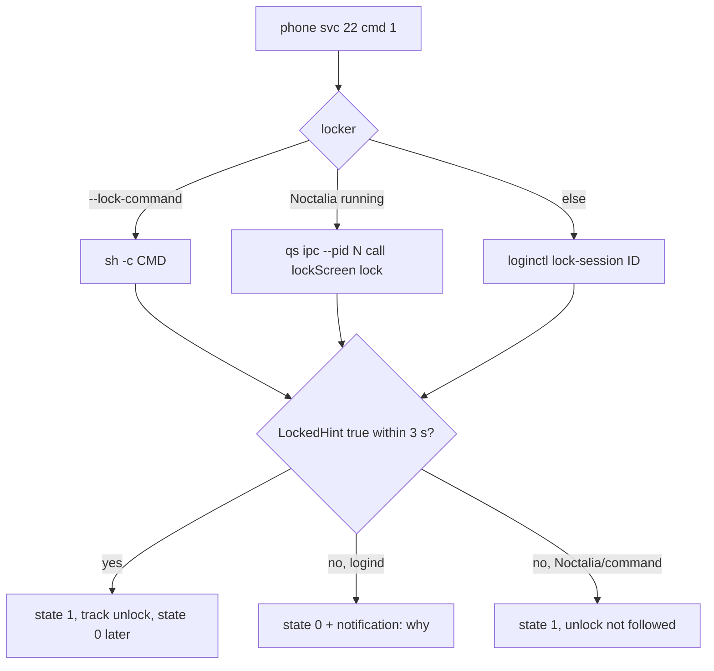

# PC lock: confirm the lock, explain failures, GNOME needs GDM

## What

- The PC lock tile (svc 22) now reports "locked" to the phone only after the lock is seen, and tells
  the user why when nothing locked.
- Locker choice, per request: `--lock-command` (new daemon flag, `sh -c`), else Noctalia's own lock
  IPC when a Noctalia shell is running, else `loginctl lock-session <graphical session id>`.
- New `Notifier::notify_local` for daemon-originated desktop notifications.

## How

`src/pc_lock.rs`:

1. `graphical_session()` resolves logind's `User.Display` (`loginctl show-user <uid> -p Display`),
   falling back to `auto`.
2. `pick_locker()`: `Command` / `Noctalia { qs, pid }` (found by scanning `/proc/*/cmdline` for a
   `qs`/`quickshell` process with `noctalia-shell` in its arguments; `qs ipc --pid <pid> call
   lockScreen lock` with the same executable) / `Logind`.
3. After the command succeeds, `wait_locked()` polls `LockedHint` every 250 ms for up to 3 s.
4. Outcomes:
   - seen → `state 1`, then `track_unlock()` polls every 2 s and sends `state 0` on unlock
     (one tracker at a time, `TRACKING`);
   - not seen with `Logind` → nothing locked: `state 0` to reset the tile, a warning, and a desktop
     notification from `no_lock_reason()`;
   - not seen with Noctalia / command → trust it, `state 1`, no unlock tracking.

## Why

- **Root cause on the user's machine:** the user logs in to GNOME through SDDM. GNOME Shell creates
  its `ScreenShield` only if `LoginManager.canLock()`, which asks GDM's D-Bus service for its version
  (`org.gnome.DisplayManager`, read from the shell's own JS in `libshell-51.so`). Without GDM there is
  no lock screen at all: logind's Lock signal, `org.gnome.ScreenSaver.Lock` (its gjs proxy errors
  with "name is not activatable") and Super+L all do nothing. No Wayland locker works on GNOME
  (Mutter has no ext-session-lock), so nothing the daemon runs can lock it. The fix is GDM, which is
  the user's call; the daemon now says so instead of failing silently.
- **What the old code did wrong:** it reported `state 1` after `loginctl lock-session` exited 0, then
  `state 0` three seconds later because `LockedHint` was false. On the phone `state 1` marks the PC
  locked and `state 0` clears it (`ControlServiceHelper`), so the tile flipped straight back, which
  looked like "doesn't work".
- **Session targeting** was checked and is *not* the cause: from a systemd user service (not in any
  logind session) a bare `loginctl` command resolves to the display session (`session-status` with
  no argument shows session 3). The explicit id is kept so the lock and the `LockedHint` polling
  target the same session.
- **Noctalia** ignores logind's Lock and doesn't set `LockedHint`, so it gets its own IPC and the
  unlock can't be followed. Leaving the tile "locked" beats reporting an unlock that didn't happen.
  Probing ext-session-lock to detect a lock would lock the screen ourselves when it isn't locked.
- A desktop notification is the only place the user sees the reason, because the request comes from
  the phone.

## Not verified

The full tile → lock → unlock path hasn't been re-run on a device; on this GNOME + SDDM machine the
expected result is the "GNOME Shell only has a lock screen…" notification and the tile resetting.
