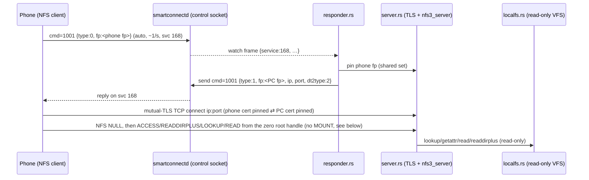
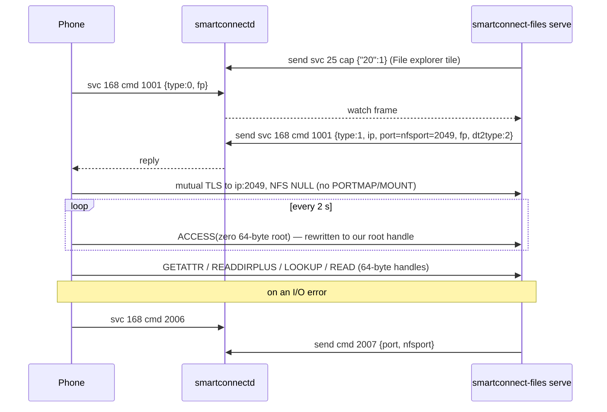

# PC→phone file sharing (`smartconnect-files serve`)

## What

Added a `smartconnect-files serve [--sharedir DIR]` subcommand that lets the connected phone **mount
and browse a PC folder**, over Smart Connect's File Station protocol (read-only, except that
the Files tab may move files to the Trash; see below). It is the mirror of
the already-working phone→PC mount: here the **PC is the NFS server** and the **phone is the NFS
client**, over the same NFSv3-on-fingerprint-pinned-mutual-TLS transport.

Status: **verified on a phone (2026-10-25)**: the phone mounts the share, lists folders, opens
subfolders and reads files, through the Android Files app (the system DocumentsUI). Getting there took
three fixes found on the device (64-byte file handles, the `2006`/`2007` network check, remembered phone
fingerprints). It also needed the firewall port in the right zone and a front-end: the GTK app now
runs `serve` from a switch on the Files page. See [Device validation](#device-validation-2026-10-25).

## How

Three new modules in `files/src/`, plus a `serve` subcommand in `main.rs`:

- **`localfs.rs` — the read-only VFS.** Implements `nfs3_server`'s `NfsReadFileSystem` over one local
  directory. Every object gets a stable 64-bit id (inode) the first time it's seen, interned both
  ways (`id ↔ path`); inode 1 is the share root. `Handle = FileHandleU64`. Implements
  `lookup`/`getattr`/`read`/`readdirplus`/`readlink` (the default `readdir`, `fsinfo`, `lookup_by_path`
  come from the trait; `fsstat`/`pathconf`/`access` are handled by the server core via `getattr`).
  Attributes come from `nfs3_server::fs_util::metadata_to_fattr3` over `std::fs::symlink_metadata`.
  Pagination is deterministic (entries sorted by name; the NFS cookie is the entry's fileid, resumed
  by finding that id in the sorted list → `BAD_COOKIE` if unknown). Read-only is enforced by wrapping
  it in `nfs3_server::vfs::adapters::ReadOnlyAdapter` (every write op → `NFS3ERR_ROFS`, attrs masked
  to `0o555`).
- **`server.rs` — the TLS NFS server.** Builds a `rustls::ServerConfig` that presents our cert
  (`cert::Identity`, reused from the client) and requires a client cert verified by a custom
  `ClientCertVerifier` (`PinnedClientVerifier`) that accepts the phone **only by SHA-256(DER)
  fingerprint** — the server-side mirror of the client's `FingerprintVerifier`. The handshake
  signature is checked against the pinned cert's own public key via the shared
  `tls::verify_signature` (webpki rejects the phone's X.509 v1 cert, so it must not route through
  webpki). The pinned-fp set is an `Arc<RwLock<HashSet<String>>>` shared with the responder. The
  accept loop does `TlsAcceptor::accept`, then runs `nfs3_server`'s stream-generic
  `process_socket` (with a per-connection clone of one base `RPCContext`) on one end of an
  in-memory pipe, with `router.rs` between it and the TLS stream (see
  [Lenovo procedures](#lenovo-procedures-files-tab)).
- **`responder.rs` — the handshake responder.** Connects to the daemon control socket, `watch`es
  serviceId 168, and for each incoming `cmd=1001` `type:0` frame: extracts the phone's `fp`, inserts
  it into the pinned set, and (throttled) sends a `type:1` reply carrying our fp + LAN IP + the
  listener port, forcing `dt2type:2` (SSL) and advertising the same port for
  `port`/`nfsport`/`nfsDataPort`. The PC's LAN IP comes from the daemon's `status` (`pcAddress`), an
  `--ip` override, or a local private IPv4 (`if-addrs`).

Shared-code change: `tls::verify_signature` was made `pub(crate)` so both the client's
`ServerCertVerifier` and the server's `ClientCertVerifier` use the one fingerprint-pinned signature
check. The client path is untouched and still builds/passes.

New deps (`files/Cargo.toml`): `nfs3_server = "0.11"` (features `__test_reexports` for the
stream-generic `process_socket` + `RPCContext`, and `fs_util` for `metadata_to_fattr3`), `if-addrs`,
and tokio's `signal` feature (Ctrl-C).

## Why

- **Reuse the proven transport.** The phone→PC mount already established that File Station is
  serviceId 168 and that `SOCKET_SSL` (plain mutual-TLS TCP, fingerprint-pinned, webpki bypassed for
  the X.509 v1 cert) is the implementable path. PC→phone is the same wire protocol with roles
  swapped, so the server reuses `cert::Identity`, the fingerprint logic and `verify_signature`.
- **`nfs3_server` instead of hand-rolling NFS.** It ships the full RFC 1813 server (MOUNT + NFS +
  PORTMAP) and a clean read-only VFS trait, so the only new logic is the directory-backed VFS. Its
  `process_socket` is stream-generic, which is exactly what lets us drive it over our own
  `tokio_rustls::server::TlsStream` instead of its built-in plain-TCP listener.
  - **Caveat:** `process_socket`/`RPCContext` are public only behind the crate's `__test_reexports`
    feature (and `#[doc(hidden)]`). We enable that feature deliberately — it's the one way to feed an
    arbitrary stream to the server core (the public `NFSTcpListener` binds its own plain-TCP socket,
    which can't carry TLS). If a future `nfs3_server` exposes `process_socket` normally, drop the
    feature. Because `RPCContext::test_ctx` is the only outside constructor, it hard-codes
    `local_port = 2049`; we therefore default the listener to **port 2049** so the portmap
    `GETPORT` reply (which returns `local_port`) stays self-consistent with the advertised port.
- **Force SSL in the reply.** The native QUIC "dt2socket" tunnel (`dt2type:3`) isn't implementable
  from the phone bytecode; the phone clamps any non-`3` `dt2type` to `2`, so replying `dt2type:2`
  deterministically selects the plain mutual-TLS path we can serve.
- **Read-only by construction.** `ReadOnlyAdapter` guarantees no standard NFS write op can slip
  through even if the VFS grew one. The one exception, added later at the user's request, is the
  Files tab's delete (Lenovo `REMOVEBATCH`), which moves files to the Trash and can be switched
  off.
- **No new daemon code.** The existing generic `send`/`watch`/`status` control-socket commands are
  enough to carry the handshake and discover the PC IP, so `serve` is a pure helper, like the mount.

## Device validation (2026-10-25)

Run against the phone with logcat open and `SMARTCONNECT_FILES_TRACE=1`. Problems in the order they
showed up:

1. **Nothing ran `serve`.** It was a CLI command no front-end started. Fixed by the GTK Files page's
   *Share with the phone* switch (below).
2. **Firewall zone.** The phone's NFS connections got "No route to host" (firewalld's reject).
   `--add-port=2049/tcp` had gone into the default zone (`public`), but the Wi-Fi interface was in
   `home`. The docs now say to use the zone from `firewall-cmd --get-active-zones`.
3. **File handles must be exactly 64 bytes.** With the port open, the phone mounted (`NULL`, then an
   `ACCESS` poll every 2 s on the zero root handle), but listing a folder timed out after 10 s. The
   trace showed our READDIRPLUS reply was well formed, and the phone re-sent the *same xid* 1 s and
   12 s later. `nfs3_server` drops a duplicate xid of a finished call, so nothing more came back. The
   cause is in the phone's XDR decoder: its byte-array reader accepts only lengths 0 and 64. Any other
   handle length sets an error flag without consuming the bytes, the rest of the entry list mis-parses,
   and the RPC layer retries. Our handles were 16 bytes (`nfs3_server`'s 8-byte generation + an 8-byte
   id). **Fix:** `localfs::PhoneHandle` is 56 bytes (the id + zero padding), so wire handles are 64.
   The same rule is why the phone uses a 64-byte all-zero root handle. With equal lengths, the
   `PhoneStream` root rewrite no longer changes the record length.
4. **Network check.** After any I/O error (for example a `serve` restart) the phone's NFS client sends
   `cmd=2006` and unmounts unless `cmd=2007 {port, nfsport}` comes back within 3 s. The responder now
   answers it with the ports it advertised. The phone's "same server?" check compares exactly those.
   In practice the phone goes back to handshaking and remounts in about 0.1 s.
5. **Restart window.** A restarted `serve` starts with an empty pin set. The phone reconnects before
   its next `type:0`, so its first few TLS handshakes were rejected. The responder now keeps the last
   4 phone fingerprints in `<state dir>/phone-fps` (0600) and pins them at start. Verified: after a
   restart the phone reconnected at once, with no rejections. The phone's NFS client certificate is
   created per app process, so old entries go stale; the cap of 4 keeps the file short.

Facts confirmed on the way (also in `docs/protocol/file-exchange.md`): when the reply carries
`nfsport`≠0 the phone skips PORTMAP and MOUNT entirely (one NFS `NULL`, then the zero root handle).
It presents its Java-side certificate, whose hash is the `type:0` `fp` (`fp2` is the native one, for
the QUIC tunnel). It compares our `fp` case-insensitively. It shows the share as a DocumentsUI root
named "<PC name> <PC IP>", from Smart Connect's own document provider.

### How the user opens it on the phone

- **Smart Connect's Files tab** (the user's route on Windows, confirmed): a "Files" section lists
  each PC; tapping one opens *All files* plus *Recents / Images / Videos / Documents / Audio /
  Downloads*. The list drops a PC (scType 2, verCode ≥ 900001000) unless the PC's svc 25 `cap` has
  key **`"206"`** non-zero (`ye8` case 5 → `g.L(206)`), so `serve` announces `{"206":1}` while it
  runs and `{"206":0}` when it stops. Everything on that page goes through Lenovo's own NFS
  procedures, not the standard ones; see [Lenovo procedures](#lenovo-procedures-files-tab).
- **Any app's "open file"/attach picker** (Android's DocumentsUI) lists the share as
  "<PC name> <PC IP>", using standard NFS only.
- **The File explorer tile** (qsType 5, local service 169) is in the non-dashboard tile list, which
  only the home-screen widget (`XiaoTianCards`) uses. Gated on `cap` `"20"`, which `serve` also
  announces. The user notes there is no tile for files in practice; the Files tab is the route.
- Opening Smart Connect's Files tab also makes a failed mount retry.

## Lenovo procedures (Files tab)

The Files tab calls three procedures the phone's own NFS server has beyond RFC 1813 (its table:
22 `READTHUMBNAIL`, 23 `READCATEGORYDIR`, 24 `GETATTRPATH`, 25 `READPATH`, 26 `CREATEPATH`,
27 `REMOVEBATCH`, …). `nfs3_server` answers unknown procedures with `PROC_UNAVAIL` before any VFS
code runs, so they can't be added as VFS methods. Instead the connection now goes through
`files/src/router.rs`:

- the **reader** assembles the phone's RPC records, rewrites the zero root handle, and answers
  22/23/27 itself, each on a `spawn_blocking` worker (tree walks, image decoding and `ffmpeg` take
  time; replies match by xid, so order doesn't matter). Everything else goes to `nfs3_server` over a
  `tokio::io::duplex` pipe;
- a **pump** copies `nfs3_server`'s reply records off the pipe;
- a **writer** owns the TLS write half and writes whole records only.

This replaced the earlier `PhoneStream` adapter, which rewrote the read side in place but couldn't
inject replies without risking a write in the middle of one of `nfs3_server`'s records.

| Proc | Args | Reply | Ours |
|---|---|---|---|
| 23 `READCATEGORYDIR` | dir handle, offset, limit, category | status; then `true` + entry per item, `false` | `LocalFs::category` |
| 22 `READTHUMBNAIL` | quality (u32), path (opaque) | status (0, or 100 = none); JPEG bytes | `LocalFs::thumbnail` |
| 27 `REMOVEBATCH` | JSON array of paths (opaque) | status; JSON array of 1/0 per path | `LocalFs::trash` |

- **Entries** are JSON strings because our handshake advertises capability bit 8
  (`PHOTO_LIST_JSON`): `fileId`, `path` (share-relative with a leading `/`), `parentPath`, `name`,
  `fileSize`, `modifyDate`/`createdDate` (seconds), `type` (1 folder, 2 image, 4 video, 8 audio,
  16 document, 0 other), `isLive`, `iCloud`. Copied from the phone's own server's `FileMetadata`.
- **Categories** (the phone's numbering): 6 = the direct children of the handle's folder (*All
  files*; folders first, then by name); 0 recents (files modified in the last 30 days), 1 images,
  2 videos, 3 documents, 4 audio, 5 the Downloads folder, 7 images and videos: these walk the
  whole share, newest first. Kinds come from file extensions. The walk is bounded (200 000 entries,
  depth 16), skips hidden folders and symlinks, and is cached 30 s per category because the phone
  pages through it with offset/limit.
- **Paths** in 22/27 arrive share-relative, with our export label, or in the document-id form
  `<ip>:/<label>/…`; `LocalFs::resolve_phone_path` accepts all three and refuses `..`, hidden
  components (unless shown), the root, and missing files.
- **Delete moves to the Trash** (`gio trash`) instead of unlinking, so a mistaken tap on the
  phone is recoverable; `--read-only` (GUI: *Let the phone delete files* off) refuses it with
  `NFS3ERR_ROFS`. The standard write procedures stay blocked by `ReadOnlyAdapter`: the phone can't
  create or modify files, only delete through the Files tab. Verified on the phone: a deleted file
  landed in the Trash.
- **Thumbnails**: images through the `image` crate (JPEG/PNG/WebP/GIF/BMP, ≤ 64 MiB), videos as one
  `ffmpeg` frame at 1 s (or 0 s for short clips, 10 s timeout); scaled to fit 320 px, JPEG,
  cached in memory by (file, mtime). Without `ffmpeg`, videos get no thumbnail (status 100).

## Sharing the home folder

The user wanted *All files* to show their home folder, so `serve`'s default folder is now `$HOME`
(the GUI's too). The export label defaults to the folder's name (`/<user>`). Sharing a home folder
read-only would still hand the paired phone `~/.ssh`, browser profiles and this project's own
keys, so **hidden (dot) entries are invisible by default**: not listed, not found by LOOKUP, not
walked, not deletable. `--include-hidden` (GUI: *Include hidden files*) shows them. Windows Smart
Connect also shares whole drives, so this keeps the same reach with a safer default.

## GTK app: *Share with the phone*

`gui/src/share.rs` (a section at the bottom of the Files page) runs `smartconnect-files serve` as a
tracked child, like the mount above it, with a switch, a folder row (Change…, open), *Include
hidden files*, *Let the phone delete files* and a status row. Choices persist in `gui.json` as
`files.share`, `files.shareDir` (default: home), `files.shareHidden` and `files.shareReadOnly`;
changing one restarts a running share. While the switch is on, the share starts when the phone
connects. If it ends while the phone is still connected (for example after a daemon restart, which
closes its control connection), it is restarted after 5 s. Quit stops it with SIGTERM: `serve`
handles SIGTERM like Ctrl-C and withdraws its tiles on the way out. The status line comes from the
log's latest milestone (waiting → offered → phone connected). If the phone has been offered the
address but hasn't connected after 15 s, it points at the firewall zone. Why the GUI and not the
daemon: the phone→PC mount is already GUI-supervised the same way, and the daemon's helper module
was being changed in parallel. Daemon-side supervision (sharing without a front-end) is still open.

Still open: the Noctalia plugin entry, creating/uploading files from the phone, `GETATTRPATH`/
`READPATH` (not seen called), daemon-side supervision, and video thumbnails without `ffmpeg`.

## Key files

- `files/src/localfs.rs` (`PhoneHandle`, hidden filtering, `category`, `resolve_phone_path`,
  `trash`, `thumbnail`), `files/src/router.rs` (record router, Lenovo procedures 22/23/27),
  `files/src/server.rs`, `files/src/responder.rs` (handshake, `2006`→`2007`, `phone-fps`, tiles
  `"20"`/`"206"`), `files/src/main.rs` (SIGTERM, `--include-hidden`, `--read-only`, home default)
- `gui/src/share.rs` (the Files page section), `gui/src/files.rs` (embeds it), `gui/src/prefs.rs`
  (`share`, `shareDir`, `shareHidden`, `shareReadOnly`)
- `files/src/main.rs` (`serve` subcommand), `files/src/tls.rs` (`verify_signature` → `pub(crate)`),
  `files/src/daemon.rs` (`socket_path` → `pub(crate)`), `files/Cargo.toml` (deps)
- Tests: unit tests in `localfs.rs` (VFS over a temp dir, hidden filtering, categories, path
  resolution, image and video thumbnails), `router.rs` (Lenovo call parsing, reply encoding,
  handle checks) and `responder.rs` (reply JSON/parse);
  loopback integration tests in `server.rs` (our client mounts/lists/reads our server over mutual
  TLS; unpinned client rejected).
- Docs: `docs/protocol/file-exchange.md`, `docs/usage.md`, `README.md`, `CHANGELOG.md`.
