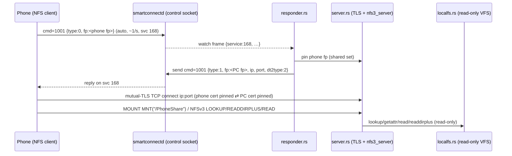

# PC→phone file sharing (`smartconnect-files serve`)

## What

Added a `smartconnect-files serve [--sharedir DIR]` subcommand that lets the connected phone **mount
and browse a PC folder, read-only**, over Smart Connect's File Station protocol. It is the mirror of
the already-working phone→PC mount: here the **PC is the NFS server** and the **phone is the NFS
client**, over the same NFSv3-on-fingerprint-pinned-mutual-TLS transport.

Status: **implemented, builds warning-free, covered by unit + loopback integration tests; live-phone
validation is pending** (the orchestrator will do it — no phone was touched).

## How

Three new modules in `files/src/`, plus a `serve` subcommand in `main.rs`:

- **`localfs.rs` — the read-only VFS.** Implements `nfs3_server`'s `NfsReadFileSystem` over one local
  directory. Every object gets a stable 64-bit id (inode) the first time it's seen, interned both
  ways (`id ↔ path`); inode 1 is the share root. `Handle = FileHandleU64`. Implements
  `lookup`/`getattr`/`read`/`readdirplus`/`readlink` (the default `readdir`, `fsinfo`, `lookup_by_path`
  come from the trait; `fsstat`/`pathconf`/`access` are handled by the server core via `getattr`).
  Attributes come from `nfs3_server::fs_util::metadata_to_fattr3` over `std::fs::symlink_metadata`.
  Pagination is deterministic (entries sorted by name; the NFS cookie is the entry's fileid, resumed
  by finding that id in the sorted list → `BAD_COOKIE` if unknown). Read-only is enforced by wrapping
  it in `nfs3_server::vfs::adapters::ReadOnlyAdapter` (every write op → `NFS3ERR_ROFS`, attrs masked
  to `0o555`).
- **`server.rs` — the TLS NFS server.** Builds a `rustls::ServerConfig` that presents our cert
  (`cert::Identity`, reused from the client) and requires a client cert verified by a custom
  `ClientCertVerifier` (`PinnedClientVerifier`) that accepts the phone **only by SHA-256(DER)
  fingerprint** — the server-side mirror of the client's `FingerprintVerifier`. The handshake
  signature is checked against the pinned cert's own public key via the shared
  `tls::verify_signature` (webpki rejects the phone's X.509 v1 cert, so it must not route through
  webpki). The pinned-fp set is an `Arc<RwLock<HashSet<String>>>` shared with the responder. The
  accept loop does `TlsAcceptor::accept`, then hands the stream to `nfs3_server`'s stream-generic
  `process_socket` with a per-connection clone of one base `RPCContext`.
- **`responder.rs` — the handshake responder.** Connects to the daemon control socket, `watch`es
  serviceId 168, and for each incoming `cmd=1001` `type:0` frame: extracts the phone's `fp`, inserts
  it into the pinned set, and (throttled) sends a `type:1` reply carrying our fp + LAN IP + the
  listener port, forcing `dt2type:2` (SSL) and advertising the same port for
  `port`/`nfsport`/`nfsDataPort`. The PC's LAN IP comes from the daemon's `status` (`pcAddress`), an
  `--ip` override, or a local private IPv4 (`if-addrs`).

Shared-code change: `tls::verify_signature` was made `pub(crate)` so both the client's
`ServerCertVerifier` and the server's `ClientCertVerifier` use the one fingerprint-pinned signature
check. The client path is untouched and still builds/passes.

New deps (`files/Cargo.toml`): `nfs3_server = "0.11"` (features `__test_reexports` for the
stream-generic `process_socket` + `RPCContext`, and `fs_util` for `metadata_to_fattr3`), `if-addrs`,
and tokio's `signal` feature (Ctrl-C).

## Why

- **Reuse the proven transport.** The phone→PC mount already established that File Station is
  serviceId 168 and that `SOCKET_SSL` (plain mutual-TLS TCP, fingerprint-pinned, webpki bypassed for
  the X.509 v1 cert) is the implementable path. PC→phone is the same wire protocol with roles
  swapped, so the server reuses `cert::Identity`, the fingerprint logic and `verify_signature`.
- **`nfs3_server` instead of hand-rolling NFS.** It ships the full RFC 1813 server (MOUNT + NFS +
  PORTMAP) and a clean read-only VFS trait, so the only new logic is the directory-backed VFS. Its
  `process_socket` is stream-generic, which is exactly what lets us drive it over our own
  `tokio_rustls::server::TlsStream` instead of its built-in plain-TCP listener.
  - **Caveat:** `process_socket`/`RPCContext` are public only behind the crate's `__test_reexports`
    feature (and `#[doc(hidden)]`). We enable that feature deliberately — it's the one way to feed an
    arbitrary stream to the server core (the public `NFSTcpListener` binds its own plain-TCP socket,
    which can't carry TLS). If a future `nfs3_server` exposes `process_socket` normally, drop the
    feature. Because `RPCContext::test_ctx` is the only outside constructor, it hard-codes
    `local_port = 2049`; we therefore default the listener to **port 2049** so the portmap
    `GETPORT` reply (which returns `local_port`) stays self-consistent with the advertised port.
- **Force SSL in the reply.** The native QUIC "dt2socket" tunnel (`dt2type:3`) isn't implementable
  from the phone bytecode; the phone clamps any non-`3` `dt2type` to `2`, so replying `dt2type:2`
  deterministically selects the plain mutual-TLS path we can serve.
- **Read-only by construction.** `ReadOnlyAdapter` guarantees no write op can slip through even if
  the VFS grew one, matching the feature's read-only scope and keeping the user's files safe.
- **No new daemon code.** The existing generic `send`/`watch`/`status` control-socket commands are
  enough to carry the handshake and discover the PC IP, so `serve` is a pure helper, like the mount.

## What still needs live-phone validation

1. Whether the phone, after our `type:1` reply, actually connects and mounts (the `type:0` trigger is
   confirmed by capture; the reply-field expectations and the mount flow are not wire-confirmed).
2. Whether the phone uses PORTMAP for this direction (if it does, the hard-coded `local_port=2049`
   matters — hence the 2049 default).
3. The exact `path`/label the phone expects and how it displays the share.
4. Whether the phone sends `type:0` unprompted for *every* connected PC, or only after some UI action.

## Key files

- `files/src/localfs.rs`, `files/src/server.rs`, `files/src/responder.rs` (new)
- `files/src/main.rs` (`serve` subcommand), `files/src/tls.rs` (`verify_signature` → `pub(crate)`),
  `files/src/daemon.rs` (`socket_path` → `pub(crate)`), `files/Cargo.toml` (deps)
- Tests: unit tests in `localfs.rs` (VFS over a temp dir) and `responder.rs` (reply JSON/parse);
  loopback integration tests in `server.rs` (our client mounts/lists/reads our server over mutual
  TLS; unpinned client rejected).
- Docs: `docs/protocol/file-exchange.md`, `docs/usage.md`, `README.md`, `CHANGELOG.md`.
