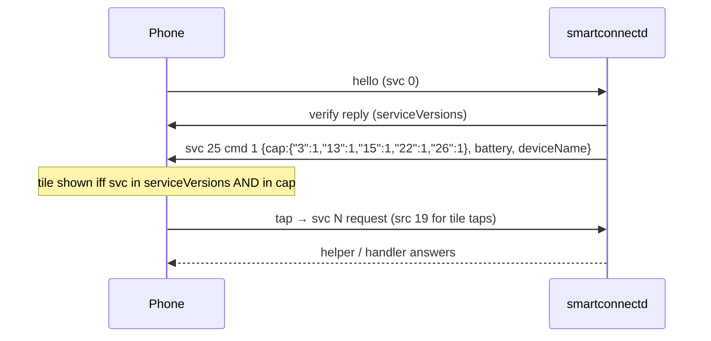

# Phone feature tiles: gating (svc 25 cap map), PC lock (svc 22), Hotspot (svc 13)

## What

- The phone's device page for "Linux PC" now shows feature tiles (App streaming, Cross Control,
  PC lock, Hotspot) like it does for a genuine Windows PC.
- Two tile handlers were added: **PC lock** (`src/pc_lock.rs`) and **Hotspot** (`src/hotspot.rs`).
- Tapping a tile only does something if a PC-side helper answers; the daemon now supervises those
  helpers (see `helper-supervision.md`).

## How

### Tile gating

A tile is drawn only if **all** of these hold (phone code `tc7.i` → `b54.I`, re-evaluated on every
refresh; full table in `evidence-2026-10-20/device-tiles-spec.md`):

1. the phone's own local capability check (passes on this phone);
2. the service is in the verify reply's `serviceVersions` (`proto::service_versions()`);
3. the service is a key in the **`cap` map of a PC → phone svc 25 `cmd 1`** message
   (`DeviceStatusServiceHelper.L`, persisted by the phone as `sp_latest_device_cap`).

We never sent (3), so no tile ever appeared. `server.rs` now sends
`proto::device_status_msg(name, battery)` right after the verify reply; the map comes from
`proto::device_status_caps()`. Cap bits: 1 = on, 2 = extra mode, 8 = busy elsewhere (tile shows
"in use"), 16 = turned off by user — only ever send 1.

| Tile | svc | Status |
|---|---|---|
| App streaming | 15 | on — phone picks the app, sends svc15 cmd 2; `smartconnect-mirror --host` answers |
| Cross Control | 26 | on — phone sends svc26 cmd 0; daemon spawns `smartconnect-crosscontrol --accept` |
| PC lock | 22 | on (needs svc 22 version ≥ 2) |
| Hotspot | 13 | on |
| Screen share / Mobile desktop | 1 | off by default; `--extra-tiles 1` adds it (phone svc 1 cmd 0 answered by the stream host, untested: `phone-view-invites.md`) |
| Webcam | 3 | on — phone sends svc3 cmd 0 `{isReply:0}`; daemon spawns `smartconnect-webcam --answer` (`webcam.md`, not verified on a device) |

`tests/handshake.rs` expects the svc 25 frame right after the verify reply.

### PC lock (svc 22)

Phone `{"ver":"1","cmd":1}` → `loginctl lock-session`; reply `{"ver":"1","cmd":2,"state":1}`, then
poll logind `LockedHint` every 2 s and send `state:0` on unlock. **Known limitation:** on the
user's niri + Noctalia setup the Noctalia lock screen doesn't react to logind's Lock signal, so
nothing visibly locks (LockedHint stays false → we immediately report "unlocked"). The user
deprioritized this.

### Hotspot (svc 13)

The **PC** chooses the SoftAP credentials: tap → phone `cmd 0` → PC `cmd 1 {authType:1 (WPA2),
ssid:"SmartConnect-xxxx", pwd:<16 random chars>, token:"", wsPort:0, fp}` → phone starts the hotspot
and sends `cmd 2` → PC `nmcli dev wifi connect` (5 retries). `cmd 4`/`cmd 6` (stop/error) →
`nmcli connection delete` so normal Wi-Fi returns. The passphrase is redacted from all logs/errors.
Untested live (joining drops the PC off its current Wi-Fi, and the phone link must then reconnect).

## Why

- The cap-map requirement was invisible from serviceVersions alone: the logcat showed the
  serviceVersions check passing for 1/15/26 while every tile still failed check (3).
- Only services with a working PC side are advertised: a tapped tile with no answer just times out
  on the phone, but svc 1 may trigger the screen-capture consent prompt and svc 13 may start
  tethering for nothing, so those stay off until implemented.
- Each svc 25 message replaces the whole map and the phone keeps the last one across reconnects,
  so the map must always be complete.

## Helper overrides: the daemon always sends the full map

**Bug:** `smartconnect-crosscontrol` set its "in use" flag by sending its own svc 25 `cmd 1` with
`cap: {"26": 9}` (and `{"26": 1}` on stop). The phone replaces its whole map with each message, so
while cross control ran, every other tile (App streaming, PC lock, Hotspot, Webcam) disappeared.

**Fix:** the daemon owns the map. `Daemon::cap_overrides` holds per-service flags set by helpers.
The control socket's `send` intercepts any svc 25 frame carrying a `cap` object, merges it into the
overrides, and sends `Daemon::device_status()` (base `device_status_caps()` plus overrides, battery,
name) instead. The verify-time svc 25 message uses the same function. Helpers need no change and
keep sending only the entries they own. Test: `proto::tests::device_status_keeps_every_tile_when_a_helper_overrides_one`.

**Caveat:** an override stays until a helper resets it, so a cross control client that crashes while
in use leaves "26" flagged until the daemon restarts.
