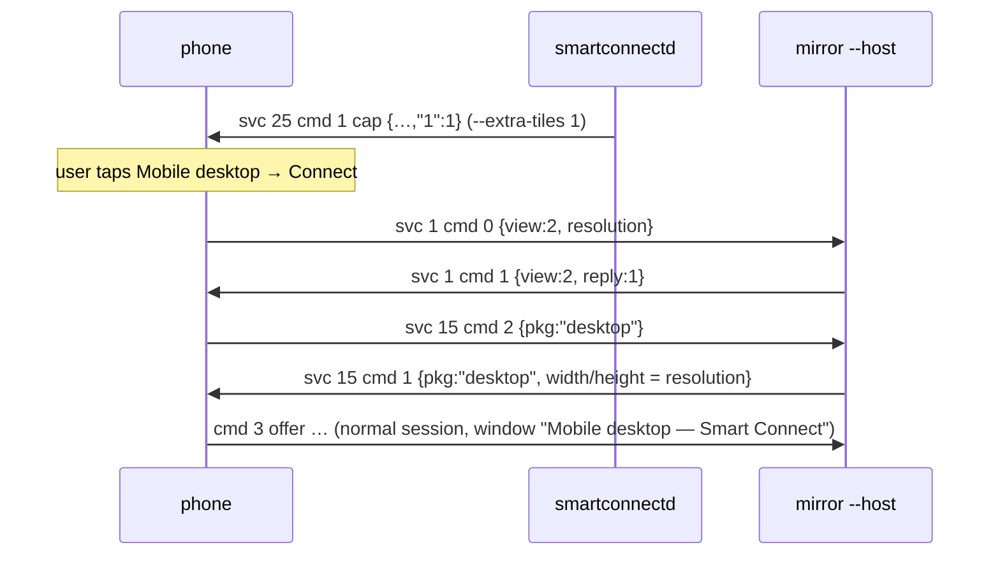

# Screen share / Mobile desktop tiles (phone-initiated svc 1 views) — 2026-10-21

Status: implemented, **untested on a device**; the tiles stay hidden unless the daemon runs with
`--extra-tiles 1`.

## What

- `smartconnectd --extra-tiles SVC[=FLAGS],…` adds entries to the svc 25 `cap` map
  (`proto::set_extra_tiles`, parsed by `proto::parse_extra_tiles`). `--extra-tiles 1` makes the
  phone draw **Screen share** and **Mobile desktop** (both gated on svc 1, which is already in
  `serviceVersions`). A warning is logged for services missing from `serviceVersions`.
- `smartconnect-mirror --host` answers the phone's svc 1 cmd 0 ("start view") with svc 1 cmd 1
  `{view (echoed), reply:1, drawerMode:false}`, then the svc 15 invite for `"mirror"`,
  `"desktop"` or `"mobile"` like any other stream (window titles "Phone / Mobile desktop /
  Virtual phone — Smart Connect").
- `smartconnect-mirror --desktop` (or host control `{"cmd":"desktop"}`) starts Ready For desktop
  from the PC (svc 1 cmd 1 `view:2, reply:0`).
- For `"desktop"` streams the host's svc 15 cmd 1 uses the resolution from the phone's cmd 0
  (`resolution`), else 1920x1080; physical size scaled at 344 mm per 1920 px.

## What the phone does (APK, `com.motorola.mobiledesktop` 09.0.3.013)

- Tile → `QuickSettingOnlineFragment`: qsType 2 = Mobile desktop panel `yj7` (resolution +
  orientation, Connect → `gu9.p(w,h)`, `gu9.o(1)`, `tc7.m(1)`); qsType 3 = Screen share panel
  `readyfor.remotedesktop.a` (Mirror = mode 0 or Virtual phone = mode 2, Connect → `gu9.o(mode)`,
  `tc7.m(1)`).
- `tc7.m(1)` → `service.q.r` → `qj7` case 2: checks (not cloud, main user, not in use, no WFD,
  codec capacity), then svc 1 cmd 0 `{ver:"1.0.0", cmd:0, view: mode+1, resolution?}` and a 20 s
  invite timer.
- PC cmd 1 → `zc7` case 13: phone state 1 (invited) → takes `view`/`drawerMode` from our cmd 1 →
  `qj7` case 1 `startHostService` → VirtualPhoneManager (`fu9`/`du9`) → svc 15 cmd 2 with
  `pkg = gu9.e(mode)` (`mirror`/`desktop`/`mobile`). `reply` is only checked in the idle state,
  where `reply:1` means "cancelled": answering with `reply:1` keeps a late answer from starting a
  fresh PC-initiated view.
- Desktop sizing (`appstream.a.f`, `"desktop"` branch): the phone's desktop resolution setting if it
  fits inside our cmd 1 `width x height`, else ours (encoder-capped); density from
  `phyWidth/phyHeight`.

## Why

- Opt-in tiles: nothing about the svc 1 flows has been seen on a device yet; a hidden tile can't
  confuse anyone. The phone persists the cap map, so a test run with `--extra-tiles 1` leaves the
  tiles until the next connection without the flag sends a fresh map.
- Only `--host` answers svc 1 cmd 0: it is the one process that always runs (daemon-supervised),
  so a standalone mirror and the host never both answer.
- `view` is echoed rather than forced to mirror: the panel's choice (mirror / virtual phone /
  desktop) is the user's.
- View packages are owned like the mirror (`own_mirror`), app packages like apps; titles and
  cmd 13 retitling skip view sessions; svc 1 cmd 5/11 closes all view sessions.

## To verify on the device

- Tile appears with `--extra-tiles 1`; Connect → window opens (Screen share = mirror, Virtual phone,
  Mobile desktop). The companion-device "allow streaming" prompt may appear first.
- Desktop mode input (keyboard + mouse on the desktop display) and resolution.
- `--desktop` from the PC.
