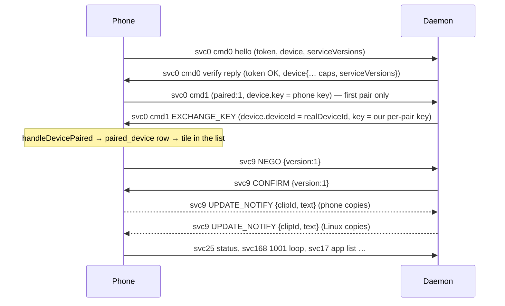

# Rung 5 — holding the session, service bring-up, and the pairing commit

Status 2026-10-20 (evening): **working end to end.** "Linux PC" is paired, appears in the phone's
device list next to the Windows PC, shows **connected** (Wi-Fi badge + Disconnect), and clipboard
**text syncs both ways** (phone → `wl-copy`, Linux `wl-paste --watch` → phone). Not yet: reconnect
without a QR re-scan (PC dial-back), file/image clips, any other service.

## What was implemented
- `server.rs` verify reply reshaped to match the genuine Windows reply, which the phone logs
  verbatim in `handleWsAvailable` (`evidence-2026-10-20/ble-capture/pair-logcat-win2.txt`):
  `connType:1`, `minVerCode`, a stable UUID `sn` (`Identity::serial_number`, derived from
  realDeviceId), `Sku`/`sku` from DMI (`identity::product_name`), `device.caps`,
  `device.serviceVersions` and a top-level `serviceVersions`.
- `proto.rs`: `service_versions()` = `{0:3, 9:4, 25:1}`, `service_caps()` = `{9:3}` — only services the
  daemon answers.
- `clipboard.rs`: serviceId 9 (spec: `evidence-2026-10-20/clipboard-spec.md`). Answers NEGO
  `{msgId:1,data:{version:v}}` with CONFIRM `{msgId:2,data:{version:min(v,1)}}`; text travels inline as
  UPDATE_NOTIFY `{msgId:3,data:{clipId,text}}` both ways with no ack/PULL; CLOSE (7) stops sending
  until the next NEGO. `LocalClipboard` writes phone text with `wl-copy` and follows Linux copies with
  `wl-paste --type text --watch` (helper frames `<CLIPBOARD_STATE>\n<text>\0`; `sensitive` =
  password-manager entries are never sent). Echo suppression: the last text that crossed the link in
  either direction is not re-sent. clipIds are seeded from the clock (Java int, rising across
  restarts). Copied files/screenshots arrive as `filelist` (served from the phone's NFS share) and are
  logged as unsupported. Never PULL a text clip, never send msgIds 13–17 or `shareHubMountInfo`, never
  send 101 (disables clipboard for this PC persistently).
- `server.rs::exchange_key` + `pairing.rs::save_phone_key`: the pairing commit (EXCHANGE_KEY, §3 below).
  Session logs are now created 0600 (they carry clipboard text).

## Why — the gates, in the order they were hit
1. **Version-complete `device` in the reply** (earlier fix): on connect the phone re-runs
   `getVersionMatchType` on the reply's device; a null `verName` crashed the app (NPE).
2. **`serviceVersions`/`caps` gate services.** The phone caches the PC's maps from the verify reply and
   only brings a service up if the PC lists it. With no map, `R4Clipboard ws available` was logged but
   `R4RemoteClipboard nego` never happened; after advertising `"9"` the phone sent NEGO immediately.
   The phone closes an unused socket after ~15 min with WS close 3123 "No used".
   The genuine PC advertises (for reference; we deliberately send a subset):
   - serviceVersions `{"0":3,"1":10,"13":1,"15":16,"18":1,"2":5,"20":4,"204":1,"205":2,"206":1,"21":3,"22":2,"24":2,"25":1,"26":1,"3":3,"32":2,"36":1,"5":2,"9":4}`
   - caps `{"1":2,"13":2,"15":3,"16":3,"168":3,"2":3,"20":2,"201":3,"202":1,"204":1,"205":3,"206":3,"21":3,"22":1,"24":3,"26":2,"3":3,"31":3,"311":3,"313":3,"5":2,"9":3}`, cap bitmask 10426.
   Note: omitting "168" from caps did NOT stop the ShareHub 1001 handshake loop (the ShareHub RE agent's
   inference was wrong on this point) — the loop is harmless spam for now.
3. **The pairing commit (EXCHANGE_KEY) — SOLVED.** Genuine first pair:
   ```
   17:39:10.743 handleWsAvailable                 (verify reply has NO device.key for a new phone)
   17:39:10.797 handleWsMessage EXCHANGE_KEY      (PC → phone, ~50 ms later)
   17:39:10.812 InstantSharingManager handleDevicePaired
   ```
   Ours: the phone sends svc 0 `{cmd:1, paired:1, device:{…, key:<phone key>}}` right after our reply;
   we don't answer, there is no EXCHANGE_KEY, and `PairServiceHelper handleFailure code:1` fires ~7 s
   later — the pair is never committed, so the device is never listed. PC-side RE says svc 0 `Cmd:1` is
   "per-pair `Device.Key` delivery" (`PaireDeviceWithPin` → `SendServiceMsg(…, ServiceManagerData{Cmd:1})`).
   **Fix** (spec `evidence-2026-10-20/pairing-commit-spec.md`): answer the phone's `cmd:1` with our own
   svc 0 `{ver:3, cmd:1, paired:1, device:{deviceId, realDeviceId, deviceName, key:<our per-pair key>, sn,
   os:6, type:4, i3:1, verCode, verName}}`. The phone does no key-equality check; it stores our key as
   `paired_device.secretKey` (PK `paired_device.deviceId` = our `device.deviceId`) and the home list is
   `SELECT * FROM paired_device WHERE pairedSource != 1`. We send our realDeviceId as `device.deviceId`,
   like the genuine PC (its `handleDevicePaired` logs its real id). The phone only starts the exchange on
   a FIRST pair (genuine reconnects never show EXCHANGE_KEY).
   **Tile offline right after the first pair:** the phone marks the PC online (`onDeviceOnline`) before
   the tile exists (`handleDevicePaired`), so a brand-new tile shows offline (✕, "Connect") until the
   next connection — then it shows connected. The genuine PC hides this by making the phone reconnect
   ~5 s after pairing (its follow-up invite over `/readyfor/mdns` + BLE). Our second QR scan did the same.
   **Noise:** repeating `PairServiceHelper handleFailure code:1` lines are the phone retrying the offline
   Windows PC over channel 10 (`R4Client{deviceName=…}` naming the Windows PC), not us; `code:134217728` = a disconnect.



## Pitfall: an empty `sn` poisons the identity
On connect the phone upserts a `remote_device` row (PK realDeviceId), but its "already exists?" probe
is `SELECT sn … WHERE realDeviceId`. Our early sessions sent `sn:""`, so the probe kept returning empty,
the code kept taking the INSERT branch, and every later connect hit `UNIQUE constraint failed:
remote_device.realDeviceId` (swallowed) — the commit never happened. Nothing on the phone ever deletes
such a row (unpair only clears `paired_device`). Fix: always send a stable non-empty `sn`
(`Identity::serial_number`). Recovery for an already-poisoned id: a fresh identity — move `identity.json`,
`cert.pem`, `key.pem`, `paired.json` from `~/.local/share/smartconnect-linux/` into
`old-identity-<ts>/` (done once, 2026-10-20) — or clear the app's data.

## Other things the phone pushes once connected (not yet consumed)
- svc 25 device status: `cmd 1` battery/charging/wifi/cell signal/bluetooth/`cap` map, `cmd 2` wallpaper
  (base64 JPEG + md5, ~280 KB), `cmd 20` AI capabilities, `cmd 22` `mUntrusted`.
- svc 100 `cmd 1018` (src 204): unread notification/message counts.
- svc 17 `cmd 1`: app list (~30 KB). svc 168: ShareHub/NFS handshake (`1001`) + file list (`2001/2005/2012`).
- The genuine PC also sends its own svc 25 status (incl. AiCapabilities `pluginId 313`) — the phone logs
  `addRemoteAICapability`. Not needed for pairing.

## Reconnect (not implemented)
The phone does not redial a known PC by itself after the daemon restarts; the genuine PC dials the
phone's `/readyfor/mdns` WebSocket and sends a fresh `cmd:1` invite (channel 3), plus a BLE write
(channel 1). Until that exists, every daemon restart needs a QR re-scan.
