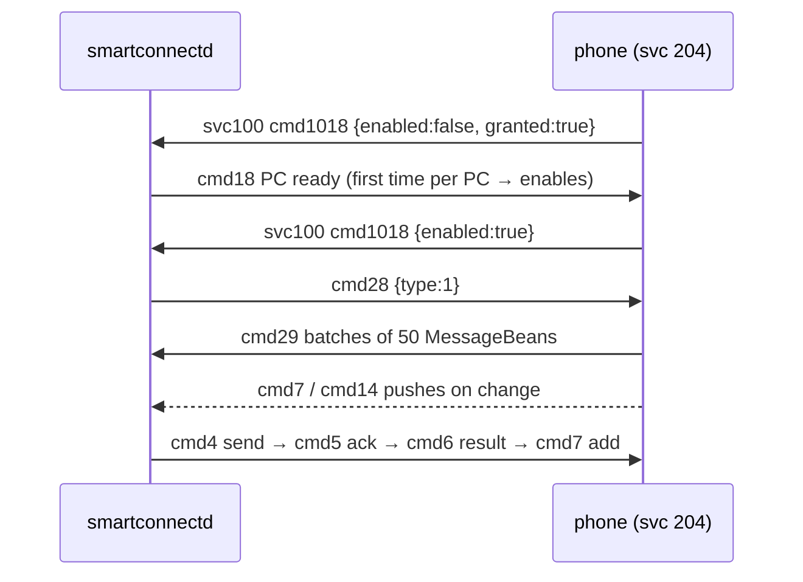

# SMS (Messages, phone svc 204)

## What
Daemon-side support for reading SMS conversations, sending SMS and marking read, via the phone's
"MessageHelper" service 204. New module `src/sms.rs`; control commands `sms_threads`, `sms_thread`,
`sms_send`, `sms_mark_read`, `sms_state`. Full protocol: `evidence-2026-10-20/sms-spec.md`.

## How
- `sms.rs`: builders wrapping payloads in the phone's `MessageData` (`{ver:"5.0",cmd,pId:110,data}`),
  an `SmsState` that folds phone frames (cmd 1018 on svc 100; cmds 2/3/6/7/11/13/14/17/21/23/25/27/29
  on svc 204) into a message map keyed by (kind, msgId), plus thread grouping.
- A global `store()` (static `Mutex<SmsState>`) fed by `spawn_collector`, which subscribes to
  `daemon.from_phone`; it is started from `control::serve` so no edit to `server.rs`/`main.rs` was needed.
- `request_sync` sends `cmd 18` (PC ready) when the phone reports `enabled:false`, then 12/1/28; the
  collector re-sends the sync once `enabled` flips to true.

## Why
- No thread id exists on the wire, so threads are grouped locally by counterpart address.
- The phone silently drops replies until the PC is enabled; `cmd 18` is the only PC-side way to enable it,
  so it is sent automatically on the first sync instead of needing a separate command.
- The store lives in `sms.rs` (static) rather than a `Daemon` field to keep edits out of `server.rs`,
  which other work touches concurrently.
- `serviceVersions` left unchanged: the phone already sends 1018 to us without `204` listed.
