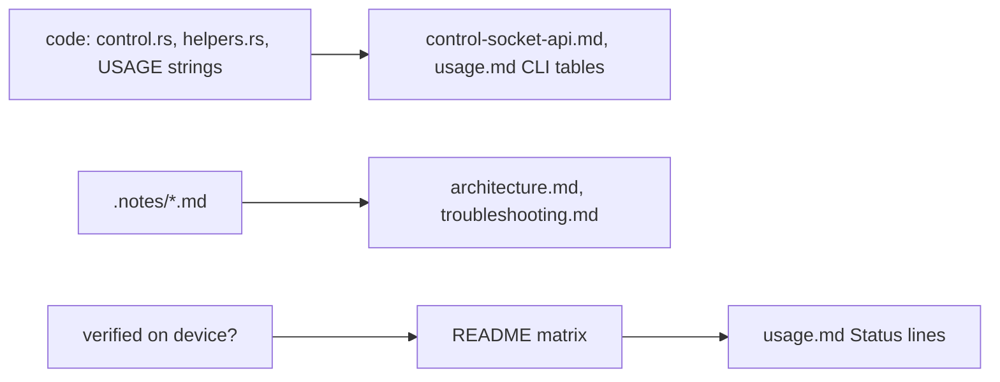

# User-facing documentation set (README, docs/, CONTRIBUTING, CHANGELOG)

## What

The first full documentation set for the public repository:

- `README.md`: pitch, feature matrix, requirements, quick start, components, disclaimer, MIT license.
- `docs/index.md` (map), `installation.md`, `usage.md`, `troubleshooting.md`, `architecture.md`,
  `control-socket-api.md`, `development.md`, `security.md`.
- `CONTRIBUTING.md` (documentation and privacy rules, PR checklist, bug reports) and `CHANGELOG.md`
  (Keep a Changelog, everything so far under `[Unreleased]`).

## How: which page owns what

| Fact | Canonical place | Must stay in sync with |
|---|---|---|
| Feature status (✅ 🟡 🚧 ❌) | README matrix | Per-feature "Status:" lines in `docs/usage.md` use the same keys and the same verdicts. |
| How to use a feature | `docs/usage.md` | CLI tables copied from each binary's `--help`: clap in `src/main.rs`, `USAGE` in `mirror/`, `crosscontrol/`, `display/`. |
| Control socket | `docs/control-socket-api.md` | `src/control.rs` (every command, reply and error string), `status.rs` (`PhoneStatus` fields), `sms.rs` (SMS objects), and `mirror/src/main.rs` `Host::on_ctl` (stream host socket). |
| Where binaries are looked up | `docs/installation.md` table | `helpers.rs::binary`, `gui/src/mirror.rs::binary`, the Noctalia `SmartConnect.qml` paths. |
| Files, permissions, logging | `docs/security.md` | Every `fs::write`/`write_private`/`SessionLog::redact` site. |
| Wire formats | `docs/protocol/` | User docs link to it and never repeat payload details. |

`docs/architecture.md` holds the Mermaid diagrams (processes, relay, session lifecycle, connection
state machine, helper supervision, data flows). The user pages carry one small diagram at most.

## Why

- **One canonical place for status.** CLAUDE.md requires every feature's docs to say what is
  verified. Repeating the README verdict on each usage section, with the same keys, keeps the two
  from drifting; any status change edits both.
- **The stream host socket is documented in the control socket page.** Front-ends need both
  sockets, and the host's protocol is small. A separate page would get out of date sooner.
- **Known security gaps are documented publicly.** These are reconnects accepted on a paired
  `realDeviceId`, secrets in session logs (per-pair keys, the hotspot password, clipboard and SMS
  text), state files created with the umask, and listening on all interfaces. Users of a LAN-exposed
  daemon need this to judge the risk, and each gap comes with a mitigation. Remove an entry from
  `security.md` when the code fixes it.
- **Arch package names were verified, not guessed.** For each GStreamer element the code uses:
  `gst-inspect-1.0 <element>` gives the plugin file, then `pacman -Qo` gives the package. That's
  how `libnice` (ICE elements, not pulled in by `gst-plugins-bad`) and `gst-plugin-va` showed up as
  separate packages. The Debian and Fedora lists are hints and are marked untested.

## Final docs pass before publication (2026-10-21)

**What:** brought README, `docs/` and the CHANGELOG up to date with everything built after the
first documentation set: background notification actions, the mute UI, `--extra-tiles` views,
opt-in window resize, the ICE filter (`pcAddress`, `SMARTCONNECT_ICE_ADDRESSES`), the phone display
(GTK *Display* page, Noctalia button and `display` IPC, `display.json`, start from the phone,
single instance, `--osk-height`, `--follow-rotation`, `--audio`), the webcam, the security fixes
(opt-in redacted session logs, 0700/0600) and the packaging (`install.sh`, `SMARTCONNECT_*_BIN`).

**How:**

- The README matrix was re-cut feature by feature so that verified and unverified parts never
  share a row (Extend ✅ but rotation 🟡; PC-started app streaming ✅ but the phone tile 🟡). The
  🚧 key is gone: everything is either verified, implemented but unverified, or not supported.
  `usage.md` "Status:" lines repeat the same verdicts.
- `usage.md` CLI tables were rebuilt from the `--help` output of all six binaries, plus every
  `SMARTCONNECT_*`/`MIRROR_*` variable found by grepping the code. `display.json` is documented as a
  key ↔ flag table, since the file is the contract between the front-ends and the helper.
- `control-socket-api.md` gained `pcAddress`, notification `pkg`, the service `-1` local events,
  the full svc 25 `cap` merge semantics, and the host socket's `desktop` command and `headless`
  field. `architecture.md` gained a helper table (host always; Cross Control on svc 26 cmd 0;
  display on svc 202 cmd 50; webcam on svc 3), the background-action sequence and the display
  front-end model. `security.md` moved the fixed gaps to a "Fixed" list and documents that a paired
  phone can now start a display session by itself.

**Why:** the docs are the only status report a user gets, so each claim was checked against code
(`helpers.rs`, `control.rs`, `status.rs`, `server.rs::redact`, `opts.rs`) rather than copied from
notes; where a note and the code disagreed, the code won (for example the 12 s / 30 s caps of a
headless session, and that a phone-started display takes only the mode from the phone).
