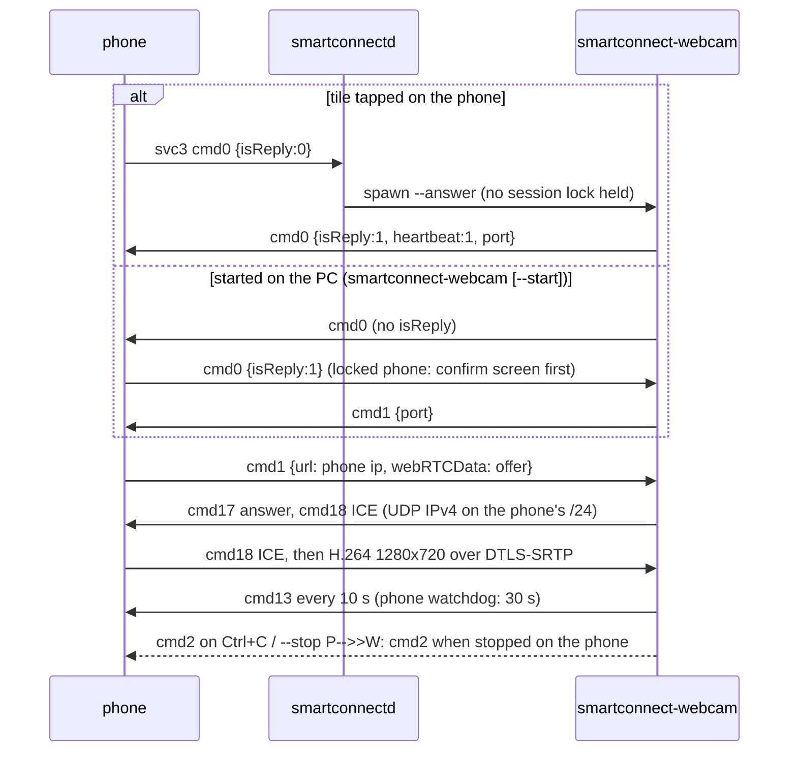

# Phone as PC webcam (svc 3) — 2026-10-21

Spec: `evidence-2026-10-20/webcam-spec.md`; the public port will be `docs/protocol/webcam.md`.

## What
- The phone's **Webcam** tile works against the Linux PC, and the PC can start the phone camera itself.
  Frames end up in a **v4l2loopback** device, so every V4L2 app sees a camera. Without one, they go to a
  **PipeWire camera node** ("Phone Camera (Smart Connect)", `media.class=Video/Source`, `media.role=Camera`).
- New crate `webcam/` → `smartconnect-webcam` (gstreamer-rs, a separate process like `mirror/`).
- Daemon: `src/webcam.rs` (svc 3 helpers), `helpers.rs::answer_webcam`, `proto.rs` advertises
  `serviceVersions["3"]=3` and svc 25 `cap["3"]=1` (that's what makes the tile appear).

## How

- Signalling goes through the daemon's existing control socket (`watch [3]` + `send`). The helper's
  messages are in `webcam/src/proto.rs` (pure, unit-tested). Media never passes through the daemon:
  `webrtcbin` in the helper receives it directly.
- Pipeline per session: `webrtcbin` (max-bundle) → `rtph264depay ! h264parse ! vah264dec|avdec_h264 !
  videoconvert ! videoscale add-borders ! videorate ! 1280x720 YUY2 30/1 ! queue leaky ! sink`. The
  offer is trimmed to H.264 and the video-orientation extension is dropped (same as the mirror).
- Output choice (`webcam/src/output.rs`): `--output auto` picks the first v4l2loopback device, preferring
  the label "Phone Camera". A device counts only if `/sys/class/video4linux/videoN` resolves under
  `/sys/devices/virtual/`, so the laptop's USB camera (`/dev/video0`/`1`) can never be chosen. An
  explicit `--device` that isn't virtual is refused. Fallback: `pipewiresink mode=provide
  use-bufferpool=false` with the camera stream properties.
- One session at a time: `$XDG_RUNTIME_DIR/smartconnect-webcam.lock` (flock + pid). The daemon spawns
  `--answer` only while the lock is free. `--stop` sends SIGTERM to the pid; the helper sends cmd 2 and exits.
- Daemon fallback: if `smartconnect-webcam` can't be spawned, the daemon replies error 12 and the phone
  shows its "install the PC camera driver" dialog.

## How to run
```sh
# optional, for a camera every app sees (root; prints the same text via --check):
sudo modprobe v4l2loopback devices=1 video_nr=10 card_label="Phone Camera" exclusive_caps=1
# persistent:
echo v4l2loopback | sudo tee /etc/modules-load.d/v4l2loopback.conf
echo 'options v4l2loopback devices=1 video_nr=10 card_label="Phone Camera" exclusive_caps=1' | sudo tee /etc/modprobe.d/v4l2loopback.conf

smartconnect-webcam --check            # where frames go + GStreamer element check
smartconnect-webcam --test-pattern 10  # test pattern into the output, no phone needed
smartconnect-webcam                    # start the phone camera from the PC (Ctrl+C or --stop ends it)
smartconnect-webcam --switch-camera | --torch | --zoom N | --cameras
```
Or tap **Webcam** on the phone's device page: the daemon starts the helper. Its log is
`$XDG_RUNTIME_DIR/smartconnectd/smartconnect-webcam.log`. With `exclusive_caps=1` the loopback device
shows up as a capture device only while a session streams. Apps list cameras when they start, so
start the webcam first.

## Why
- **WebRTC, not `/readyfor/webcam`:** the phone hard-codes a WebRTC session and the APK never mentions
  that path. In winapi.dll, `webcamHandler` rejects every non-loopback peer: it's the Windows UI's
  preview feed. So no daemon route was added. Any stray upgrade would still show in the daemon's
  "WebSocket upgraded" log line.
- **Separate helper, not GStreamer in the daemon:** same split as `mirror/`. The daemon stays small,
  and a crashing decoder can't take the phone link down.
- **Fixed 1280x720 YUY2 30 fps output:** a v4l2loopback device can't change format while an app has
  it open, and YUY2 is the most widely accepted webcam format. The phone already sends 1280x720,
  rotated and letterboxed on the phone.
- **`use-bufferpool=false` on pipewiresink:** found with the test pattern. With the pool, the pipeline
  stalled after 2 frames until some app opened the camera, because the pool only recycles buffers
  while a consumer is attached.
- **Heartbeat 10 s:** the phone's watchdog fires after 30 s without `cmd 13`.
- Rejected: always-on helper supervised like the mirror host. A webcam session is short-lived and
  needs no state between sessions, so spawn-on-request plus a lock is simpler.

## Verified / not verified
- Verified: unit tests (`webcam/`: message shapes, offer trimming, candidate filter, device selection;
  daemon: request detection). `--test-pattern` into PipeWire gives 30 fps, the node appears as
  `Video/Source`/`Camera`, a `pipewiresrc` client reads it, and there is no stall without a consumer.
  `--device /dev/video0` is refused.
- Verified with a phone (2026-10-21): a live session, and switching between the front and back
  camera (after the fix below).
- Not recorded: whether that session went to v4l2loopback or to the PipeWire node.
- Not yet verified: the quality presets' effect, pause/resume (`cmd 11/12`, not used), behaviour when the phone
  rotates, the Motorola UVC camera-app path (`com.motorola.motcameradesktop` phones).

## Camera flip stopped the webcam (fixed) and quality presets

**Bug (observed live, 2026-10-21):** switching to the selfie camera stopped the webcam. The session
log showed the phone re-sending its `cmd 1` start message with the **identical offer** (same `o=`
session id and version, ICE credentials and DTLS fingerprint) about 14 s in, right after the
switch. The phone re-sends its start message whenever its camera screen reports "streaming
started". The helper treated it as a new session: it dropped the working connection and sent a
second answer with new ICE credentials. The phone's peer connection, already stable, couldn't take
it and sent `cmd 2` (stop) 10 ms later.

**Fix:** `proto::sdp_origin` + `proto::classify_offer` compare the offer's `o=` line with the one
already answered:
- **Repeat** (same id and version): keep the session and send nothing.
- **Renegotiation** (same id, new version): answer on the same webrtcbin.
- **New session** (new id): replace the webrtcbin.

Test: `repeated_offers_are_not_answered_again`.

**Quality:** the phone always captures 1280x720 at 30 fps in this mode; there's no PC command to
change it, so 60 fps isn't possible. The bitrate is the receiver's to set: `--quality
low|medium|high|max` (default `high`; also `quality` in `~/.config/smartconnect-linux/webcam.json`,
which applies to sessions the daemon starts from the phone's tile) writes `b=AS:<max>` and
`x-google-{min,start,max}-bitrate` into the answer sent to the phone. Presets are
300/800/1500, 800/2000/4000, 1500/4000/8000 and 2500/8000/15000 kbit/s. Whether the phone's own
encoder caps the maximum below `max` is untested. Test: `bitrate_goes_into_the_video_section_and_h264_fmtp`.
