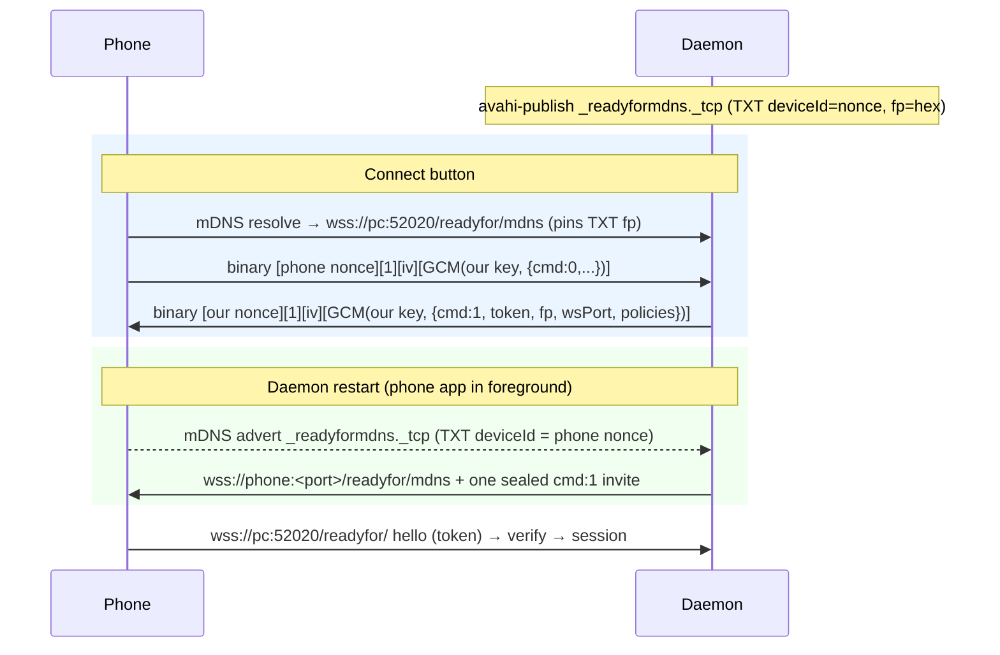

# Wi-Fi reconnect without a QR (`/readyfor/mdns`, discovery channel 3)

Status 2026-10-20: **verified on the phone** — after the phone dropped the session, the daemon saw its
`_readyformdns._tcp` advert, pushed the sealed invite to its `/readyfor/mdns` (port 11330 that run), and the
phone dialed `/readyfor/` back 0.2 s later with no QR. Needs inbound mDNS through the firewall.

Re-pairing after the user removes our tile: the phone still reports `paired:1` and never starts the key
exchange itself, so the tile never comes back. `server.rs::session_loop` therefore sends EXCHANGE_KEY
**unprompted** if the phone hasn't sent its svc 0 `cmd:1` within 2 s (the phone's handler is
insert-or-update, so repeating it on every connect is harmless). Known gap: after the user taps
Disconnect, the watcher dials the phone straight back if its advert is up.

## What
Three ways the phone reconnects to the daemon without scanning a QR:
1. **Connect button** on an offline tile — the phone finds us by mDNS and asks us to invite it.
2. **Daemon restart** — we spot the phone's own mDNS advert (only up while Smart Connect is in the
   foreground) and push it an invite.
3. **Post-pair refresh** — 5 s after a first pair we push an invite, so the brand-new tile (which the
   phone creates *after* marking the PC online) flips to "connected" like the Windows PC's does.

## How
- `src/discovery.rs`
  - Discovery frame (`seal`/`open`): binary WS message `[16 B sender nonce id][1 B type=1][12 B IV]
    [AES-256-GCM ct||tag]`, AAD = first 17 bytes, key = **our per-pair key** (`paired.json` `key`, the
    one sent in EXCHANGE_KEY = the phone's `paired_device.secretKey`). Type 2 (plaintext) makes the
    phone unpair — never sent.
  - `invite_json`: `{ver:2, cmd:1, deviceId:<our nonce>, deviceName, fp:<b64 sha256 cert>, token,
    policies:[{wifi:[ips]}], wsPort, appVer, verCode, os:6, scType:2, type:4}`. The phone checks
    token/fp/policies/wsPort, then dials `wss://<ip>:<wsPort>/readyfor/` pinning our cert.
  - `serve`: our `/readyfor/mdns` endpoint (same TLS listener/port as the control WS, routed by path in
    `server.rs`). Finds the paired phone by its frame prefix (`identity::is_nonce_of`), decrypts with our
    key (then the phone's), and answers a `cmd:0` trigger with the sealed invite on the same socket.
  - `push_invite`/`dial_phone`: dial the phone's `/readyfor/mdns` (its self-signed cert is not pinned;
    the payload is sealed), send one frame, linger 5 s, close. The phone replies by dialing us.
  - `advertise`: `avahi-publish -s <name> _readyformdns._tcp <port>` with the Windows TXT set
    (`deviceId`=nonce, `deviceName`, `appType=1`, `type=4`, `os=6`, `cap=0`, `timestamp` in seconds,
    `fp` lowercase hex).
  - `watch_phones`: `avahi-browse -r -p -k _readyformdns._tcp`; a resolved advert whose TXT
    `deviceId` is a paired phone's nonce is remembered (`Daemon::remember_phone_mdns`) and, if no session
    is up, dialed back.
- `identity.rs`: `device_id` is now a per-run nonce `salt8 || SHA256(realId || salt8)[..8]` (the
  phone's `gy3.s`), like the Windows PC's per-run id. The phone maps any such nonce back to our
  realDeviceId by recomputing the hash.
- `server.rs`: path routing for `/readyfor/mdns`; `Daemon::current_token` (an invite token valid ≥ 60 s
  for discovery invites); `schedule_post_pair_dial` after EXCHANGE_KEY.

## Why this way
- Spec and evidence: `evidence-2026-10-20/reconnect-spec.md` (static RE + the Windows capture's
  channel-3 `/readyfor/mdns` lines). Bluetooth/cloud aren't needed; the "check Bluetooth" dialog is the
  phone's catch-all when no trigger channel reached the PC.
- avahi child processes instead of an in-process mDNS crate: avahi already owns UDP 5353 on this
  desktop; publishing through it avoids two responders fighting over the port.
- The invite is sealed with **our** key because the phone resolves the frame prefix to our realDeviceId
  and decrypts with that pair's `paired_device.secretKey`.

## Prerequisites (runtime)
- `firewall-cmd --add-service=mdns` (+ `--permanent`): the `public` zone only allowed 52020/tcp, so the
  phone's mDNS queries and adverts never reached avahi.
- One more unpair + QR pair: the current tile was filed under the old session id (before EXCHANGE_KEY
  sent our realDeviceId as `device.deviceId`), and the phone looks up the key for our frames by
  realDeviceId. A pair made with the fixed EXCHANGE_KEY is filed under the realDeviceId.

## Open risks
- The phone's `/readyfor/mdns` server and advert exist only while the app is in the foreground, so the
  restart path needs the user to open the app; the Connect button is the robust path.
- Not runtime-verified: whether the phone accepts the invite on the same socket it triggered on.
- `is_connected` is daemon-wide (any phone); fine for one phone.

## Bluetooth fallback for desktop-side Connect (`src/ble_connect.rs`) — verified 2026-10-20

The phone's `/readyfor/mdns` server only runs while Smart Connect is in the foreground (otherwise
`Connection refused`), so `discovery::connect_now` tries Wi-Fi first and then Bluetooth LE, like the
genuine PC (Windows HCI capture in `evidence-2026-10-20/ble-capture/CAPTURE-NOTES.md`):

1. Scan (BlueZ via `bluer`) for service 0x5246. The phone's advert service data is
   `10 11 f5 14 || 16-byte nonce`, and the nonce is `salt8 || SHA256(realPhoneId || salt8)[..8]`
   (checked against a live advert) → `identity::is_nonce_of` against paired phones.
2. Connect as GATT central, subscribe to 0x0722 (indicate) and 0x0726 (notify), then write ONE frame to
   0x0722: the same AES-GCM-sealed `cmd:1` invite as on `/readyfor/mdns` (prefix = our nonce id).
3. The phone dials `wss://pc:52020/readyfor/` (0.3 s after the write in testing); drop the LE link.

Pitfalls: the phone rotates its LE address and a new device's service data can arrive after its
DeviceAdded event, so the scan also re-checks all known devices every second — but only ones with a
current RSSI, because BlueZ keeps stale entries for old addresses whose cached service data still
matches. Scan timeout 20 s.

## Persistence (auto-reconnect) — verified 2026-10-20

Superseded in part by [background-reconnect.md](background-reconnect.md) (2026-10-21): the loop
moved to `src/reconnect.rs` (presence probe, nudges, 60 s cap while the phone is on the LAN),
connects are serialized, BLE scans are 30 s with cancel + rescan, and silent sessions drop after 70 s.

- The phone backgrounding Smart Connect does NOT drop the LAN session: its "Power saving" close only
  applies to Wi-Fi Direct (`networkType 3`, `se7` handleScreenOff/ACTION_DISCONNECT_WFD).
- svc 0 `cmd 6` = the phone announcing a user Disconnect (`me7` case 2: send `R4Data(3, 6, device)`, close
  2 s later). The daemon records it (`phone_said_bye`) → `user_disconnected`, as does desktop Disconnect.
  Any Connect (desktop button, or a verified session the phone opens) clears it.
- Any other session end (and startup, after 8 s) runs one `spawn_auto_reconnect` loop: `connect_now`
  (Wi-Fi `/readyfor/mdns`, then BLE) with backoff 2/5/15/30/60 s then every 300 s, until connected or the
  user disconnects. Verified: daemon restart with the app backgrounded → BLE invite → connected in ~8 s.
- BLE scan has NO UUID discovery filter: with the app backgrounded the phone's advert only carries 0x5246
  as service data, which BlueZ's UUID filter doesn't match. The daemon never changes adapter power
  (suspected of making BlueZ reconnect the user's earbuds).
