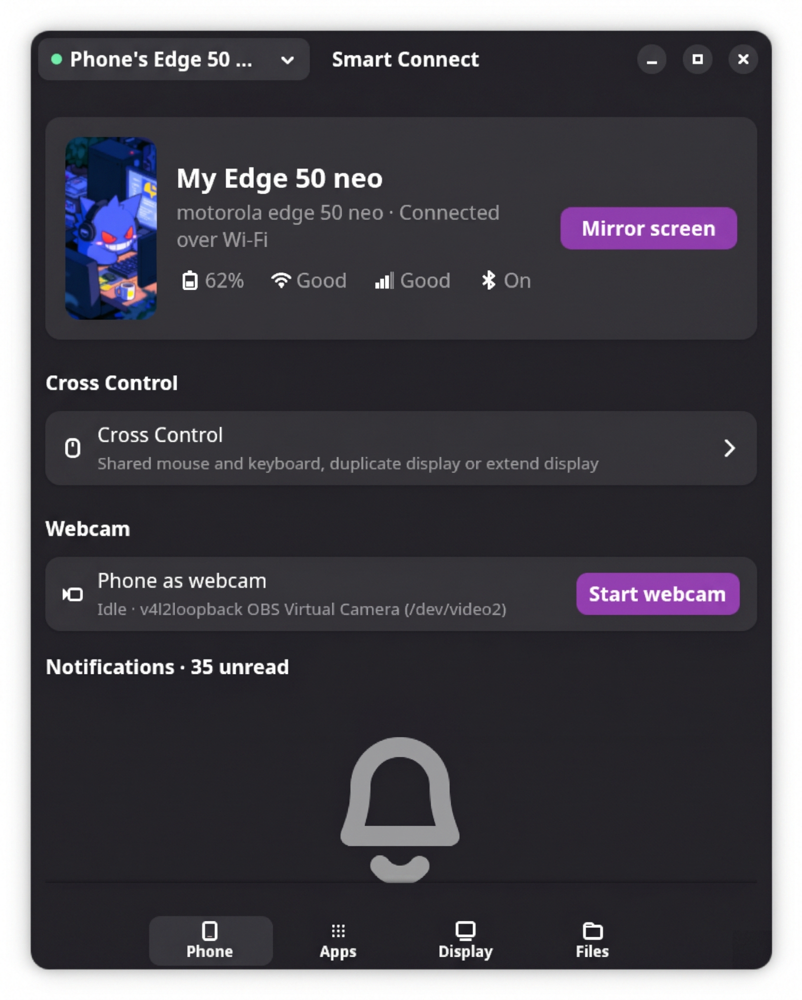
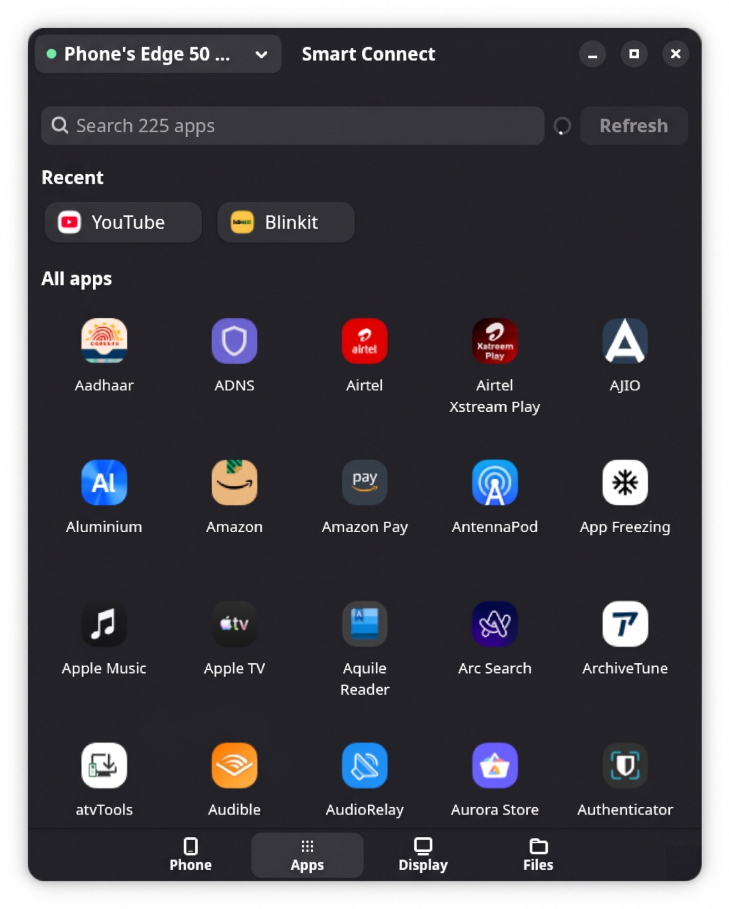
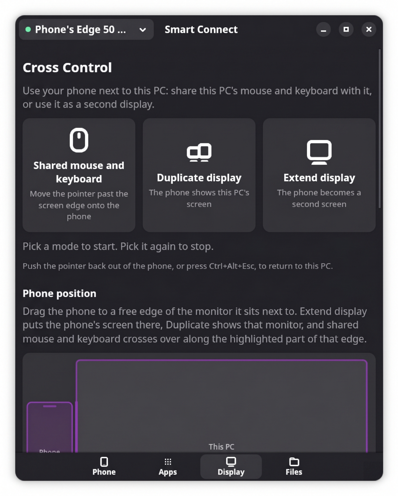
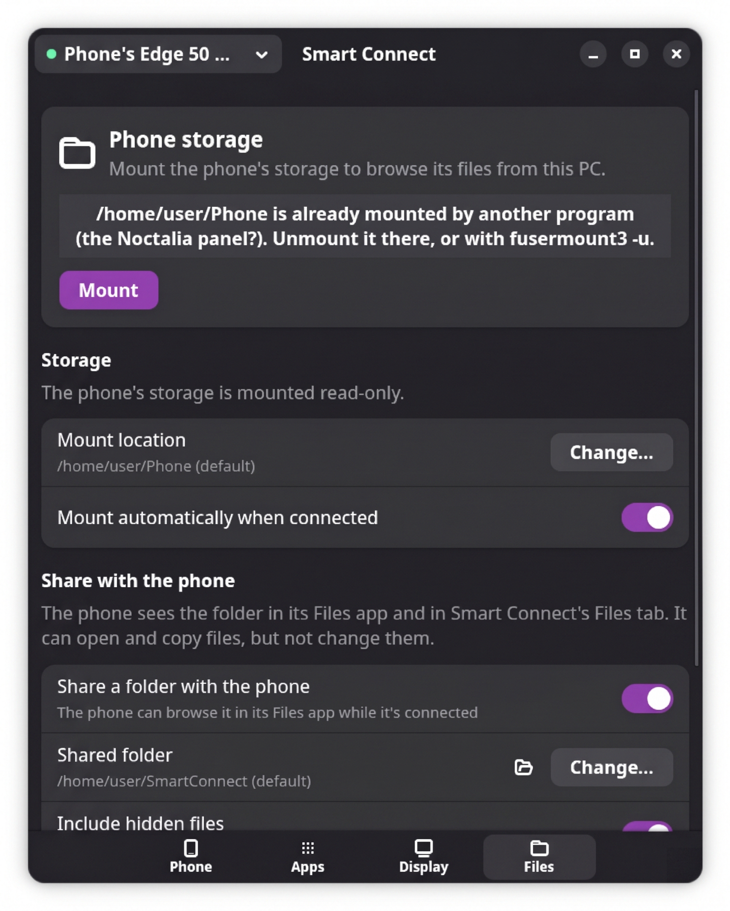

# smartconnect-linux

[](https://github.com/vemru/linuxsmartconnect/releases/tag/v0.3.0)
[](LICENSE-MIT)
[](docs/installation.md)
[](https://www.rust-lang.org)

Native Linux companion daemon and GTK4/Libadwaita application for the Motorola/Lenovo Smart Connect ecosystem — screen mirroring, phone-as-webcam, external display, file sharing, and clipboard sync over local Wi-Fi.

The phone connects using the stock, unmodified Motorola Smart Connect Android application: **no root privileges, no developer options, and no third-party mobile apps required.**

---

### :warning: Disclaimer & Trademark Notice

> [!IMPORTANT]
> **smartconnect-linux** is an independent, community-driven open-source project. It is **not** affiliated with, sponsored by, or endorsed by Motorola Mobility LLC, Lenovo Group Ltd., or any of their affiliates.
>
> This software is developed cleanly for interoperability purposes under statutory reverse-engineering exceptions (such as EU Directive 2009/24/EC Article 6 and 17 U.S.C. § 1201(f)). All trademarks, service marks, trade names, and product names (including "Motorola", "Ready For", and "Smart Connect") are the property of their respective owners.

---

## :camera_flash: Interface Preview

| **Main Page & Device Status** | **Apps Page (App Streaming)** |
| :---: | :---: |
|  |  |
| *Phone connection, battery, live mirror & webcam controls* | *Launch individual Android apps into native Linux windows* |
| **Display Page (Cross Control)** | **Files Page (Wireless Storage)** |
|  |  |
| *Mouse/keyboard edge traversal and duplicate/extend modes* | *Mount phone storage locally and share PC folders to Android* |

---

## Features

- **Screen Mirroring & App Streaming:** Low-latency WebRTC H.264 screen mirroring with hardware video decoding (VA-API), mouse/keyboard navigation, and individual Android apps running in isolated desktop windows.
- **Phone as Webcam:** Feed high-definition front or rear phone camera video directly into desktop applications (OBS, Zoom, Google Meet, Firefox, Chromium) via `v4l2loopback` or PipeWire camera nodes.
- **Cross Control:** Seamlessly glide your PC mouse pointer and keyboard focus across desktop screen boundaries onto your phone display (Wayland `wlr-layer-shell` or GNOME Shell `InputCapture` portal).
- **Phone as External Display:** Extend your desktop workspace onto the phone as a secondary monitor or duplicate your screen, featuring touch gesture injection and on-screen keyboard support.
- **Wireless Storage & File Sharing:** Mount phone storage locally via FUSE (NFSv3 over mutual TLS), export PC folders (`~/SmartConnect`) read-only to Android, and browse photos with asynchronous thumbnail caching.
- **Notification & SMS Integration:** Real-time desktop notification synchronization with contact avatars, multi-line chat previews, inline quick replies, and per-app mute toggles.
- **Clipboard Sync with OTP Protection:** Bi-directional text clipboard synchronization. Password manager entries are filtered out, and one-time passwords (OTP / 2FA codes) require explicit double-copy confirmation before transmission.
- **Searchable Activity Timeline:** SQLite FTS5-backed local activity log recording file transfers, notifications, and clipboard events with full-text search.
- **Command Palette:** Quick fuzzy search across connected phone actions, settings, and apps (`smartconnectd palette`) with compositor keybinding shortcuts.
- **Connection Doctor:** Automated diagnostic utility (`smartconnectd doctor`) checking network interfaces, Avahi mDNS discovery, listener ports, firewall rules, and dependencies with safe repair scripts.
- **File Manager Integrations:** Native right-click "Send to phone" action scripts for GNOME Nautilus, KDE Dolphin, Nemo, and Thunar, plus the CLI `smartconnectd send` utility.

---

## Requirements & Supported Platforms

### Linux Distributions
- **Arch Linux** / Manjaro / EndeavourOS
- **Fedora 40+** / RHEL 9+
- **Ubuntu 24.04 LTS+** / Debian 12 (Bookworm)+

### Desktop Compositors
- **GNOME Shell (45+)** (Wayland)
- **KDE Plasma (6+)** (Wayland)
- **wlroots compositors:** Hyprland, Sway, Niri

### Mobile Handsets
- Motorola or Lenovo Android devices running **Android 11 or newer** with the official **Motorola Smart Connect** app installed from Google Play.

---

## Installation

### 1. Install System Dependencies

<details open>
<summary><b>Select your distribution</b></summary>

- **Arch Linux:**
  ```bash
  sudo pacman -S --needed git base-devel rust avahi bluez wl-clipboard fuse3 \
    gstreamer gst-plugins-{base,good,bad} libnice gst-libav gst-plugin-va gtk4 libadwaita
  sudo systemctl enable --now avahi-daemon bluetooth
  ```

- **Fedora:**
  ```bash
  sudo dnf install git gcc pkgconf-pkg-config dbus-devel wayland-devel avahi bluez \
    wl-clipboard fuse3 gstreamer1-devel gstreamer1-plugins-{base,good,bad-free} \
    libnice-gstreamer1 gst-plugin-va gtk4-devel libadwaita-devel
  sudo systemctl enable --now avahi-daemon bluetooth
  ```

- **Ubuntu 24.04+ / Debian 12+:**
  ```bash
  sudo apt install git build-essential pkg-config libdbus-1-dev libwayland-dev \
    avahi-daemon bluez wl-clipboard fuse3 libgtk-4-dev libadwaita-1-dev \
    gstreamer1.0-plugins-{base,good,bad} gstreamer1.0-nice gstreamer1.0-libav gstreamer1.0-vaapi
  sudo systemctl enable --now avahi-daemon bluetooth
  ```

</details>

### 2. Build and Install

Clone the repository and run the installer:

```bash
git clone https://github.com/vemru/linuxsmartconnect.git
cd linuxsmartconnect
./packaging/install.sh --enable
```

The installer builds the entire Cargo workspace in release mode and installs:
- Binaries to `~/.local/bin/` (`smartconnectd`, `smartconnect-gui`, helpers)
- Systemd user service (`~/.config/systemd/user/smartconnectd.service`)
- Desktop menu entry and application icons (`dev.smartconnect.Linux.desktop`)
- File manager "Send to phone" action scripts

*(Arch Linux users can alternatively build a local package with `cd packaging/arch && makepkg -si`)*

### 3. Uninstalling

To uninstall binaries, desktop files, and systemd services:
```bash
./packaging/install.sh --uninstall
```

To also remove all stored pairings, device identity keys, and caches:
```bash
./packaging/install.sh --uninstall --purge
```

---

## Pairing Guide

1. Ensure your PC and phone are connected to the **same local Wi-Fi network**.
2. Launch the desktop app:
   ```bash
   smartconnect-gui
   ```
   *(Or start pairing from the terminal: `smartconnectd pair`)*
3. On your phone, open the **Smart Connect** app.
4. Tap the **+** (Add device) or **Connect to PC** icon, then tap **Scan QR code**.
5. Scan the QR code displayed on your desktop screen.
6. Once paired, the PC and phone will reconnect automatically whenever both devices are on your home Wi-Fi network.

---

## Troubleshooting & Diagnostics

If your phone fails to discover the PC or helper features report errors, run the built-in diagnostic tool:

```bash
smartconnectd doctor
```

The diagnostic tool inspects:
- **Network Interfaces:** Confirms active LAN IP addresses.
- **Avahi / mDNS:** Verifies local discovery broadcast (`_smartconnect._tcp`).
- **Listener Ports:** Checks that TCP ports `52020` (Control/FEX) and `2049` (NFS) are accessible.
- **Firewall Rules:** Detects blocked ports in `firewalld` or `ufw` and provides safe repair commands.
- **Kernel Subsystems:** Validates FUSE permissions (`/dev/fuse`), `v4l2loopback` availability, and Wayland compositor protocols.

You can also view live diagnostic cards and perform one-click repairs in the **Diagnostics** tab of `smartconnect-gui`.

For detailed troubleshooting recipes, consult [docs/troubleshooting.md](docs/troubleshooting.md).

---

## Security Model

- **Unprivileged Execution:** All daemons and helper utilities run as unprivileged user processes under `systemd --user`. Root privileges are never required.
- **LAN-Only Inbound Listeners:** Application-layer checks restrict incoming connections on TCP 52020 and TCP 2049 to private local subnets.
- **State File Isolation:** Pairing keys, credentials, and databases are stored with mode `0600` inside `~/.local/share/smartconnect-linux/` (directory mode `0700`).
- **Private Vulnerability Reporting:** Security issues should be reported confidentially via GitHub Security Advisories as described in [SECURITY.md](SECURITY.md).

---

## Documentation Index

- [Installation Guide](docs/installation.md) — Distribution packages, build prerequisites, and systemd units.
- [Usage Guide](docs/usage.md) — Comprehensive feature workflows, CLI options, and configuration schemas.
- [Architecture](docs/architecture.md) — Process model, IPC design, and WebRTC streaming architecture.
- [Protocol Specifications](docs/protocol/) — Clean-room reverse-engineered wire protocol documentation.
- [Security Architecture](docs/security.md) & [Security Policy](SECURITY.md) — Threat model, network boundaries, and vulnerability disclosure.
- [Contributing Guidelines](CONTRIBUTING.md) — Development workflow, testing, clippy, and code formatting standards.

---

## License

This project is dual-licensed under:
- **MIT License** ([LICENSE-MIT](LICENSE-MIT) or [LICENSE](LICENSE))
- **Apache License, Version 2.0** ([LICENSE-APACHE](LICENSE-APACHE))

You may choose either license at your option.
