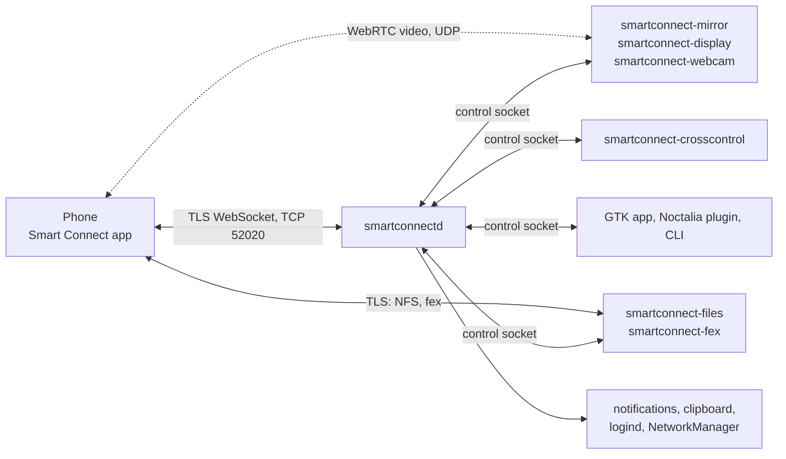

# smartconnect-linux

**Use Motorola's Smart Connect with a Linux PC.**

smartconnect-linux makes a Linux desktop show up in Motorola's **Smart Connect** phone app as if it
were a Windows PC. The phone runs the stock, unmodified app: no root, no extra app, no developer
options. Pair once by scanning a QR code, and you get:

- phone notifications on the desktop, with quick reply
- clipboard sync, both ways
- screen mirroring, and phone apps in their own Linux windows
- the phone as a second monitor (extend or duplicate)
- Cross Control: the PC's mouse and keyboard move onto the phone across a screen edge
- the phone camera as a webcam
- the phone's storage mounted as a folder, and a PC folder shared to the phone

It is a Rust daemon (`smartconnectd`) plus small helper programs, a GTK4/libadwaita app and a
[Noctalia Shell](https://github.com/noctalia-dev/noctalia) plugin.

> **Unofficial project.** Not affiliated with, endorsed by or sponsored by Motorola or Lenovo. See
> the [disclaimer](#disclaimer).

## Contents

1. [Quick start](#quick-start)
2. [Feature status](#feature-status)
3. [Requirements](#requirements)
4. [How it works](#how-it-works)
5. [Notification actions](#notification-actions)
6. [Known issues](#known-issues)
7. [Components](#components)
8. [Documentation](#documentation)
9. [Disclaimer](#disclaimer)
10. [License](#license)

<a name="quick-start"></a>
<details open>
<summary><h2>Quick start</h2></summary>

```sh
# Arch Linux; other distributions: docs/installation.md#packages
sudo pacman -S --needed git base-devel rust avahi bluez wl-clipboard gstreamer \
  gst-plugins-{base,good,bad} libnice gst-libav gst-plugin-va gtk4 libadwaita fuse3
sudo systemctl enable --now avahi-daemon bluetooth

git clone https://github.com/rudrahnpatel/smartconnect-linux.git && cd smartconnect-linux
./packaging/install.sh --enable           # build, install to ~/.local, start the user service

# firewalld example; see docs/installation.md for ufw
sudo firewall-cmd --permanent --add-port=52020/tcp
sudo firewall-cmd --permanent --add-service=mdns
sudo firewall-cmd --reload
```

`install.sh` builds the Cargo workspace and installs all eight programs to `~/.local/bin`, the
systemd user unit, the GTK app's launcher and the Noctalia plugin. `--enable` needs a running
systemd user session; without one it only warns. It never runs `sudo`: at the end it prints the
optional steps that need root (the firewall, `vkms`, `v4l2loopback`, `wvkbd`). `--dry-run` shows
what it would do. See [Installation](docs/installation.md#packaginginstallsh).

1. **Pair.** Show a pairing QR on the PC: the device menu → **Pair new phone…** in the GTK app
   (**Smart Connect** in your application launcher), the QR button in the Noctalia panel, or
   `smartconnectd pair` and the QR it writes:
   `xdg-open ~/.local/share/smartconnect-linux/pairing-qr.svg`. On the phone, open Smart Connect,
   tap **+**, choose **Scan QR code** and scan it. The PC appears in the phone's device list as
   `Linux PC` (set by `--name` in the systemd unit).
2. **Connect.** The first connection happens right after pairing. Later, tap **Connect** on the PC's
   tile in the phone app, or use Connect in the GTK app, the Noctalia panel or
   `smartconnectd connect`. The daemon also reconnects on its own after drops and restarts.
3. **Use it.** Copy text on either side, watch phone notifications arrive, press *Mirror screen*,
   stream an app from the *Apps* page, turn the phone into a second monitor on the *Display* page,
   mount its storage from the *Files* page, or follow [docs/usage.md](docs/usage.md) for the rest.

</details>

<a name="feature-status"></a>
<details>
<summary><h2>Feature status</h2></summary>

Key: ✅ verified on a real phone · 🟡 implemented, not verified on a phone yet · ❌ not supported

Tested with a motorola edge 60 stylus running Smart Connect 09.0.3.013, against niri 26.04 with
Noctalia Shell on Arch Linux. Other phones, app versions and desktops may behave differently.
[docs/usage.md](docs/usage.md) explains each feature, including what is and isn't verified.

**Connection**

| Feature | Status | Notes |
|---|---|---|
| Pairing by QR code | ✅ | Scan a QR from the Smart Connect app; the PC then appears in the phone's device list. |
| Reconnect over Wi-Fi and Bluetooth LE | ✅ | The phone's Connect button, the daemon dialing the phone back over Wi-Fi (mDNS), and a Bluetooth LE wake that reaches the phone while Smart Connect is in the background. |
| Automatic reconnect | ✅ | After drops, at startup and after a failed Connect, with Smart Connect in the background on the phone (Bluetooth LE wake, about 5 to 6 s). Early retries (phone back on Wi-Fi, resume, network change, Bluetooth switched on) and dropping a dead session after 70 s of silence are unit-tested, not yet seen on a device. A Disconnect from either side is respected. |
| Feature tiles for this PC on the phone | ✅ | App streaming, Cross Control, PC lock, Hotspot and Webcam. |
| PC lock tile | 🟡 | Locks through logind. Some lock screens don't react to that, Noctalia's for example. |
| Hotspot tile | 🟡 | |

**Notifications, clipboard and messages**

| Feature | Status | Notes |
|---|---|---|
| Phone notifications, quick reply, multi-line messages | ✅ | Through your desktop's notification daemon. Reply from a small window, the GTK app or the Noctalia panel. Chats show their recent messages, with sender names in groups. |
| Notification action buttons and "Open" | 🟡 | Action buttons (e.g. "Mark as read") run on the phone through a short background app-streaming session, without a window. See [Notification actions](#notification-actions). |
| Notification dedupe, coalescing and themed icons | 🟡 | |
| Per-app notification mute | 🟡 | A mute toggle on each notification and a *Muted apps* list, in the GTK app and the Noctalia plugin. |
| Clipboard text, both ways | ✅ | Password-manager copies are never sent to the phone. |
| Clipboard images and files | ❌ | Protocol reconstructed ([file-exchange.md](docs/protocol/file-exchange.md), [clipboard.md](docs/protocol/clipboard.md)). The daemon recognises an incoming image/file clip; the fex client it needs exists but is not wired to clipboard clips yet. |
| SMS (read threads, send, mark read) | 🟡 | Control socket only, no UI yet. Needs enabling on the phone. |

**Mirroring and app streaming**

| Feature | Status | Notes |
|---|---|---|
| Phone screen mirroring with mouse input | ✅ | |
| Keyboard, phone keys and scrolling in the mirror window | 🟡 | Esc = Back, Ctrl+Alt+H = Home, Ctrl+Alt+R = Recents. |
| App streaming started from the PC | ✅ | Each phone app in its own Linux window (`smartconnect-mirror --app`). |
| App streaming from the phone's tile and the GTK app's *Apps* page | 🟡 | |
| Real app icons for the *Apps* page | ✅ | Downloaded from the phone on every connection into `~/.cache/smartconnect-linux/app-icons/`. `smartconnect-fex fetch-app-icons` does it by hand. |
| App window resize | 🟡 | Opt-in (`SMARTCONNECT_MIRROR_RESIZE=1`): the phone resizes the app's virtual display to the window. |
| Screen share and Mobile desktop tiles | 🟡 | Hidden unless the daemon runs with `--extra-tiles 1`. |

**Cross Control**

| Feature | Status | Notes |
|---|---|---|
| Cross Control started from the PC | ✅ | The PC's mouse and keyboard glide onto the phone across a screen edge. |
| Cross Control started from the phone's tile | 🟡 | |

**Phone as a display**

| Feature | Status | Notes |
|---|---|---|
| Extend | ✅ | The phone becomes a second monitor: a `vkms` virtual output at the phone's resolution, placed to the right of your screens and switched off when the session ends (`smartconnect-display --mode extend`). |
| Duplicate | ✅ | Shows the focused screen on the phone. |
| Display scale | ✅ | 200 % by default, the value Windows uses (`--display-scale`). |
| Keyboard button on the phone display | ✅ | Shows an on-screen keyboard ([wvkbd](https://git.sr.ht/~proycon/wvkbd)) on the shared screen, so you type by tapping it on the phone. |
| Larger on-screen keyboard | 🟡 | 45 % of the screen's height by default (`--osk-height`). |
| Touch input | 🟡 | Tap = click, drag, long-press = right click, two-finger scroll. |
| Following the phone's rotation | 🟡 | Opt-in: `--follow-rotation`. |
| The PC's audio on the phone | 🟡 | Opt-in: `--audio`. |
| Starting it from the phone | 🟡 | The daemon starts `smartconnect-display` with the settings saved by the GTK app or the plugin. |
| Controls in the GTK app and the Noctalia panel | 🟡 | The GTK app's *Display* page and the panel's *Phone as display* button, with shared settings. Tested against a stand-in helper, not yet with a phone. |

**Webcam**

| Feature | Status | Notes |
|---|---|---|
| Phone as a webcam | ✅ | `smartconnect-webcam`: the phone camera as a v4l2loopback device (shows up in every app) or, without it, a PipeWire camera. Switching between the front and back camera keeps the stream. 1280×720 at 30 fps, set by the phone. |
| Webcam quality setting | 🟡 | `--quality low\|medium\|high\|max` or `webcam.json`: the bitrate the phone may encode at (default `high`, 8 Mbit/s). |

**Files**

| Feature | Status | Notes |
|---|---|---|
| Browse the phone's files (mount `/sdcard`) | ✅ | `smartconnect-files mount`: the phone's storage as a read-only FUSE folder, over the phone's own File Station protocol (NFSv3 on mutual TLS, no root or adb). Surviving a phone reconnect or daemon restart, and unmounting cleanly on Ctrl+C/SIGTERM, are tested against this project's own server, not yet through a real phone reconnect. |
| Phone files in the GTK app | 🟡 | The *Files* page: **Mount**, **Open in Files**, **Unmount**, quick folders (Camera, Screenshots, Downloads, Documents), a mount folder setting (default `~/Phone`) and *Mount automatically when connected*. Wraps the verified helper. |
| Phone files in the Noctalia panel | 🟡 | The *Phone files* tile: **Mount**, then **Open** and **Unmount**, with the mount folder in the plugin settings. Wraps the verified helper. |
| Share a PC folder to the phone | 🟡 | `smartconnect-files serve` exports a folder (default `~/PhoneShare`) **read-only** to the phone over the same protocol. Covered by loopback tests; not yet exercised with a phone. |
| Writing to the phone | 🟡 | Reverse-engineered; the NFS write path is not implemented yet. |
| File transfer (push/pull single files) | ❌ | Separate "fex" transport; see [file-exchange.md](docs/protocol/file-exchange.md). No send/receive UI; `smartconnect-fex pull` only fetches an offer whose coordinates you already have. |

**Desktop app**

| Feature | Status | Notes |
|---|---|---|
| GTK app tray icon and background running | 🟡 | A StatusNotifierItem whose icon tracks the connection state, with Show/Hide, Connect, Disconnect and Quit. Closing the window hides it to the tray; Quit also stops the daemon. Opening the app starts the daemon; *Start at login* runs it hidden at login. Needs a system-tray host (the Noctalia/Quickshell bar provides one). |

</details>

<a name="requirements"></a>
<details>
<summary><h2>Requirements</h2></summary>

- A Motorola phone with the Smart Connect app, on the same Wi-Fi network and subnet as the PC
  (discovery uses mDNS).
- A Linux desktop with a Wayland compositor and a systemd user session. Cross Control needs
  wlr-layer-shell and works best with pointer constraints. Linux-to-phone clipboard sync needs the
  data-control protocol.
- Runtime: avahi, BlueZ, `wl-clipboard`, a notification daemon, GStreamer 1.22 or newer with
  `webrtcbin` and libnice. Optional: NetworkManager (Hotspot tile), Quickshell (reply window),
  GTK 4.18 / libadwaita 1.7 (GTK app), Noctalia Shell 4.4 or newer (plugin).
- The phone display needs PipeWire and VA-API; Extend also needs niri plus the `vkms` kernel module
  or an HDMI dummy plug, and the keyboard button needs `wvkbd`. The webcam works best with
  `v4l2loopback`. Browsing the phone's files needs `fuse3` (its `fusermount3` helper).
- Reconnecting while Smart Connect is in the background on the phone: BlueZ and a Bluetooth LE
  adapter that is already powered on (the daemon never powers it on).
- To build: Rust 1.88 or newer, `git`, a C toolchain, `pkg-config` and the development files of
  GTK 4, libadwaita, GStreamer and D-Bus.
- Firewall: inbound TCP 52020 and mDNS (UDP 5353). Sharing a PC folder with the phone
  (`smartconnect-files serve`) also needs inbound TCP 2049, or the port you pass with `--port`
  (use another port when a system `nfs-server` already holds 2049).

[docs/installation.md](docs/installation.md) has package lists for Arch, with hints for Debian and
Fedora.

</details>

<a name="how-it-works"></a>
<details>
<summary><h2>How it works</h2></summary>

The phone connects to `smartconnectd` over a TLS WebSocket, exactly as it would to the Windows app.
The daemon handles pairing, notifications, clipboard and phone status itself, and starts helper
programs for the heavier features. The GTK app, the Noctalia plugin and the CLI all talk to the
daemon through a local control socket.



More in [Architecture](docs/architecture.md) and the [protocol notes](docs/protocol/README.md).

</details>

<a name="notification-actions"></a>
<details>
<summary><h2>Notification actions</h2></summary>

What each button on a phone notification does on the desktop:

| Button | What happens | Status |
|---|---|---|
| **Reply**, or clicking a chat notification | Opens a reply box: a small Quickshell window, or the reply field in the GTK app or the Noctalia panel. The text goes to the phone as a direct reply. | ✅ |
| The app's own buttons, e.g. **Mark as read**, WhatsApp's **Mute**, a timer's **Pause** | Sent to the phone. Smart Connect runs these inside an app-streaming session, as it does for a Windows PC: the phone opens the app on a virtual display and fires the action once the app has focus. The stream host answers that session without a window and closes it about 2.5 s later. `SMARTCONNECT_BACKGROUND_ACTIONS=0` shows the window instead. | 🟡 |
| **Open on phone** (apps without a reply action) | Opens the app in a streamed window on the PC. | 🟡 |
| **Mute** (bell icon in the GTK app and the Noctalia panel) | Stops desktop popups from that app on this PC. The phone still notifies; unmute from *Muted apps*. | 🟡 |

The action buttons need the stream host, which `smartconnectd` starts and supervises. Its log is
`$XDG_RUNTIME_DIR/smartconnectd/smartconnect-mirror.log`.

</details>

<a name="known-issues"></a>
<details>
<summary><h2>Known issues</h2></summary>

- **Only one phone at a time.** The daemon pairs and connects a single phone. While one phone is
  connected you cannot pair or connect a second one; disconnect the first, and later reconnect it
  only after disconnecting the other. Phones taking turns works, two at once does not.
  Multi-device support is tracked in [TODO.md](TODO.md).
- **Reconnecting while Smart Connect is in the background needs Bluetooth on the PC.** A
  backgrounded phone app has no Wi-Fi listener and never reconnects to a PC by itself, so the daemon
  wakes it over Bluetooth LE, as the Windows app does. The daemon never switches Bluetooth on or off:
  with it off, open Smart Connect on the phone (or tap Connect there), or switch Bluetooth on and the
  daemon reconnects at once. `--no-ble-wake` disables the wake. The phone's background Bluetooth
  advert is weak, so a wake can take a few retries when the phone is far from the PC.
- **Messaging notifications show the app icon, not the sender's picture.** With WhatsApp-style chat
  notifications the phone sends only its owner's own picture, never the sender's
  ([details](docs/protocol/notifications.md#whose-picture-is-person_icon)).
- **Browsing the phone's files can be slow.** Every directory and file read is an NFS round-trip over
  TLS to the phone, so large folders and big files feel sluggish. Read caching is on the
  [TODO list](TODO.md).
- **Writing to the phone and the image/file clipboard aren't implemented yet.** Sharing a PC folder
  *to* the phone is built but not yet verified with a phone
  ([file-exchange.md](docs/protocol/file-exchange.md)).
- **The webcam is 1280×720 at 30 fps.** The phone app fixes this in this mode. Without
  `v4l2loopback` the camera is PipeWire-only: OBS, Firefox with
  `media.webrtc.camera.allow-pipewire`, Chromium with its PipeWire camera flag. Most other apps need
  `v4l2loopback`.
- **Extend needs a virtual output.** niri can't create one, so use the `vkms` module or an HDMI
  dummy plug. If `smartconnect-display` is killed rather than stopped, switch the output off with
  `niri msg output Virtual-1 off`.
- **The PC lock tile** locks through logind, which some lock screens ignore (Noctalia's, for
  example).
- **Reconnects are accepted on the phone's device ID**; it's still unknown whether the phone can
  prove it holds the pairing key. See [Security](docs/security.md).
- **Noctalia plugin stuck on "smartconnectd is not running" after a daemon restart.** Fixed; restart
  Noctalia once after updating, since switching the plugin off and on reloads its panels but not its
  shared service.
- **Quickshell crashes after a Qt update.** If `qs` warns that it "was built against Qt X but the
  system has updated to Qt Y", rebuild or reinstall your Quickshell package (for example
  `noctalia-qs`).

</details>

<a name="components"></a>
<details>
<summary><h2>Components</h2></summary>

| Component | Source | Purpose |
|---|---|---|
| `smartconnectd` | `src/` | The daemon. It runs the TLS WebSocket server the phone connects to and handles pairing, mDNS and Bluetooth LE reconnects, clipboard, notifications, phone status, SMS, the PC lock and Hotspot tiles, and the local control socket. It starts and supervises the helpers. The same binary is the CLI (`smartconnectd status`, `connect`, …). |
| `smartconnect-mirror` | `mirror/` | WebRTC viewer: whole-screen mirroring and app streaming, one window per stream, plus the long-running stream host (`--host`) that also runs notification action buttons in the background. |
| `smartconnect-crosscontrol` | `crosscontrol/` | Cross Control for Wayland: an edge strip and a pointer lock forward the PC's mouse and keyboard to the phone. |
| `smartconnect-display` | `display/` | The phone as an external display, extending or duplicating the desktop. It also injects the phone's touch input on the PC and shows an on-screen keyboard for the phone's keyboard button. |
| `smartconnect-webcam` | `webcam/` | The phone camera as a Linux webcam (v4l2loopback or a PipeWire camera). |
| `smartconnect-files` | `files/` | The phone's storage as a read-only FUSE mount, and (`serve`) a local folder shared read-only to the phone, both over File Station (NFSv3 over fingerprint-pinned mutual TLS). It handshakes with the phone through the daemon. |
| `smartconnect-fex` | `fex/` | Client for the phone's "fex" file-transfer server (TLS pinned by fingerprint, a WebSocket of text frames, a zip download). `fetch-app-icons` downloads the app icons by hand (the daemon does it on every connection with the same library); `pull` fetches any offer. |
| `smartconnect-gui` | `gui/` | GTK4/libadwaita app: a header device menu (current device · Pair new phone… · Preferences · Connect/Disconnect) over a Phone / Apps / Display / Files / Notifications view switcher. |
| Noctalia plugin | `noctalia-plugin/smart-connect/` | Bar pill, control-center button, panel (mirror, Cross Control, phone-as-display, connect and phone-files tiles) and settings for Noctalia Shell, plus the IPC target `plugin:smart-connect`. |
| Reply window | `desktop/reply.qml` | Quick-reply window. It is built into `smartconnectd` and run with Quickshell (`qs`). |
| Packaging | `packaging/` | `install.sh`, `uninstall.sh`, the systemd user unit, the GTK app's launcher and icon, and an Arch `PKGBUILD`. |

</details>

<a name="documentation"></a>
<details>
<summary><h2>Documentation</h2></summary>

- [Documentation index](docs/index.md)
- [Installation](docs/installation.md): dependencies, building, systemd, firewall, front-ends
- [Usage](docs/usage.md): pairing, connecting, every feature, CLI reference
- [Troubleshooting](docs/troubleshooting.md)
- [Architecture](docs/architecture.md)
- [Control socket API](docs/control-socket-api.md)
- [Development](docs/development.md)
- [Security](docs/security.md)
- [Protocol notes](docs/protocol/README.md): the Smart Connect wire protocol, one page per service
- [Contributing](CONTRIBUTING.md) · [Changelog](CHANGELOG.md)

</details>

<a name="disclaimer"></a>
<details>
<summary><h2>Disclaimer</h2></summary>

smartconnect-linux is an independent, unofficial project. It is not affiliated with, endorsed by or
sponsored by Motorola or Lenovo. Motorola, Smart Connect, Ready For and related names and logos are
trademarks of their respective owners. They are used here only to say what this software works with.

The project exists for interoperability: it lets Linux computers talk to the Smart Connect app that
is already on your phone. The protocol was worked out through clean-room protocol analysis. This
repository contains no Motorola code or binaries. Using this software is at your own risk, and a
future phone app update may break it.

</details>

<a name="license"></a>
<details>
<summary><h2>License</h2></summary>

MIT. See [LICENSE](LICENSE).

</details>
