# Architecture

smartconnect-linux has one daemon that speaks the phone's protocol, separate helper processes for
the media-heavy features, and desktop front-ends. Everything on the PC talks to the daemon over one
local control socket. This page shows how the pieces fit together. The wire protocol itself is in
[docs/protocol/](protocol/README.md), and the design history is in [`.notes/`](../.notes/index.md).

- [Processes](#processes)
- [Inside the daemon](#inside-the-daemon)
- [The relay model](#the-relay-model)
- [Session lifecycle](#session-lifecycle)
- [Connection state and reconnects](#connection-state-and-reconnects)
- [Helper supervision](#helper-supervision)
- [Data flows](#data-flows): [clipboard](#clipboard) · [notifications](#notifications) ·
  [mirroring and app streaming](#mirroring-and-app-streaming) · [Cross Control](#cross-control) ·
  [phone as display](#phone-as-display) · [webcam](#webcam)
- [Files, sockets and ports](#files-sockets-and-ports)
- [Design choices](#design-choices)

## Processes

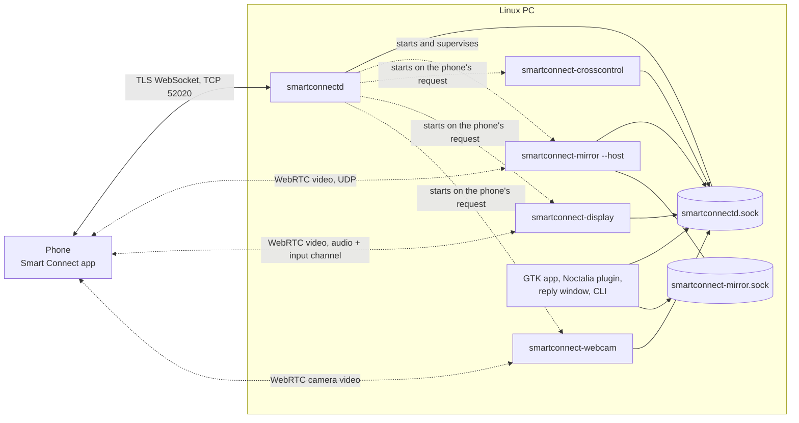

| Process | Source | Started by | Role |
|---|---|---|---|
| `smartconnectd` | `src/` | the systemd user unit, or by hand | Owns the phone connection: TLS server, pairing, discovery, the session, in-daemon services, the control socket. |
| `smartconnect-mirror --host` | `mirror/` | the daemon after the first verified session, the GTK app, or the user | Answers every stream the phone offers (mirror, app streaming, notification "Open", the Screen share and Mobile desktop views) with one window per stream, and runs notification action buttons in windowless sessions. Serves the stream host socket. |
| `smartconnect-mirror` (viewer, `--app`, `--list-apps`) | `mirror/` | the user, the Noctalia panel | One-shot clients. They hand their request to the host when one runs. |
| `smartconnect-crosscontrol` | `crosscontrol/` | the daemon (phone tile), the GTK switch, the Noctalia button, the user | Wayland client for Cross Control. Only one runs at a time (file lock, newest takes over). |
| `smartconnect-display` | `display/` | the daemon (when the phone starts the PC screen), the GTK app's *Display* page, the Noctalia panel, or the user | Phone as a display: captures the PC screen (and optionally its audio), sends it over WebRTC, injects the phone's touch input, shows an on-screen keyboard for the phone's keyboard button. Single instance (`$XDG_RUNTIME_DIR/smartconnect-display.lock`). |
| `smartconnect-webcam` | `webcam/` | the daemon (`--answer`, phone tile), or the user | Phone camera as a webcam: receives WebRTC video and feeds v4l2loopback or a PipeWire camera node. Single instance (`$XDG_RUNTIME_DIR/smartconnect-webcam.lock`). |
| `smartconnect-files` | `files/` | the GTK app's *Files* page, the Noctalia *Phone files* tile, or the user (`mount`, `list`, `serve`) | The phone's storage as a read-only FUSE mount (NFSv3 over mutual TLS to the phone, after a `cmd=1001` handshake on service 168 through the control socket), and `serve`: a local folder exported read-only to the phone on TCP 2049. Not supervised by the daemon. |
| `smartconnect-fex` | `fex/` | the user (`fetch-app-icons`, `pull`) | Client for the phone's fex file-transfer server. The same library runs inside the daemon, which downloads the app icons on every service 17 app list. |
| `smartconnect-gui` | `gui/` | the user | GTK4/libadwaita front-end. |
| Noctalia plugin | `noctalia-plugin/` | Noctalia Shell | Bar widget and panel. |
| Reply window | `desktop/reply.qml` (embedded in the daemon) | the daemon, when Reply is clicked | Quickshell window that sends one `reply` command. |

The daemon also uses these system services:

| Integration | How |
|---|---|
| Desktop notifications | `org.freedesktop.Notifications` on the session bus (zbus): `Notify`, `CloseNotification`, and the `ActionInvoked`/`NotificationClosed` signals. |
| Clipboard | `wl-paste --type text --watch …` (child process) and `wl-copy`. |
| mDNS | `avahi-publish -s … _readyformdns._tcp` and `avahi-browse -r -p -k _readyformdns._tcp` (child processes). |
| Bluetooth LE | BlueZ over D-Bus (`bluer`). It acts as a GATT central for the Connect wake, and as an optional peripheral without `--no-ble`. |
| PC lock | `loginctl lock-session`, then polling `loginctl show-session auto -p LockedHint`. |
| Hotspot | `nmcli dev wifi connect …` / `nmcli connection delete …`. |

## Inside the daemon

`smartconnectd` is a single tokio process. `main.rs` builds a shared `Daemon` (`src/server.rs`) and
starts these tasks:

| Task | Module | Job |
|---|---|---|
| TLS listener | `server.rs` | Accepts TCP on `--port`, does the TLS handshake (15 s limit) and the WebSocket upgrade. It routes `/readyfor/mdns` to discovery and every other `/readyfor/…` path to a session. |
| Invite loop | `server.rs` | Keeps a valid pairing token. It renders a fresh QR (terminal + SVG) whenever the token expires. |
| Control socket | `control.rs` | Serves `smartconnectd.sock`, one task per client. Also starts the SMS collector (`sms.rs`). |
| mDNS advertiser and watcher | `discovery.rs` | Publishes `_readyformdns._tcp`. It remembers paired phones' adverts and dials them back when allowed. |
| Clipboard watcher | `clipboard.rs` | Follows the Wayland clipboard. Only runs when `WAYLAND_DISPLAY` is set. |
| PC lock, Hotspot | `pc_lock.rs`, `hotspot.rs` | React to their services' messages from the phone. |
| Helpers | `helpers.rs` | Supervise the stream host, and start Cross Control, the phone display or the webcam helper when the phone asks. |
| Notifier | `notifications.rs` | Shows phone notifications and forwards clicks back to the phone. |
| Auto-reconnect | `reconnect.rs` (started from `server.rs`) | Runs only while reconnecting, one loop at a time: backoff, a TCP presence probe of the phone every 30 s, early retries on a nudge. |
| System watcher | `reconnect.rs` | Every 5 s: detects a resume from suspend (boot-time vs monotonic clock) and LAN address changes; updates the invite addresses and nudges the reconnect loop. |
| Bluetooth adapter watcher | `ble_connect.rs` | Read-only: nudges the reconnect loop when the adapter is powered on. Not started with `--no-ble-wake`. |

The shared state lives in `Daemon`: identity, pairing store, current invite, `StatusHub`, and these
broadcast channels:

| Channel | Capacity | Carries |
|---|---|---|
| `from_phone` | 256 | Every message from the phone as `(service, data)`, plus the daemon's local events on service `-1` (notification clicks, for the stream host). |
| `to_phone` | 32 | Messages for the phone from any desktop-side feature. |
| `StatusHub` changes | 32 | The full status JSON after every change, for `subscribe`. |
| `LocalClipboard` changes | 16 | Linux clipboard copies to send. |

## The relay model

Each phone connection has one **session loop** (`server.rs::session_loop`). For every text frame it
receives, the loop:

1. appends it to the session log when the daemon runs with `--session-log`
   (`sessions/<ms>-<ip>.jsonl`, with keys, tokens, passwords, clipboard, SMS and notification
   contents and the wallpaper redacted);
2. publishes `(service, data)` on `from_phone`;
3. folds it into `StatusHub` (battery, signal, wallpaper, unread count, recent notifications);
4. handles the few services the daemon answers inline: 0 (hello, key exchange, the phone's
   "disconnecting" `cmd 6`), 9 (clipboard), 5 and 37 (notifications), plus two minimal acks
   (service 1 `cmd 31`, service 16 `cmd 14`) that keep the session alive.

In the other direction, anything sent on `to_phone` is wrapped in the phone's envelope (this PC's
per-run `deviceId`, `serviceId`, `srcServiceId`, a fresh `msgId`), sent, and logged (with
`--session-log`).

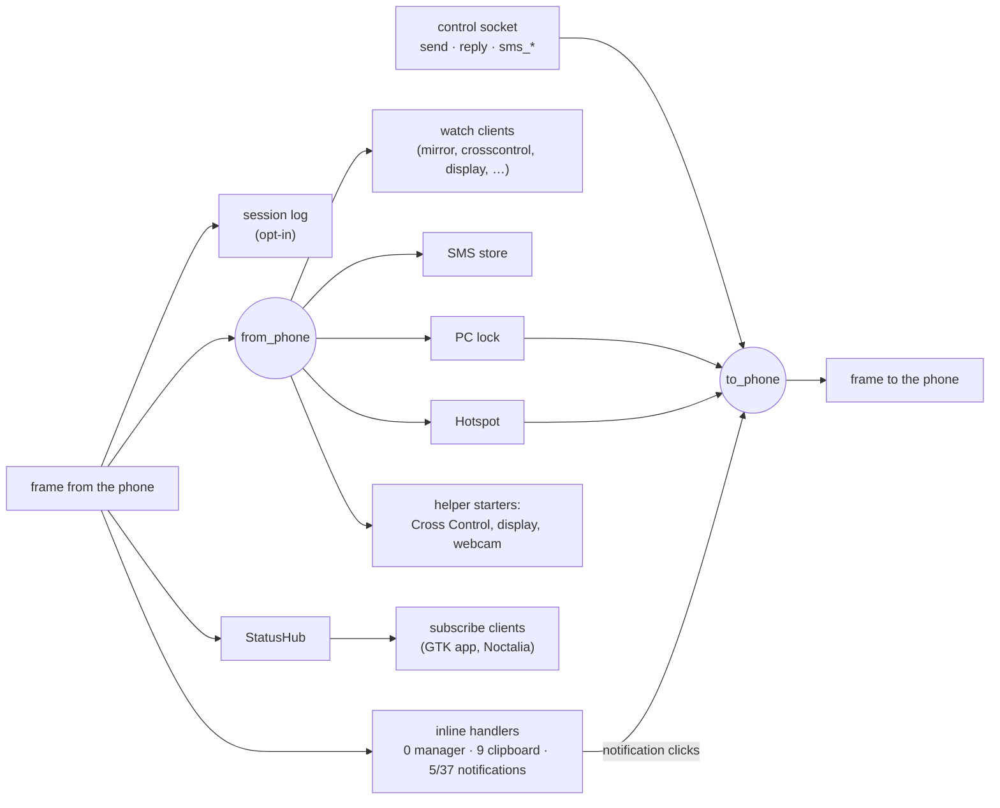

This is what lets a helper implement a whole phone service without daemon code: it opens one
control-socket connection with `{"cmd":"watch","services":[…]}` and another for
`{"cmd":"send",…}`. Mirroring, app streaming, Cross Control and the phone display all work this
way. The daemon's part is to **advertise** the service so the phone enables it (`serviceVersions`
and `caps` in the handshake reply, plus the tile `cap` map for services with a tile; see
`src/proto.rs`), and, if the phone starts the feature, to make sure a helper is running. The
[control socket API](control-socket-api.md) documents both commands.

## Session lifecycle

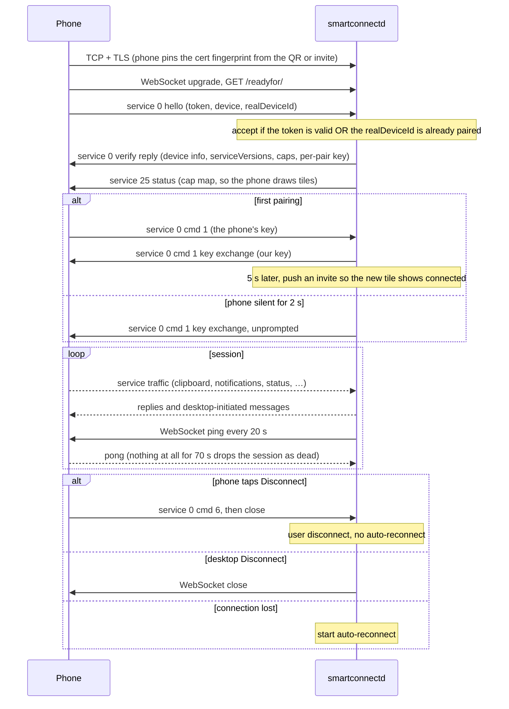

Timeouts: TLS handshake 15 s, first WebSocket message 40 s. The first message must be a service 0
text frame; anything else closes the connection. Details and payloads are in
[pairing and discovery](protocol/pairing-and-discovery.md).

## Connection state and reconnects

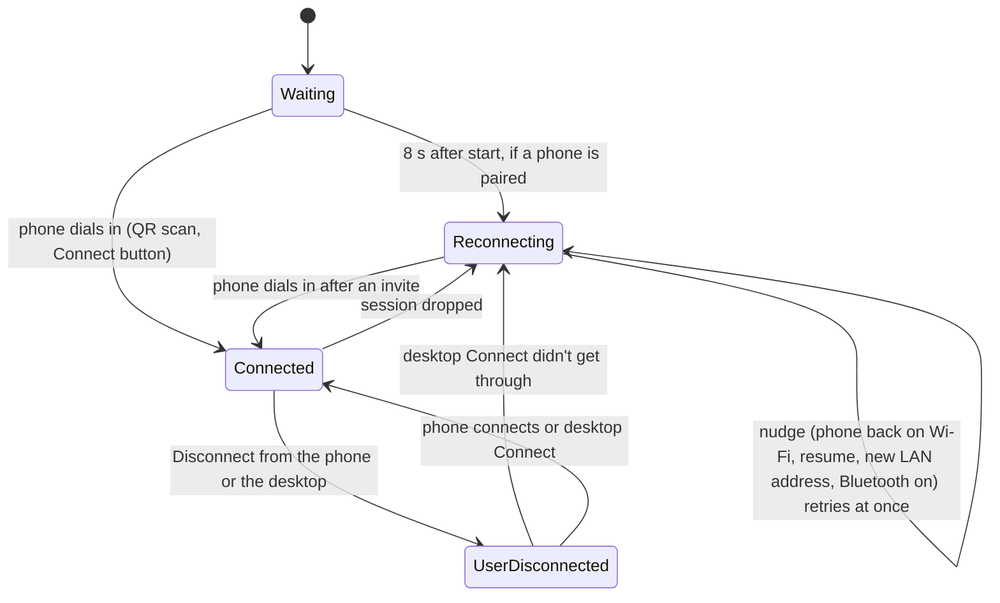

One reconnect attempt is the same `connect_now` that the `connect` command runs. It pushes a sealed
invite to the phone's own `/readyfor/mdns` endpoint over Wi-Fi, using the address remembered from
the phone's mDNS advert. If that fails, it scans Bluetooth LE for the phone's advert and writes the
same invite to its GATT characteristic. In both cases the phone then dials the PC.

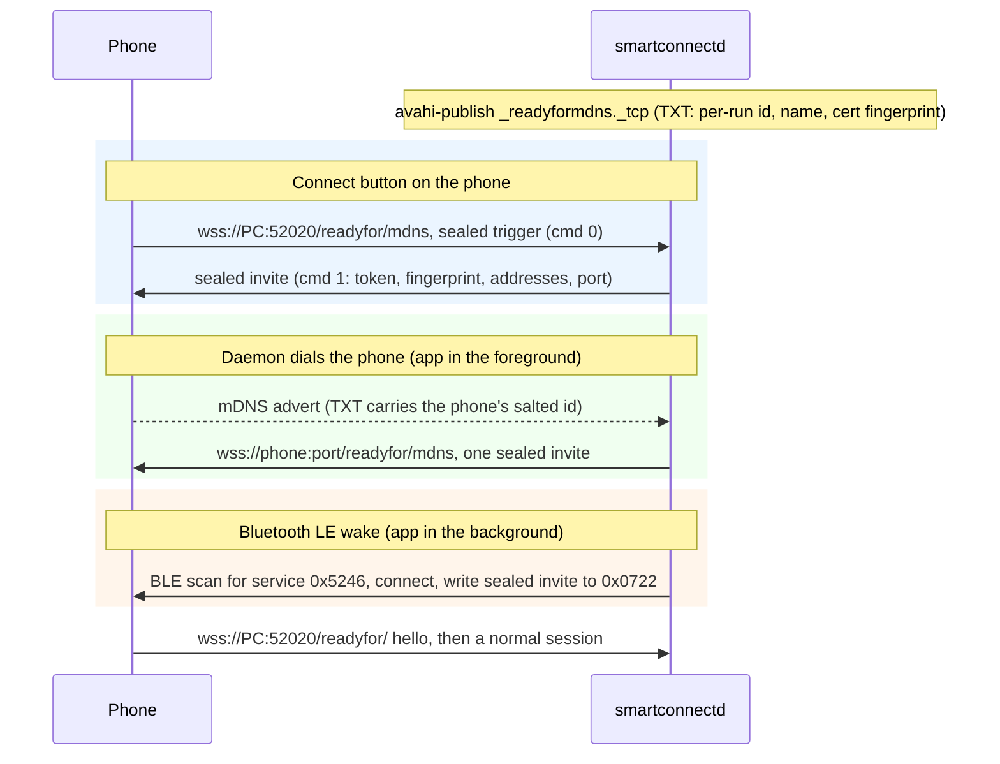

Discovery frames are AES-256-GCM sealed with the per-pair key exchanged during pairing. A frame
starts with the sender's salted id, so each side can tell which pairing (and key) it belongs to.
See [pairing and discovery](protocol/pairing-and-discovery.md).

## Helper supervision

Feature tiles on the phone only work if something on the PC answers the phone's request. That's why
the daemon makes sure helpers run (`src/helpers.rs`). The stream host runs all the time once a phone
has connected; the other helpers are started when the phone asks for their feature and nothing is
answering yet:

| Helper | Started when | Single-instance check |
|---|---|---|
| `smartconnect-mirror --host` | after the first verified session, and again (with backoff) whenever it exits | its socket `smartconnect-mirror.sock` answers |
| `smartconnect-crosscontrol --edge $SMARTCONNECT_CROSS_EDGE --accept` | phone service 26 `cmd 0` (Cross Control tile) | `smartconnect-crosscontrol.lock` |
| `smartconnect-display --mode <shareType>` | phone service 202 `cmd 50` (the phone starts the PC screen) | `smartconnect-display.lock` |
| `smartconnect-webcam --answer` | phone service 3 `cmd 0` with `isReply: 0` (Webcam tile) | `smartconnect-webcam.lock` |

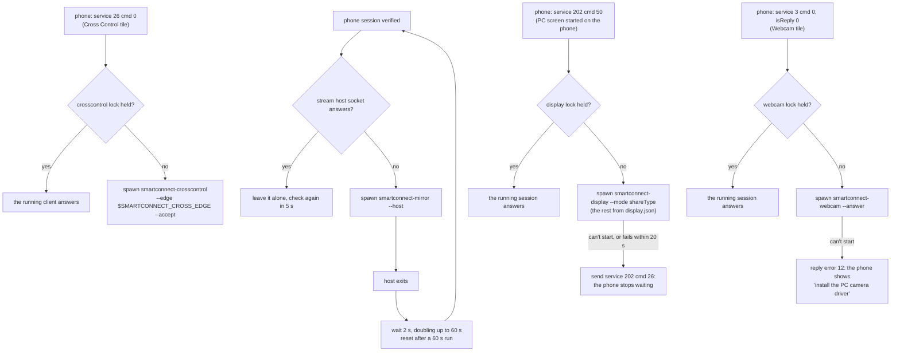

- Children log to `$XDG_RUNTIME_DIR/smartconnectd/<name>.log`. They get `PR_SET_PDEATHSIG=SIGTERM`
  so they die with the daemon, and on a normal shutdown they get SIGTERM plus 2 s to tell the phone
  they are stopping.
- Binary lookup: `$SMARTCONNECT_MIRROR_BIN` / `$SMARTCONNECT_CROSSCONTROL_BIN` /
  `$SMARTCONNECT_WEBCAM_BIN` / `$SMARTCONNECT_DISPLAY_BIN`, then the directory `smartconnectd` runs
  from (an installation, or the workspace's target directory: either way all eight binaries sit
  together), then `PATH`. The GTK app uses the same order from its own directory, also for
  `smartconnect-files` (`$SMARTCONNECT_FILES_BIN`) and `smartconnectd` (`$SMARTCONNECT_SMARTCONNECTD_BIN`)
  ([Installation](installation.md#how-the-programs-find-each-other)).
- `SMARTCONNECT_HELPERS=0` turns supervision off. The stream host, Cross Control and the phone
  display are also skipped when neither `WAYLAND_DISPLAY` nor `DISPLAY` is set. The webcam helper
  needs no display and is started regardless.
- A host started by someone else (the GTK app, the user) is detected through its socket and left
  alone. `--host` itself refuses to start twice.
- The other helpers hold a `flock` on their lock file in `$XDG_RUNTIME_DIR` (with their PID inside),
  and the daemon only spawns one when nobody holds it; a running instance answers the phone itself.
  For Cross Control and the display, the daemon also remembers the child it started, so a request
  the phone repeats while that child is still starting doesn't start a second one. On a conflict, a newer Cross Control client sends
  SIGINT to the holder and takes over; a second `smartconnect-display` refuses to start unless it
  is given `--replace`; a second webcam session refuses.
- The daemon passes `smartconnect-display` only the mode the phone asked for. Everything else comes
  from `~/.config/smartconnect-linux/display.json`, the file the GTK app and the Noctalia plugin
  write, so every way of starting a session uses the same settings.

## Data flows

### Clipboard

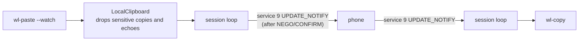

The phone opens the clipboard with a negotiation message at the start of each connection, and the
daemon only sends text after confirming it. Text crosses in both directions without acks. The last
text that crossed the link is remembered so that the daemon's own `wl-copy` isn't sent back. See
[clipboard](protocol/clipboard.md).

### Notifications

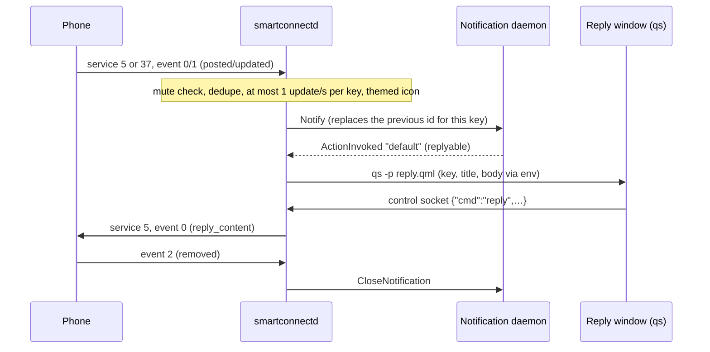

Action buttons send event 1 with the action's index, and "Open on phone" sends event 2. On the
tested phone both run through app streaming: the phone invites the PC to stream the app (service 15
`cmd 2`) and fires the action once the app is up on its own virtual display. "Open" should end with
the app in a window, but an action button shouldn't open one, so the daemon tells the stream host
about each click first, as a [local event](control-socket-api.md#local-events-service--1) on
service `-1`. The host then answers the matching invite headlessly: the video goes into a
`fakesink`, and the session is closed again about 2.5 s after the phone reports the app is up
(`cmd 13`). Without that report it is closed 12 s after the answer, and never later than 30 s.

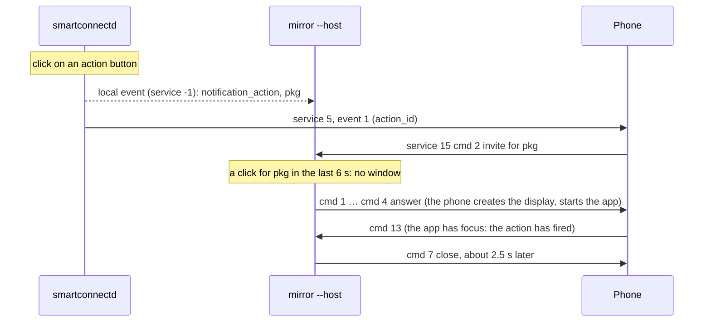

`SMARTCONNECT_BACKGROUND_ACTIONS=0` makes action buttons open a window like "Open". See
[notifications](protocol/notifications.md) and [app streaming](protocol/app-streaming.md).

### Mirroring and app streaming

The signalling goes through the daemon's relay. The video goes straight from the phone to the
helper over WebRTC.

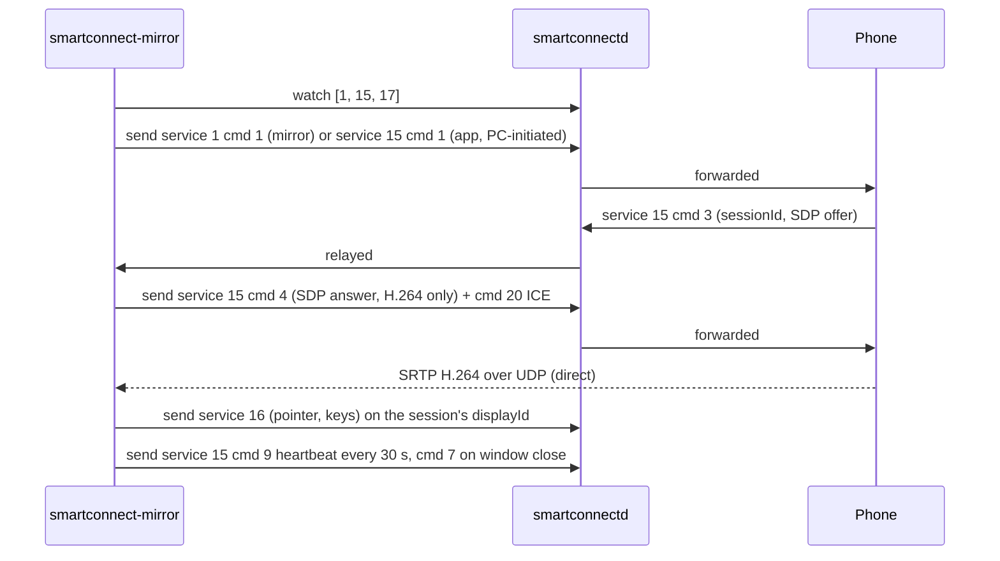

Each stream has its own GStreamer pipeline (`webrtcbin` → `rtph264depay` → `h264parse` →
`vah264dec`/`avdec_h264` → `glimagesink`) and its own window. The host starts streams one at a
time. Every process shares one `instanceId` through
`$XDG_RUNTIME_DIR/smartconnect-mirror.instance`, because the phone drops all sessions when the id
changes. See [mirroring](protocol/mirroring.md) and [app streaming](protocol/app-streaming.md).

- **ICE candidates.** The helper offers the phone only UDP candidates on one address: the daemon's
  `pcAddress`, the local address of the phone's control connection, which the phone has already
  shown it can reach. Without it (an older daemon), it falls back to private IPv4 addresses on
  interfaces that don't look virtual (Docker, bridges, VPNs). `SMARTCONNECT_ICE_ADDRESSES` overrides
  both. The phone display uses the same rules (`display/src/ice.rs`); the webcam helper offers
  addresses on the phone's /24.
- **Views.** The host also answers the phone's service 1 `cmd 0` (the Screen share and Mobile
  desktop tiles, advertised only with `--extra-tiles 1`) and then treats the `mirror`, `mobile` or
  `desktop` stream like the whole-screen mirror.
- **Window resize** (opt-in, `SMARTCONNECT_MIRROR_RESIZE=1`): the host polls each app window's size
  and sends service 15 `cmd 17` once a new size has settled; the phone resizes that app's virtual
  display and renegotiates the stream.

### Cross Control

`smartconnect-crosscontrol` maps a 1-pixel layer-shell strip on the chosen screen edge. When the
pointer enters it, the client asks the phone over service 26, gets the phone's screen size, maps a
transparent full-screen overlay with exclusive keyboard focus, locks the pointer, and turns relative
pointer motion into absolute phone coordinates. Pointer, button, wheel and key events go out as
service 16 input on display 0 (motion is coalesced to at most 125 Hz). Pushing back past the edge,
or Ctrl+Alt+Esc, releases held keys, tells the phone, and unlocks. See
[Cross Control](protocol/cross-control.md).

### Phone as display

`smartconnect-display` is the opposite direction: the phone is the WebRTC offerer and the PC sends
H.264 (and, with `--audio`, Opus from the default output's monitor). The video source comes from
niri's screencast D-Bus API by connector name (or the xdg-desktop-portal ScreenCast as a fallback
for mirror mode), through `pipewiresrc ! vapostproc`. For extend, the tool first turns on a spare
output with temporary `niri msg output …` commands (mode, position, scale), and resizes or rotates
it in place when the phone asks for another resolution or, with `--follow-rotation`, turns. The
phone's touch, mouse and key packets arrive on a WebRTC data channel and are injected through
`zwlr_virtual_pointer_v1` (pinned to the shared output) and `zwp_virtual_keyboard_v1`. The phone's
keyboard button starts an on-screen keyboard (wvkbd) on the shared output.

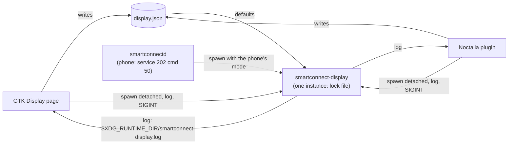

The front-ends don't own the session. They start the helper detached through a small shell wrapper
that writes its output to `$XDG_RUNTIME_DIR/smartconnect-display.log` (first line `pid N`), find
running sessions through `/proc` (the plugin through `pgrep`), read the settings of a running
session from its command line, and stop it with one SIGINT. So a session survives a closed GTK
window or a reloaded shell, and either front-end can stop a session the other one, the daemon or a
terminal started. See [phone as display](protocol/phone-as-display.md) and the `display-*` notes
in `.notes/`.

### Webcam

`smartconnect-webcam` follows the same pattern as the mirror viewer, with the phone as the sender.
Signalling for service 3 goes through `watch`/`send`. The phone's H.264 stream arrives directly over
WebRTC and is decoded and scaled to 1280x720 YUY2. The frames are written to a v4l2loopback device
(only virtual devices are accepted) or offered as a PipeWire camera node. A heartbeat every 10 s
keeps the phone's 30 s watchdog happy. See [webcam](protocol/webcam.md) and `.notes/webcam.md`.

## Files, sockets and ports

| What | Where | Owner |
|---|---|---|
| Phone connection | TCP `--port` (52020) on all interfaces, TLS | daemon |
| PC folder share (only while `smartconnect-files serve` runs) | TCP `--port` (2049) on all interfaces, mutual TLS, NFSv3 | `smartconnect-files serve` |
| Phone files mount | the mount folder (default `~/Phone`), FUSE | `smartconnect-files mount` |
| Phone files log | `$XDG_RUNTIME_DIR/smartconnect-files.log` (mounts started by the GTK app) | GTK app |
| File Station identity | `$XDG_DATA_HOME/smartconnect-linux/files-identity/` (`cert.der`, `key.der`; 0700/0600) | `smartconnect-files` |
| mDNS advert | `_readyformdns._tcp` via avahi | daemon |
| Control socket | `$XDG_RUNTIME_DIR/smartconnectd.sock` | daemon |
| Stream host socket | `$XDG_RUNTIME_DIR/smartconnect-mirror.sock` | `smartconnect-mirror --host` |
| Shared stream instance id | `$XDG_RUNTIME_DIR/smartconnect-mirror.instance` | mirror processes |
| Cross Control lock | `$XDG_RUNTIME_DIR/smartconnect-crosscontrol.lock` (holds the PID) | crosscontrol |
| Display lock | `$XDG_RUNTIME_DIR/smartconnect-display.lock` (holds the PID) | display |
| Webcam lock | `$XDG_RUNTIME_DIR/smartconnect-webcam.lock` (holds the PID) | webcam |
| App-icon fetch lock | `$XDG_RUNTIME_DIR/smartconnectd/app-icons.lock` (`flock`, one icon download at a time) | daemon, `smartconnect-fex` |
| App-icon cache | `$XDG_CACHE_HOME/smartconnect-linux/app-icons/` (`<iconName>` from the fex download, `<pkg>.png` from the stream host) | daemon, `smartconnect-fex`, mirror; read by the GTK app |
| Runtime files | `$XDG_RUNTIME_DIR/smartconnectd/` (`icons/`, `phone-wallpaper.*`, `reply.qml`, logs of the helpers the daemon started) | daemon |
| Display session log | `$XDG_RUNTIME_DIR/smartconnect-display.log` (sessions started by the GTK app or the plugin) | GTK app, Noctalia plugin |
| Display debug files | `$XDG_RUNTIME_DIR/smartconnect-display.{offer,answer}.sdp` | display |
| State | `$XDG_DATA_HOME/smartconnect-linux/`, mode 0700 (identity, cert, keys, pairings, QR, endpoints, mute list, screencast token, and session logs with `--session-log`) | daemon, display |
| Settings | `$XDG_CONFIG_HOME/smartconnect-linux/` (`display.json` shared by the GTK app, the plugin and the display helper; `gui.json` for the GTK app) | GTK app, Noctalia plugin, display |
| Cache | `$XDG_CACHE_HOME/smartconnect/` (`apps.json`, `mirror-host.log`) | mirror, GTK app |

Permissions and contents are covered in [Security](security.md#data-on-disk).

## Design choices

- **Helpers are separate processes.** GStreamer pipelines and Wayland protocol clients can crash
  or block. Keeping them out of the daemon means a failed stream never takes the phone session down,
  and it keeps the daemon a small tokio program without GTK, GStreamer or Wayland dependencies.
- **One relay instead of per-service plumbing.** The daemon forwards raw service traffic, and each
  helper owns its protocol. New features usually only need the daemon to advertise one more service
  id.
- **The daemon supervises its helpers, not systemd.** Helpers need the daemon's socket and the
  graphical environment, and only the daemon knows when a phone session is verified and when the
  phone asks for a feature.
- **avahi child processes instead of an in-process mDNS stack.** avahi already owns UDP 5353 on most
  desktops, and two responders on one port would conflict.
- **Only working services are advertised.** The phone draws a tile for every advertised service it
  supports. A tile with nothing behind it times out on the phone, or worse, triggers phone-side
  actions such as tethering, so services are advertised only once their PC side works. Tiles whose
  PC side isn't verified yet (Screen share, Mobile desktop) stay behind `--extra-tiles`.
- **One address for the media.** WebRTC candidates are limited to the address the phone's control
  connection already reached (`pcAddress`), because the phone tries every candidate it gets and
  spends its connection timeout on Docker, VPN and second-NIC addresses.
- **The GTK app uses blocking sockets on worker threads.** That keeps it free of tokio. Results
  reach the main loop through `async_channel` and `gio::spawn_blocking`, and notification rows are
  diffed by key so a half-typed reply survives frequent status updates.
