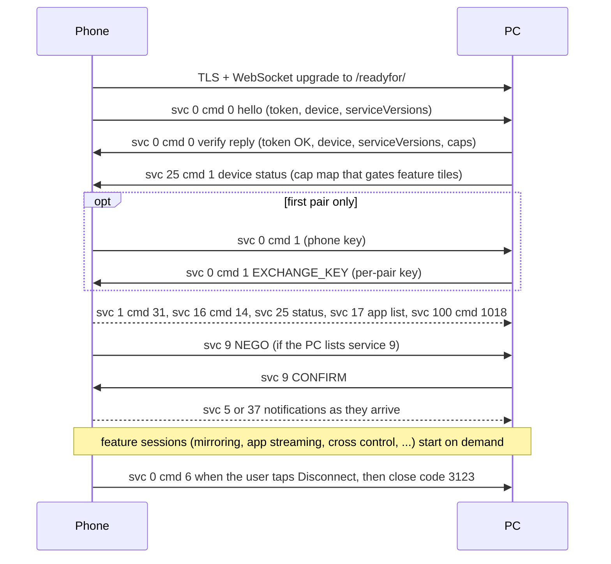

# Smart Connect wire protocol

This folder describes the protocol between the Motorola **Smart Connect** Android app
(`com.motorola.mobiledesktop`) and a PC. Normally the PC side is the official Windows app;
smartconnect-linux implements that side on Linux so that the unmodified phone app treats a Linux
machine as a Windows PC.

The protocol was worked out for interoperability. The sources are traffic between a phone and this
project's daemon, the phone app's own log output, and static analysis of the shipped apps (phone
app build `09.0.3.013.0`, Windows app build `09.0.3.013.000`). This is unofficial and incomplete,
and it can change with any app update. No vendor code is reproduced here: behaviour is described
in our own words, and class or log-tag names appear only where they help a reader check a claim.

## Contents

| File | Covers |
|---|---|
| [pairing-and-discovery.md](pairing-and-discovery.md) | Service 0 handshake, QR pairing, the pairing commit, mDNS and `/readyfor/mdns` discovery frames, Bluetooth LE wake, reconnect |
| [device-status-and-tiles.md](device-status-and-tiles.md) | Service 25 device status and the rules that decide which feature tiles the phone shows |
| [clipboard.md](clipboard.md) | Service 9, text clipboard in both directions, and the image/file-clip control plane |
| [file-exchange.md](file-exchange.md) | Services 2, 24, 30 and 168: fex file transfer (the LAN pull is implemented and verified for app icons), File Station NFS file browsing (implemented; browsing the phone verified), and Share Hub |
| [notifications.md](notifications.md) | Services 5 and 37, phone notifications on the PC, reply/action/open |
| [mirroring.md](mirroring.md) | Services 1, 15 and 16: phone screen in a PC window over WebRTC, PC input to the phone |
| [app-streaming.md](app-streaming.md) | Services 15 and 17: single phone apps in their own PC windows, the app list |
| [cross-control.md](cross-control.md) | Service 26: the PC mouse and keyboard move onto the phone |
| [sms.md](sms.md) | Service 204 (and 100): SMS conversations, sending, read state |
| [hotspot.md](hotspot.md) | Service 13: the phone starts a hotspot that the PC joins |
| [pc-lock.md](pc-lock.md) | Service 22: lock the PC from the phone |
| [phone-as-display.md](phone-as-display.md) | Service 202: the PC screen on the phone (mirror or extended display) |
| [webcam.md](webcam.md) | Service 3: phone camera as a PC webcam (verified with a phone, including the camera switch) |

## Conventions

- **OBSERVED**: seen on the wire or in the phone's log output with a real phone, read directly in
  the shipped apps (static analysis), or exercised by this project's working code.
- **INFERRED**: reasoned from observed facts but not confirmed. Treat these as hypotheses.
- Each file's **Status** line says what has actually been verified against a real phone.
- "PC → phone" and "phone → PC" give the direction of a message. "Windows" means the official
  Windows app. The phone is always the unmodified Smart Connect app.
- Every value in an example is a placeholder: `<token>`, `<per-pair-key>`, `<pc-real-id>`,
  `<phone-nonce-id>`, `<fp-b64>`, `<fp-hex>`, `<phone-name>` and so on. IP addresses use the
  documentation-style LAN `192.168.1.20` (PC) and `192.168.1.35` (phone). `52020` is this
  project's default control port, not a protocol constant.
- Types in the tables: `int` (32-bit), `long` (64-bit, see the precision note below), `bool`
  (a JSON `true`/`false`), `string`, `object`, `array`, and **JSON string** (a string whose
  content is itself JSON, which some services nest inside a field).

## Transport

### Control channel

| Item | Value | Tag |
|---|---|---|
| Transport | TLS, then a WebSocket upgrade. Windows offers TLS 1.2 AES-GCM suites and negotiates TLS 1.3 in practice. | OBSERVED |
| Path | `/readyfor/`, matched as a prefix (`GET /readyfor/` and anything below it). | OBSERVED |
| Port | Chosen by the PC and given to the phone as `wsPort` (in the QR or a discovery invite). Windows picks a port per peer; this project uses one port, default `52020`. | OBSERVED |
| Server authentication | Self-signed certificate, pinned by the phone through the SHA-256 of the certificate DER. Nothing else in the chain, name or validity is checked. See [pairing-and-discovery.md](pairing-and-discovery.md#identity-and-trust). | OBSERVED |
| Client authentication | None. No client certificate; the phone sends no SNI and no ALPN. | OBSERVED |
| Frames | UTF-8 JSON in **text** frames only. No binary frames on the control channel. | OBSERVED |
| First frame | The phone's service 0 hello. Windows allows 40 s from the upgrade to the first frame; the phone waits about 5 s for the verify reply, within a 50 s overall connect timer. | OBSERVED |
| Keepalive | WebSocket ping/pong (the phone's library answers pings). This project pings every 20 s. | OBSERVED |
| Close | The phone closes with WebSocket close code `3123`. Seen reasons: an unused connection after roughly 15 min ("No used"), and a duplicate connection when another one to the same PC has already been verified. | OBSERVED |
| Message size | Notifications can carry full-size JPEGs (hundreds of KB to several MB) and the wallpaper is about 280 KB. Accept messages of at least 16 MB. | OBSERVED |

### Discovery channels

These carry short encrypted invites and triggers. They are used to reconnect without a QR, never
for service traffic. Details are in [pairing-and-discovery.md](pairing-and-discovery.md#discovery-and-reconnect).

| Channel | Summary |
|---|---|
| mDNS | Both sides advertise `_readyformdns._tcp.local`. The TXT record carries a rotating device id and the certificate fingerprint (hex). |
| `/readyfor/mdns` | A TLS WebSocket endpoint on each side that takes one binary, AES-256-GCM sealed frame. The PC serves it on its advertised SRV port; the phone serves it only while the app is in the foreground. |
| Bluetooth LE | The phone advertises service `0x5246`. The PC connects as a GATT central and writes the same sealed invite to characteristic `0x0722`. This works while the app is in the background. |

### Other endpoints on Windows

Windows runs a second HTTPS server on the port it advertises over mDNS. Besides `/readyfor/mdns`
it serves `/readyfor/check`, `/readyfor/rdp`, `/readyfor/rpc/`, `/readyfor/webcam`,
`/readyfor/freerdp` and `/readyfor/firewallDone` (OBSERVED in the Windows app). Their roles are not
documented here; in a genuine pair the phone makes one HTTPS request to that port, purpose unknown
(OBSERVED). This project serves only `/readyfor/` and `/readyfor/mdns`, both on the control port.

## Message envelope

Every control-channel message is one JSON object (OBSERVED, both apps):

```json
{
  "deviceId": "<sender-device-id>",
  "srcServiceId": 9,
  "serviceId": 9,
  "msgId": 42,
  "data": { "msgId": 3, "data": { "clipId": 7, "text": "<text>" } }
}
```

| Field | Type | Meaning | Tag |
|---|---|---|---|
| `deviceId` | string | The sender's current device id: a "nonce id" (base64 of 16 bytes) that changes per session or periodically, not the stable id. Never key state on it; use `device.realDeviceId` from the handshake. | OBSERVED |
| `srcServiceId` | int | Sending service. Usually equal to `serviceId`. Exceptions: the phone sends Messages status from 204 to 100, and requests started from a phone feature tile can come from 19. | OBSERVED |
| `serviceId` | int | Destination service; selects the handler. | OBSERVED |
| `msgId` | long | Per-sender counter. The phone increments a global counter modulo 2147483647. There is no request/ack layer at the envelope level; replies are defined per service. | OBSERVED |
| `data` | object | The service payload (see below). | OBSERVED |
| `ver` | string | Sent by the phone only (`"3.0.0"`). Windows ignores it. | OBSERVED |
| `senderId` | int | Sent by the phone only (`1` = phone-originated). Windows ignores it. | OBSERVED |

### Payload shapes

Each service wraps its payload differently, and the field that selects the message type is not
always called `cmd` (OBSERVED):

| Service | `data` shape | Message type field |
|---|---|---|
| 0 | `{ver: 3, cmd, token, paired, device: {…}, …}` | `cmd` |
| 1 | `{ver: "1.0.0", cmd, …}` | `cmd` |
| 5, 37 (phone → PC) | `{version: "1.0", key, event, type, actions, data: {…}}` | `event` |
| 5, 37 (PC → phone) | `{cmd, event, key, version: "1.0", data: {…}}` | `cmd`, then `event` |
| 9 | `{msgId, data: {…}}` | `msgId` (inside `data`) |
| 13 | `{ver: "1.0.0", cmd, …}` | `cmd` |
| 15 | `{ver: "1", cmd, data: {…}}` | `cmd` |
| 16 | `{cmd, data: {…}, messageId, instanceId}` | `cmd` |
| 17, 22, 25, 26 | `{ver: "1", cmd, …}` | `cmd` |
| 100 | `{ver: "5.0", cmd: 1018, …}` | `cmd` |
| 202 | `{ver: "1", cmd, data: <object or JSON string>, sessionId}` | `cmd` |
| 204 | `{ver: "5.0", cmd, pId: 110, data}` | `cmd` |

### How the phone parses JSON

The phone deserializes payloads with Gson into typed classes (OBSERVED). This shapes what a PC may
send:

- **Types must match exactly.** A field declared `boolean` must be `true`/`false`, not `0`/`1`.
  A mismatch throws inside a background executor, usually with nothing in the normal log, and the
  feature silently does nothing. See the `supportCustomDisplay` pitfall in
  [mirroring.md](mirroring.md#pitfalls).
- Unknown fields are ignored and missing fields take defaults (`0`, `false`, `null`).
- Where a service expects an object, send an object, not a JSON-encoded string (service 202 is the
  exception that accepts both).
- Map keys are strings even when they are service ids: `{"9": 4}`.
- When the phone serializes, it omits null fields.
- Some ids are 64-bit values close to or above 2^53 (for example service 15 `sessionId`). Parse
  them as 64-bit integers, not as floating-point numbers.

## Session lifecycle



## Service IDs

"Windows advertises" gives the values the Windows app puts in its verify reply as
`serviceVersions` / `device.caps` (OBSERVED from a genuine reply; `-` means absent). Some ids that
are absent there are still used on the wire.

| id | Name | Windows advertises | Status in this project | Doc |
|---|---|---|---|---|
| 0 | Manager: handshake, pairing commit, disconnect | 3 / - | Implemented, verified on a device | [pairing-and-discovery.md](pairing-and-discovery.md) |
| 1 | Session control for mirror, desktop and virtual-phone views | 10 / 2 | PC-started mirror implemented and verified; phone-started views (Screen share and Mobile desktop tiles, behind `--extra-tiles 1`) and the PC-started desktop view implemented, not verified | [mirroring.md](mirroring.md) |
| 2 | File exchange ("fex" / FileEx) | 5 / 3 | The fex pull is implemented (used for service 17 app icons); service 2 offers themselves (clipboard images) not wired yet | [file-exchange.md](file-exchange.md#3-fex--fileex-service-2) |
| 3 | Webcam | 3 / 3 | Implemented and advertised; a live session and the front/back camera switch verified with a phone | [webcam.md](webcam.md) |
| 5 | Notifications (apps on the phone's show list) | 2 / 2 | Implemented, verified | [notifications.md](notifications.md) |
| 7 | Windows-internal (embedded web view and media plugins) | - / - | Not used on the phone link | - |
| 8 | Web-view messages; the phone sends one while it shows a confirmation screen | - / - | Ignored | - |
| 9 | Clipboard | 4 / 3 | Text implemented and verified; image/file clips recognised, not fetched yet | [clipboard.md](clipboard.md) |
| 10 | Display information for the phone's desktop mode | - / - | Not implemented | - |
| 13 | Hotspot | 1 / 2 | Implemented, not verified on a device | [hotspot.md](hotspot.md) |
| 15 | App Stream: WebRTC signalling for mirroring and per-app windows | 16 / 3 | Implemented, verified | [mirroring.md](mirroring.md), [app-streaming.md](app-streaming.md) |
| 16 | Input, PC to phone | - / 3 | Implemented; mouse verified | [mirroring.md](mirroring.md#service-16-input) |
| 17 | App list | - / - | List and icons implemented, icons verified (downloaded over fex on every list) | [app-streaming.md](app-streaming.md#service-17-app-list) |
| 18 | Unknown | 1 / - | - | - |
| 19 | Pairing helper: QR `wsData.serviceId`, and the source of tile-initiated requests | - / - | Used in the QR | [pairing-and-discovery.md](pairing-and-discovery.md) |
| 20 | Unknown | 4 / 2 | - | - |
| 21 | Unknown; Windows-side analysis labels it drag and drop (see 24) | 3 / 3 | - | - |
| 22 | PC lock | 2 / 1 | Implemented | [pc-lock.md](pc-lock.md) |
| 24 | Drag and drop (the phone's handler uses this id) | 2 / 3 | Not implemented; moves bytes over fex | [file-exchange.md](file-exchange.md#3-fex--fileex-service-2) |
| 25 | Device status, feature-tile capabilities | 1 / - | Implemented, verified | [device-status-and-tiles.md](device-status-and-tiles.md) |
| 26 | Cross Control ("Universal Control") | 1 / 2 | Implemented, verified | [cross-control.md](cross-control.md) |
| 30 | Share Hub (`cmd 5001` MOUNT) | - / - | Documented, not used | [file-exchange.md](file-exchange.md#2-share-hub-control-plane-service-30--168) |
| 32, 36 | Unknown | 2, 1 / - | - | - |
| 37 | Notifications (apps not on the show list) | - / - | Implemented | [notifications.md](notifications.md) |
| 100 | Messages status (`cmd 1018`, sent from service 204) | - / - | Implemented (read only) | [sms.md](sms.md) |
| 168 | File Station (`cmd=1001` NFS handshake, both directions) | - / 3 | Implemented; phone→PC mount verified, PC→phone `serve` not verified | [file-exchange.md](file-exchange.md#the-cmd1001-handshake-observed--and-the-pc-chooses-the-transport) |
| 201 | Windows-internal page id (File station WebView), not on the wire | - / 3 | - | [file-exchange.md](file-exchange.md#1-tunnelled-nfsv3-file-access) |
| 202 | PC screen to the phone ("R4SS") | - / 1 | Implemented; mirror and extend video, display scale and the keyboard button verified; touch input, rotation, audio and phone-started sessions not yet | [phone-as-display.md](phone-as-display.md) |
| 204 | Messages (SMS/MMS) | 1 / 1 | SMS implemented, not verified end to end | [sms.md](sms.md) |
| 205, 206 | Messages family, not worked out | 2, 1 / 3, 3 | - | [sms.md](sms.md) |
| 31, 311, 313 | Appear only in Windows `caps`; 313 is also the id of an AI-capabilities plugin in Windows' own service 25 status | - / 3 | - | - |

The Windows UI also has an internal service-id namespace (ids such as 99-108, 168, 170, 201-205,
303) used between its UI and its core. Some of those numbers collide with wire ids. On the phone
link they mean what the table above says (OBSERVED for 100, 202 and 204).

## Versioning gates

The phone decides what it will do with a PC from a handful of values in the verify reply and in
service 25. Getting any of them wrong usually fails silently.

| Gate | Rule | Tag |
|---|---|---|
| App version | A PC-class peer (`os: 6`, `type: 4`) must report `verCode >= 700000000`, or the phone shows an "update your PC app" dialog and refuses to continue. Windows encodes its build `09.0.3.013.000` by concatenating the parts: `903013000`. The phone's own build `09.0.3.013.0` encodes to `9030130`. | OBSERVED on a device |
| Complete `device` | The verify reply's `device` must include `verName` (and the other version fields). The phone re-runs the version check against it on every connect and crashes on a null `verName`. | OBSERVED on a device |
| `serviceVersions` | Map of service id to version in the verify reply (top level and in `device`). The phone caches it per PC `realDeviceId` when the connection is verified, so a change takes effect on the next connection. Services check minimum versions, for example clipboard needs `"9" >= 2` and PC lock needs `"22" >= 2`. A missing key is treated as version 1. | OBSERVED |
| Map precedence | If the reply contains `rfaServiceVersions`, the phone uses it instead of `serviceVersions`, even when it lacks a key. Do not send it. | OBSERVED |
| `device.caps` | Per-service capability levels, for example `"202": 1` for the phone's "PC screen" entry. Most values' meanings are unknown; copying Windows' values for implemented services is safe. | OBSERVED (202) / INFERRED (others) |
| Service 25 `cap` map | A feature tile appears only if its service is both in `serviceVersions` and a key in the PC's service 25 `cap` map. See [device-status-and-tiles.md](device-status-and-tiles.md). | OBSERVED on a device |
| `device.cap` | An integer bitmask. Windows sends `10426`, this project sends `0`. Meaning unknown; `0` has caused no problem. | OBSERVED (values) |
| `minVerCode` | `{"1": 7000000, "2": 700000000, "3": 7000000, "4": 7000000}`, copied from Windows. Probably the minimum app version per peer type. | INFERRED |
| Sub-protocol versions | Several services carry their own version: clipboard NEGO `version` (send 1), service 202 `key_pc_ss_version` (`"pc_ss_ver_2Dot5"`), service 204 `ver` (`"5.0"`). | OBSERVED |

### What this project advertises

The current values live in [`src/proto.rs`](../../src/proto.rs); at the time of writing:

| Field | Value |
|---|---|
| `verCode` / `verName` / `appVer` | `903013000` / `"09.0.3.013.000"` / `"09.0.3.013.000"` |
| `os` / `type` / `scType` | `6` (Windows) / `4` (PC) / `2` |
| `serviceVersions` | `{"0":3, "1":10, "3":3, "9":4, "13":1, "15":16, "22":2, "25":1, "26":1, "202":1}` |
| `device.caps` | `{"1":2, "9":3, "15":3, "16":3, "26":2, "202":1}` |
| Service 25 `cap` map | `{"3":1, "13":1, "15":1, "22":1, "26":1}` |

Only services with a working PC side are advertised: a tile with nothing behind it times out on the
phone, and some (service 1, service 13) start phone-side work such as screen-capture prompts or
tethering before the PC answers.

Windows, for comparison (OBSERVED):

- `serviceVersions`: `{"0":3, "1":10, "2":5, "3":3, "5":2, "9":4, "13":1, "15":16, "18":1, "20":4, "21":3, "22":2, "24":2, "25":1, "26":1, "32":2, "36":1, "204":1, "205":2, "206":1}`
- `device.caps`: `{"1":2, "2":3, "3":3, "5":2, "9":3, "13":2, "15":3, "16":3, "20":2, "21":3, "22":1, "24":3, "26":2, "31":3, "168":3, "201":3, "202":1, "204":1, "205":3, "206":3, "311":3, "313":3}`

## Debugging tips

- The phone logs most protocol decisions only at debug level. Production builds check
  `Log.isLoggable`, so the app's debug output can be enabled with
  `adb shell setprop log.tag.MotoDesktopLog DEBUG` followed by restarting the app (OBSERVED). Several
  pitfalls in these docs were found that way.
- This project's daemon records every frame of a verified session to a private JSONL file. Those
  logs can contain clipboard text and file names, so never publish them.
