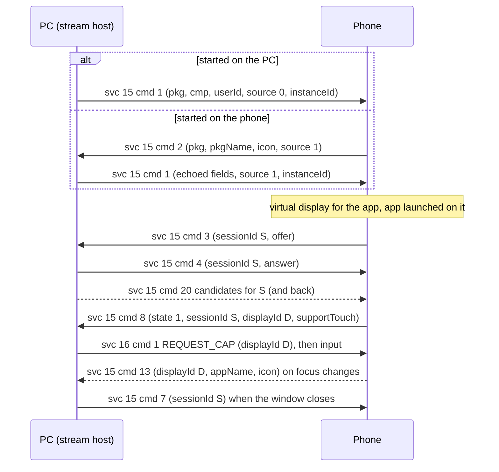

# App streaming (services 15 and 17)

**Status in this project:** Launching a phone app from Linux into its own window is verified on a
device (the app runs on its own virtual display, streams H.264, the window is titled after the app,
and closing the window releases the display on the phone). Invites started on the phone (the App
streaming tile's app picker, notification "Open" and action buttons) are answered by the same code
but were not separately verified. Notification action buttons are answered without a window and
the stream is closed again once the phone has run the action; window resize (`cmd 17`) is
implemented but off by default. Both are **untested on a device**. Not implemented: pausing a
minimised window (`cmd 5`/`6`) and window icons. The app-list icons (service 17) are downloaded by
the daemon on every connection over the phone's fex server ([`fex/`](../../fex/src/icons.rs), verified
on a device: every icon the phone offered).

**Implementation:** [`mirror/src/main.rs`](../../mirror/src/main.rs): `smartconnect-mirror --host`
(long-running; answers every phone invite and serves a local control socket), `--app PKG [CMP]`,
`--list-apps`. The daemon keeps one host running after the first verified connection
([`src/helpers.rs`](../../src/helpers.rs)).

## Overview

App streaming reuses the WebRTC machinery of the [mirror](mirroring.md): service 15 messages, the
phone as WebRTC offerer and the PC as answerer, service 16 for input. The differences (OBSERVED,
phone app; the PC-initiated path also on a device):

- There is no service 1 step. `pkg` is a real package name instead of `"mirror"`.
- **Each app gets its own virtual display and its own WebRTC session,** with its own `sessionId`,
  offer, answer and candidates. At most 5 app displays are open at once. A sixth app, or an app
  started when no encoder is free, opens on the most recent display instead ("merge", `cmd 12`).
- Starting an app that is already streamed creates no new session: the phone sends `cmd 12`
  (merge) and `cmd 14` (move to top) with the `displayId`, and the PC should raise that window.
- App windows can be resized (`cmd 17`) and report focus changes inside a display (`cmd 13`,
  with the app name and icon).
- The display size is the phone's own screen size, rotated to the app's declared orientation and
  fitted inside the PC's `width x height` by factors 1, 0.8, 0.75, 0.66 and 0.5 (defaults 1920x1080,
  alignment 32). With `supportCustomDisplay: true` the phone uses `displayWidth`, `displayHeight`
  and `displayDensity` as given.

## Starting a stream

### From the PC

The PC sends `cmd 1` with the package (OBSERVED on a device):

```json
{
  "ver": "1",
  "cmd": 1,
  "data": {
    "pkg": "com.example.notes",
    "cmp": "com.example.notes.MainActivity",
    "shortcutId": null,
    "userId": 0,
    "source": 0,
    "width": 1920,
    "height": 1080,
    "phyWidth": 344,
    "phyHeight": 194,
    "displayWidth": 1920,
    "displayHeight": 1080,
    "displayDensity": 160,
    "displayScale": 1.0,
    "align": 0,
    "instanceId": 1700000000000,
    "port": 0,
    "supportedMediaFormat": 1,
    "supportWebRTC": 1,
    "supportCustomDisplay": false,
    "vrSupportUnfolded": false
  }
}
```

- `cmp` and `userId` come from the [app list](#service-17-app-list) (work-profile apps have their
  own `userId`). An empty `cmp` makes the phone use the package's launcher activity (OBSERVED).
- With `source` other than 1 the phone may ask for confirmation: if it is unlocked and interactive
  it accepts silently; if it is locked it shows a confirmation or unlock screen first (OBSERVED).
- If another PC already owns app streaming, the phone answers `cmd 8` with `state: 0`,
  `reason: 3858` and that PC's `deviceName` (OBSERVED, phone app).
- **One start at a time.** The phone keeps a single pending start per PC. Wait for the `cmd 3`
  offer, a `cmd 8` with `state: 0`, or a `cmd 12` merge before requesting the next app (INFERRED from
  the phone app; this project also gives up after 20 s).

### From the phone

The phone invites the PC with `cmd 2` when the user picks an app in the phone's App streaming
picker, hands an app over, or acts on a notification from the PC (OBSERVED on a device):

```json
{
  "ver": "1",
  "cmd": 2,
  "data": {
    "deviceId": "<phone-nonce-id>",
    "pkg": "com.example.notes",
    "pkgName": "Example Notes",
    "icon": "<base64 PNG>",
    "source": 1,
    "userId": 0,
    "cmp": "com.example.notes.MainActivity",
    "shortcutId": null
  }
}
```

- The PC answers with the same `cmd 1` as above, but with `source: 1` and the echoed `pkg`, `cmp`,
  `userId` and `shortcutId`. With `source: 1` the phone skips its confirmation (OBSERVED).
- When the invite came from a notification, the phone fires the stored notification intent on the
  new virtual display once the stream is up, so the right chat or screen opens (OBSERVED, phone
  app). See [notifications.md](notifications.md#actions-run-through-app-streaming) and
  [below](#when-a-notification-intent-fires).
- The phone re-sends an unanswered invite every few seconds (OBSERVED on a device).
- `cmp` is present only when the PC's service 15 version is 10 or higher; `pkgName` and `icon` are
  null when the phone cannot resolve the package (OBSERVED).
- The phone sends such invites only if it supports app streaming itself, its platform level is
  recent enough, the link is not a cloud connection, and (on phones that need it) the PC has a
  companion-device association; otherwise it silently does nothing (OBSERVED, phone app).

## Main flow



Input works exactly as for the mirror ([service 16](mirroring.md#service-16-input)), with the
`displayId` from `cmd 8` state 1 (the authoritative value; the second `cmd 3` carries it too) and
coordinates in that session's video-frame pixels. `supportTouch` in `cmd 8` says whether touch
events are usable.

### What the phone does when (OBSERVED, phone app)

- `cmd 1` only prepares the WebRTC session: the phone sends the `cmd 3` offer, but no virtual
  display exists yet.
- **The PC's `cmd 4` answer** (with `error: 0` and `resize` other than 1) is what makes the phone
  create the `AppStream:<pkg>` virtual display, report it with `cmd 8` state 1, and start the app
  on it about half a second later. It then applies the answer SDP and starts the encoder. ICE and
  media follow in parallel; the display and the app do not wait for them.
- Whenever a task gains focus on an app-stream display, the phone sends `cmd 13` for that display.

### When a notification intent fires

For an invite caused by a PC-side notification click (OBSERVED, phone app):

1. The phone keeps the notification's PendingIntent and invites the PC with `cmd 2`. The `pkg` is
   the intent's creator package, normally the app that posted the notification.
2. If that app is already streamed to this PC, there is no invite: the phone fires the intent on
   the existing display at once and sends `cmd 12` (merge) and `cmd 14` (raise).
3. Otherwise the PC answers `cmd 1` and `cmd 4` as usual. When the launched app's task gains focus
   on the new display, the phone sends `cmd 13` for it **and at the same moment** starts a small
   trampoline activity that sends the stored intent with that display as its launch display (and
   background activity starts allowed), then finishes.

So the PC only has to answer `cmd 1` and `cmd 4` and keep the session open until shortly after
`cmd 13`; ICE, video and a window are not needed for the intent to fire. Closing the session with
`cmd 7` afterwards releases the display. What then happens to an activity the intent started on
that display (moved to the phone's screen, or destroyed) is decided by the phone's system service
and is not known.

This project uses this for notification action buttons: the daemon announces each click to the
stream host, which answers the next invite for that package within 6 s without a window, sends
`cmd 7` 2.5 s after `cmd 13` (or after 12 s without one), and never keeps such a session longer than
30 s. "Open" clicks keep their window. (INFERRED to work; untested on a device.)

### Resize

`cmd 17` resizes an app's display **in place** (OBSERVED, phone app):

1. The phone computes a new display size from the new `width x height` bound the same way as for
   `cmd 1`. If that is the size the display already has, it answers `cmd 26` with
   `success: false` and changes nothing. A phone-side feature flag gates `cmd 17`; with it off
   there is no answer at all.
2. Otherwise it resizes the virtual display, answers `cmd 26` `{displayId, success: true}`, and
   changes the capture size of the **same** WebRTC session (same `sessionId`, no new offer). A new
   `cmd 3` with the new `width`/`height` and the `displayId` and a new `cmd 8` state 1 follow, and
   the video frame size changes mid-stream.
3. A mirror display, a "virtual tablet" display and a desktop display with a zero size always get
   `success: false`. For the Ready For desktop display the new size becomes its resolution.

This project sends `cmd 17` with the window's client size (debounced: the size must hold for
400 ms, at most one request per second, and nothing is sent while the window already matches the
stream), and only when resizing is switched on (`SMARTCONNECT_MIRROR_RESIZE=1`; untested on a
device).

## Commands

Service 15, as used by app streams (OBSERVED in the phone app unless noted; the mirror subset is in
[mirroring.md](mirroring.md#service-15-stream-setup)):

| cmd | Direction | Name | Payload | Notes |
|---|---|---|---|---|
| 1 | PC → phone | Start (peer start data) | See above | One at a time |
| 2 | phone → PC | Invite | See above | OBSERVED on a device |
| 3 | phone → PC | Session parameters and offer | `sessionId`, `isWebRTC: 1`, `webRTCData` (JSON string with the offer), `width`, `height`, `pkg`, `cmp`, `userId`, `hb: 30`, later `displayId` | Same as the mirror |
| 4 | PC → phone | Answer | `sessionId`, `error: 0`, `isWebRTC: 1`, `resize: 0`, `webRTCData` (JSON string with the answer) | Same as the mirror |
| 5, 6 | PC → phone | Pause, resume the encoder | `{sessionId}` | Window minimised or restored; the phone answers `cmd 8` state 2 or 3 |
| 7 | PC → phone | Close the app window | `{sessionId, error: 0}` | Releases the display. `error: 1` shows a dialog on the phone. OBSERVED on a device |
| 8 | phone → PC | State change | `state`: 0 stopped, 1 connected, 2 paused, 3 resumed. `reason`: 3857 app task removed on the phone (close the window), 3858 in use by another PC, 3859 no encoder available, 3860 app does not exist (`msg` has text), 3861 paused because the encoder was taken, 145/147 denied or timed out. Also `displayId`, `sessionId`, `pkg`, `userId`, `cmp`, `supportTouch`, `animationDisabled` | State 1 and 0 OBSERVED on a device |
| 9, 10 | PC → phone, phone → PC | Heartbeat, ack | none | One `cmd 9` every 30 s covers all sessions of the PC |
| 12 | phone → PC | Merge | `{pkg, cmp, shortcutId, displayId, userId}` | The app was added to an existing display; no new session |
| 13 | phone → PC | Focus changed | `{appName, displayId, icon (base64 PNG), pkg, userId}` | Update the window title and icon |
| 14 | phone → PC | Move to top | `{displayId}` | Raise that window |
| 15 | PC → phone | Moved to another monitor | Peer start data plus `displayId` | The phone tears the session down and restarts it with a new offer and a new `sessionId` |
| 16 | phone → PC | Rotation | `{sessionId, displayId, rotation}` | |
| 17 | PC → phone | Resize | All peer start data fields plus `displayId` (`width`, `height`, `pkg`, `userId`, `cmp`, `phyWidth`, `phyHeight`, `displayScale`, `instanceId`, `supportWebRTC: 1`) | The phone resizes the virtual display in place and changes the capture size of the same session, so the video frame size changes mid-stream. See [Resize](#resize). Implemented here, off by default |
| 20 | both | ICE candidate | As for the mirror | The phone finds the session by `sessionId`, so route each candidate with the right one |
| 21 | phone → PC | Apps playing audio | `{audioAppList: […]}` | Phone-audio feature; ignorable |
| 24 | PC → phone | Visible sessions | `{appList: [{pkgName, sessionId, visible}]}` | Tells the phone which windows are visible, so it can pause the right encoder when encoders run short (service 15 version 15 or later). Optional |
| 25 | PC → phone | Pause the heartbeat watchdog | none | |
| 26 | phone → PC | Resize result | `{displayId, success, error}` | Reply to `cmd 17`; always false for a mirror, and false when the new bound maps to the current size |

## Service 17: app list

The phone sends its launchable apps on every connection (at most once per 6 s, and only for its main
user) (OBSERVED on a device; fields from the phone app):

```json
{
  "ver": "1",
  "cmd": 1,
  "port": 40500,
  "fingerprint": "<phone-fp-hex>",
  "token": "<one-time-token>",
  "appLimit": 5,
  "autoDownload": false,
  "apps": [
    {
      "pkg": "com.example.notes",
      "name": "Example Notes",
      "userId": 0,
      "cmp": "com.example.notes.MainActivity",
      "iconName": "com.example.notes_com.example.notes.MainActivity.png"
    }
  ],
  "wpApps": []
}
```

| cmd | Direction | Purpose | Payload | Tag |
|---|---|---|---|---|
| 1 | phone → PC | App list | `apps` and `wpApps` (work profile): `{pkg, name, userId, cmp, iconName}`; `appLimit`; `autoDownload`; and `port`, `fingerprint`, `token` (see below) | OBSERVED on a device |
| 2 | PC → phone | Send the list again | `{"ver": "1", "cmd": 2}` | OBSERVED on a device |
| 4 | PC → phone | Apps the PC refuses to stream | `{"ver": "1", "cmd": 4, "blacklist": [pkg, …], "blackCmpList": [{…}]}` | OBSERVED (code) |
| 5 | PC → phone | Ask for running apps | `{"ver": "1", "cmd": 5}`; the phone answers `cmd 6` | OBSERVED (code) |
| 6 | phone → PC | Running apps | `{runningAppInfos: [{pkg, userId, displayId, isVisible, isFocused}]}` | OBSERVED (code) |
| 10 | phone → PC | Recent apps | `{recentApps: [ {…app…} ]}`, sent right after the PC reports the icon transfer complete | OBSERVED on a device |

- `iconName` is `<pkg>_<cmp>.png`, prefixed with `<userId>_` for other users (OBSERVED; a second
  user such as a cloned-app profile shows up in `apps` with its own `userId`, e.g. `10_…`).
- **Icons are not in the JSON.** Just before `cmd 1` the phone zips one PNG per app (named exactly
  as its `iconName`) and starts a short-lived **fex** file-transfer server for it; `port`,
  `fingerprint` and `token` are that server's coordinates (OBSERVED on a device). The PC pulls the
  zip as described in [file-exchange.md §3](file-exchange.md#3-fex--fileex-service-2): TLS pinned to
  `fingerprint`, WebSocket `/websocket` (ack `versionNegotiation` and `sendRequest`), `GET
  /download?taskId=<id>`, then `status` type 1. The zip holds one 158×158 PNG
  per app (roughly 13 KB each) and the pull takes well under a second on a LAN (OBSERVED).
- Completing the pull matters to the phone beyond the icons: only after the `status` type 1 does it
  fire its `onComplete` and send `cmd 10` (recent apps) (OBSERVED). An unclaimed transfer just times
  out on the phone.
- Every `cmd 1` (each connection, and each `cmd 2` the PC sends) starts a new server with a new
  port, fingerprint, token and task id; the phone rate-limits these to one per 6 s (OBSERVED, code).
- `autoDownload` was `false` in every advert seen, yet the Windows PC caches the icons per phone
  (OBSERVED in its config); this project pulls on every advert (INFERRED to be what the phone
  expects, since the recent-apps list waits for it).
- Besides the download, the base64 PNGs in service 15 `cmd 2` (`icon`, with `pkgName`) and `cmd 13`
  (`icon`, with `appName`) are the only real icons (OBSERVED).

### Icon cache (this project)

Every front-end of this project reads phone app icons from one directory:

`$XDG_CACHE_HOME/smartconnect-linux/app-icons/` (default `~/.cache/smartconnect-linux/app-icons/`)

| File | Written by | Content |
|---|---|---|
| `<iconName>` exactly as in the svc 17 list (`<pkg>_<cmp>.png`, `<userId>_<pkg>_<cmp>.png` for another user) | the fex icon download: `smartconnectd` on every svc 17 `cmd 1`, or `smartconnect-fex fetch-app-icons` (temp file + rename; unchanged files are not rewritten; nothing is deleted) | the phone's launcher icon for that activity |
| `<pkg>.png` | `smartconnect-mirror`, from service 15 `cmd 2` / `cmd 13` (written once, if absent; temp file + rename) | the icon the phone sent with a stream invite or focus change |

- `smartconnect-mirror --list-apps --json` (and the `apps.json` it caches) keeps `cmp`, `userId` and
  `iconName` for each app, so a front-end can find the first kind; when `iconName` is missing it is
  computed from `pkg`/`cmp`/`userId` as above.
- The harvest accepts only a package name made of letters, digits, `.`, `_` and `-`, and only data
  that decodes to a PNG; it never overwrites an existing file.
- Only one icon download runs at a time: the daemon and the CLI share the lock
  `$XDG_RUNTIME_DIR/smartconnectd/app-icons.lock`; the CLI takes it before it sends `cmd 2`, so the
  daemon leaves that offer to it. `SMARTCONNECT_APP_ICONS=0` turns the daemon's download off.
- The GTK app looks up an icon in this order: `<iconName>`, `<pkg>.png`, an **exact** desktop icon
  (the package as a themed icon name, or an installed application with exactly the app's name), then
  the app name's initials. It watches the directory, so icons that arrive later appear on their own.

## Pitfalls

1. **`instanceId` must stay constant.** When a `cmd 1` carries a different `instanceId` from the
   previous one, the phone releases **all** sessions of that PC, closing every open app window
   (OBSERVED, phone app). This project keeps one id per login session, shared by all its processes.
2. **Booleans.** `supportCustomDisplay` and `vrSupportUnfolded` must be `true`/`false`, never `0`/`1`
   (see [mirroring.md](mirroring.md#pitfalls)).
3. **Start one app at a time** and wait for its offer, rejection or merge.
4. **Route by `sessionId`.** Candidates, pause, resume and close all name a session; a wrong id is
   ignored.
5. **Encoder limits.** Phones have a few hardware encoder instances. Beyond that you get reason 3859
   (none available) or 3861 (paused because another session took it). `cmd 24` helps the phone pick
   which session to pause.
6. **Resize.** Debounce window resizes (300 ms or more) before sending `cmd 17`, expect `cmd 26`,
   and expect the video frame size to change mid-stream. Never send `cmd 17` for the mirror.
   Remember the last size you requested: the phone may pick a display size that does not match the
   window, and asking again for the same window size only gets `success: false`.
7. **`cmd 15` restarts the session** with a new `sessionId`.
8. **The phone's display ids are per session.** Keep a map from `displayId` to window to handle
   `cmd 12`, `13` and `14`.
9. **Keep a notification's stream open until `cmd 13`.** The intent behind a notification click
   fires only when the app gains focus on its new display; closing the session before that loses
   the action.

## Open questions

- Whether the phone-side companion-device association prompt appears for a non-Windows PC on phones
  that require it.
- The exact behaviour of the confirmation screen on a locked phone for PC-initiated starts.
- What happens to an activity a notification intent started on an app display after the PC closes
  that stream (`cmd 7`): moved to the phone's screen or destroyed.
- Whether the phone's display-size fitting for `cmd 17` follows the window's aspect ratio or only
  picks a scale step of the phone's own screen size.
