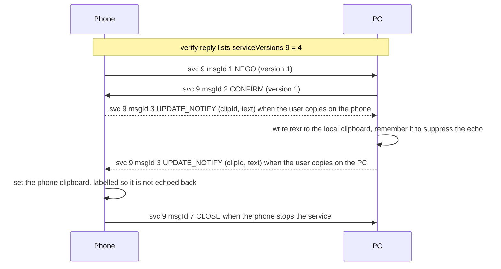

# Clipboard (service 9)

**Status in this project:** Text sync in both directions is implemented and verified on a device
(phone copies appear in the Linux clipboard through `wl-copy`; Linux copies reach the phone through
`wl-paste --watch`). File and image clips: the control plane is documented
[below](#image-and-file-clips); the daemon recognises them and logs them, but does not fetch the
bytes yet (the fex client exists but isn't wired to clipboard clips).

**Implementation:** [`src/clipboard.rs`](../../src/clipboard.rs), wired into the session loop in
[`src/server.rs`](../../src/server.rs).

## Overview

Clipboard text travels inline in one message type, in both directions, with no acknowledgement. The
phone starts the service with a negotiation message, and it only sends its own copies after the PC
has confirmed. The message type is in `data.msgId`, not in a `cmd` field (OBSERVED).

```json
{
  "deviceId": "<pc-nonce-id>",
  "srcServiceId": 9,
  "serviceId": 9,
  "msgId": 57,
  "data": { "msgId": 3, "data": { "clipId": 1001, "text": "<copied text>" } }
}
```

`data` must be a JSON object containing `msgId` and a nested `data` object. A JSON string in place
of either object makes the phone's parser throw (OBSERVED).

## Gates

The phone sends its negotiation (NEGO) on every new connection only if all of these hold (OBSERVED,
phone app):

1. **The PC advertises clipboard version 2 or higher:** `serviceVersions["9"] >= 2` in the verify
   reply. Windows and this project send `4`; the values 2, 3 and 4 behave the same. A missing key
   counts as 1, and then nothing happens: no NEGO, and no error in the normal log.
2. **No `rfaServiceVersions` without a `"9"`** in the verify reply (the phone prefers that map; see
   [versioning gates](README.md#versioning-gates)).
3. **The phone's global clipboard switch is on.** On a fresh install it is **off** by default. It
   also requires the phone's main user in the foreground and the system-wide "PC" settings on.
4. **The per-PC switch is on** (the phone keeps a list of PCs with clipboard disabled).

There is no check of `os`, `type`, `caps` or an account on this path. With the version right but
the switch off, the phone logs "ws available" and nothing else (OBSERVED on a device). A PC can
detect this as "no NEGO within a couple of seconds after the verify reply".

## Commands

| msgId | Name | Direction | `data` fields | Purpose | Tag |
|---|---|---|---|---|---|
| 1 | NEGO | phone → PC (first, on every connection); PC → phone allowed | `version` int | Starts the service. The phone always offers `1`. If the PC sends NEGO, the phone answers CONFIRM with `min(version, 1)`. | OBSERVED on a device |
| 2 | CONFIRM | PC → phone (answer to NEGO); phone → PC (answer to a PC NEGO) | `version` int | The agreed version. Send `1`. The phone stores it as is and only checks that it is non-zero: `0` would leave the phone receive-only. Windows answers within 20-190 ms. | OBSERVED |
| 3 | UPDATE_NOTIFY | both | `clipId` int, `text` string | A new clip. Text travels inline. No acknowledgement, no follow-up. | OBSERVED on a device |
| 4, 5, 6 | PULL, PULL_RESPONSE, PULL_CANCEL | - | - | Used for file and image clips only (see [below](#image-and-file-clips)). **Never send PULL for a text clip** (see pitfalls). | OBSERVED |
| 7 | CLOSE | phone → PC on teardown | `code` int (0), `reason` string (`""`) | The phone stops the service for this PC. Stop sending until the next NEGO. A CLOSE from the PC has no effect on the phone. | OBSERVED |
| 10 | SYNC_SUPPORT_FILES | - | `enabled` bool | Ignored by the phone. | OBSERVED |
| 12 | SYNCED | - | `clipId` int | Ignored by the phone (Windows has a matching name). | OBSERVED |
| 13-17 | Phone-internal handler codes | **never send** | - | 13 makes the phone's handler loop forever; 15 throws a class-cast exception; 14 and 17 make it re-send NEGO; 16 makes it PULL. | OBSERVED (code) / INFERRED (effects) |
| 100 | GLOBAL_SETTINGS_ENABLE | PC → phone | `{}` (ignored) | Turns on the phone's global clipboard switch and the switch for this PC, shows a notification, and NEGO follows. Changes the user's settings: send only with consent. | OBSERVED (code) / INFERRED (NEGO follows) |
| 101 | GLOBAL_SETTINGS_DISABLE | PC → phone | `{}` (ignored) | **Persistently** disables clipboard for this PC, and the phone sends CLOSE. The user has to re-enable it on the phone. | OBSERVED |

## Main flow



### Phone to PC

- The phone reacts to its own clipboard changes. Only `text/*` clips go out as text (HTML is sent
  as its plain text). Blank text is skipped, as is the same text again within 1 s (OBSERVED).
- `clipId` comes from a counter in the phone app process, starting at 1 and shared with file and
  image clips (OBSERVED).
- The phone sends only after it has received CONFIRM (or answered a PC NEGO) (OBSERVED).
- The PC should set its own clipboard and do nothing else: no acknowledgement, SYNCED or PULL is
  expected (OBSERVED).
- A copy of a file or image arrives as an UPDATE_NOTIFY **without** `text` (it carries file
  metadata instead). See [Image and file clips](#image-and-file-clips); this project recognises it
  and does not fetch it yet.

### PC to phone

- Send UPDATE_NOTIFY once the phone has sent NEGO and the PC has confirmed. `clipId` is any positive
  int; `0` means an empty clip. Use a rising counter that stays within a Java `int`. This project
  seeds it from the clock, so ids keep rising across restarts (OBSERVED).
- Send only `clipId` and `text`. Leave out every file-related field.
- The phone needs its global switch on when the message arrives. It truncates text longer than
  100000 characters (with a toast) and sets its clipboard with a label that keeps the clip from being
  echoed back (OBSERVED).
- When one PC sets the phone's clipboard, the phone sends an empty clip (`{"clipId": 0}`, no text)
  to every other connected PC (OBSERVED). Ignore it.
- No acknowledgement follows.

## Image and file clips

**Status in this project: not implemented** (text only). This section documents the control half,
reconstructed from static evidence (OBSERVED unless tagged). The *bytes* do not travel on service 9
— they move over **fex** ([file-exchange.md](file-exchange.md#3-fex--fileex-service-2)). This
project now has a fex client (it downloads the app icons, service 17), but it is not wired to
clipboard clips yet.

A clip that holds files or an image uses the same `UPDATE_NOTIFY` (msgId 3), but `data` carries a
file list instead of `text`:

```json
{ "clipId": 42,
  "filelist": [ { "attr": 128, "name": "a.jpg",
                  "path": "/storage/emulated/0/Pictures/a.jpg", "size": 12345 } ],
  "storage": "/storage/emulated/0" }
```

- `FileInfo`: `attr` (**16 = directory, 128 = normal file**), `name` (base name), `path` (absolute
  on the owner, under `storage`), `size` (bytes). The phone sends `path` even though it is marked
  `@Expose(serialize=false)`, because the app serialises with plain Gson. JSON key casing is seen as
  both `filelist` and `fileList`.
- `storage` is the root the paths are relative to: `/storage/emulated/0` on the phone, a Share Hub
  directory on the PC.

### Pulling the bytes

| msgId | Name | Payload | Meaning |
|---|---|---|---|
| 4 | PULL | `{"clipId": 42}` | The receiver asks the owner for the bytes. `clipId` must equal the owner's current clip, or it is rejected. |
| 5 | PULL_RESPONSE | `{"requestId": 0, "clipId": 42, "error": 1\|2}` | **Errors only** (1 = invalid request, 2 = obsolete clip). On success nothing comes back on service 9 — the bytes arrive over fex. |

**Phone → PC (phone copies an image):** the phone's `onPrimaryClipChanged` sees an `image/*` clip
**≤ 10 MB** (larger ones raise a "clipboard too large" UI and are dropped), optionally converts HEIC
to JPEG, builds the `filelist` + `storage`, and after CONFIRM sends `UPDATE_NOTIFY`. The PC then
sends `PULL`; the phone calls `fileTransfer_SendFilesJsonAsync`, i.e. **fex-pushes** the file. The PC
receiver writes the image to its clipboard.

**PC → phone (PC copies an image/file):** the PC sends `UPDATE_NOTIFY` with its own `filelist`, the
phone sends `PULL`, the PC pushes over fex — or the phone mounts the PC's paths over Share Hub
(service 30) when every `path` is non-empty. Which path a genuine PC drives is an open question for a
capture (INFERRED).

### Why this project does not pull yet

Receiving the bytes needs the **fex client**: TLS pinned to the advertised fingerprint, a
WebSocket of `action`/`ack` text frames, then `GET /download` (see
[file-exchange.md §3](file-exchange.md#the-lan-pull-protocol-https--a-websocket-of-text-frames-observed-on-a-device);
the earlier "AES-256-GCM, per-chunk-signed" description was the cloud path, not the LAN one). That
client exists ([`fex/`](../../fex/src/client.rs), verified on a device for app icons), and the
service 2 `FileExSendData` that follows a PULL carries the same `port` + `fingerprint` (INFERRED to be
the same server). What is left: send PULL, catch the service 2 advert, pull with
`smartconnect_fex::client::pull` (or the direct `/downloadFile` mode, if clipboard sends use it),
and put the image on the clipboard. Until then the daemon recognises an incoming image/file clip and
logs it, but does **not** send a PULL. That is deliberate and safe: the phone simply gets no pull and
nothing crashes.

## Pitfalls

1. **Suppress your own echo.** When the PC writes the phone's text into its clipboard, its own
   clipboard watcher sees a change. Remember the last text that crossed the link in either direction
   and do not send it back (OBSERVED in this project).
2. **Never PULL a text clip.** The phone's PULL handler assumes a file list and fails on the handler
   thread (OBSERVED in code).
3. **Never send msgIds 13-17**, and never send 101 unless the user wants clipboard sync off for good.
4. **Clipboard defaults to off on the phone.** If nothing arrives, check the phone's clipboard
   setting before debugging the PC. msgId 100 can turn it on, but it changes the user's settings.
5. **Sensitive copies.** Password managers mark their clips as sensitive. This project never sends
   those to the phone (`wl-paste` reports them with the state `sensitive`).
6. **Version changes take effect on the next connection,** because the phone caches the PC's
   versions at verify time.
7. **Do not log clipboard text.** This project's session logs can contain it and are kept private
   (mode 0600).

## Open questions

- Whether Windows sends its own NEGO, and what it sends for msgIds 10, 12, 100 and 101 (the phone
  ignores most of them).
- Whether the phone's per-service executor catches a malformed message or loses the task.
