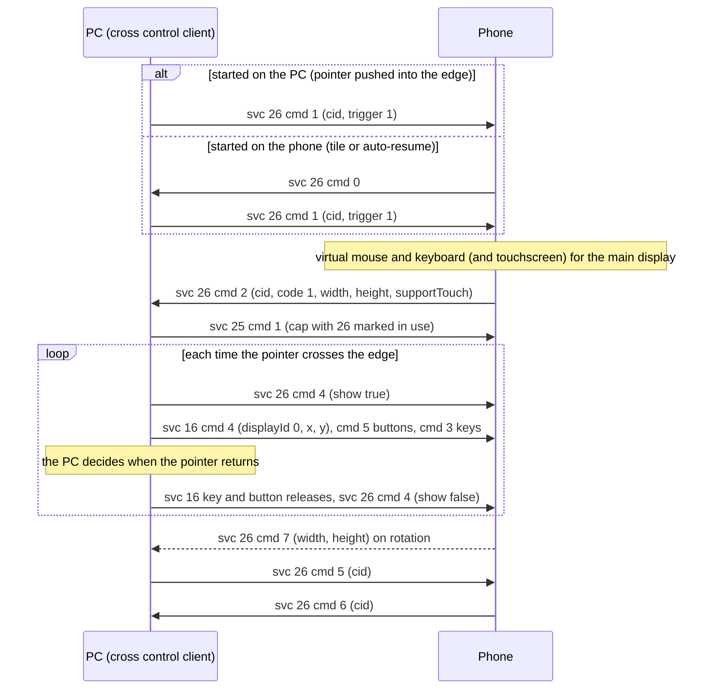

# Cross Control (service 26)

**Status in this project:** Implemented and verified on a device: the phone accepts a control
request and reports its screen size, absolute pointer moves are applied on the phone, and stopping
works in both directions. Keyboard handling and the feel of the pointer (gain, edge return) are
implemented but less tested. Drag and drop (service 24) is not implemented.

**Implementation:** [`crosscontrol/src/main.rs`](../../crosscontrol/src/main.rs)
(`smartconnect-crosscontrol`, a Wayland client that captures the pointer at a screen edge). The
daemon starts it when the phone asks to be controlled ([`src/helpers.rs`](../../src/helpers.rs)).

## Overview

Cross Control (the apps' internal name is "Universal Control") lets the PC's mouse and keyboard move
onto the phone across a screen edge (OBSERVED, phone app and on a device):

- Service 26 is **only a session channel**. It carries no input.
- **All input goes over [service 16](mirroring.md#service-16-input)** with `displayId: 0` and
  absolute coordinates in the phone's real screen pixels (the `width x height` the phone reports).
- Accepting a session makes the phone create, for that PC, a virtual mouse and keyboard on its main
  display and, on phones that support it, a virtual touchscreen of display size.
- **The PC owns all geometry.** The phone knows nothing about sides or edges and never reports that
  the pointer left it. The PC keeps a virtual cursor inside the phone's screen and decides when to
  enter and leave; it tells the phone only to show or hide its pointer (`cmd 4`).

## Gates

| Gate | Detail | Tag |
|---|---|---|
| Phone support | The phone's desktop service must be new enough. A supporting phone lists `"26": 2` in its own capabilities. | OBSERVED (code) |
| Phone setting | A system-wide "cross control" switch, on by default. | OBSERVED (code) |
| PC advertisement | Windows lists `"26": 1` in `serviceVersions`. The phone accepted a PC-initiated request from this project before it listed `"26"` (OBSERVED on a device), but the Cross Control tile needs it (see [device-status-and-tiles.md](device-status-and-tiles.md)). | OBSERVED |
| Companion association | On phones that route input through the system's virtual-device manager, the PC needs a companion-device association. Without it every request is denied (`cmd 2`, `code: 2`). | OBSERVED (code) |
| Network | LAN only; the phone refuses requests over a cloud connection. | OBSERVED (code) |
| Liveness after a reconnect | When the control connection comes back, the phone waits 1 s and checks that the PC's service 25 `cap["26"]` has bit 8 ("in use") set; otherwise it ends the session. While a session is active, report `"26"` with bit 8 in the PC's service 25 map. This project sends `9`; the exact value Windows uses is unknown, and the phone reports `5` for itself. | OBSERVED (check) / INFERRED (value) |

## Commands

Payload: one flat object (no nested `data`) with the fields `ver` (`"1"`), `cmd`, `cid`, `code`,
`controller`, `width`, `height`, `show`, `showScreen`, `supportTouch`, `trigger` (OBSERVED).

| cmd | Direction | Meaning | Fields used | Tag |
|---|---|---|---|---|
| 0 | phone → PC | The phone asks to be controlled (the user tapped Cross Control, or auto-resume fired). It may arrive with `srcServiceId: 19`. | - | OBSERVED on a device |
| 1 | PC → phone | The PC requests control. | `cid` int (chosen by the PC), `trigger` int (`1` = accept without asking the user), `code` int (`2` cancels a pending request), `controller` bool (ignored by the phone) | OBSERVED on a device |
| 2 | phone → PC | Answer to `cmd 1`. | `cid`, `code` (`1` allowed, `2` denied), `width`, `height` (main display size, swapped to landscape when the phone is rotated by 90 or 270 degrees), `supportTouch` bool (a virtual touchscreen exists) | OBSERVED on a device |
| 3 | PC → phone | Answer to the phone's `cmd 0`. `code: 1` makes the phone connect with this `cid`; other codes are ignored. | `cid`, `code` | OBSERVED (code) |
| 4 | PC → phone | Show or hide the phone's pointer: the pointer entered or left the phone. `show: true` also gives the main display input focus. | `show` bool | OBSERVED on a device |
| 5 | both | Disconnect request. The receiver tears the session down and answers `cmd 6`. The phone sends it when the feature is turned off or the PC is unpaired. | `cid` | OBSERVED on a device |
| 6 | both | Disconnect acknowledgement. | `cid` | OBSERVED on a device |
| 7 | phone → PC | Screen geometry changed (rotation, fold). After a fold the phone recreates its virtual input devices 1 s later. | `cid`, `width`, `height` | OBSERVED on a device |
| 8 | PC → phone | Remember "auto-resume" for this PC. When set, the phone uses its sensors (lying fairly flat, not in a pocket, still, unlocked, not yet connected) to send `cmd 0` by itself, for example right after it is unlocked. | `showScreen` bool | OBSERVED (code) |

Phone-side states: 0 idle, 1 requesting (it sent `cmd 0`), 2 incoming (it got `cmd 1`), 4 connected
(OBSERVED, phone app).

How the phone handles `cmd 1` (OBSERVED, phone app): it denies without a companion association, or
when another PC is connected (the same PC gets its old session replaced); `code: 2` cancels;
`trigger: 1` accepts at once; otherwise it asks the user if the phone is locked or its screen is off
(and may send a service 8 message), and accepts directly if not. Accepting creates the virtual
devices and sends `cmd 2` with `code: 1`.

**Use `trigger: 1`, and answer a phone `cmd 0` with a fresh `cmd 1`** rather than `cmd 3`: the
`cmd 2` reply then carries the screen size.

Example exchange as this project sends it:

```json
{"deviceId": "<pc-nonce-id>", "srcServiceId": 26, "serviceId": 26, "msgId": 101,
 "data": {"ver": "1", "cmd": 1, "cid": 1, "code": 0, "trigger": 1, "controller": true}}
```

```json
{"deviceId": "<phone-nonce-id>", "srcServiceId": 26, "serviceId": 26, "msgId": 2001,
 "data": {"ver": "1", "cmd": 2, "cid": 1, "code": 1, "width": 2000, "height": 1000,
          "supportTouch": true, "controller": false, "show": false, "showScreen": false, "trigger": 0}}
```

Enter and leave are `{"ver": "1", "cmd": 4, "show": true}` and `{"ver": "1", "cmd": 4, "show": false}`;
stop is `{"ver": "1", "cmd": 5, "cid": 1}`, answered by `{"cmd": 6, "cid": 1}`.

## Main flow



## Input

Service 16 with `displayId: 0` (OBSERVED on a device for moves; the rest from the phone app and this
project):

| What | How |
|---|---|
| Setup | No `cmd 1` REQUEST_CAP is needed: accepting the service 26 session already created the devices. Sending one anyway is harmless (INFERRED). |
| Pointer | `cmd 4` with **absolute** `x`, `y` in the `width x height` space from `cmd 2`/`cmd 7`. The phone applies its rotation and scale and positions its pointer there. Relative motion never goes over the wire: the PC integrates its own deltas into a virtual cursor and clamps it to the screen. This project limits moves to about 125 per second. |
| Buttons | `cmd 5` with `key` 1 left, 2 middle, 3 right; wheel `key` 4 with `down` giving the direction (`true` scrolls the content down). |
| Keys | `cmd 3` with set-1 scancodes and `flags: 0x100` for E0 keys; media keys and BACK as Android keycodes with `flags: 0x1000`; text with `cmd 7`. See [key codes](mirroring.md#service-16-input). |
| Touch | `cmd 9` works only when `supportTouch` is true. Windows uses it for two-finger touchpad scrolling (INFERRED from its function names). |
| Mouse as touch | Service 16 `cmd 13` with `inputMode: 1` makes the mouse emulate touch. Leave it at 0 for cross control. |
| Cursor | The phone draws its own pointer, shown and hidden with `cmd 4`. Pointer images (`cmd 6`) arrive only after a `cmd 10` request and can be ignored. |
| Keyboard focus | No explicit message: keys go to whatever has focus on the main display, and `show: true` focuses it. Release every held key and button (`down: false`) before handing control back; Windows does the same. |

## Returning control

The phone never reports that the pointer left it (OBSERVED): only `cmd 0`, `2`, `5`, `6` and `7` go
from the phone to the PC. The PC has to decide, and the screen arrangement (which side of which
monitor the phone sits on) is entirely PC-side; the phone receives no position information.

This project's rule (OBSERVED in this project): control returns when the virtual cursor is pushed
outward past the shared edge by more than a threshold (default 12 phone pixels) with no button
held, or on Ctrl+Alt+Esc. It then releases held keys and buttons, sends `cmd 4` with `show: false`,
and puts the PC pointer just inside the edge at the matching position. While the pointer is still
in the edge strip, entering again needs a deliberate outward push of about 25 pixels.

Implementation note for Wayland (OBSERVED in this project): a 1-pixel layer-shell strip on the
chosen edge detects arrival; while the phone is controlled, a transparent fullscreen overlay holds
exclusive keyboard focus, the pointer is locked (pointer-constraints), relative motion comes from
the relative-pointer protocol, and compositor shortcuts are inhibited. Wayland clients cannot warp
the pointer, so the return position is set with the lock's cursor-position hint.

## Drag and drop (service 24)

Not implemented here; described for completeness (OBSERVED in the phone app). The phone's drag and
drop handler uses service 24 (Windows-side analysis labels service 21 as drag and drop; prefer 24
and re-check on a device). It is active while service 15, 26 or 1 is connected, needs a phone-side
feature flag, and uses `ver: "1.0"`.

| cmd | Direction | Meaning | Fields |
|---|---|---|---|
| 1 | phone → PC | A drag started on the phone while cross control has the pointer | `token` long, `displayId`, `x`, `y`, `text`, `thumb` (base64 PNG), plus file fields |
| 1 | PC → phone | Drag data. With `text` only, the phone injects a text drop at `x`, `y` | `token`, `displayId`, `x`, `y`, `text` |
| 2 | PC → phone | The drop happened. An empty `path` means a drop into the phone | `token`, `displayId`, `path`, `x`, `y` |
| 3 | PC → phone | A PC drag entered or left the phone; the phone shows the thumbnail as its pointer | `enter` (0/1), `displayId`, `text` (0/1), `thumb` |

File drags in either direction use the file-transfer service, which is out of scope.

## Pitfalls

1. **Release keys and buttons before leaving,** or they stay pressed on the phone.
2. **Rotation.** Rescale the virtual cursor on every `cmd 7`; `width` and `height` swap when the
   phone turns.
3. **`code: 2` in `cmd 2`** means a missing companion association or another PC in control. Tell the
   user to allow it on the phone.
4. **The service 25 map is replaced as a whole.** Reporting the in-use bit by sending a map that
   contains only `"26"` hides the other tiles; this project currently does that (see
   [device-status-and-tiles.md](device-status-and-tiles.md#pitfalls)).
5. **The phone's `cmd 0` needs a listener.** Tapping the tile does nothing unless a PC process answers.
   This project's daemon starts the client when `cmd 0` arrives and the client answers with `cmd 1`.
6. **Coordinates.** Check corners in both orientations: the space is the landscape-swapped
   `width x height`, mapped by the phone's own rotation logic.

## Open questions

- The `cap["26"]` value Windows reports while a session is active (bit 8 or bit 4).
- Whether a pointer lock is always granted on a layer-shell surface by every compositor.
- Service 21 versus 24 for drag and drop.
