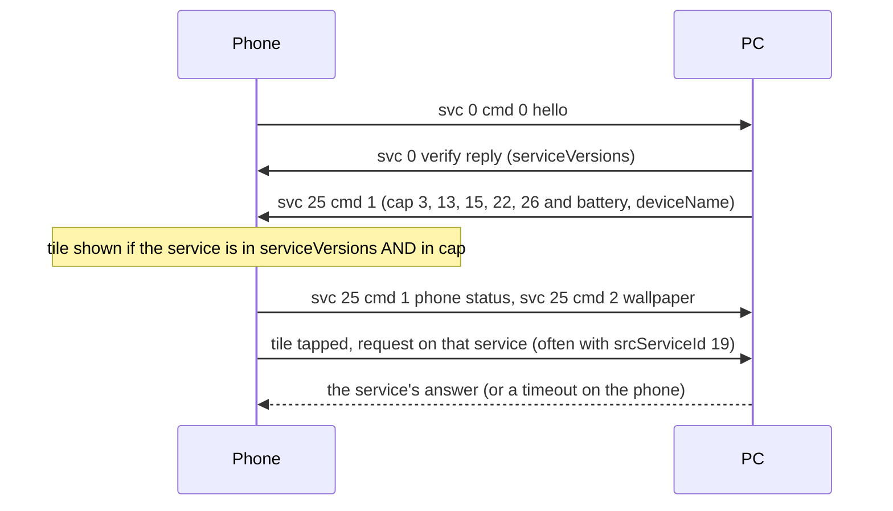

# Device status and feature tiles (service 25)

**Status in this project:** Implemented and verified on a device. The daemon sends its status and
tile capability map right after every verify reply, and the phone's device page then shows the App
streaming, Cross Control, PC lock and Hotspot tiles. The Webcam tile was added later in the same
way. The Screen share and Mobile desktop tiles (service 1) are only advertised with the daemon's
experimental `--extra-tiles 1` flag (untested on a device). The phone's own status (battery,
signal, wallpaper) is read and shown on the desktop.

**Implementation:** [`src/proto.rs`](../../src/proto.rs) (`device_status_msg`, `device_status_caps`),
[`src/server.rs`](../../src/server.rs) (sent after the verify reply),
[`src/status.rs`](../../src/status.rs) (phone status for desktop UIs).

## Overview

Service 25 carries device status in both directions. Its most important job for a PC is the `cap`
map in the PC's `cmd 1`: the phone draws a feature tile on the PC's device page only if the service
is listed both in the verify reply's `serviceVersions` and in this map (OBSERVED on a device).
There is no separate "feature list" message. Before this was understood, the Linux PC paired fine
but its device page had no tiles at all.

## Commands

All payloads are flat: `{"ver": "1", "cmd": N, …}` (OBSERVED).

| cmd | Direction | Purpose | Payload fields | Tag |
|---|---|---|---|---|
| 1 | PC → phone | PC status and tile capabilities | `ver` string `"1"`, `cmd` int, `cap` object (service id string → int flags), `battery` int (PC battery percent; 100 without a battery), `deviceName` string (renames the PC on the phone), `realDeviceName` string, `model` string | OBSERVED |
| 1 | phone → PC | Phone status, sent on connect and on changes | `battery` int, `isCharging` bool, `wifi` bool, `wifiSignal` int, `dataSignal` int, `bluetooth` bool, `deviceName` string, `model` string, `cap` object (the phone's per-feature flags towards this PC) | OBSERVED on a device |
| 2 | phone → PC | Phone wallpaper | `wallpaper` string (base64 image, about 280 KB), `md5` string. Re-sent on connect; skip decoding when `md5` is unchanged. | OBSERVED on a device |
| 6 | PC → phone | Do-not-disturb state of the PC | `dndState` int. Non-zero puts this PC on the phone's do-not-disturb list: the phone stops pushing notifications to it, and the setting persists. | OBSERVED (phone app) |
| 20 | phone → PC | AI capabilities | Not worked out. | OBSERVED (presence) |
| 22 | phone → PC | A trust flag (`mUntrusted`) | Not worked out. | OBSERVED (presence) |

Windows also sends its own status on service 25, including an AI-capabilities entry with plugin id
313, which the phone logs as a remote AI capability (OBSERVED). It is not needed for pairing or
tiles.

Example PC message, as this project sends it:

```json
{
  "deviceId": "<pc-nonce-id>",
  "srcServiceId": 25,
  "serviceId": 25,
  "msgId": 2,
  "data": {
    "ver": "1",
    "cmd": 1,
    "cap": { "3": 1, "13": 1, "15": 1, "22": 1, "26": 1 },
    "battery": 100,
    "deviceName": "My Linux PC",
    "realDeviceName": "My Linux PC",
    "model": "Linux PC"
  }
}
```

### `cap` values

Each value is a small bit set (OBSERVED from the phone's own map and its tile code):

| Bit | Meaning | Tag |
|---|---|---|
| 1 | Feature available | OBSERVED |
| 2 | An extra mode of the feature | OBSERVED (value) / INFERRED (meaning) |
| 4 | Unknown. The phone reports `"26": 5` for itself while Cross Control is connected, so this may mean "connected". | INFERRED |
| 8 | In use with another device: the tile shows "in use". The phone also checks this bit for Cross Control after a reconnect (see [cross-control.md](cross-control.md#gates)). | OBSERVED |
| 16 | Turned off by the user | OBSERVED |

In the phone's own `cap` map, bit 16 on `"5"`, `"9"` or `"204"` means the phone will not sync
notifications, clipboard or Messages to this PC (sync is off for this PC, the global switch is off,
or a permission is missing) (OBSERVED). A desktop can use it to explain why nothing arrives.

## Tile gating

A tile is shown only if all four checks pass. The phone re-evaluates them every time the device page
refreshes (OBSERVED):

1. **Phone-local check:** the phone itself supports the feature (hardware, settings, policy).
2. **Peer type:** the PC's `type` and `scType` give the right "view" bits. Windows sends `type: 4`,
   `scType: 2`, and so does this project.
3. **`serviceVersions`:** the service is in the map the phone cached from the verify reply, with a
   value of 0 or more. With `scType: 2`, services 20 and 202 pass this check automatically.
4. **Service 25 `cap`:** the service is a key in the last `cap` map the PC sent. For 205 and 206 the
   value must also be non-zero. The phone persists this map, so a stale map survives PC restarts until
   the next `cmd 1` replaces it.

| Tile | Service | Windows `serviceVersions` | Extra gates | What a tap sends | This project |
|---|---|---|---|---|---|
| App streaming | 15 | `"15": 16` | Phone not in a conflicting mode | Opens the phone's own app picker, then service 15 `cmd 2` | Shown, works |
| Mobile desktop | 1 | `"1": 10` | Peer type bits | Opens a panel (resolution, orientation, Connect); Connect sends service 1 `cmd 0` with `view: 2` and `resolution`, then the service 15 `"desktop"` stream ([mirroring.md](mirroring.md#views-started-on-the-phone)) | Not shown by default; `--extra-tiles 1` adds `"1"` to the map (experimental, untested on a device) |
| Screen share (phone to PC) | 1 | `"1": 10` | Peer type bits; peer is not a phone | Opens a panel (Mirror or Virtual phone, Connect); Connect sends service 1 `cmd 0` with `view: 1` or `3`, then the service 15 `"mirror"` or `"mobile"` stream | Same tile flag as Mobile desktop (`--extra-tiles 1`) |
| Webcam | 3 | `"3": 3` | Phone camera capability | Service 3 `cmd 0` with `srcServiceId 19` | Advertised; see [webcam.md](webcam.md) |
| Hotspot | 13 | `"13": 1` | A Motorola phone, not a tablet | Service 13 `cmd 0` | Shown |
| PC lock | 22 | `"22": 2` | - | Service 22 `cmd 1` | Shown |
| Cross Control | 26 (may be merged with 202 on the dashboard) | `"26": 1` | Phone-side support | Service 26 `cmd 0` | Shown |
| Send files (dashboard only) | 2 | `"2": 5` | - | File transfer | Not documented |

The tile-to-service mapping and the gates are OBSERVED in the phone app; the "Shown" column is
OBSERVED on a device. Before a tapped feature connects, the phone runs the app-version check again
(see [versioning gates](README.md#versioning-gates)).



## Advertising a service without a handler

- A tapped tile with nothing behind it waits for an answer, times out and returns to "not
  connected". No path that drops the connection or crashes was found (INFERRED).
- Some services act on the phone before the PC answers: service 13 can start tethering
  (INFERRED). Advertise those only with a working handler.
- The service 1 tiles only send service 1 `cmd 0` and wait 20 s for the PC; the phone captures
  through its privileged desktop service, and no screen-capture consent prompt was found on that
  path (OBSERVED, phone app). A companion-device "allow streaming" prompt may still appear on phones
  that require it (see [mirroring.md](mirroring.md#service-1-session-control)).

## Pitfalls

1. **Each `cmd 1` replaces the whole map,** and the phone keeps the last one across reconnects.
   Always send the complete map. *Known issue in this project:* the Cross Control client sends a
   map containing only `"26"` (with the in-use bit while connected, and `{"26": 1}` on exit), which
   hides the other tiles until the daemon sends its full map again on the next connection.
2. **Never set bit 8 or 16 by accident.** The tile then shows "in use" or "turned off".
3. **`cmd 6` with a non-zero `dndState` silences notifications** to this PC, persistently. Send it
   only when the user asks for do-not-disturb.
4. **`serviceVersions` alone is not enough.** The phone's log shows the version check passing while
   every tile still fails the `cap` check (OBSERVED on a device).
5. The wallpaper arrives as a large base64 string; do not write it into logs.

## Open questions

- The exact `cap` values Windows sends (its map is built at runtime and was not captured). Any
  non-zero value without bits 8 and 16 has worked.
- The meaning of bits 2 and 4, and of phone `cmd 20` and `cmd 22`.
