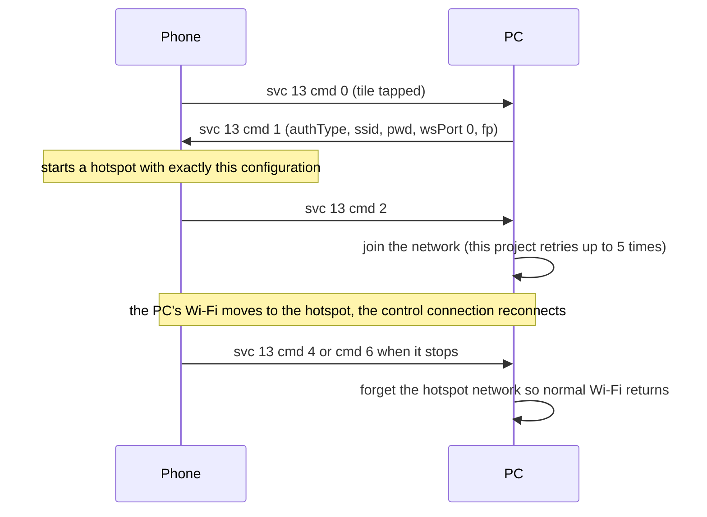

# Hotspot (service 13)

**Status in this project:** Implemented, **not verified on a device**. The tile appears on the
phone. Joining the phone's hotspot moves the PC off its current Wi-Fi network, after which the control
connection has to reconnect; that path has not been exercised.

**Implementation:** [`src/hotspot.rs`](../../src/hotspot.rs) (joins with NetworkManager's `nmcli`).

## Overview

From the PC's device page the user can ask the phone to share its mobile data. The **PC chooses**
the network name and passphrase; the phone starts a hotspot with exactly that configuration and then
tells the PC to join (OBSERVED in the phone app).

Payloads are flat: `{"ver": "1.0.0", "cmd": N, …}` (OBSERVED in the phone app).

## Commands

| cmd | Direction | Meaning | Payload | Tag |
|---|---|---|---|---|
| 0 | phone → PC | Invite: the user tapped the Hotspot tile | `{ver, cmd: 0}` | OBSERVED (code) |
| 1 | PC → phone | Hotspot configuration | `authType` int (0 open, 1 WPA2-PSK, 2 WPA3 transition, 3 WPA3-SAE), `ssid` string, `pwd` string, `token` string, `wsPort` int, `fp` string | OBSERVED (code) |
| 2 | phone → PC | The hotspot is up; join it now | `{ver, cmd: 2}` | OBSERVED (code) |
| 4 | either | Stop | `{ver, cmd: 4, errorCode}` (this project sends 1313) | OBSERVED (code) |
| 5 | phone → PC | No mobile data on the phone; hotspot not started | `{ver, cmd: 5, netAvailable}` | OBSERVED (code) |
| 6 | phone → PC | Cancelled or failed | `{ver, cmd: 6, errorCode}`: 1312 busy, 1313 stopped, 1314 tethering failed, 145/147 denied or timed out, 306 disabled by an administrator, 1537 not the phone's main user | OBSERVED (code) |

The phone's hotspot accepts one client (OBSERVED in the phone app).

Example configuration as this project sends it (placeholders):

```json
{"ver": "1.0.0", "cmd": 1, "authType": 1, "ssid": "SmartConnect-XXXX",
 "pwd": "<passphrase>", "token": "", "wsPort": 0, "fp": "<fp-hex>"}
```

- This project generates a fresh `SmartConnect-` name and a random 16-character passphrase per
  request, and never logs the passphrase.
- `wsPort` is sent as `0`. With a port, the phone would also dial the PC's control channel over the
  hotspot using `token`, whose meaning has not been worked out (INFERRED). The existing connection
  recovers through the normal [reconnect](pairing-and-discovery.md#reconnect-behaviour-of-this-project)
  instead.
- `fp` is the PC's certificate fingerprint; this project sends the hex form. Which form Windows uses
  is not known (INFERRED).

## Main flow



## Pitfalls

1. **Advertise service 13 only with a handler.** Tapping the tile can start tethering on the phone
   before the PC answers (INFERRED).
2. **The passphrase is a secret.** Keep it out of logs and error messages, including the network
   manager's own error output.
3. **Clean up.** Delete the joined network profile after `cmd 4` or `cmd 6`, or the PC may keep
   trying to rejoin a network that no longer exists.
4. The hotspot can take a few seconds to show up in Wi-Fi scans; retry the join.

## Open questions

- The role of `token` and `wsPort` (probably a second control connection over the hotspot).
- Whether the phone keeps the old control connection alive during the switch.
