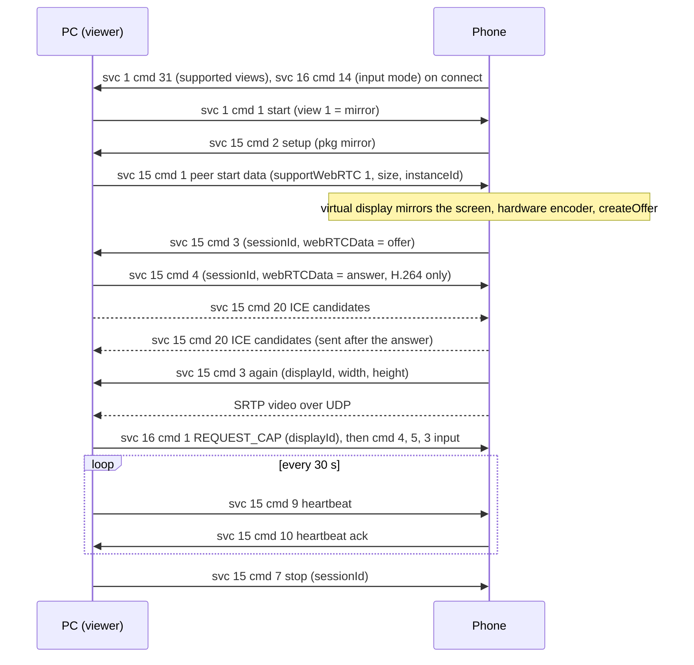
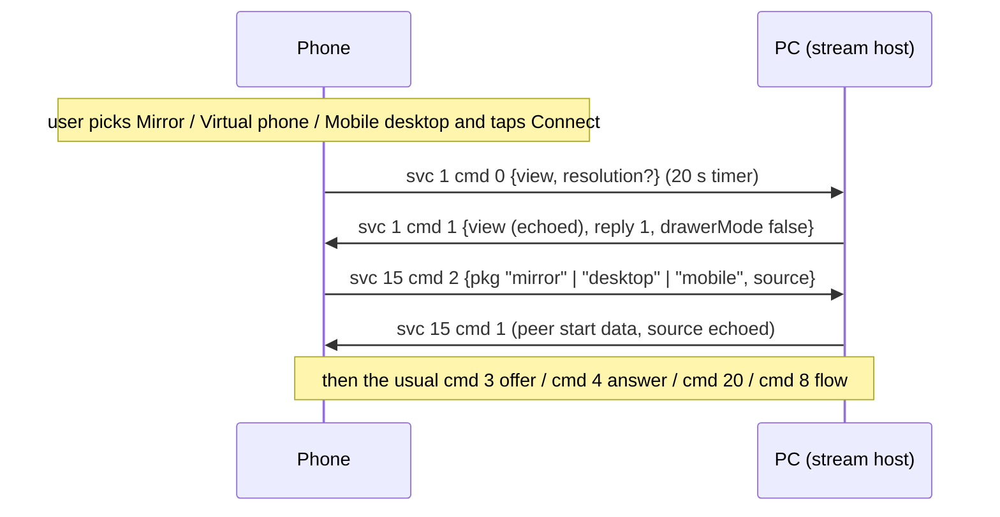

# Screen mirroring (services 1, 15 and 16)

**Status in this project:** The phone's screen streams into a Linux window and mouse input works
(verified on a device). Keyboard input is implemented but not separately verified. The mirror is
started from the PC (verified). Views started on the phone (service 1 `cmd 0`: the Screen share
and Mobile desktop tiles) and a PC-started Ready For desktop (`smartconnect-mirror --desktop`) are
answered by the stream host but are **untested on a device**; the tiles only appear with the
daemon's `--extra-tiles 1`. The answer is restricted to H.264, so an offer without H.264 is not
decoded.

**Implementation:** [`mirror/src/main.rs`](../../mirror/src/main.rs) (`smartconnect-mirror`, a
GStreamer `webrtcbin` viewer), [`mirror/src/keys.rs`](../../mirror/src/keys.rs) (key mapping). The
daemon only relays: viewers subscribe to phone frames with the control-socket `watch` command and
send with `send` ([`src/control.rs`](../../src/control.rs)).

## Overview

Despite the "RDP" names in the apps, mirroring is not RDP. The phone runs a standard libwebrtc
PeerConnection and sends one H.264 or H.265 video track; **the phone makes the offer and the PC
answers** (OBSERVED, phone app and a capture of the Windows app). All signalling travels as JSON on
the control channel:

- **Service 1** starts and stops the session at the "view" level (mirror, desktop, virtual phone).
- **Service 15** (App Stream) sets up the stream: SDP offer and answer, ICE candidates, heartbeat,
  pause, stop. A mirror is an app-stream session whose package is the literal `"mirror"`; the same
  messages carry [single-app streams](app-streaming.md).
- **Service 16** carries mouse, keyboard and touch from the PC to the phone, as JSON with absolute
  coordinates.

Media: host ICE candidates only, UDP only, BUNDLE, rtcp-mux, DTLS-SRTP. Nothing proprietary is on
the media path apart from an optional offer constraint that reorders codecs (OBSERVED).

## Main flow



## Service 1: session control

Payload: `{"ver": "1.0.0", "cmd": N, …}`. The phone always sends `ver: "1.0.0"`. Known fields:
`cmd`, `ver`, `reply`, `view`, `rotation`, `port`, `fp`, `mediaFormat`, `lockscreenState`,
`errorCode`, `autoStart`, `dynamicPhone`, `drawerMode`, `showNaviBar`, `deviceWidth`,
`deviceHeight`, `monitor {width, height, physicalWidth, physicalHeight}`,
`resolution {width, height}` (OBSERVED).

`view` on the wire is the phone's internal mode plus one: **`1` mirror**, `2` desktop, `3` virtual
phone (OBSERVED).

| cmd | Direction | Purpose | Payload | Tag |
|---|---|---|---|---|
| 1 | PC → phone | Start | `{ver, cmd: 1, view: 1, reply: 0, drawerMode: false}`. `reply` must not be 1 (an idle phone reads `reply: 1` as "cancelled"). | OBSERVED on a device |
| 5 | PC → phone; phone → PC | Stop or cancel | `{ver, cmd: 5}` | OBSERVED |
| 11 | both | Error | `{ver, cmd: 11, port: 0, errorCode}`. From the phone: 145 user denied or no permission, 147 confirmation timed out, 293 already mirroring to another PC, 296 codec busy, 305 capability disabled or Wi-Fi Display connecting, 306 disabled by an administrator, 1537 secondary Android user. From the PC: 275 means "the PC is already in use" and cancels. | OBSERVED |
| 20 | PC → phone | Lock the phone while streaming | `lockscreenState: 1` | OBSERVED (code) |
| 30 | PC → phone | Switch view while streaming | `view`, optional `resolution` | OBSERVED (code) |
| 31 | phone → PC | Supported views, sent whenever the connection comes up | `view`: bit mask, bit 0 mirror, bit 1 desktop, bit 2 virtual phone. **No reply needed.** | OBSERVED on a device |
| 32 | PC → phone | Resume (pointer resync) | - | OBSERVED (code) |
| 33 | PC → phone | Desktop-mode resolution (service 1 version 6 or later) | `resolution {width, height}` | OBSERVED (code) |
| 35, 36 | PC → phone | Flags | `dynamicPhone` bool, `autoStart` bool | OBSERVED (code) |
| 0 | phone → PC | View requested on the phone | `{ver, cmd: 0, view}` plus `resolution {width, height}` (the phone's desktop resolution setting) when the PC's service 1 version is 6 or later. `view` is the phone's current display-mode setting plus one, set by the panel the user tapped: Screen share offers mirror (1) or virtual phone (3), Mobile desktop sends 2. The PC must answer with `cmd 1` within 20 s; see [Views started on the phone](#views-started-on-the-phone). | OBSERVED (code) |
| 34, 56 | phone → PC | Desktop-mode display information | Ignore for mirroring. | OBSERVED (code) |

Any other `cmd` from the PC, including an echo of `cmd 31`, is ignored by the phone (OBSERVED).

Before it starts, the phone checks, in order: a companion-device association for this PC on
builds that stream through the system's virtual-device manager, the main user, admin policy, its
own mirroring capability, no active Wi-Fi Display session, and free encoder capacity. Any failure
returns `cmd 11`. If the phone is unlocked and interactive, it starts **without a dialog**; if it
is locked, it asks the user to unlock first (OBSERVED, phone app).

### Views started on the phone

The phone's Screen share and Mobile desktop tiles (and some other phone entry points) start a view
themselves (OBSERVED, phone app):



- Before sending `cmd 0` the phone checks that it is not cloud-connected, runs as the main user,
  has no other view running, no Wi-Fi Display session and free encoder capacity; it fails locally
  otherwise (OBSERVED, phone app).
- While it waits for the answer, the phone takes `view` and `drawerMode` from the PC's `cmd 1`; the
  PC may change the view there. `resolution` from the PC is ignored on this path (OBSERVED, phone
  app).
- `reply` is not checked while the phone waits. An idle phone (for example after its 20 s timer
  ran out) treats `reply: 1` as "cancelled" and ignores the message, so this project answers with
  `reply: 1`; with `reply: 0` a late answer would start a new PC-initiated view (INFERRED from the
  phone's checks).
- The stream that follows is an app-stream session whose package is the view name:
  `"mirror"`, `"desktop"` (Ready For desktop on its own virtual display) or `"mobile"` (virtual
  phone). The same `cmd 1` starts a view from the PC (`reply: 0`), which is how
  `smartconnect-mirror --desktop` starts the desktop.
- **Desktop size:** for `"desktop"` the phone uses its own desktop resolution setting when it fits
  inside the PC's `width x height` from service 15 `cmd 1`, else the PC's size (limited by the
  encoder), and derives the desktop density from `phyWidth`/`phyHeight` (millimetres) (OBSERVED,
  phone app). This project sends the resolution from the phone's `cmd 0` (or 1920x1080).
- Switching between mirror and virtual phone while connected keeps the same service 15 session;
  the content and `displayId` change (OBSERVED, phone app).

## Service 15: stream setup

Payload: `{"ver": "1", "cmd": N, "data": {…}}` (OBSERVED). Field names are case-sensitive.

### Commands used by the mirror

| cmd | Direction | Name | `data` fields | Tag |
|---|---|---|---|---|
| 2 | phone → PC | Setup | `deviceId` string (phone), `pkg` `"mirror"`, `pkgName` null, `icon` null, `source` int (0 when the PC started it, 1 when the phone did), `userId` int (0), `cmp`, `shortcutId` | OBSERVED on a device |
| 1 | PC → phone | Peer start data | See the example below. `supportWebRTC` must be `1`: the phone builds a session only for WebRTC peers. | OBSERVED on a device |
| 3 | phone → PC | Session parameters and offer | `sessionId` long, `width`, `height`, `pkg`, `ip` (phone), `error` 0, `hb` 30 (heartbeat seconds), `userId`, `isWebRTC` 1, `webRTCData` **JSON string** `{"sdp": "…", "type": "offer"}` (first `cmd 3` only), `displayId` (in a **second** `cmd 3`, sent once the capture format is known; -1 before), `density`, `screenWidth`, `screenHeight`, `screenDensity`, `cmp`, `shortcutId` | OBSERVED on a device |
| 4 | PC → phone | Answer | `sessionId` (echo), `error` 0, `isWebRTC` 1, `resize` 0, `userId`, `webRTCData` **JSON string** `{"type": "answer", "sdp": "…"}` | OBSERVED on a device |
| 20 | both | ICE candidate | `sessionId`, `type` `"candidate"`, `pkg`, `userId`, `data` **JSON string** `{"type": "candidate", "label": <m-line index int>, "id": "<mid>", "candidate": "candidate:…"}` | OBSERVED on a device |
| 9 | PC → phone | Heartbeat | none. The phone answers `cmd 10` while it has a session. | OBSERVED on a device |
| 10 | phone → PC | Heartbeat ack | none | OBSERVED |
| 25 | PC → phone | Pause the heartbeat watchdog | none | OBSERVED (code) |
| 5, 6 | PC → phone | Pause, resume the encoder | `{sessionId}`. The phone answers `cmd 8` with state 2 or 3. | OBSERVED (code) |
| 7 | PC → phone | Stop | `{sessionId, error}`. `error: 1` makes the phone show a dialog. | OBSERVED on a device |
| 8 | phone → PC | State change | `state` (0 stopped, 1 connected, 2 paused, 3 resumed), `reason` (145/147 denied or timed out, 3858 in use by another PC, 3861 encoder taken away), `sessionId`, `pkg`, `displayId`, `userId`, `deviceName`, `msg`, `supportTouch`, `animationDisabled` | OBSERVED |
| 16 | phone → PC | Rotation | `{sessionId, displayId, rotation}` (0-3) | OBSERVED |
| 22 | phone → PC | Phone screen information | `{width, height, density, naviMode}` | OBSERVED (code) |
| 23 | phone → PC | Display state | `{displayId, state}`: 0 resumed, 1 paused (screen off and similar) | OBSERVED |
| 26 | phone → PC | Resize result | `{displayId, success, error}`. A mirror display is never resizable. | OBSERVED (code) |

The full app-streaming set, including resize, merge and focus messages, is in
[app-streaming.md](app-streaming.md#commands).

Peer start data as this project sends it (the size is the target bound the phone fits its stream
into; 1920x1080 is also the phone's default when 0):

```json
{
  "ver": "1",
  "cmd": 1,
  "data": {
    "pkg": "mirror",
    "userId": 0,
    "width": 1920,
    "height": 1080,
    "phyWidth": 344,
    "phyHeight": 194,
    "displayWidth": 1920,
    "displayHeight": 1080,
    "displayDensity": 160,
    "displayScale": 1.0,
    "align": 0,
    "instanceId": 1700000000000,
    "port": 0,
    "source": 0,
    "supportedMediaFormat": 1,
    "supportWebRTC": 1,
    "supportCustomDisplay": false,
    "vrSupportUnfolded": false
  }
}
```

`source` echoes the `source` of the phone's `cmd 2`. `phyWidth` and `phyHeight` are the PC
screen's physical size in millimetres. `instanceId` must stay the same for as long as the PC runs
(see [app-streaming.md](app-streaming.md#pitfalls)).

### Heartbeat

After the first session starts, the phone gives the PC 35 s to send `cmd 9`; after that, every
`cmd 9` re-arms a 65 s watchdog. When it expires, the phone releases all sessions of that PC
(OBSERVED, phone app). Send `cmd 9` every 30 s, matching `hb: 30`. One heartbeat covers every
session of the PC.

### WebRTC details

| Item | Value | Tag |
|---|---|---|
| Roles | The phone offers; the PC answers. In a capture of the Windows app the PC is ICE-controlled and the DTLS client, as expected for an answerer with `a=setup:active`. | OBSERVED |
| ICE | No STUN or TURN servers, host candidates only, TCP candidates disabled, continual gathering. The phone binds a random UDP port in 50000-59999. | OBSERVED (code) |
| Bundling | max-bundle, rtcp-mux required, Unified Plan, ECDSA DTLS certificate | OBSERVED (code) |
| Media | One send-only video track. No audio in a mirror. No data channel on a LAN connection. | OBSERVED |
| Codecs | The phone's hardware encoders: H.265 is listed first when its (default-on) H.265 preference is set, followed by H.264. Answer with H.264 only unless you decode H.265. | OBSERVED on a device |
| Candidates | The phone holds back its own candidates until it has the answer, then sends them. | OBSERVED |
| Rate | Up to 60 fps; bitrate between about 300 kbit/s and 8000 kbit/s. | OBSERVED (code) |
| Rotation | The phone sends `cmd 16` and a new `cmd 3` with the new size. If the answer leaves out the `urn:3gpp:video-orientation` header extension, the phone rotates frames itself and the receiver just follows the frame size. | OBSERVED (code) / OBSERVED in this project |
| Capture | The phone mirrors its main display into a virtual display through its privileged desktop service, not through the screen-capture API, so there is no capture consent dialog. | OBSERVED (code) |
| Windows tunnel | When the Windows app's own peer-to-peer tunnel is up, the phone routes the WebRTC packets through it. Without the tunnel (as with this project) the phone uses plain host candidates on the LAN, which works. | OBSERVED (capture, and on a device) |

## Service 16: input

Payload: `{"cmd": N, "data": {…}, "messageId": <long>, "instanceId": <long>}` (OBSERVED).
`messageId` and `instanceId` are optional de-duplication counters: when both are non-zero, an event
whose `messageId` is not newer than the last one for that `instanceId` is dropped. Send `0` and `0`
(this project does), or a rising `messageId`.

| cmd | Direction | Name | `data` | Tag |
|---|---|---|---|---|
| 1 | PC → phone | REQUEST_CAP | `{"ver": 1, "displayId": D, "caps": 3}`. Bit values: 1 keyboard, 2 mouse, 4 touch (ignored by this request). Creates a virtual keyboard and mouse bound to display D. Send once per display before any input. | OBSERVED on a device |
| 3 | PC → phone | KEYBOARD | `{"displayId": D, "flags": F, "key": K, "down": bool, "metaState": 0}` (key codes below) | OBSERVED |
| 4 | PC → phone | MOUSE_MOVE | `{"displayId": D, "x": X, "y": Y}`, **absolute** | OBSERVED on a device |
| 5 | PC → phone | MOUSE_BUTTON | `{"displayId": D, "key": B, "x": X, "y": Y, "down": bool}`. B: 1 left, 2 middle, 3 right, 4 wheel (one notch per message; `down: true` scrolls the content down, `false` up), 5 horizontal wheel (ignored). The phone may swap left and right for a left-handed user. | OBSERVED on a device |
| 7 | PC → phone | TEXT_COMMITTED | `{"displayId": D, "text": "…"}`, text committed as if typed with an input method | OBSERVED |
| 9 | PC → phone | TOUCH_EVENT | `{"displayId": D, "event": E, "pointerId": P, "x": X, "y": Y, "pressure": f, "majorAxisSize": f}`, E: 1 down, 2 move, 0 up, 3 cancel. Needs a virtual touchscreen, which only [Cross Control](cross-control.md) creates. Use mouse events for a mirror. | OBSERVED (code) |
| 10 | PC → phone | REQUEST_POINTER_SYNC | `{}` | OBSERVED (code) |
| 12 | PC → phone | GET_INPUT_MODE | `{}`; the phone answers `cmd 14` | OBSERVED (code) |
| 13 | PC → phone | SET_INPUT_MODE | `{"inputMode": 0 or 1}`; 1 makes the mouse emulate touch when a touchscreen exists | OBSERVED (code) |
| 14 | phone → PC | SYNC_INPUT_MODE | `{"touchModeSupported": bool, "inputMode": 0 or 1}`, sent on every connection. **No reply needed.** | OBSERVED on a device |
| 2, 6, 8 | phone → PC | Capability reply, pointer image `{displayId, type, xHotspot, yHotspot, data}`, input-method focus `{displayId}` | Informational | OBSERVED (code) |

**Coordinates.** Use the `displayId` of the session's virtual display (from the second `cmd 3`, or
`cmd 8` state 1) and pixel coordinates in the decoded video frame. The phone recognises its mirror
display and maps the coordinates back onto the real screen (OBSERVED on a device). Window events
from the video sink are already in frame pixels in this project.

**Key codes.** `key` is a PC/AT set-1 scancode (for most keys equal to the Linux evdev code).
`flags`: `0x100` = an E0-prefixed key (arrows, Home/End, Page Up/Down, Insert/Delete, right
Ctrl/Alt, Super, Menu, keypad Enter and `/`), `0x1000` = `key` is an Android keycode instead. This
project sends Android BACK (4), HOME (3), APP_SWITCH (187) and media keys (volume, play/pause,
next, previous, stop, mute) with `0x1000`. The phone app also defines `0x10000` for media keys
(OBSERVED in code, not used here). Release every held key and button before leaving a session.

## Pitfalls

Each of these caused a silent failure on a real device:

1. **Booleans, not numbers.** `supportCustomDisplay` and `vrSupportUnfolded` in `cmd 1` are booleans
   in the phone's class. Sending `0` makes the phone's JSON parser throw inside a background
   executor that swallows the error: nothing is logged and the start times out after 15 s. It was
   found only with the app's debug logging enabled (see [debugging tips](README.md#debugging-tips)).
2. **H.265 comes first.** The phone lists H.265 before H.264 in its offer. Remove every non-H.264
   payload type from the video section before creating the answer (this project also drops the
   video-orientation extension there).
3. **Input needs the mirror's own display.** Target the `displayId` from `cmd 3`/`cmd 8`, send
   `cmd 1` REQUEST_CAP for it first, and scale coordinates to the video frame.
4. **Offer only LAN candidates.** The phone tries every candidate it is given; container bridges
   and VPN interfaces only delay or break the connection. This project offers only the address the
   phone's control connection reached (the daemon's `pcAddress`); without it, private IPv4
   addresses not owned by a virtual interface; `SMARTCONNECT_ICE_ADDRESSES` overrides both.
5. **Keep `sessionId` a 64-bit integer.** It is a large number built from a timestamp and can lose
   precision as a floating-point value.
6. **Heartbeat in time,** or the phone drops the stream after 35 s.
7. **Service 1 `cmd 31` and service 16 `cmd 14` need no reply.** This project echoes them back with
   `reply: 1`, which the phone ignores.

Implementation notes for GStreamer: `webrtcbin` works as the answerer when the offer and answer are
handled synchronously; an explicit `rtph264depay ! h264parse ! <decoder>` chain is more reliable
than `decodebin` inside a bin added at runtime (OBSERVED in this project).

## Open questions

- Whether the companion-device ("allow streaming") prompt appears for a non-Windows PC on phones
  that require it. It did not get in the way in testing.
- Answering H.265 when the PC can decode it.
- Whether the phone-initiated views (service 1 `cmd 0`) and Ready For desktop work end to end with
  this project's answers (implemented, not yet tried on a device).
