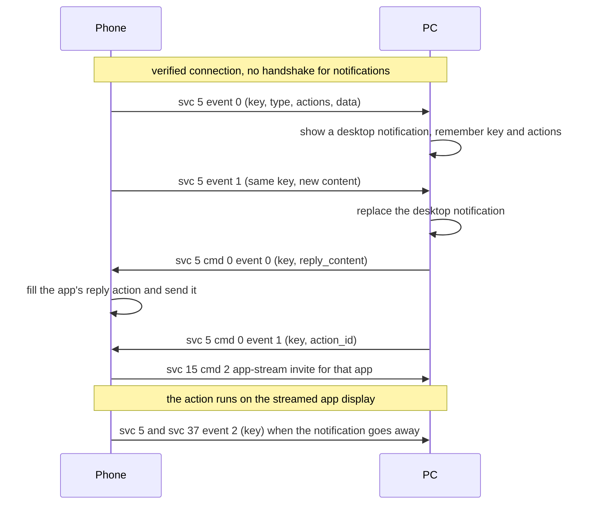

# Notifications (services 5 and 37)

**Status in this project:** Implemented. Phone notifications appear as desktop notifications
(`org.freedesktop.Notifications`), are replaced and closed in step with the phone, and quick reply
works end to end (verified on a device with a messaging app). Action buttons and "Open on phone"
reach the phone correctly, but on a LAN connection the phone carries them out through
[app streaming](app-streaming.md). "Open" shows the app in a streamed window; action buttons are
run by the stream host without a window, which closes the stream again once the phone has fired
the action (implemented, **untested on a device**).

**Implementation:** [`src/notifications.rs`](../../src/notifications.rs),
[`src/status.rs`](../../src/status.rs) (recent notifications for desktop UIs),
[`src/control.rs`](../../src/control.rs) (`reply` and `notif_mute` commands).

## Overview

The phone pushes every notification event to every verified PC, with no handshake and no
negotiation (OBSERVED on a device). The PC does not need to advertise anything: this project
received notifications before it listed service 5 at all. Windows advertises `"5": 2`; neither
value is read by the phone (OBSERVED).

- **Service 5** carries notifications of apps on the phone's "show list" (the apps the user picked
  for PC sync; the default list includes the dialer).
- **Service 37** carries the other apps. Because the phone's notification listener mostly receives
  only allowed apps, service 37 in practice carries little except removals (OBSERVED on a device).
- Removals are sent on **both** services for every app, including keys the PC never saw (OBSERVED).

## Phone-side gates

A notification reaches a PC only if all of these hold (OBSERVED, phone app):

1. Smart Connect has notification-listener access.
2. The phone's global notification-sync switch is on. It defaults to on once listener access is
   granted, and requires the phone's main user in the foreground and the system-wide "PC" setting.
   No PC message turns it on; `cmd 2` only shows a prompt.
3. Sync is not disabled for this PC.
4. The PC is not in do-not-disturb: a non-zero `dndState` sent by the PC on service 25 `cmd 6`
   silences it (see [device-status-and-tiles.md](device-status-and-tiles.md#commands)).
5. The app is not on the phone's block list. Group summaries without a full-screen intent and the
   app's own sync notifications are dropped. There is **no** filter for ongoing, media, secret or
   lock-screen-sensitive notifications.

The phone tells the PC when sync is off: in its service 25 status, bit 16 of `cap["5"]` means
"notifications will not be sent to this PC" (OBSERVED).

## Phone to PC: the notification event

The envelope has `serviceId` and `srcServiceId` 5 (or 37). The payload has no `cmd`: it is the
notification itself (OBSERVED on a device):

```json
{
  "version": "1.0",
  "key": "0|com.example.chat|<id>|<tag>|<uid>",
  "event": 0,
  "type": 3,
  "actions": [
    { "action_id": 0, "action_name": "Reply", "remote_input": true },
    { "action_id": 1, "action_name": "Mark as read", "remote_input": false }
  ],
  "data": {
    "package_name": "com.example.chat",
    "apk_name": "Example Chat",
    "apk_icon": "<base64 JPEG>",
    "title": "<sender>",
    "content": "<message text>",
    "priority": 0,
    "progress": { "current": 0, "indeterminate": false, "max": 0 },
    "person_name": "<phone owner, e.g. You>",
    "person_icon": "<base64 JPEG of the phone owner>",
    "conversation_title": "",
    "messages": ["<message text>"],
    "message_persons": ["<sender>"]
  }
}
```

| Field | Type | Meaning | Tag |
|---|---|---|---|
| `version` | string | Always `"1.0"`. | OBSERVED |
| `key` | string | The Android notification key. The only id; replace and remove by it. | OBSERVED |
| `event` | int | `0` posted (new key), `1` updated (key already shown), `2` removed. | OBSERVED |
| `type` | int | Style: `0` simple, `1` big picture, `2` big text, `3` messaging, `4` inbox, `5` media, `6` call, `7` custom view (sent as simple; Windows drops these and so does this project). | OBSERVED |
| `actions` | array | `{action_id int, action_name string, remote_input bool, choices array?}`. Only actions with a title are listed; `action_id` is the index among the listed ones. `choices` are canned replies. | OBSERVED |
| `data` | object | Content; fields below. A removal carries only `version`, `key`, `event` and `type`. | OBSERVED |

`data` fields by style (OBSERVED):

| Style | Fields |
|---|---|
| All | `package_name`, `apk_name` (app label), `apk_icon` (base64 JPEG of the small icon), `title`, `content`, `priority` (-2..2), `progress {max, current, indeterminate}` |
| 1 big picture | `expand_tile`, `expand_summary`, `big_picture` (base64 JPEG, full size) |
| 2 big text | `expand_tile`, `expand_summary`, `big_text` |
| 3 messaging | `person_name`, `person_icon` (base64 JPEG), `conversation_title`, `messages[]`, `message_persons[]` (parallel arrays) |
| 4 inbox | `expand_tile`, `expand_summary`, `line_text[]` |
| 5 media | nothing extra |
| 6 call | `person_name`, `person_icon`, `callType`, `isVideo`, `callStyleActions[]` (indices of call actions) |

There is **no timestamp** in the event; use the time of arrival (OBSERVED).

### Whose picture is `person_icon`?

| Field | Messaging (type 3) | Call (type 6) | Tag |
|---|---|---|---|
| `person_name`, `person_icon` | The style's **user** Person, which Android defines as the device owner ("self"), not a sender. | The caller (`android.callPerson`). | OBSERVED, phone app (`MessagingData`, `CallData`) |
| `message_persons[]` | One sender **name** per message (`""` when the message has no sender Person). No icons. | - | OBSERVED, phone app |
| `title` | `android.title`: the sender in a 1:1 chat; group chats put the group and/or sender here. | The caller or call state. | OBSERVED on a device / INFERRED for groups |
| `apk_icon` | The app's small icon (white glyph on black). | same | OBSERVED |

- The phone sends **no per-sender icon** and **no conversation (large) icon** for a messaging
  notification: only the user Person's icon and the small icon are serialized (OBSERVED, phone app).
- WhatsApp: on a device, every chat (several 1:1 chats and a group) carried the **same**
  `person_icon` bytes and the same short `person_name`, which never appears in `message_persons`.
  That is the phone owner's own profile picture (OBSERVED on a device).
- Some apps set the user Person to the other party: a Google Phone (dialer) messaging notification
  carried `person_name` equal to `title` and to the only sender (OBSERVED on a device).
- So a PC must not show `person_icon` of a messaging notification as the sender's avatar. This
  project uses it only when `person_name` equals `title` (the user Person *is* the headline person);
  otherwise it shows the app icon (the phone's launcher icon from the
  [icon cache](app-streaming.md#icon-cache-this-project), a themed desktop icon, or `apk_icon`).
  The sender's real avatar is not available on the wire, for 1:1 or group chats (OBSERVED in this
  project).

## PC to phone: commands

The PC sends a `NtfData` object on service 5 (or 37 for a key that arrived there). The phone acts
only on a message whose envelope `serviceId` matches the service of its handler (OBSERVED).

| cmd | event | Purpose | Payload | What the phone does | Tag |
|---|---|---|---|---|---|
| 0 | 0 | Quick reply | `{"cmd": 0, "event": 0, "key": "<key>", "version": "1.0", "data": {"reply_content": "<text>", "smart_reply": false}}` | Finds the first action with a free-form remote input (any remote input if `smart_reply` is true), fills in the text and fires it. | OBSERVED on a device |
| 0 | 1 | Action button | `{"cmd": 0, "event": 1, "key": "<key>", "version": "1.0", "data": {"action_id": 1}}` | Fires that action's intent (on LAN, through app streaming, see below). | OBSERVED |
| 0 | 2 | Open | `{"cmd": 0, "event": 2, "key": "<key>", "version": "1.0"}` | Fires the full-screen intent, else the content intent, then **cancels the notification on the phone** (which comes back as an `event 2`). | OBSERVED |
| 1 | - | Block app | `{"cmd": 1, "pkg": "<package>"}` | **Persistently** removes the app from the phone's show list. | OBSERVED |
| 2 | - | Ask for permission | `{"cmd": 2}` | Shows a dialog on the phone asking the user to enable notification sync. | OBSERVED |

An `event` outside 0-2 is rejected cleanly. There is no acknowledgement and no error reply; a key
the phone no longer knows is dropped silently (OBSERVED).

### Actions run through app streaming

On a LAN connection, when the phone carries out an action or "open" from a PC, it does not simply
fire the app's intent. It asks the PC to stream that app (service 15 `cmd 2`, an app-stream invite
that includes the app icon), creates a virtual display for it, and fires the intent there once the
stream is up (OBSERVED on a device). Plain intent firing is used only when that routing is off. A PC
that does not answer the invite sees nothing happen. See [app-streaming.md](app-streaming.md).

Details from the phone app (OBSERVED, phone app):

- The routing applies to action buttons (`event 1`) and to "open" (`event 2`, full-screen intent,
  else content intent) alike. It is used when the phone supports app streaming itself, the intent's
  creator is the default dialer or the phone's platform level is recent enough, and the link is not
  a cloud connection.
- "Up" means: the PC answered the invite with service 15 `cmd 1` and the offer with `cmd 4`. The
  `cmd 4` answer makes the phone create the app's virtual display and start the app; the stored
  intent fires when the app's task gains focus there, at the moment the phone sends `cmd 13` for
  that display. ICE, video and a visible window are not needed.
- If the app is already streamed to this PC, there is no invite: the intent fires at once on that
  display and the phone sends `cmd 12` and `cmd 14` (raise).

So a PC can run an action button in the background: answer the invite and the offer, wait for
`cmd 13`, then close the stream with `cmd 7`. This project does that for action buttons and keeps
the window for "open" (see [app-streaming.md](app-streaming.md#when-a-notification-intent-fires)).

Quick reply does not need this: the phone fills in the app's own reply action directly.

## Main flow



## Pitfalls

1. **Large frames.** Messaging posts with avatars reach about 40 KB, and big-picture posts carry a
   full-size JPEG at maximum quality (hundreds of KB to several MB). Allow WebSocket messages of at
   least 16 MB (OBSERVED on a device).
2. **No rate limiting on the phone.** Every re-post resends the whole event with its images.
   Progress, media, timer and call notifications produce bursts of `event 1`. Drop identical
   re-posts (compare the visible text, not the images, which are re-encoded every time) and coalesce
   updates per key. This project shows at most one update per key per second (OBSERVED in this
   project).
3. **Images.** `apk_icon` is a JPEG of the small icon: a white glyph on black, no alpha, about 68x68.
   `person_icon` is about 180x180, and for messaging it is the phone owner, not the sender (see
   [Whose picture is `person_icon`?](#whose-picture-is-person_icon)). The base64 contains a line
   break every 76 characters; strip whitespace before decoding. This service has no colour app
   icon; this project uses the phone's launcher icon from the app-icon cache (service 17, see
   [app-streaming.md](app-streaming.md#icon-cache-this-project)), then a themed desktop icon matched
   by package or app name, then `apk_icon` (OBSERVED).
4. **Removals for unknown keys** arrive on both services. Ignore keys you never showed.
5. **Action index mismatch.** The phone numbers only titled actions when it sends `actions`, but
   counts all actions when it handles `action_id`. If an app has an untitled action before a titled
   one, the wrong action fires (OBSERVED in code). Prefer reply or open when unsure.
6. **Apps with two reply actions** get the reply twice (rare) (OBSERVED in code).
7. **No dismiss-only message.** Closing a notification on the PC is local; "open" also cancels it on
   the phone but launches the app.
8. **"Open" and action buttons need app streaming.** Without a PC that answers the app-stream
   invite, they have no visible effect (OBSERVED on a device). Answering only `cmd 1` is not
   enough: the action fires after the PC's `cmd 4` answer, once the app has focus on its new
   display (OBSERVED, phone app). Quick reply does not depend on it.
9. **`cmd 1` and `cmd 2` have side effects.** `cmd 1` changes the phone's settings persistently;
   each `cmd 2` pops a dialog. Send them only on an explicit user request.
10. **Wrong types throw.** A non-object `data` or an `action_id` sent as a string fails inside the
    phone's executor and the task is lost (OBSERVED in code).
11. **`choices` may not be strings.** They come from rich text on the phone and could serialize as
    objects; accept other types defensively (INFERRED).
12. **Privacy.** Message text, sender names and avatars arrive in clear inside TLS. Do not write them
    to disk logs; this project redacts service 5 and 37 payloads in its session logs.

## Open questions

- The default show list on the phone (stored in app resources, not decoded).
- Whether Windows ever sends service 5 commands in normal use.
- What service 37 is meant for on the Windows side.
