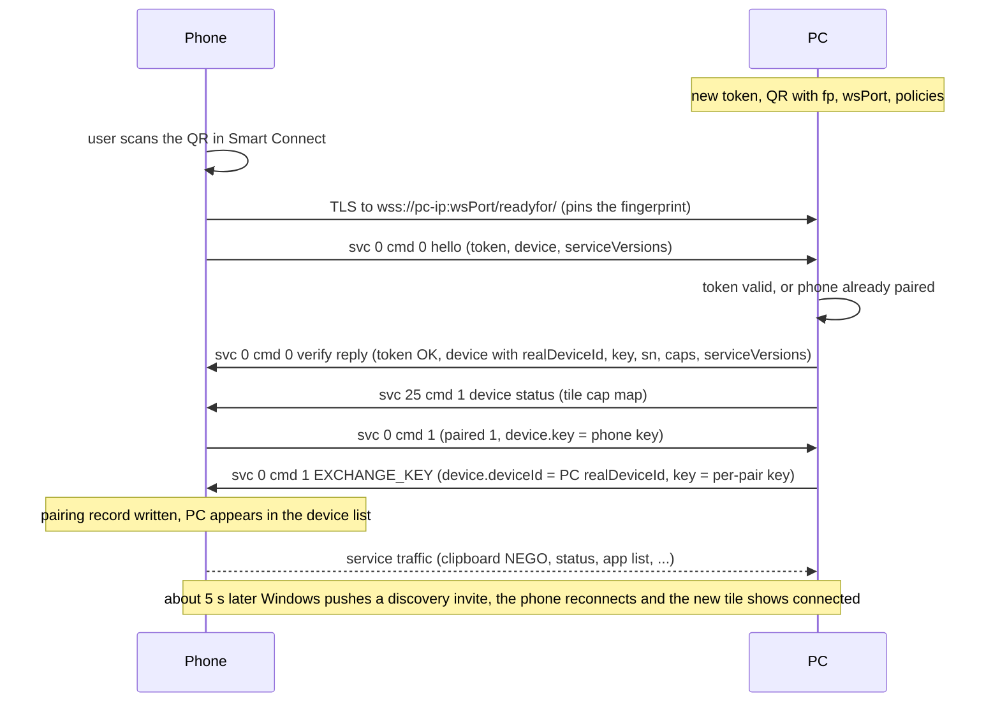
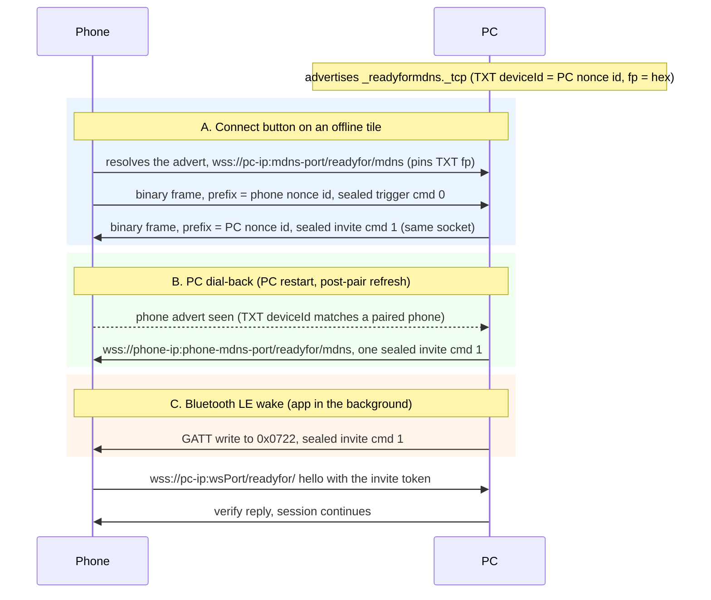

# Pairing, discovery and reconnect (service 0)

**Status in this project:** QR pairing, the pairing commit, and reconnect without a QR (PC dial-back
over Wi-Fi, and Bluetooth LE wake) are implemented and verified on a device. The phone's
"Connect" button path is implemented, but its last step (the PC answering on the socket the phone
opened) is not yet verified. PIN pairing and cloud channels are not implemented.

**Implementation:** [`src/identity.rs`](../../src/identity.rs), [`src/invite.rs`](../../src/invite.rs),
[`src/server.rs`](../../src/server.rs), [`src/pairing.rs`](../../src/pairing.rs),
[`src/discovery.rs`](../../src/discovery.rs), [`src/ble_connect.rs`](../../src/ble_connect.rs),
[`src/reconnect.rs`](../../src/reconnect.rs), test harness [`tests/handshake.rs`](../../tests/handshake.rs).

## Overview

Trust between the phone and a PC has two parts (OBSERVED, both apps):

1. **A pinned certificate.** The PC presents a self-signed TLS certificate. The phone learns its
   SHA-256 fingerprint out of band (from the QR code or a discovery invite) and accepts nothing else.
2. **A short-lived token.** The QR (or invite) carries a random token that the phone sends back in
   its first message. The PC accepts the connection only with a valid token, or from a phone it
   has already paired.

There is no key agreement on the Wi-Fi path: no ECDH and no KDF. (Early notes that read X25519/HKDF
strings in the apps as a pairing key schedule were wrong; those strings belong to bundled crypto
libraries.) After the handshake the PC hands the phone a random **per-pair key**. That key is used
only to seal the small discovery messages that let the two sides find each other again without a
QR. The control channel itself relies on TLS alone.

## Identity and trust

| Item | Format | Notes | Tag |
|---|---|---|---|
| `realDeviceId` | base64 of 16 random bytes | Stable id of a device. The phone keys its pairing record for a PC on the PC's `realDeviceId`. | OBSERVED |
| Nonce id | base64 of 16 bytes: `salt ‖ SHA-256(realDeviceId bytes ‖ salt)[0..8]`, where `salt` is 8 random bytes and `realDeviceId bytes` is the base64-decoded stable id | Used as the envelope `deviceId`, the mDNS TXT `deviceId`, the id in the Bluetooth advert, and the prefix of discovery frames. A peer that knows the stable id recognises any nonce id by recomputing the hash with the first 8 bytes as the salt; others cannot link two nonce ids. The phone rotates its nonce id (roughly every 30 minutes); this project makes a new one per daemon run. | OBSERVED |
| `deviceName` | string | Shown in the phone's device list. Defaults to the hostname here. | OBSERVED |
| `sn` | string, UUID form | The PC's serial. It **must be non-empty and stable** (see [pitfalls](#pitfalls)). Windows sends a GUID; this project derives one from its `realDeviceId`. | OBSERVED |
| Certificate | Self-signed X.509 | Windows uses RSA-2048 with SHA-256, a random 128-bit serial, a vendor subject and a validity of now minus 30 days to now plus 30 days. The phone checks only the fingerprint, so any subject and validity work. This project uses RSA-2048 with a 20-year validity, so the pin never changes. | OBSERVED |
| Fingerprint | SHA-256 of the leaf certificate DER | Two encodings of the same 32 bytes: 64 lowercase hex characters in the mDNS TXT `fp`, and standard base64 (44 characters) in the QR and invite `fp`. The phone base64-decodes `fp`, hex-encodes the result and compares it, ignoring case, with the hex SHA-256 of the certificate the server presents. A mismatch fails the TLS handshake (`R4CertException` in the phone log). | OBSERVED |
| Per-pair key | base64 (standard alphabet, padded) of 32 random bytes | Generated by the PC. Sent in the verify reply and in EXCHANGE_KEY. The phone stores it as the pair's secret and both sides use it directly as the AES-256-GCM key for discovery frames. | OBSERVED |
| Phone key | Same format | The phone generates its own key and sends it in its service 0 `cmd 1`. The phone keeps it separately, and uses it only if the PC's EXCHANGE_KEY arrives with an empty key. | OBSERVED |

## First pairing



### QR code

The QR holds the literal ASCII prefix `motorolardpconnection` followed directly (no separator) by
JSON of the form `{"wsData": {…}, "version": "3.0.0"}` (OBSERVED, both apps). This is what this
project encodes:

```json
{
  "wsData": {
    "cmd": 1,
    "ver": 2,
    "appVer": "09.0.3.013.000",
    "i3": 1,
    "deviceId": "<pc-nonce-id>",
    "realDeviceId": "<pc-real-id>",
    "deviceName": "My Linux PC",
    "serviceId": 19,
    "token": "<token>",
    "fp": "<fp-b64>",
    "wsPort": 52020,
    "policies": [{ "wifi": ["192.168.1.20"] }],
    "os": 6,
    "type": 4,
    "verCode": 903013000,
    "verName": "09.0.3.013.000",
    "bleAddress": "<pc-bt-address>",
    "device": {
      "deviceId": "<pc-nonce-id>",
      "realDeviceId": "<pc-real-id>",
      "deviceName": "My Linux PC",
      "os": 6,
      "type": 4,
      "verCode": 903013000,
      "verName": "09.0.3.013.000",
      "bleAddress": "<pc-bt-address>"
    }
  },
  "version": "3.0.0"
}
```

| Field | Type | Meaning | Tag |
|---|---|---|---|
| `cmd` | int | Must be `1`: "open the WebSocket now, as a client". With `0` the phone first tries a Bluetooth policy exchange, which times out on a PC without that path and ends in a misleading "check that Bluetooth is turned on" error (`code:128 Receive gatt data timeout` in the log). | OBSERVED on a device |
| `ver`, `appVer` | int, string | `2` and the Windows build string, as the genuine QR. | OBSERVED |
| `i3` | int | `1`, as Windows sends. Meaning unknown. | OBSERVED (value) |
| `deviceId` | string | The PC's nonce id. | OBSERVED |
| `realDeviceId` | string | The PC's stable id. | OBSERVED (this project) |
| `deviceName` | string | Name for the phone's list. | OBSERVED |
| `serviceId` | int | `19`. The Windows UI writes its "device paired" service id here. | OBSERVED |
| `token` | string | The invite token (below). | OBSERVED |
| `fp` | string | Certificate fingerprint, base64. | OBSERVED |
| `wsPort` | int | Control-channel port. | OBSERVED |
| `policies` | array | Where to dial: a list of one-key objects, keys `wifi`, `usb`, `acc`, `wfd`, `usb_proxy`, each with a list of IP strings. The phone dials every address it finds and keeps the first that verifies; `wfd` entries are dropped when Wi-Fi Direct is off on the phone. | OBSERVED |
| `os`, `type` | int | `6` (Windows) and `4` (PC). | OBSERVED |
| `verCode`, `verName` | long, string | See [versioning gates](README.md#versioning-gates). | OBSERVED |
| `bleAddress` | string | The PC's Bluetooth address. This project fills it only while its experimental Bluetooth peripheral runs, otherwise sends `""`. The phone associates the PC with this address for Bluetooth; Wi-Fi pairing does not need it. | INFERRED |
| `device` | object | The PC's device record (same fields as above). | OBSERVED |

The Windows UI hides the code after 55 s and its token expires after 60 s; it then shows the
placeholder `default{"wsData":{},"version":"3.0.0"}` (OBSERVED). This project's token lives 180 s by
default (`--token-ttl`) and a new QR replaces the old one when it expires.

### Invite token

- Windows makes the token from 32 random bytes, base64-encodes them, and replaces every `=`, `+`
  and `/` with a random letter or digit, giving about 44 characters. One token per invite, valid for
  60 s. It is compared in constant time; a wrong or expired token makes Windows drop the TCP
  connection without a WebSocket close frame (OBSERVED). This project does the same.
- The token is **not single-use**. During a pair the phone may connect more than once inside the
  token's lifetime (OBSERVED on a device). This project keeps a token valid for its whole TTL.
- Every discovery invite carries a token too, and the phone sends that token back in its hello.
  Windows mints a fresh 60 s token per discovery cycle (OBSERVED). This project hands out a token
  that stays valid for at least one more minute.

### Phone hello (`cmd 0`)

The first text frame on every control connection (OBSERVED):

```json
{
  "ver": "3.0.0",
  "deviceId": "<phone-nonce-id>",
  "srcServiceId": 0,
  "serviceId": 0,
  "senderId": 1,
  "msgId": 101,
  "data": {
    "ver": 3,
    "cmd": 0,
    "token": "<token>",
    "paired": 0,
    "ip": "192.168.1.35",
    "device": {
      "deviceId": "<phone-nonce-id>",
      "realDeviceId": "<phone-real-id>",
      "deviceName": "<phone-name>",
      "os": 1,
      "sku": "<phone-sku>",
      "cap": 0,
      "sn": "<phone-serial>",
      "key": "<phone-key>",
      "verCode": 9030130,
      "verName": "09.0.3.013.0",
      "scType": 1,
      "minVerCode": { "1": 7000000, "2": 700000000, "3": 7000000, "4": 7000000 },
      "serviceVersions": { "0": 3, "9": 4 }
    },
    "serviceVersions": { "0": 3, "1": 10, "2": 5, "3": 2, "5": 1, "9": 4, "13": 1, "15": 17, "16": 6, "25": 2 },
    "rfaServiceVersions": { "0": 3, "1": 10, "9": 3, "15": 17 },
    "ips": [{ "connType": 1, "ip": "192.168.1.35", "port": 0, "fp": "<phone-fp>" }]
  }
}
```

| Field | Meaning | Tag |
|---|---|---|
| `token` | The token from the QR or invite. | OBSERVED |
| `paired` | `1` if the phone believes it is already paired with this PC. | OBSERVED |
| `device.realDeviceId` | The phone's stable id. Key all per-phone state on this, never on the envelope `deviceId`. | OBSERVED |
| `serviceVersions`, `rfaServiceVersions` | The phone's own service versions (the second set belongs to an older companion stack). | OBSERVED |
| `ips` | The phone's own reachable addresses and per-session server ports. Treat the port as a hint only; it is not the phone's `/readyfor/mdns` port. | OBSERVED (shape) / INFERRED (use) |
| `limitService`, `connType` | Also present; meaning not worked out. | OBSERVED (presence) |

The hello may carry `cmd 3` instead of `cmd 0`; the difference has not been worked out (OBSERVED in
the phone app, INFERRED to be equivalent for a PC).

### Verify reply (`cmd 0`)

The phone accepts the connection when the reply has `cmd: 0`, `token: "OK"` and a non-empty
`device.realDeviceId` (OBSERVED, phone app). It then caches the PC's `serviceVersions` and marks the
link connected. This project's reply is shaped like the genuine one, which the phone writes to its
log:

```json
{
  "deviceId": "<pc-nonce-id>",
  "srcServiceId": 0,
  "serviceId": 0,
  "msgId": 1,
  "data": {
    "ver": 3,
    "cmd": 0,
    "token": "OK",
    "paired": 1,
    "connType": 1,
    "device": {
      "deviceId": "<pc-nonce-id>",
      "realDeviceId": "<pc-real-id>",
      "deviceName": "My Linux PC",
      "os": 6,
      "type": 4,
      "scType": 2,
      "verCode": 903013000,
      "verName": "09.0.3.013.000",
      "appVer": "09.0.3.013.000",
      "minVerCode": { "1": 7000000, "2": 700000000, "3": 7000000, "4": 7000000 },
      "sn": "<pc-serial-uuid>",
      "Sku": "<pc-model>",
      "sku": "<pc-model>",
      "cap": 0,
      "caps": { "1": 2, "9": 3, "15": 3, "16": 3, "26": 2, "202": 1 },
      "serviceVersions": { "0": 3, "1": 10, "3": 3, "9": 4, "13": 1, "15": 16, "22": 2, "25": 1, "26": 1, "202": 1 },
      "key": "<per-pair-key>",
      "isPaired": true
    },
    "serviceVersions": { "0": 3, "1": 10, "3": 3, "9": 4, "13": 1, "15": 16, "22": 2, "25": 1, "26": 1, "202": 1 }
  }
}
```

| Field | Meaning | Tag |
|---|---|---|
| `token` | Literal `"OK"`. | OBSERVED |
| `paired`, `device.isPaired` | Windows sends `paired` absent (0) and an empty `device.key` to a phone it has not paired yet. This project sends `paired: 1` and its key; the phone still starts the key exchange on a first pair. | OBSERVED on a device |
| `connType` | `1`, as Windows. Meaning unknown. | OBSERVED (value) |
| `device.verName` | Required. A null `verName` crashes the phone app. | OBSERVED on a device |
| `device.sn` | Required, non-empty and stable. | OBSERVED on a device |
| `Sku`, `sku` | The PC model name. Windows sends the machine's product name under both spellings. | OBSERVED |
| `caps`, `serviceVersions` | Decide which services the phone brings up for this PC. See [versioning gates](README.md#versioning-gates). | OBSERVED |
| `key` | The per-pair key. | OBSERVED |

Right after the verify reply, send the service 25 status message (see
[device-status-and-tiles.md](device-status-and-tiles.md)): without it the phone shows no feature
tiles for this PC.

### Pairing commit (EXCHANGE_KEY)

A verified connection is not yet a pairing. The phone writes its pairing record, and lists the PC
in its device list, only when it **receives** a service 0 `cmd 1` with a `device` object from the PC
(logged as `handleWsMessage EXCHANGE_KEY`, then `handleDevicePaired`) (OBSERVED on a device).

1. Right after the verify reply, on a first pair, the phone sends its own key:
   `{"ver": 3, "cmd": 1, "paired": 1, "device": {…, "key": "<phone-key>"}}`.
2. The PC answers with its EXCHANGE_KEY:

```json
{
  "deviceId": "<pc-nonce-id>",
  "srcServiceId": 0,
  "serviceId": 0,
  "msgId": 3,
  "data": {
    "ver": 3,
    "cmd": 1,
    "paired": 1,
    "device": {
      "deviceId": "<pc-real-id>",
      "realDeviceId": "<pc-real-id>",
      "deviceName": "My Linux PC",
      "key": "<per-pair-key>",
      "sn": "<pc-serial-uuid>",
      "cap": 0,
      "os": 6,
      "type": 4,
      "i3": 1,
      "verCode": 903013000,
      "verName": "09.0.3.013.000"
    }
  }
}
```

What the phone does with it (OBSERVED, phone app):

- It needs a verified connection from this PC; it does not re-check `paired`, `realDeviceId`, or the
  key against anything. Whatever key arrives becomes the pair's secret; an empty key falls back to
  the phone's own key from step 1.
- `device.deviceId` becomes the primary key of the pairing record, and the record is written only
  if both that id and the key are non-empty. **Send the PC's `realDeviceId` here, not the nonce id**:
  the phone shows the tile as online only when a live connection's `realDeviceId` equals this id
  (OBSERVED on a device; Windows does the same).
- The device list shows every pairing record except those with one particular pairing-source value
  (`pairedSource` 1); a PC peer's record never has it.
- The phone's pairing helper gives up about 7 s after the socket came up (`PairServiceHelper
  handleFailure code:1`) if no EXCHANGE_KEY arrived. Answer promptly; Windows answers within about
  50 ms.

On a reconnect of an already-paired phone, Windows sends no EXCHANGE_KEY and the phone sends no
`cmd 1` (OBSERVED). However, if the user removed the PC's tile, the phone still says `paired: 1` and
never starts the exchange, so the tile never comes back. This project therefore sends EXCHANGE_KEY
on its own if the phone has not sent `cmd 1` within 2 s of the verify reply. The phone's handler
inserts or updates, so repeating it on every connection is harmless (OBSERVED on a device).

### Service 0 commands

| cmd | Direction | Phone log name | Purpose and payload | Tag |
|---|---|---|---|---|
| 0 | phone → PC | hello | Opens every control connection: `{ver: 3, cmd: 0, token, paired, ip, device, serviceVersions, rfaServiceVersions, ips, limitService}`. | OBSERVED |
| 0 | PC → phone | TOKEN_VALIDATION | Verify reply: `{ver: 3, cmd: 0, token: "OK", paired, connType, device, serviceVersions}`. | OBSERVED |
| 1 | phone → PC | sendSecretKey | First pair only: the phone's key in `device.key`, `paired: 1`. | OBSERVED on a device |
| 1 | PC → phone | EXCHANGE_KEY | Commits the pair. `{ver: 3, cmd: 1, paired: 1, device: {deviceId, realDeviceId, deviceName, key, sn, cap, os, type, i3, verCode, verName}}`. Windows also uses it to hand over a new key after PIN pairing. | OBSERVED |
| 2 | PC → phone | DELETE_KEY | Unpair: the phone deletes its pairing record for this PC. Payload beyond `cmd` not worked out. | OBSERVED (handler) / INFERRED (payload) |
| 3 | phone → PC | hello variant | See above. | OBSERVED (code) |
| 6 | phone → PC | disconnect | The user tapped Disconnect on the phone: `{ver: 3, cmd: 6, device}`. The phone closes the socket about 2 s later. Do not reconnect automatically after this. | OBSERVED on a device |

## Discovery and reconnect

A paired phone does not redial a PC by itself when the PC restarts. Either side has to push a
sealed **invite** to the other, over Wi-Fi (`/readyfor/mdns`) or Bluetooth LE.

### What the phone does by itself, and when it can be reached

The phone app has its own auto-connect, but for a Windows-class PC (`os` 6) it hardly ever fires:
when the phone sees a paired PC in its discovery results, it starts a reconnect only if the PC is
of certain other device classes (`os` 1 or 2), if the pair was made through the Lenovo account
(a "cloud key" pair), or once for each paired PC right after the Smart Connect UI comes back to
the foreground (OBSERVED in the phone app). So with the app in the background the PC has to reach
out.

The phone accepts an invite over these channels (OBSERVED in the phone app's channel table; the
transport of 9 and 10 is from code, not a capture):

| Channel | Transport | Reachable with the app in the background? |
|---|---|---|
| 0 | Cloud broker (Lenovo account) | Only with an account (not used by this project) |
| 1, 7 | Bluetooth LE, phone as GATT server | **Yes** (OBSERVED on a device) |
| 2, 6, 8 | Accessory / USB / file station | Not over a LAN |
| 3 | Wi-Fi, `/readyfor/mdns` | **No**: the server and the phone's mDNS advert stop when the app leaves the foreground (OBSERVED on a device: the app holds no listening TCP socket then, and a dial to its old port is refused) |
| 9 | Cloud push | Only with an account |
| 10 | Peer-to-peer tunnel of the account service | Only with an account |

A genuine Windows PC, without an account, therefore wakes a backgrounded phone the same way this
project does: over Bluetooth LE ([below](#bluetooth-le-wake)). A dial that is **refused** (TCP
reset) tells the PC that the phone is on the LAN with the app in the background; one that times out
means the phone isn't on the LAN (OBSERVED on a device, about 35 ms for a refusal).

### mDNS advert

| | PC | Phone | Tag |
|---|---|---|---|
| Service type | `_readyformdns._tcp.local` | Same | OBSERVED |
| Instance name | The device name | Not used | OBSERVED |
| SRV port | Port of the PC's `/readyfor/mdns` server. Windows: its separate HTTPS server. This project: the control port. | Port of the phone's `/readyfor/mdns` server: random in 11000-11999, chosen again when the phone's IP or nonce id changes. | OBSERVED |
| TXT `deviceId` | Nonce id (base64) | Nonce id (base64) | OBSERVED |
| TXT `deviceName` | Name | Name | OBSERVED |
| TXT `type` / `os` | `4` / `6` | `1` / `1` | OBSERVED |
| TXT `appType` | `1` | Absent | OBSERVED |
| TXT `cap` | Integer (`0` here) | Integer | OBSERVED |
| TXT `timestamp` | Unix time in **seconds** | Unix time in **milliseconds** | OBSERVED |
| TXT `fp` | Certificate fingerprint, 64 lowercase hex characters | Same, for the phone's own certificate | OBSERVED |

The phone only uses a PC advert with a non-empty `fp`, an IPv4 address on its own subnet (it tries
a /24 match, then /16), and a non-zero SRV port (OBSERVED).

The phone advertises, and serves `/readyfor/mdns`, only **while Smart Connect is in the
foreground**, on a secured (not open) Wi-Fi network, and with a phone-side discovery setting
enabled (OBSERVED). Backgrounding the app does not drop an existing control connection (OBSERVED on a
device); it only stops the phone's discovery server.

### `/readyfor/mdns` endpoints

- Both sides run a TLS WebSocket server for the path `/readyfor/mdns`. The phone answers any other
  path with HTTP 403 (OBSERVED).
- One message is one **binary** WebSocket frame holding one discovery frame (below), never base64.
- Certificates: when the phone dials the PC, it pins the PC's certificate with the mDNS TXT `fp`
  (OBSERVED). When the PC dials the phone, the phone presents its own self-signed certificate,
  which the PC does not pin; the payload is sealed anyway (INFERRED for Windows; this project does
  not pin, verified on a device).
- There is no application-level acknowledgement. A side that receives an invite answers by
  dialing the control channel, not on this socket (OBSERVED).
- The phone keeps an open `/readyfor/mdns` socket for reuse and closes it after 20 s of inactivity
  (OBSERVED). This project lingers 5 s after pushing an invite, then closes.

### Discovery frame

```
offset  size  field
0       16    sender's nonce id (raw 16 bytes, not base64)
16      1     type: 1 = sealed, 2 = plaintext, 3 = "cannot decrypt"
17      12    IV, random per frame
29      n+16  AES-256-GCM ciphertext of the JSON payload, followed by the 16-byte tag
```

- **Cipher:** AES-256-GCM with a 96-bit IV and a 128-bit tag. The additional authenticated data is
  bytes 0-16 (nonce id and type byte), so the type byte cannot be changed without breaking the tag
  (OBSERVED, both apps; byte-identical layout on both sides).
- **Key:** the base64-decoded per-pair key, 32 bytes, used directly; there is no key derivation.
  Both directions use the per-pair key that the PC delivered in EXCHANGE_KEY (OBSERVED on a device
  for PC → phone; the phone app seals its own frames with the same stored key).
- **Prefix:** the **sender's** nonce id. The receiver maps the prefix to a paired device, either by
  an exact match with a stored id or by the salted-hash check against stored `realDeviceId`s, and
  decrypts with that device's key (OBSERVED). If the PC put the phone's id here, the phone would
  look up its own record, fail to decrypt, and answer with a type 3 frame (INFERRED).
- **Fallback keys:** when the pair key fails, the phone also tries temporary PIN keys and an
  account (cloud) key (OBSERVED). This project tries its own key, then the phone's key from its
  `cmd 1`.
- **Type 2 and 3 unpair.** The phone treats a type 2 (plaintext) frame as "this PC removed us" and
  deletes the pairing. A type 3 frame ("I cannot decrypt your data") also makes the receiver unpair
  the sender (OBSERVED). Never send either; if you receive type 3, your key is wrong.

Test vector with dummy inputs (not real values), as used by this project's unit test:

| Input | Value |
|---|---|
| Key | bytes `00 01 … 1f`, base64 `AAECAwQFBgcICQoLDA0ODxAREhMUFRYXGBkaGxwdHh8=` |
| Sender nonce id | bytes `a0 a1 … af` |
| Type | `01` |
| IV | bytes `00 01 … 0b` |
| Plaintext | `{"cmd":1}` (9 bytes) |

The 54-byte frame, split by field (hex):

```
a0a1a2a3a4a5a6a7a8a9aaabacadaeaf    nonce id
01                                  type
000102030405060708090a0b            IV
3c20b576a1c7f82af0                  ciphertext (9 bytes)
f7245b9e966e997f676a43dd38cacf53    tag (16 bytes)
```

Nonce id derivation with dummy inputs: a `realDeviceId` of bytes `00 01 … 0f` (base64
`AAECAwQFBgcICQoLDA0ODw==`) and the salt `10 11 … 17` give the nonce id
`10111213141516171d64add2a6388367` (hex), base64 `EBESExQVFhcdZK3SpjiDZw==`.

### Invite (`cmd 1`) and trigger (`cmd 0`)

The sealed payload is plain JSON. An **invite** tells the receiver where to dial (OBSERVED, both
apps; this is what this project sends):

```json
{
  "ver": 2,
  "cmd": 1,
  "deviceId": "<pc-nonce-id>",
  "deviceName": "My Linux PC",
  "fp": "<fp-b64>",
  "token": "<token>",
  "policies": [{ "wifi": ["192.168.1.20"] }],
  "wsPort": 52020,
  "appVer": "09.0.3.013.000",
  "verCode": 903013000,
  "os": 6,
  "scType": 2,
  "type": 4
}
```

On an invite the phone requires `cmd == 1`, a non-empty `token`, a non-empty `fp`, a non-empty
`policies` list, `wsPort > 0`, and its own "PC features" switch to be on (it is by default). Any
failure is a silent drop. It does **not** check the token or the sender's id at this point; the
token is checked by the PC when the phone sends it back in the hello. The phone then dials
`wss://<each policy address>:<wsPort>/readyfor/`, pins `fp`, and runs the normal handshake
(OBSERVED). A `reqId` field that is non-zero and does not match a request the phone made is
rejected as unsolicited; a PC-initiated invite leaves it out (OBSERVED).

A **trigger** asks the receiver to send an invite back. The phone sends one when the user taps
Connect on an offline tile (OBSERVED in the phone app; shape seen in its log):

```json
{
  "ver": 1,
  "cmd": 0,
  "serviceId": 19,
  "reqId": 1,
  "deviceId": "<phone-nonce-id>",
  "errorCode": 0,
  "wsPort": 0,
  "policies": [{ "wifi": ["192.168.1.35"] }]
}
```

### Reconnect flows



- **A. Connect button.** The phone finds the PC through its mDNS advert, opens the PC's
  `/readyfor/mdns`, and sends a sealed trigger. This project answers with a sealed invite on the same
  socket. That last step follows from the phone app's code but has not been verified on a device
  (INFERRED). The phone's "Unable to connect, check Bluetooth" message is its catch-all for "no
  channel reached the PC"; it does not mean Bluetooth is required (OBSERVED).
- **B. PC dial-back.** The PC watches for the phone's advert, recognises its nonce id, opens the
  phone's `/readyfor/mdns` and pushes one sealed invite. The phone dials back within about 0.2 s
  (OBSERVED on a device; about 25 ms in a capture of the Windows app). It only works while the
  phone app is in the foreground.
- **Post-pair refresh.** The phone marks a newly paired PC online before it creates the PC's tile,
  so a brand-new tile shows "offline" until the next connection. About 5 s after a first pair,
  Windows pushes an invite (over Wi-Fi and Bluetooth) so that the phone reconnects and the tile
  flips to "connected" (OBSERVED). This project does the same over Wi-Fi when it knows the phone's
  endpoint.
- **C. Bluetooth LE wake** works while the app is in the background (below).

### Bluetooth LE wake

The phone always advertises 16-bit service UUID `0x5246` (`00005246-0000-1000-8000-00805f9b34fb`)
with 20 bytes of service data (OBSERVED in the phone app's advertiser and in a live advert):

| Offset | Size | Field |
|---|---|---|
| 0 | 1 | `0x10`, plus `0x02` for a tablet |
| 1 | 1 | High nibble: device subtype. Low nibble: OS id (1 Android, 2 iPhone, 3 macOS, 4 Windows, 5 Linux, 7 ChromeOS, 8 iPadOS) |
| 2 | 2 | Capability bitmask, little-endian |
| 4 | 16 | The phone's nonce id (raw bytes) |

A scan response carries more service data under UUID `0x0720` (a device-info blob, not needed).
While the app is in the background, `0x5246` appeared **only** in the service data, not in the
advertised UUID list, so a scan filtered by service UUID never saw the phone (OBSERVED on a
device). Filter on the service data instead.

On the test phone the advert runs continuously while Bluetooth is on, whether the app is open or
not: one advertising set, connectable and scannable, every 250 ms, at about -7 dBm transmit power
(OBSERVED in the phone's Bluetooth dump, app in the background). The low power means a PC a few
metres away can miss it for 20 s or more (OBSERVED: several 20 s scans heard nothing while the next
one found the phone within a second), so scan for longer and retry rather than giving up.

The phone also runs a GATT server with primary service `0x5246`. The PC wakes it like this (the
sequence the Windows app uses, OBSERVED in a Bluetooth capture; this project does the same, verified
on a device):

1. Scan for an advert whose `0x5246` service data ends with the nonce id of a paired phone
   (salted-hash check). The phone rotates its Bluetooth address.
2. Connect as GATT central and discover service `0x5246`.
3. Enable indications on characteristic `0x0722` and notifications on `0x0726`.
4. Write one discovery frame to `0x0722`: type 1, prefix = the PC's nonce id, sealed with the
   per-pair key, payload = the same `cmd 1` invite as over Wi-Fi.
5. The phone dials the control channel (about 0.3 s after the write in testing). Disconnect the LE
   link once the phone is connected; Windows leaves it idle for about 60 s. The phone drops the LE
   link itself once the control channel is up (OBSERVED on a device).

The LE connection took 3 to 7 s to come up in testing; the whole wake, scan to verified session,
took 5 to 6 s with the phone near the PC (OBSERVED on a device). With BlueZ, a connect attempt that
times out stays pending in the controller until cancelled (a Disconnect call cancels it); left
pending, it makes the next attempt fail with "operation already in progress" and stalls scanning
(OBSERVED on a device).

| Characteristic | Role | Tag |
|---|---|---|
| `0x0722` | Write target for the invite; indications enabled before writing | OBSERVED |
| `0x0726` | Notifications enabled before writing | OBSERVED |
| `0x0728` | Write and notify, used for messages split over several writes ("long GATT"): a 2-byte header per fragment (message id, then `total << 4 \| index`), chunks of MTU − 7 bytes, at most 15 fragments. The exact header position is unconfirmed. | OBSERVED (code) / INFERRED (header) |
| `0x5247` | Notify companion | OBSERVED (code) |

The phone requests an MTU of 516. This project writes the invite with a single GATT write and lets
BlueZ split it if the negotiated MTU is smaller (INFERRED).

### Reconnect behaviour of this project

- After startup (8 s grace), after any session that ends without a Disconnect, and after a desktop
  Connect that failed, the daemon tries to reconnect: Wi-Fi dial-back to the phone's last known
  `/readyfor/mdns` endpoint first, then Bluetooth LE (only while the PC's adapter is already on; the
  daemon never changes its power; `--no-ble-wake` turns this step off). Retries back off over 2, 5,
  15, 30 and 60 s, then every 300 s; while the phone answers on the LAN the wait is capped at 60 s
  for the first 15 attempts. Only one attempt runs at a time.
- Between attempts the daemon checks every 30 s whether the phone is on the LAN, with one TCP
  connection attempt to its last address (a refusal counts as present). When it comes back after
  being away, the daemon tries at once. It also tries at once after a resume from suspend
  (boot-time clock running ahead of the monotonic clock), when the PC gains a LAN address, and when
  the PC's Bluetooth adapter is powered on.
- A session that receives nothing for 70 s is dropped as dead. The phone answers WebSocket pings
  (OBSERVED on a device) and the daemon pings every 20 s, so a live session is never silent that
  long.
- The PC's LAN addresses are re-read every 5 s (unless pinned with `--ip`), so invites carry the
  current ones. The phone's last address is remembered, and a remembered `/readyfor/mdns` endpoint
  follows the phone to a new address.
- A phone-side Disconnect (service 0 `cmd 6`) or a desktop Disconnect stops automatic reconnects
  until the user connects again from either side.
- The last `/readyfor/mdns` endpoint seen for each paired phone is kept across restarts.
- A hello is accepted with a valid token, or from a phone whose `realDeviceId` is already paired.
  The second rule exists because, early in development, the phone opened a further connection right
  after pairing whose `token` was not the invite token (OBSERVED on a device). Windows instead
  re-validates the fresh token of each invite. Accepting by `realDeviceId` is weaker: any device
  that learns a paired phone's `realDeviceId` could connect as that phone (INFERRED risk).

## Not used by this project

- **PIN pairing (Windows).** The 32-byte AES key is the PIN as a big-endian 32-bit integer
  repeated 8 times, with no KDF. It is a temporary key, valid for 90 s, and after PIN pairing the PC
  sends a fresh per-pair key with service 0 `cmd 1` (OBSERVED in the Windows app).
- **Bluetooth negotiation with the PC as peripheral.** The phone app also has a path where the
  phone connects to a PC that advertises `0x5246` and exchanges an IP policy with it (service 19,
  `GattRequest` / `GattResponse` messages framed like discovery frames). Its bootstrap uses P-256
  ECDH: public keys travel as base64 X.509 SubjectPublicKeyInfo in a JSON `key` field, and the raw
  32-byte shared secret is used directly as the AES-256-GCM key (OBSERVED in the phone app). A
  Bluetooth capture of a genuine first pair with the Windows app showed no such traffic, and Wi-Fi
  pairing works without it (OBSERVED). This project's daemon still starts an experimental
  peripheral that advertises `0x5246` and only logs writes ([`src/ble.rs`](../../src/ble.rs));
  `--no-ble` turns it off.
- **Cloud and other channels.** For each PC the phone records which channels reached it: 0 cloud
  broker, 1 and 7 Bluetooth, 2 accessory/USB, 3 Wi-Fi mDNS, 6 file station, 8 USB, 9 cloud push,
  10 peer-to-peer (OBSERVED). A PC first seen over Wi-Fi mDNS gets channel 3. Cloud channels need a
  vendor account and are not implemented.

## Pitfalls

1. **An empty `sn` poisons the PC's identity on the phone.** On every connection the phone upserts a
   row keyed by the PC's `realDeviceId`, but its "does a row exist" probe looks for that row's `sn`.
   A row stored with an empty `sn` looks absent, so every later insert fails on the primary key; the
   error is swallowed and the pairing never commits. Nothing on the phone deletes such a row, not even
   an unpair (OBSERVED on a device). Always send a stable, non-empty `sn`. Recovery for an affected
   id: use a new `realDeviceId` (a fresh identity) or clear the phone app's data.
2. **Version gate.** Without `verCode >= 700000000` the phone shows an "update your PC app" dialog.
   Without `verName` in the reply's `device` the phone app crashes (OBSERVED on a device).
3. **QR `cmd` must be 1** (see the QR table); `cmd 0` produces a Bluetooth error that has nothing to
   do with the real problem (OBSERVED on a device).
4. **No EXCHANGE_KEY, no device.** A verified connection without the PC's `cmd 1` never shows up in
   the phone's list, and the phone logs `handleFailure code:1` about 7 s later (OBSERVED on a device).
5. **Regenerating the certificate breaks every pairing.** Phones pin the fingerprint, so keep the
   key pair for the life of the identity.
6. **Firewall.** The phone must reach the control port (TCP) and, for discovery, mDNS (UDP 5353)
   must be allowed inbound. A blocked port shows up as connection timeouts on the phone, or as no
   reaction to the Connect button.
7. **Only list reachable addresses in `policies`.** The phone tries every listed address;
   container bridges and VPN interfaces only add timeouts. Extra connections that do get through are
   closed by the phone with code 3123.
8. **The TXT key is `fp`.** A "`Cfp`" reading of Windows' advert is a parsing artefact: `C` is the
   TXT length byte (0x43 = 67 = `fp=` plus 64 hex characters).
9. **Bluetooth on Linux.** Do not filter the scan by service UUID (the background advert has the UUID
   only in service data). BlueZ keeps stale entries for the phone's old addresses, so only consider
   devices heard in the current scan (with a current RSSI). Do not power-cycle the adapter: BlueZ may
   then reconnect the user's audio devices (OBSERVED on a device).
10. **Stale PCs cause noise.** The phone keeps retrying other paired PCs over cloud channels and logs
    failures (`handleFailure code:1` and similar) that are not about your PC. Give the Linux PC a
    name that differs from any Windows PC paired with the same phone.

## Open questions

- What credential the phone sends when it reconnects right after pairing (the token that was not the
  invite token).
- The exact field names of Windows' QR and invite structures beyond those listed (the Windows app's
  field-to-tag mapping was not fully extracted).
- The meaning of `connType`, `limitService`, `i3`, `minVerCode` keys and hello `cmd 3`.
- Whether the phone accepts an invite on the socket it opened for a trigger, and whether that invite
  should echo the trigger's `reqId`.
- The long-GATT fragment header layout on `0x0728`.
