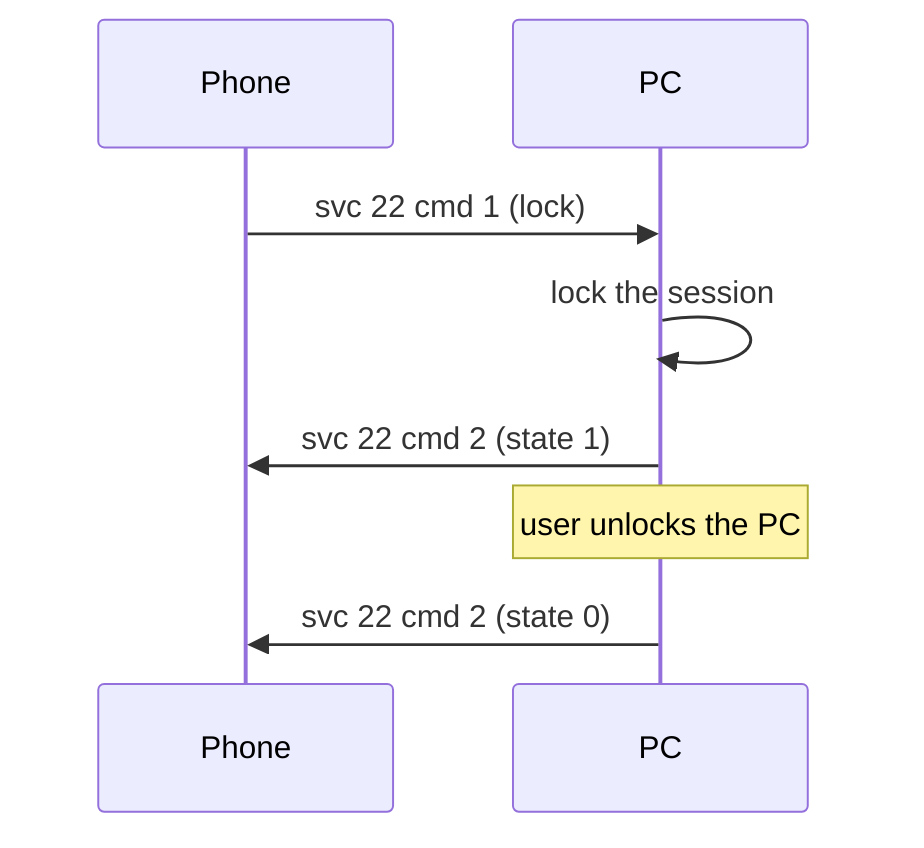

# PC lock (service 22)

**Status in this project:** Implemented. The phone's "PC lock" tile appears and the lock request
reaches the PC. The daemon locks with Noctalia's lock screen when Noctalia is running, else with
`loginctl lock-session <graphical session>` (GNOME under GDM, KDE, and any locker started by an idle
daemon that follows logind's Lock signal), or with your own `--lock-command`. It only tells the
phone "locked" once the lock is seen; when nothing locks it says why in a desktop notification.
GNOME started from another display manager (SDDM, LightDM) has no lock screen at all.

**Implementation:** [`src/pc_lock.rs`](../../src/pc_lock.rs).

## Overview

The phone can lock the PC it is connected to. The PC reports the lock state back so the phone's tile
can follow it (OBSERVED in the phone app).

The phone only registers its handler for this PC when the PC advertises `serviceVersions["22"] >= 2`
(Windows sends `2`, and so does this project) (OBSERVED in the phone app). The tile also needs `"22"`
in the PC's service 25 `cap` map (see [device-status-and-tiles.md](device-status-and-tiles.md)).

## Commands

| cmd | Direction | Meaning | Payload | Tag |
|---|---|---|---|---|
| 1 | phone → PC | Lock now | `{"ver": "1", "cmd": 1}` | OBSERVED on a device |
| 2 | PC → phone | Lock state | `{"ver": "1", "cmd": 2, "state": 1}` once locked, `{"ver": "1", "cmd": 2, "state": 0}` once unlocked | OBSERVED (code) |

## Main flow

This project runs the lock command, then waits up to 3 s for logind's `LockedHint` on the graphical
session to turn true. If it does, it reports `state: 1`, polls the hint every 2 s, and reports
`state: 0` when it turns false again. If it doesn't:

- with the logind path, nothing locked: it reports `state: 0` (the tile resets) and shows a desktop
  notification with the reason;
- with Noctalia or `--lock-command` (lockers that may not set the hint), it trusts the command and
  reports `state: 1`, but can't follow the unlock, so the tile stays "locked" until the next lock or
  reconnect.

What the two states do on the phone (OBSERVED in the phone app): `state: 1` marks this PC locked
and shows the tile as on; `state: 0` clears that and shows the tile as off again.

## Pitfalls

1. **GNOME needs GDM for its lock screen.** GNOME Shell only creates its lock screen when GDM is
   running (it asks GDM for its version at startup). Under SDDM or LightDM, logind's Lock signal,
   `org.gnome.ScreenSaver.Lock` and Super+L all do nothing, and no Wayland locker works on GNOME.
   The only fix is logging in through GDM.
2. **Not every locker reacts to logind.** Noctalia's lock screen ignores logind's Lock signal; this
   project calls its IPC (`qs ipc --pid <pid> call lockScreen lock`) instead. For other lockers use
   `--lock-command`.
3. **Don't report an unlock you didn't see.** Reporting `state: 0` because `LockedHint` is false
   right after locking makes the tile flip straight back (what earlier versions of this project did
   with lockers that don't set the hint).
4. **Version 2 or higher.** With `"22": 1` or no entry, the phone never sends the request.

## Open questions

- Whether the phone expects `cmd 2` within a time limit, and what it shows if `state: 1` never comes.
