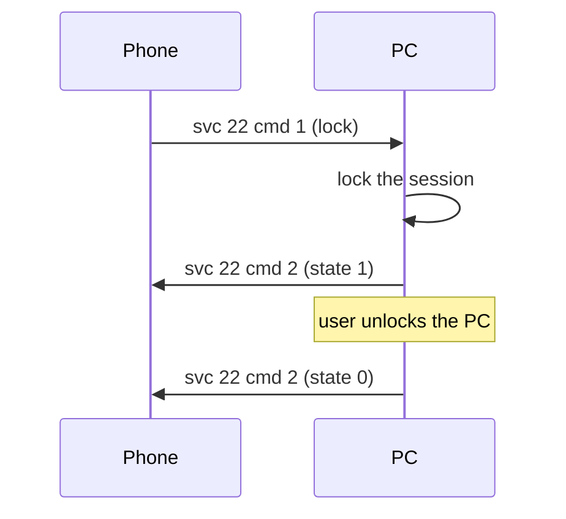

# PC lock (service 22)

**Status in this project:** Implemented. The phone's "PC lock" tile appears and the lock request
reaches the PC, which runs `loginctl lock-session`. Whether the screen visibly locks depends on the
desktop's screen locker: some lockers do not react to logind's lock signal, in which case nothing
locks and the PC reports "unlocked" a few seconds later.

**Implementation:** [`src/pc_lock.rs`](../../src/pc_lock.rs).

## Overview

The phone can lock the PC it is connected to. The PC reports the lock state back so the phone's tile
can follow it (OBSERVED in the phone app).

The phone only registers its handler for this PC when the PC advertises `serviceVersions["22"] >= 2`
(Windows sends `2`, and so does this project) (OBSERVED in the phone app). The tile also needs `"22"`
in the PC's service 25 `cap` map (see [device-status-and-tiles.md](device-status-and-tiles.md)).

## Commands

| cmd | Direction | Meaning | Payload | Tag |
|---|---|---|---|---|
| 1 | phone → PC | Lock now | `{"ver": "1", "cmd": 1}` | OBSERVED on a device |
| 2 | PC → phone | Lock state | `{"ver": "1", "cmd": 2, "state": 1}` once locked, `{"ver": "1", "cmd": 2, "state": 0}` once unlocked | OBSERVED (code) |

## Main flow

This project reports `state: 1` after a successful `loginctl lock-session`, then polls logind's
`LockedHint` every 2 s and reports `state: 0` when it turns false.

## Pitfalls

1. **The locker must react to logind.** With a locker that ignores logind's lock signal,
   `LockedHint` stays false, so the PC reports "unlocked" a few seconds later and nothing visibly locks.
2. **Version 2 or higher.** With `"22": 1` or no entry, the phone never sends the request.

## Open questions

- Whether the phone expects `cmd 2` within a time limit, and what it shows if `state: 1` never comes.
