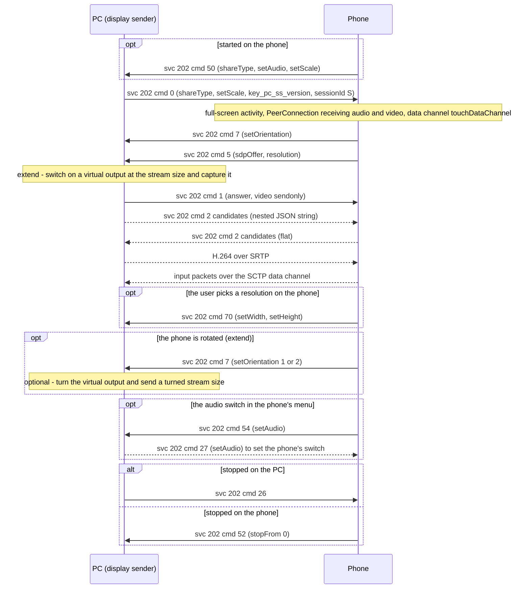

# PC screen on the phone (service 202)

**Status in this project:** Implemented in `smartconnect-display`. Verified on a device: the PC
screen mirrored to the phone with real screen capture, an extended display (a virtual output
switched on at the stream size) shown on the phone, a test pattern, a simulated resolution change
that kept the stream running, stopping from either side, and the phone's keyboard button
(`cmd 62`). Implemented but **not verified live** (tested locally against a phone-like WebRTC peer
and the virtual output only): following the phone's rotation (`cmd 7`, opt-in), the PC's audio
(opt-in, `cmd 54`/`27`), a start requested on the phone (`cmd 50`, the daemon starts the sender).
**Not verified live:** input from the phone (the packet layout comes from the phone app and the
injection was tested locally) and reconnect requests (`cmd 16`/`72`). Not implemented: the scale,
switch, resolution-list and statistics commands.

**Implementation:** [`display/src/session.rs`](../../display/src/session.rs) (signalling and the
WebRTC sender), [`display/src/capture.rs`](../../display/src/capture.rs) (screen capture, virtual
output), [`display/src/input.rs`](../../display/src/input.rs) (input packets from the phone).

## Overview

Service 202 ("R4SS", screen share) turns the phone into a display for the PC: either a **mirror** of
a PC screen or an **extended** desktop. The phone shows the stream full screen and sends touch,
mouse, keyboard and pen input back (OBSERVED, phone app and on a device):

- Signalling is service 202 JSON on the control channel, in its own dialect (below).
- **The phone is still the WebRTC offerer**, but its offer only *receives* audio and video and adds
  a data channel named `touchDataChannel`. **The PC answers and sends the video.**
- Input comes back as small binary little-endian packets over the data channel.

## Gates

- Windows lists `"202": 1` in `device.caps` (not in `serviceVersions`); the phone's quick-settings
  entry and remote-capability check use it (OBSERVED, phone app). The phone accepted `cmd 0` from
  this project before it advertised 202 at all (OBSERVED on a device). This project lists
  `"202": 1` in both maps. With `scType: 2` the version check for 202 passes automatically.
- Before it offers, the phone checks (OBSERVED, phone app): the feature is enabled in its own
  screen-share configuration (it can be disabled, for example below a memory threshold); the phone is
  not in its own desktop mode; no session is already running (otherwise `cmd 66` or `13`); and the
  phone is unlocked (otherwise it shows a confirmation screen or a lock-screen notification;
  declining sends `cmd 68`).

## Message shape

```json
{
  "deviceId": "<pc-nonce-id>",
  "srcServiceId": 202,
  "serviceId": 202,
  "msgId": 12,
  "data": { "ver": "1", "cmd": 0, "data": { "shareType": "extend" }, "sessionId": 7 }
}
```

- The phone requires envelope `serviceId: 202` and an outer `data` **object** (OBSERVED, phone app).
- The inner `data` may be an object or a JSON string; the phone parses either. **The phone always
  sends its inner `data` as a JSON string**, sometimes a bare string such as `"iceFailure"`
  (OBSERVED on a device).
- `sessionId` is an **int** chosen by the PC in `cmd 0` (inside the payload); the phone adopts it and
  echoes it in the outer `sessionId` of every message (OBSERVED). Before that, and after a stop, the
  phone's own messages carry its previous id or `0` (OBSERVED, phone app).
- The phone dispatches the PC's commands by `cmd` alone; it does not check their `sessionId`
  (OBSERVED, phone app).
- Field names below that start with `set` are the phone's own spelling.

## Commands

PC → phone (OBSERVED, phone app; `0`, `1`, `2` and `26` also on a device):

| cmd | Name | Inner `data` |
|---|---|---|
| 0 | Connection ready (start) | `{"shareType": "extend" or "mirror", "setAudio": false, "setScale": 100, "key_pc_ss_version": "pc_ss_ver_2Dot5", "sessionId": 7, "logLevel": 2, "collectStats": false}`. `setScale` is the PC's DPI percentage (at least 100). |
| 1 | Answer | `{"answer": "{\"type\":\"answer\",\"sdp\":\"v=0…\"}", "messageType": "answer"}`; `answer` is itself a JSON string. Accepted only while the phone is still connecting. |
| 2 | ICE candidate | `{"candidate": "{\"id\":\"0\",\"label\":0,\"candidate\":\"candidate:…\"}", "messageType": "candidate"}`; a nested JSON string with `id` (mid), `label` (m-line index), `candidate`. Accepted only while connecting, so send all candidates quickly. |
| 14 | Switch mode while connected | `{"shareType", "setAudio", "setScale"}`; changes the phone's UI mode without renegotiation |
| 18 | Reconnect started by the PC | `{}`; the phone stops quietly and expects a new `cmd 0` |
| 26 | Stop | `{}`. Also cancels a start the phone requested (`cmd 50`) that is still waiting; the phone answers `cmd 52` (OBSERVED, phone app) |
| 27 | Audio on or off | `{"setAudio": bool}`; sets the phone's audio switch (stored, shown in its menu) (OBSERVED, phone app) |
| 28 | Scale | `{"setScale": int}` |
| 35 | Resolution menu | `{"setWidth": w, "setHeight": h, "setAuto": 0 or 1, "setList": [...]}`; updates the phone's resolution menu |
| 36 | Statistics | `{"sl_enc_ave_frame_rate", "sl_cap_ave_frame_rate", "sl_enc_ave_encode_time", "sl_ave_rtt_ms"}` (floats); feeds the phone's automatic resolution choice; optional |
| 37 | PC screen-share version | `{"key_pc_ss_version": "pc_ss_ver_2Dot5"}` |
| 39 | Check resolution | `{}`; foldable phones re-check their screen size and may answer `cmd 72` |
| 41 | Stop without a message | `{}` |

Phone → PC (OBSERVED, phone app; `5`, `2`, `7`, `52` and `62` also on a device):

| cmd | Meaning | Inner `data` |
|---|---|---|
| 5 | Offer | `{"sdpOffer": "v=0…", "resolution": "{\"width\":W,\"height\":H,\"widthReq\":1920,\"heightReq\":1080,\"fps\":60,\"maxHeight\":1440}", "errorCode": "", "key_android_ss_version": "android_ss_ver_2Dot5"}`. `width`/`height` are the phone's display size in pixels; `widthReq`/`heightReq`/`fps` the recommended stream (default 1920x1080); `maxHeight` the tallest entry of the phone's preset **landscape** resolution list (2560x1440, 1920x1080, 1280x720) that its decoder accepts, so it says nothing about portrait sizes (OBSERVED, phone app). `resolution` is a JSON string. `width`/`height` came as portrait (e.g. 1220x2712) even in landscape sessions, so they are no orientation hint (OBSERVED on a device). |
| 2 | ICE candidate | `{"label": 0, "id": "0", "candidate": "candidate:…", "type": "candidate"}`, **flat**, unlike the PC's form. Held back until the answer is set. |
| 7 | Orientation | `{"setOrientation": n}`: **1 when the phone's screen turns landscape, 2 when it turns portrait** (OBSERVED, phone app). Sent at the start of a session, often twice about 0.3 s apart, before or after `cmd 5`, and on every rotation (OBSERVED on a device). The phone shows mirror landscape only; in extend it follows how it is held. |
| 12 | ICE failure | the string `"iceFailure"` |
| 13 | Error | `{"sdpOffer": "", "resolution": "", "errorCode": "ConnectionFailed"}` and similar |
| 50 | Start requested on the phone | `{"shareType": "extend", "setAudio", "setScale"}`; the PC should answer with `cmd 0`. `shareType` is the mode stored on the phone for this PC (default `extend`), `setAudio` its stored audio switch, `setScale` its stored scale (default 200). Until a `cmd 0` or a stop arrives, the phone counts as connecting and ignores further start requests (OBSERVED, phone app). |
| 52 | The phone stopped | `{"stopFrom": 0}` |
| 54 | Audio toggled on the phone | `{"shareType", "setAudio"}`: the audio switch in the phone's screen-share menu. The phone updates its own switch first, then tells the PC; nothing on the phone was found to silence the received audio itself, so the PC is expected to stop or start sending (OBSERVED, phone app / INFERRED) |
| 62 | Keyboard button tapped | `{"setOSK": true or false}`. Windows shows its on-screen keyboard on the shared screen, so it appears on the phone; this project does the same. |
| 66 | Status reply to `cmd 0` | strings such as `"pc ss is disabled"`, `"pc ss is already started"`, `"pc ss is unavailable in PC Mode"` |
| 68 | Declined on the lock screen | `"device lock rejected"` |
| 70 | The user picked a resolution on the phone | `{"setWidth": w, "setHeight": h, "setAuto": 0 or 1}`; the PC must resize its output and encoder |
| 16, 72 | Reconnect requested (after a fold or a resolution change) | `{"shareType", "setAudio"}`; the PC sends `cmd 0` again with a new `sessionId` |

## Main flow



## WebRTC details

| Item | Value | Tag |
|---|---|---|
| Phone configuration | No ICE servers, Unified Plan, TCP candidates disabled, max-bundle, a 5 s ICE "unwritable" timeout | OBSERVED (code) |
| Offer | A receive-only audio section (Opus), a receive-only video section, and an SCTP application section for `touchDataChannel` | OBSERVED on a device |
| Video codecs | Whatever the phone's hardware decoders take: H.264 (constrained baseline, packetization-mode 1, was offered), plus VP8, VP9, H.265, possibly AV1, and RTX. H.264 is the safe choice. | OBSERVED on a device / INFERRED (full list) |
| Audio | The offer always has the receive-only Opus section (payload type 111, stereo, `ptime:10`), whatever `setAudio` says. Send Opus on it only when audio is on; otherwise leave it without a track (answered `inactive`). That the phone plays a received track by itself is INFERRED (its WebRTC audio device is enabled). | OBSERVED (offer) / INFERRED (playback) |
| Size | The phone scales the stream into its view and letterboxes it. Send `widthReq x heightReq`, or the panel's own aspect ratio (landscape) for a pixel-exact extended display. A 16:9 stream on a wider phone panel is pillarboxed. | OBSERVED on a device |
| Size changes | Whenever the frame size changes, the phone refits its video view to the new aspect ratio (it also honours a video-orientation rotation). That view's size is what it reports as `resX`/`resY` in input packets. So the stream may change size, or turn portrait, mid-session without renegotiation. | OBSERVED (phone app); mid-session resize OBSERVED on a device |
| Keyframes | Frequent keyframes (this project: at least every 30 frames) make the picture appear quickly after connecting or after loss. The phone's keyframe requests also reach the encoder. | OBSERVED in this project |

## Input packets

All little-endian. Every packet starts with `u32 type` at offset 0 (0 touch, 1 keyboard, 2 mouse,
3 pen) and `u32 0` at offset 4 (OBSERVED, phone app). When the PC announces a screen-share version
below 2.4 (`key_pc_ss_version`), the phone sends everything as touch (OBSERVED, phone app).

**Touch (128 bytes)**

| Offset | Type | Field |
|---|---|---|
| 8, 12 | i32, i32 | x, y of the primary pointer, in the phone's view pixels |
| 16, 20 | i32, i32 | resX, resY: the size of the phone's video view |
| 24 | u16 | flags: 1 down, 3 move, 5 up or cancel |
| 26 | u16 | pointer id |
| 28 | i32 | event time, ms |
| 32 | i32 | count of pointers that follow (at most 7) |
| 36 + 12n | i32, i32, u16, u16 | x, y, flags, pointer id of pointer n |

The phone sends only down, move, up and cancel, never separate "second pointer down/up" events: a
second finger shows up only as a count of 2 or more in a move packet (OBSERVED, phone app). Map
coordinates as `x * outputWidth / resX`, `y * outputHeight / resY`.

**Mouse (48 bytes):** `f32 dx` at 8 and `f32 dy` at 12 (**relative** motion), `i32 resX` at 16,
`i32 resY` at 20, `i32 flags` at 24 (1 move, 2 left down, 4 left up, 8 right down, 16 right up,
32 middle down, 64 middle up, 2048 wheel), `f32 wheel` at 28 (Android scroll axis, +1 = up; the
phone's touchpad mode sends +1 or -1 for both scroll and zoom), `i64 time` at 32. Sent for a
Bluetooth mouse on the phone and for its touchpad mode.

**Keyboard (32 bytes):** `i32 Android keycode` at 8, `i32 flags` at 16: 0 down, 2 up, 32768
CapsLock toggle (a single packet, no down/up pair). Copy and paste arrive as left Ctrl (113) plus C
(31) or V (50). These are **Android keycodes**, not scancodes, so the PC needs a translation table.

**Pen (56 bytes):** like touch for x, y, resX, resY; `u16 flags` at 24 (1 down, 2 move, 4 up,
32 cancel, 8 hover, 16 hover exit), `f32 pressure` at 28, `i32 tilt` at 32, `i32 orientation` at 36,
`i64 time` at 40.

This project turns touch into pointer gestures: a tap is a left click, a one-finger move beyond a
small threshold is a left drag, a press of 600 ms or more without moving is a right click, and two
or more fingers scroll. It injects through the Wayland virtual-pointer and virtual-keyboard
protocols, with the pointer pinned to the output being shown.

## This project

- `--mode mirror` captures an existing output; `--mode extend` switches on a spare or virtual
  output (default: the first `Virtual-*` output, provided by the `vkms` kernel module) at the stream
  size, places it next to the other outputs, captures it, and switches it off again at the end.
  Capture uses the compositor's screen-cast D-Bus interface, with the desktop portal as a fallback.
- An extended display needs a virtual monitor. Options on Linux include a compositor's own virtual
  or headless outputs, `vkms`, a spare connector forced on with an EDID override, `evdi`, or an HDMI
  dummy plug. This project uses `vkms` by default and accepts any named output.
- The extend output's scale defaults to 200 %, so text on the phone is readable; `setScale` sent to
  the phone stays at 100 (its effect on the phone is unknown).
- `cmd 62` starts or stops an on-screen keyboard on the shared output.
- Defaults come from `~/.config/smartconnect-linux/display.json` (written by the desktop app);
  command-line flags override it.
- `cmd 50`: when no sender is running, `smartconnectd` starts one in the mode the phone asks for
  (other choices from the settings file). If it cannot start, the daemon sends `cmd 26` so the phone
  stops waiting. Only one sender runs at a time (a lock file).
- Opt-in `--follow-rotation` (extend): on `cmd 7` the virtual output is turned in place: a custom
  mode of the turned size, or `transform 90` when the connector lists no mode of that orientation.
  The capture is swapped and the stream resized. Portrait streams are capped at 1920 px tall, because
  the phone's decoder is only checked for landscape sizes.
- Opt-in `--audio`: what the PC plays (the default output's monitor) is sent as Opus on the offer's
  audio section, and `cmd 0` says `setAudio: true`. The phone's `cmd 54` mutes or unmutes it. If the
  phone switches audio on while none is sent, the PC answers `cmd 27 {"setAudio": false}`.
- Local ICE candidates offered: the address the phone reached (`pcAddress` from the daemon), else
  private IPv4 on non-virtual interfaces; `SMARTCONNECT_ICE_ADDRESSES` overrides. UDP only.

## Pitfalls

Found on a real device (1–5), and from the device's logs and the phone app (6–7):

1. **`a=inactive` answers.** If the sender's sink pad on `webrtcbin` has no caps, the encoder's real
   caps can reach it before the offer is applied; they then fail to match the offer's video section,
   `webrtcbin` creates a new receive-only transceiver and answers `inactive`, and the phone waits
   forever. Request the sink pad with caps, make its transceiver send-only with those caps as codec
   preferences, and keep the pipeline out of PLAYING until the answer is set.
2. **Input packets arrive as data-channel *string* messages.** `webrtcbin` hands string messages to
   the application only up to the first NUL byte, and a touch packet starts with a zero `u32`, so the
   application sees empty strings. Read the raw SCTP payloads instead. (That the phone marks its
   binary packets as strings is INFERRED from this behaviour.)
3. **Trim the answer's video section to one H.264 payload type**
   (constrained baseline, packetization-mode 1); the phone offers many codecs and RTX.
4. **Send candidates promptly.** The phone ignores answers and candidates once it has left its
   connecting state.
5. **One sender per offer.** Every local process watching service 202 sees every phone message; a
   second sender answering the same offer broke ICE in testing. Ignore messages with another
   `sessionId`.
6. **Orientation.** A portrait-held phone letterboxes a landscape extended output. Rotating the
   output and sending a portrait size fills it (opt-in here, not yet verified on a device). Don't
   take the orientation from `cmd 5`'s `width`/`height`: they came as portrait even in landscape
   sessions. Use `cmd 7`, and expect it twice.
7. **A start request the PC can't serve must still be answered.** After `cmd 50` the phone waits in
   its connecting state and ignores further start requests; send `cmd 26` if no `cmd 0` will follow.

## Open questions

- Whether the phone needs the quick-settings entry path (with `"202"` in `caps`) for anything beyond
  showing the entry.
- The effect of `setScale` on the phone.
- Whether the phone plays the PC's audio as expected and how far behind the video it is; whether it
  decodes portrait streams taller than 1920 px.
- The full set of phone error and status strings.
