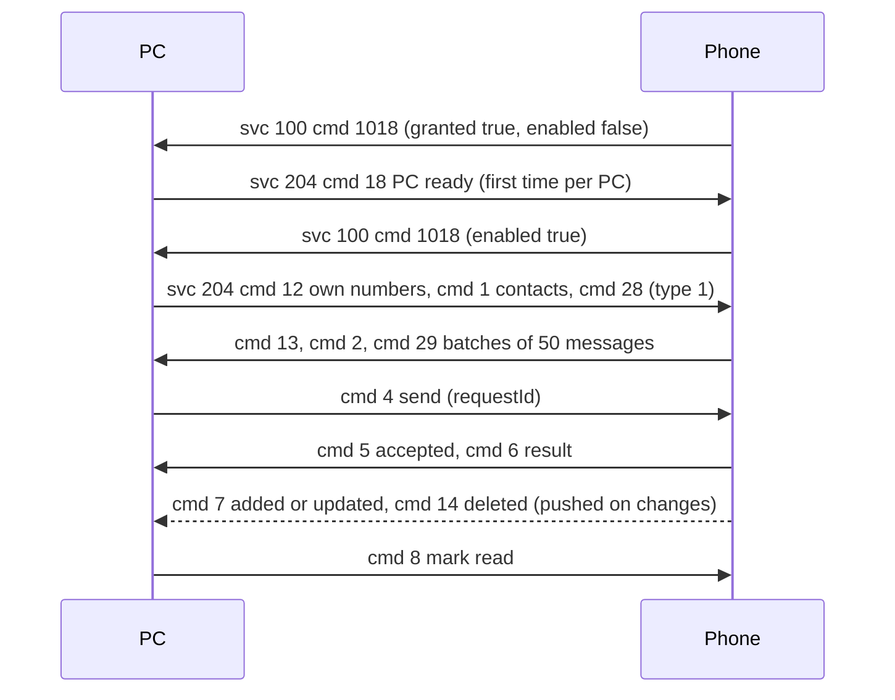

# Messages: SMS and MMS (service 204, with 100)

**Status in this project:** SMS reading, sending and marking as read are implemented in the daemon
and exposed as control-socket commands (`sms_threads`, `sms_thread`, `sms_send`, `sms_mark_read`,
`sms_state`). The status message on service 100 has been seen from a real phone; the rest of this
page comes from static analysis of the phone app and is **not yet verified end to end**. MMS media
and contact sync are parsed but not used. Services 205 and 206 are not worked out.

**Implementation:** [`src/sms.rs`](../../src/sms.rs), commands in
[`src/control.rs`](../../src/control.rs).

## Overview

The phone's "Messages" feature lets a PC read recent SMS/MMS, send SMS through the phone, and mark
messages read. It runs on service 204 (the number is reused from an unrelated constant in the phone
app). The phone only answers once this PC is **enabled** for Messages, and the PC can enable itself
once, the first time it says it is ready (OBSERVED in the phone app).

There are **no conversation threads on the wire**: the phone sends flat message lists and the PC
builds conversations itself (OBSERVED in the phone app). All queries cover only the **last 10 days**
(OBSERVED in the phone app).

## Envelope

Service 204 payloads are a `MessageData` object (OBSERVED in the phone app):

```json
{"ver": "5.0", "cmd": 28, "pId": 110, "data": {"type": 1, "count": 0}}
```

| Field | Type | Meaning |
|---|---|---|
| `ver` | string | Protocol version. Above `"3.0"` the phone wraps message lists in a sync object and sends MMS without media bytes; above `"2.0"` it uses the newer contact format. The phone itself sends `"5.0"`, and so does this project. Windows' value is unknown. |
| `cmd` | int | Command (table below). |
| `pId` | int | Must be `110`, or the phone ignores the message as "not message related". |
| `data` | any | Command payload (object or array). |

The phone also drops a frame unless the envelope `serviceId` is 204.

The **status message** is the exception: it arrives on **service 100** from `srcServiceId: 204`,
flat, without `pId` or nested `data` (OBSERVED on a device):

```json
{"ver": "5.0", "cmd": 1018, "granted": true, "enabled": false, "triggered": false,
 "unreadCnt": 3, "unreadList": [{"type": 1, "ids": ["<sms-id>"]}, {"type": 2, "ids": []}]}
```

| Field | Meaning |
|---|---|
| `granted` | The phone has cellular service and its SMS, contacts and phone-state permissions. |
| `enabled` | Messages is enabled for **this** PC. |
| `triggered` | This PC has announced itself before (`cmd 18`). |
| `unreadCnt`, `unreadList` | Unread inbound messages within the time window, by type (1 SMS, 2 MMS). |

The phone sends it on connect, on every enable or permission change, and on request (`cmd 1016`).

## Gates

1. The phone has cellular service and the needed permissions (`granted`).
2. Messages is enabled globally on the phone (default: on when `granted`) **and** this PC is on the
   phone's enabled list (`enabled`).
3. While `enabled` is false, the phone **silently drops every reply** except `cmd 17`, `21` and `27`.
4. The PC sends `cmd 18` ("PC messages ready"). The first time a PC does this, the phone marks it as
   triggered, adds it to the enabled list and re-sends `cmd 1018` with `enabled: true`. This happens
   once per PC: if the user later disables Messages for the PC on the phone, only the phone's UI can
   turn it back on.
5. The phone sent `cmd 1018` to this project without `"204"` in the PC's `serviceVersions`, so the PC
   probably does not need to advertise it (INFERRED). Windows lists `"204": 1`, `"205": 2`,
   `"206": 1` and caps `"204": 1`, `"205": 3`, `"206": 3`.

All of the above is OBSERVED in the phone app; the `enabled: false` state was also seen on a device.

## Commands

PC requests mostly have even numbers and phone answers odd ones (OBSERVED in the phone app).

| cmd | Direction | Name | Payload | Answer |
|---|---|---|---|---|
| 1 | PC → phone | Get contacts | none | `cmd 2`: list of `{id, name, phone: [...], email, note}` (exact shape for newer versions not checked) |
| 3 | phone → PC | Contacts changed | `{action, contactBeanList: [...]}` | - |
| 4 | PC → phone | Send a message | a message object (below) with `requestId`, `subId` (-1 = default SIM), `messageType: 2`, `toAddress`, `body`, **`medias: []`** | `cmd 5` at once, `cmd 6` with the result |
| 5 | phone → PC | Send accepted | `{requestId}` | - |
| 6 | phone → PC | Send result | `{requestId, msgId, type (1 SMS, 2 MMS), status, code}` | - |
| 7 | phone → PC | Messages changed (pushed on any change in the phone's message store) | `{action (1 added, 3 updated), type, messageBeanList: [...]}`; a message the PC sent carries its `requestId` | - |
| 8 | PC → phone | Mark read or unread | `{msgId, status (1 read, 0 unread), type (1 SMS, 2 MMS)}` | - |
| 10 | PC → phone | Get messages | `{type: 1, count: N}`; `type: 2` is rejected, other types are treated as MMS | `cmd 11` |
| 11 | phone → PC | Messages | `ver` above 3.0: `{action: 4, type, messageBeanList}`; older: a bare array | - |
| 12 | PC → phone | Get own phone numbers | none | `cmd 13`: list of `{subId, slotId, phoneNumber, countryCode}` |
| 14 | phone → PC | Messages deleted | `{type, deleteList: ["<id>", ...]}` | - |
| 16 | PC → phone | Request permissions | none; may open a permission screen on the phone | `cmd 17` status (always sent) |
| 18 | PC → phone | PC messages ready | none; enables Messages for this PC the first time | `cmd 1018` on service 100 |
| 20 | PC → phone | Query permissions | none | `cmd 21` `{granted, enabled, triggered}` (always sent) |
| 22 | PC → phone | Get MMS parts | `{idList: ["<id>", ...]}` | `cmd 23`: messages with media |
| 24 | PC → phone | Get contacts by id | `{idList: [...]}` | `cmd 25`: contacts |
| 26 | PC → phone | Can SMS be sent now? | none | `cmd 27` `{isAvailable, errorCode, msg}` (always sent) |
| 28 | PC → phone | Get all messages of a type | `{type: 1 or 2}` (`count` is ignored) | `cmd 29` in batches of 50: `{action: 4, type, messageBeanList, totalCount, currentBatch, totalBatches}`; an empty store gives one batch with a null list |
| 1016 | PC → phone | Settings request from the PC UI | none | `cmd 1018` on service 100 |

### Message object

`{msgId, requestId, subId, messageType (1 received, 2 sent), toAddress: [...], fromAddress, body,
subject, medias: [{partId, mimeType, mediaData (base64), path, name}], read (0 or 1), date (ms)}`
(OBSERVED in the phone app). For a received SMS, `fromAddress` is the sender and `toAddress` holds the
phone's own number; for a sent one it is the other way round.

Example send request (placeholders):

```json
{"ver": "5.0", "cmd": 4, "pId": 110,
 "data": {"requestId": 7, "msgId": 7, "subId": -1, "messageType": 2,
          "toAddress": ["<phone-number>"], "body": "<message text>",
          "medias": [], "read": 1, "date": 1700000000000}}
```

## Main flow



## This project

- `sms_threads` sends `cmd 18` (only while not enabled), then `12`, `1` and `28` for SMS, and
  returns the cached conversations; when the phone later reports `enabled: true`, the sync is sent
  again automatically.
- Conversations are grouped by the other party's address: the last 10 digits for phone numbers (so
  local and international forms match), the lowercased text for alphanumeric senders.
- `sms_send` sends `cmd 4` with a fresh `requestId`; results from `cmd 5`/`cmd 6` are kept for
  `sms_state`.

## Pitfalls

1. **`medias` must be present** (an empty list) in `cmd 4`: the phone iterates it unconditionally.
2. **Long text is not converted to MMS** by the phone.
3. **Silent drops while not enabled.** If nothing comes back, look at `enabled` in `cmd 1018`.
4. **`cmd 18` works only once per PC.** After that, re-enabling is up to the user on the phone.
5. **10-day window.** Older messages are never returned.
6. **Mark-as-read guard.** The decompiled handler for `cmd 8` reads like an inverted null check;
   it is assumed to work normally (INFERRED).
7. **Privacy.** Message bodies, numbers and contact names are personal data. Keep them out of logs.

## Open questions

- Windows' `ver` value and whether any behaviour depends on it beyond the thresholds above.
- What services 205 and 206 carry (likely contacts or calls in the same family).
- Whether advertising `"204"` changes anything.
